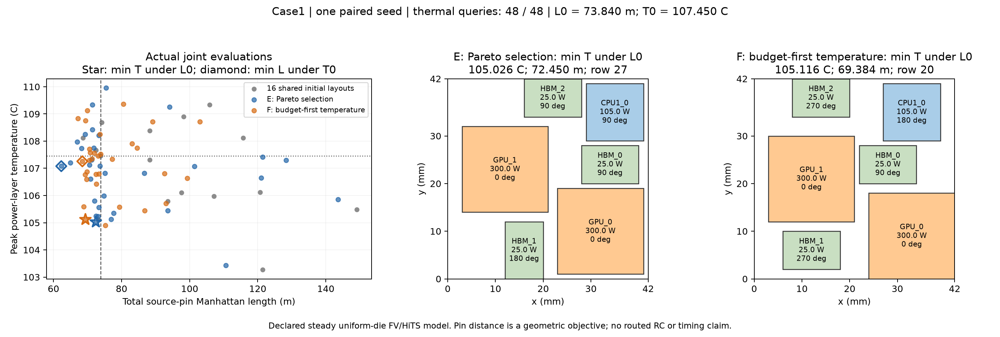

# Case1：选择规则对齐主约束目标，单次质量改善未通过

2026-11-13，按[冻结协议](atplace-case1-constrained-selection-protocol.md)完成 F 的一次
单种子、48 次本地热查询。实现/协议先在
`ff634ac9cd2a02756291f2d1994298b8bcc815eb` 推送并核实远端，再运行实验。
清单 SHA-256 为 `a0af1d6cdde93675acb94fa918f41a6265b9aa917cc9dc65e23a6b603be266c6`，
绑定 23 个执行源码/协议文件。直接基线 E 固定在 `b6f3955`，只回放旧响应，不重跑。

**选择规则及执行验收通过，质量改进未通过。** 种群距离可行数从共同初始 4 个增至
12、16 个，E 为 4、10、13 个；但相对 E，主指标变热 0.089975 K，反向距离增加
9.933618%。同模型历史 B 还有更冷的可行点，不能把规则对齐当作算法优越性的证明。
356 项测试、两芯粒 CLI 和完整保存响应回放均通过，未追加查询、种子或预算。

## 固定约束下的实际联合赢家

L0=73.840208806 m、T0=107.45047721858577 °C 原值不变，包含等号。

| 方法 | min T，L≤L0：温度 / 距离 / 行 | min L，T≤T0：距离 / 温度 / 行 |
| --- | --- | --- |
| B：历史 pin 引导参考 | 103.712271 °C / 72.596956 m / 38 | 61.050977 m / 107.333425 °C / 22 |
| C：历史合法姿态交叉 | 104.959490 °C / 70.715295 m / 48 | 50.239777 m / 106.520719 °C / 49 |
| D：随机空隙重构 | 104.840882 °C / 58.905473 m / 45 | 58.905473 m / 104.840882 °C / 45 |
| E：候选预筛、Pareto 选择，直接基线 | 105.026266 °C / 72.449988 m / 27 | 62.291760 m / 107.079489 °C / 34 |
| F：距离可行优先，再按温度选择 | **105.116242 °C / 69.383581 m / 20** | **68.479585 m / 107.257369 °C / 35** |

F 相对 E：主指标变热 0.089975 K；反向距离增加 6.187825 m（9.933618%）。
相对 B：主指标变热 1.403971 K；反向距离增加 7.428608 m（12.167877%）。
相对 D：主指标变热 0.275360 K，且 D 的同一个 row 45 同时优于 F 的两个约束赢家。
两项指标来自各自实际布局，不把 row 20 的温度和 row 35 的距离拼成一个点。

[完整 E/F 证据](evidence/atplace-case1-constrained-selection-v1.json) ·
[可导出图](evidence/atplace-case1-constrained-selection-v1.pdf)。
历史 B/C 见[交叉证据](evidence/atplace-case1-crossover-v1.json)，D 见[表示证据](evidence/atplace-case1-slack-v1.json)。

| 热查询数 | E：min T / min L | F：min T / min L |
| --- | --- | --- |
| 16 | 105.118177 °C / 73.163204 m | 105.118177 °C / 73.163204 m |
| 32 | 105.026266 °C / 70.567120 m | 105.116242 °C / 68.875776 m |
| 48 | 105.026266 °C / 62.291760 m | 105.116242 °C / 68.479585 m |

每项是各自约束选点的统计，完整 `(T,L)` 与行号见 JSON。
F 主指标相对共同初始 row 8 只降低 **0.001935780 K**，不能将其包装成有实质意义的
真实封装降温；本轮也不为这点差异追加精度校准。历史 B 在同场景下的可行冷点说明
当前小预算搜索没有找到已有证据中更好的布局，而不是这个模型完全不能表达温度差。

## 规则确实执行，但与质量分开验收

F 父代和生存者都按同一个预定字典序比较：可行 `(0,T,L)`；不可行 `(1,L-L0,T)`。
温度和距离没有加权相加，没有修改 h、功率或评价温度来制造收益。
原四候选交叉、pin 预筛、变异、实际热求解和全部额度保持 E 的定义。

| 种群阶段 | E 的距离可行数 | F 的距离可行数 | F 完整/热状态多样性 |
| --- | ---: | ---: | --- |
| 相同初始 16 行 | 4 | 4 | 16/16 |
| 第一完整代生存者 | 10 | 12 | 16/16 |
| 第二完整代生存者 | 13 | 16 | 16/16 |

第二次生存者选择发生在第 48 次热查询后，16/16 可行是收尾状态，并未再运行下一代。
对已保存的父代＋子代合并集合，另按上述数学排序定义重选两代的前 16 个键，均与
记录一致；核对未调用 `selection_key()`。完整响应回放还核对了随机路径、父行选择键、
每代行 ID/键、所有候选池和预算。这是本地代码/记录核对，不是 Chat 独立审核。

32 次在线提议的 64 个父代槽中，39 个来自距离可行布局；初始种群仍含不可行点，
两个抽中的父候选都不可行时按超额选较优者，不会凭空制造可行父代。
最终全部 48 行中，E/F 的距离可行数为 22/24，温度可行数为 32/27。

所有已评估行仍在全局档案里。较冷但距离超额的初始 row 3 已退出 F 最终种群，
仍保留在记录和 Pareto 集。F 最终 Pareto 行为 `[3,20,21,35,39,45]`；例如 row 45 为
`(104.900185 °C, 75.275204 m)`，超出 L0，不能冒充主赢家。没有从最终种群单独计算指标。

主赢家 row 20 来自父行 13/8 的新重构，交叉选中时 L=77.199471 m；后续变异
CPU1_0、GPU_0、HBM_2 后才进入距离预算。反向赢家 row 35 来自父行 8/0 的父状态
重构，再变异 GPU_0 和 HBM_0。没有对变异前状态另求热，不能拆分各操作温差贡献。

## 成本与物理核对

| 项目 | E | F |
| --- | ---: | ---: |
| 新热求解 / 尝试 | 48 / 48 | 48 / 48 |
| 完整布局 / 热缓存命中 | 48 / 0 | 48 / 0 |
| 提议，含共同初始化的 21 次未保留尝试 | 70 | 69 |
| 在线提议 | 33 | 32 |
| 非法 / 完全重复提议 | 0 / 1 | 0 / 0 |
| pin 总调用 | 283 | 318 |
| 交叉 / 变异 / 实际布局 pin 调用 | 103 / 132 / 48 | 102 / 168 / 48 |
| 几何候选检查 | 679,370 | 720,622 |
| 初始化 / 交叉 / 变异几何检查 | 559,192 / 174 / 120,004 | 559,192 / 174 / 161,256 |
| 拓扑对检查 | 870 | 870 |
| 交叉候选 / 至少一个可行候选的池 | 116 / 14 | 116 / 19 |
| 新重构 / 父重构 / bypass | 25 / 4 / 4 | 24 / 5 / 3 |
| 空变异集 / 非法上下文 fallback | 0 / 0 | 0 / 0 |

F 的 pin 账 `102+168+48=318`，几何账 `559192+174+161256=720622`。
F 观察总时间 63.356 s，热求解 42.933 s，pin 预筛 14.724 s；E 历史总时间 30.642 s。
机器负载未受控，不将墙钟差解释成选择规则导致的速度变化。

48 条实际热输入均通过继承的非姿态设计签名及物理/数值准入：固定硬块尺寸、逐芯粒
功率共 780 W、局部 pins、材料、网格规则、封装及冷却边界；只允许刚体姿态变化。
最大能量不平衡 3.67e-7 W，最大原方程相对残差 1.01e-10，同矩阵参考解最大差
1.93e-8 K。峰温范围 103.269–109.358 °C。后两项验证求解，不是实测温度精度。
原顶面对流热阻 0.009 K/W、守恒推导表面均温 52.02 °C 不变；没有新增 RC/STA
或真实热—时序闭合结论。

## 本次验收结论

选择规则已与主目标一致，档案和反向指标保留，物理条件及预算受控；这部分通过。
本种子、48 查询内的质量改进未通过，不能将 F 推广成比 E 或历史 B/C/D 更好的方案，
也不能由这一小预算单次结果推出所有约束选择方法都无效。

保留 B/C/D 更好的历史联合点及 E/F 负结果。本轮不再叠加新的选择权重、多样性规则、
种子或查询。后续改动应检验怎样生成真正更冷的可行邻域，而不是继续用可行数量代替
温度质量；现有证据不能将退化唯一归因于选择压力或某一个几何因素。

原始查询在 `results/atplace-case1-constrained-selection-v1/`，执行日志在
`results/atplace-constrained-selection-*.log`。按用户决定，Chat 保持待审核。
