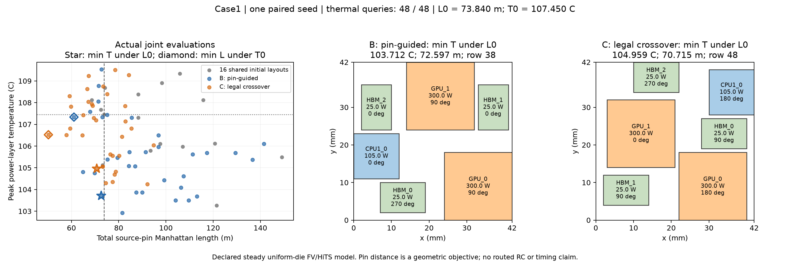

# Case1 合法性交叉：拒绝归零，但主指标变差

**本轮执行验收通过，主指标改善未通过。** 新交叉 C 在相同距离预算下的最低峰温比
已审核的 pin 引导基线 B 高 **1.247220 K**；反向固定温度预算下，最佳总 pin 距离
缩短 **17.708481%**。这是目标间的权衡，不是总体算法优势，也不能用零非法提议替代
主指标验收。没有追加预算、种子或事后修改规则。

## 输入、冻结及验证

开始时成功 fetch 主仓库、HiTS 和 ATPlace；主仓库无新提交，分析起点 `b5957a7`。
使用 [冻结协议](atplace-case1-crossover-protocol.md)及
[清单](evidence/atplace-case1-crossover-plan-v1.json)，在正式热运行前推送并核实
`f0ac16e28dd8e50f57837905e06947e2053cc4fa`。清单哈希为
`95f4cef5706fb7eb8c3811d3439fc7b36d6f68a9150e45a2cd56f47ed317d5a5`。
ATPlace / HiTS 仍是 `fe3dbfdaf78dc0ddeac3a2cfc3a85ff0971f88df` /
`be59924de3f0c1a3d6d134aea411d1264cfa64c6`。

B 直接复用 commit `5434165` 的完整冻结记录，核对 Git 内容和源码/输入哈希，并用
保存热响应回放通过。C 使用相同 seed `2026111200`、16 初始布局、NSGA-II/pin 变异、
物理设置与成本上限，只替换交叉。C 私有空缓存实际支付 16+32=48 新热求解；本轮仅
新增这一次本地运行。339 项测试及两芯粒 CLI 通过；图像生成已运行并目视检查。
结果阶段只为既有绘图脚本增加方法标签和实际查询数显示；13 个冻结执行/协议文件均未改变。

C 的完整事件、方向状态、热引用、精确 pin 指标、检查点、每代记录与非时间成本均通过
保存响应回放，初始 16 行与 B 完全相同。报告/回放不增加热求解。
[完整证据](evidence/atplace-case1-crossover-v1.json)保存 B/C 两条记录，共 99 行布局，
其中含跨方法重复的共同初始化，不表示 99 个全局唯一状态。

## 实际联合布局指标

共同 L0=73.840208806 m、T0=107.45047721858577 °C，按原值包含等号选择。

| 指标 | B：上轮 pin 引导 | C：仅替换合法性交叉 | C 相对 B |
| --- | --- | --- | --- |
| L≤L0 的最低峰温 | **103.712271 °C**；L=72.5969555632 m；row 38 | **104.959490 °C**；L=70.7152951308 m；row 48 | **变热 1.247220 K** |
| T≤T0 的最短距离 | **61.0509773304 m**；T=107.333425 °C；row 22 | **50.2397768276 m**；T=106.520719 °C；row 49 | **缩短 10.811201 m / 17.708481%** |

C 的反向指标赢家同时比 B 的反向赢家更短、更冷 0.812706 K；但该点不是 C 的最低温
赢家，不能混合两行极值。C 仍未追上 B 的主指标。C 相对共同初始化的主指标只改善
0.158687 K，B 的改善为 1.405907 K。

| 已消费热查询（含初始） | B 主指标 T / °C | C 主指标 T / °C | B 反向 L / m | C 反向 L / m |
| --- | --- | --- | --- | --- |
| 16 | 105.118177 | 105.118177 | 73.163204 | 73.163204 |
| 32 | 105.118177 | 105.063238 | 61.050977 | 64.678496 |
| 48 | 103.712271 | 104.959490 | 61.050977 | 50.239777 |

[PDF](evidence/atplace-case1-crossover-v1.pdf)。图中每点来自实际完整布局，没有插值前沿。

## 交叉机制和成本

| 记账项 | B（历史） | C（本轮） |
| --- | --- | --- |
| 完成状态 | complete_thermal_budget | complete_thermal_budget |
| 新热求解 / 上限 | 48 / 48 | 48 / 48 |
| 完整布局行 / 热缓存命中 | 49 / 1 | 50 / 2 |
| 全部提议（含初始化） | 171 | 78 |
| 在线提议 | 134 | 41 |
| 非法完整提议 | 87 | **0** |
| 重复完整状态提议 | 14 | 7 |
| 完整 pin 计算（其中预筛） | 261（212） | 258（208） |
| 候选几何检查 | 1,084,752 | 746,408 |
| 因其他固定芯粒重叠而取消 pin 引导 | 82 | **0** |
| 热求解累计时间 / s | 17.680 | 43.759 |
| pin 预筛时间 / s | 5.279 | 11.804 |
| 总墙钟时间 / s | 26.069 | 61.751 |

提议均含 21 次未保留初始化尝试；几何检查均含初始化的 559,192 次。
共享离线初始化 0.419 s 单列，不混入在线墙钟时间。逻辑候选检查数不是相同 CPU 指令
数量，B 和 C 也不是同时期受控计时；本轮不从历史墙钟时间作速度改善或退化的因果判断。

C 有 36 次真正触发交叉，共支付 36×64=2,304 次完整组合检查，另 5 次绕过交叉。
36 次中只有 **12 次**存在合法且实际贡献来自双亲的混合状态；其余 **24 次**退回父代。
24 次细分：4 次父代完全相同、1 次仅一个芯粒姿态不同、19 次六个姿态全不同但没有
合法混合。重复掩码按完整状态去重，父代复制没有被冒充成混合成果。

两完整代的生存者均有 16 个完整状态，独立热状态数为 16、15；最后另保留 2 个 offspring。
因此未发生种群完全塌缩，但“合法父代组合大多不能形成新的合法混合”是具体限制。
这只能作为下一项机制假说，不足以单独证明它导致主指标变差：换交叉也改变 RNG 轨迹，
本轮没有反事实分解各原因。最终评价集中满足 L0 的行数从 B 的 13 增至 C 的 22，
但满足距离预算的点更多仍不保证其中有更好的最低温点。

## 物理合理性核对

- C 的 48 次实际热输入均与冻结的物理设置签名一致：780 W 总功率、逐芯粒功率/尺寸、
  局部 pins、层厚及材料、45 °C 环境、散热器和边界、名义网格规则不变，只有整体姿态变化。
  同一芯粒的几何、材料和功率身份没有在父代拼接时错配。
- 全部输入通过既有被动导热及热平衡检查。最大能量误差 3.94e-7 W、原方程相对残差
  1.06e-10；最低温升非负。这些是数值/基本定律证据，不是材料或封装标定。
- 固定 h 作用于 0.04 m² 顶面，对流热阻为 **0.009 K/W**；780 W 在此边界下对应面积
  平均表面温度 **52.02 °C**，所有有源层峰温高于此守恒下界。该平均值是解析推导，
  不是顶层网格中心平均。内部导热、半层边界热阻仍在求解器中；不把源表达式中的
  0.1 误当成当前 200 mm 散热器的对流热阻。
- 固定功率下，`G(x) theta = P` 中布局改变导热路径，所以峰温可以变化而总散热量仍是
  780 W。两个主指标赢家的 GPU 矩形最小边缘距离为 B 6 mm、C 1 mm；这与“热源靠近
  可能增加局部热相互作用”的解释相容，但其他芯粒也移动了，不能将 1.247 K 全部归因
  于这个距离。共形网格也随几何变化，精确差值仍是当前离散模型预测。
- Pin 距离是源连接的几何代理，没有绕障/拥塞、回流路径或时序。不能把距离下降直接
  写成延迟、能耗或真实封装收益；本轮没有声称热—时序闭合。

**通过范围：同一个明确物理假设下的合法性、固定场景、预算及联合记录可复现。**
**未通过：新交叉优于 B 的主指标或总体质量。** 保留 B 的更冷布局及 C 的更短布局，
不替换历史结论、不重跑挑结果。下一步先让 Chat 读取已推送的本阶段 Git 历史、
证据和物理解释，再确定一个有区分力的小问题。

本地原始查询在 `results/atplace-case1-crossover-v1/`，执行入口见冻结协议。
