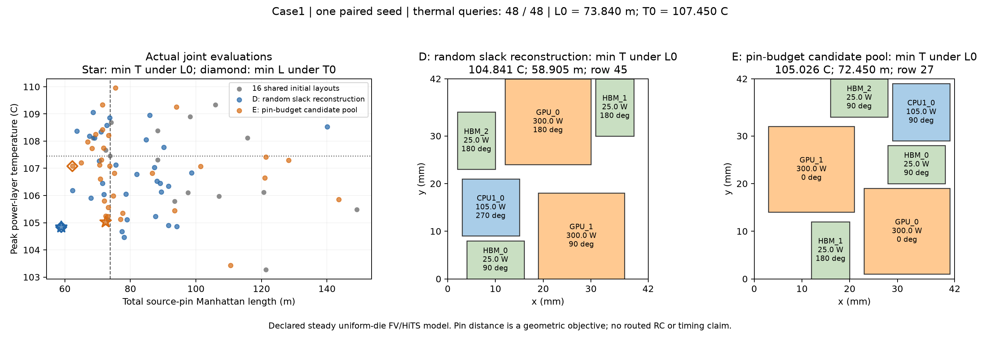

# Case1：空隙候选池的 pin 预算预筛——保留负结果

2026-11-13 按[冻结协议](atplace-case1-guided-slack-protocol.md)完成一次本地 E 实验。
实现/清单先在 `3f0c8325cf1bacade582d64f8109ca76769ca452` 推送并核实远端，然后运行。
清单 SHA-256：`c1fa0ac6f039cc6e33d6b5715b145fd8bedc071a4bbee078c0dd35b3f0528e28`，
绑定 20 个执行源码/协议文件。历史 D 直接基线保持原样，只回放保存响应。

**执行验收通过，质量改进未通过。** 相对 D，可行布局数增加，但固定距离预算下
最低峰温变热 0.185384 K，固定温度上限下最短 pin 距离增加 5.748679%。因此不将
E 作为已获改进的方案推广；保留代码与完整负结果，不重跑挑种子或扩大预算。
352 项测试、two-chiplet CLI、全部候选池/事件/实际热输入的保存响应回放均通过。
按用户决定，Chat 继续待审核；本页结论属于本地执行证据。

## 主要指标：保留实际联合布局

共同阈值保持原值 L0=73.840208806 m、T0=107.45047721858577 °C，包含等号。

| 方法 | min T，L≤L0：温度 / 距离 / 行 | min L，T≤T0：距离 / 温度 / 行 |
| --- | --- | --- |
| B：历史 pin 引导参考 | 103.712271 °C / 72.596956 m / 38 | 61.050977 m / 107.333425 °C / 22 |
| C：历史合法姿态交叉 | 104.959490 °C / 70.715295 m / 48 | 50.239777 m / 106.520719 °C / 49 |
| D：随机空隙重构，直接基线 | 104.840882 °C / 58.905473 m / 45 | 58.905473 m / 104.840882 °C / 45 |
| E：四候选 pin 预算预筛 | **105.026266 °C / 72.449988 m / 27** | **62.291760 m / 107.079489 °C / 34** |

相对 D：主指标变热 0.185384 K；反向距离增加 3.386287 m（5.748679%）。
相对 B：主指标变热 1.313996 K；反向距离增加 1.240782 m（2.032371%）。
相对 C：主指标变热 0.066776 K；反向距离增加 12.051983 m（23.988926%）。
D 的同一个 row 45 在温度与距离上同时优于 E 的两个约束赢家。

[完整 D/E 记录](evidence/atplace-case1-guided-slack-v1.json) ·
[可导出图](evidence/atplace-case1-guided-slack-v1.pdf)。B/C 原记录见
[交叉阶段证据](evidence/atplace-case1-crossover-v1.json)。

| 热查询数 | D：min T / min L | E：min T / min L |
| --- | --- | --- |
| 16 | 105.118177 °C / 73.163204 m | 105.118177 °C / 73.163204 m |
| 32 | 105.118177 °C / 71.969088 m | 105.026266 °C / 70.567120 m |
| 48 | 104.840882 °C / 58.905473 m | 105.026266 °C / 62.291760 m |

该表每项是各自约束的选点统计，不能拼成一个联合布局；完整联合点及行号均保存在 JSON。
E 中更冷的 row 45 为 `(103.424764 °C, 110.599072 m)`，不满足 L0，不能替代主赢家。
最终 Pareto 行为 `[3,27,34,43,45,47]`，其中 row 3 是共同初始化的更冷、更长布局。

## 筛选机制和变异后的变化

29 次交叉共解码 116 个掩码候选，按完整位置/方向去重后支付 103 次 pin 预筛。
各池有 1–4 个不同完整布局。14 个池至少有一个候选满足原 L0，均从可行候选中选择；
其余 15 个池选最短距离，不放宽约束。选中结果有 25 个新布局重构、4 个父布局重构。
另有 4 个事件绕过交叉；没有追加候选直到满意，也没有给被否决候选求热。

| 交叉选中点 → 原变异后 | 事件数 |
| --- | ---: |
| 距离可行 → 可行 | 13 |
| 距离可行 → 不可行 | 1 |
| 距离不可行 → 可行 | 2 |
| 距离不可行 → 不可行 | 13 |

此表包含那个最终完整布局重复的事件：它属于可行→可行，不增加新热查询或新布局行。
主赢家 row 27 来自父行 8/7；交叉选中点 L=75.275204 m，本来不满足 L0，之后
HBM_1 变异使其达到 L=72.449988 m。反向赢家 row 34 来自父行 26/31 的 bypass，
然后变异 HBM_2。不能将这两个赢家的收益简单归因于候选池预筛。

最终距离可行完整布局数 D/E=17/22，其中共同初始化均有 4 个；温度可行数为 30/32。
可行数量增加与约束内最佳质量变差同时出现。频数也不构成对温差退化的因果分解，
不能据此断言某一次变异一定无关紧要。

## 显式成本和物理条件

| 项目 | D | E |
| --- | ---: | ---: |
| 新热求解 / 尝试 | 48 / 48 | 48 / 48 |
| 不同完整布局 / 热缓存命中 | 48 / 0 | 48 / 0 |
| 提议，含共同初始化 21 次未保留尝试 | 70 | 70 |
| 在线提议 | 33 | 33 |
| 非法 / 完全重复提议 | 0 / 1 | 0 / 1 |
| pin 总调用 | 212 | 283 |
| 交叉 / 变异预筛 pin 调用 | 0 / 164 | 103 / 132 |
| 实际完整布局 pin 评估 | 48 | 48 |
| 几何候选检查 | 707,148 | 679,370 |
| 其中共同初始化 / 交叉 / 变异 | 559,192 / 96 / 147,860 | 559,192 / 174 / 120,004 |
| 拓扑对检查 | 960 | 870 |
| 空变异集 / 非法上下文 fallback | 0 / 0 | 0 / 0 |
| 完整代数，每代完整/热状态多样性 | 2，均 16/16 | 2，均 16/16 |

E 总 pin 账 `103+132+48=283`；几何账 `559192+174+120004=679370`。
虽然多了 103 次交叉预筛，随机轨迹变化后变异调用减少，不能把两者混为一项或省略成本。
E 观察总时间 30.642 s，热求解 21.227 s，pin 预筛 6.333 s；D 历史总时间 26.162 s。
负载不受控，时间仅作记录，不构成受控算法加速/减速结论。

48 条实际热输入均保持 D 的非姿态设计签名并通过原准入：尺寸、每芯粒功率、局部
pins、材料、外框、网格规则和冷却条件不变，总功率 780 W。最大能量不平衡
3.59e-7 W，最大原方程相对残差 9.76e-11，同矩阵参考解最大差 2.31e-8 K。
有源层峰温范围 103.269–109.959 °C。上述求解核对不是实物温度精度。
原顶面对流热阻仍为 0.009 K/W，空隙没有被改成冷源或硅，温度来自同一声明模型。
没有新 RC/STA 或真实热—时序闭合结论。

## 本次决定与下一项问题

保持 D/B/C 的更好历史联合布局，E 作为受控负结果保存。只增加距离可行候选不足以
解决当前质量问题；本轮不继续叠加更多候选或更多种子。

下一项应检验**选择规则是否对齐固定距离约束下的降温目标**。现有 NSGA-II 的父代和
生存者排序仍优化无约束的 `(T,L)` Pareto 前沿，不使用 L0；E 中 110.599 m 的冷点
可被保留，却不能用于主指标。这是代码与记录可见的差异，尚不是失败原因的因果证明。
后续若修改，应单独改变选择压力、保留反向指标档案和物理模型，再做同预算对照。

本地原始查询在 `results/atplace-case1-guided-slack-v1/`，日志在 `results/atplace-guided-slack-*.log`。
没有启动新的 Chat 审核，D/E 的独立审核状态仍为待审核。
