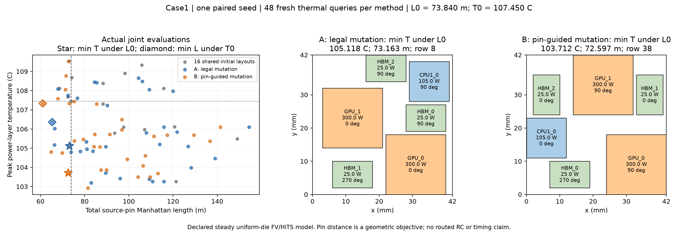

# Case1：单种子 pin 引导消融验收

在冻结的共同距离上限下，pin 引导方法 B 比合法变异基线 A 的最低峰温低
**1.405907 K**；反向固定温度上限下，总 pin 距离缩短 **4.251216 m（6.510066%）**。
两方法都完成全部预算。当前结论是这个案例、种子和预算下观察到联合布局收益，
尚不支持稳定优越性或新算法/SOTA 宣称。

## 问题、输入与版本

问题：只改变向热求解器提交候选前的 pin 筛选，是否比均匀合法变异找到更好的联合布局？
使用 [Chat 已复核的 Case1](atplace-case1-review.md)，不修改热模型或旧 R3 结果。
源 ATPlace commit `fe3dbfdaf78dc0ddeac3a2cfc3a85ff0971f88df`，HiTS
`be59924de3f0c1a3d6d134aea411d1264cfa64c6`；6 芯粒、780 W、3,168 条源双端网络、
42×42 mm 载板，1 mm 中心网格及间隙，四方向。

正式实验前已将实现、[协议](atplace-case1-search-protocol.md)及
[清单](evidence/atplace-case1-search-plan-v1.json)推送至
`e94523d3a291ddd2e2a2145d43247f91e11a7682`，并核实远端相同。开始研究和发布前
fetch 成功，没有未纳入的远端更新。清单 SHA-256 为
`9b882a96f6169807c8f5d99c02262c56eb4b1bc57db8c5be3bf3abb01735aa1f`，绑定 10 个
源码/协议文件以及输入；`code_base_commit` 指实现前的 `6f9f29f`，新增文件版本由
清单内容哈希和上述冻结提交共同确定，不把父提交当作新代码所在版本。

固定 seed `2026111200`、NSGA-II population 16，共同的 16 个初始布局含 base；
两方法各自空热缓存，各支付 16 初始 + 32 在线新热求解。A 均匀条件合法变异，
B 每次最多筛选四个条件合法候选，优先选满足 L0 的候选，否则取最短者。
正式运行没有更换种子、增加预算或调阈值。冻结前初始化的失败及修改也已保留，
见协议中的 preflight 记录。

## 主指标：保留真实的联合布局

锚点取既有 base，**L0=73.840208806 m，T0=107.45047721858577 °C**，原值包含等号。
距离是所有源网络的 pin-to-pin Manhattan 长度之和，不是 routed wirelength。
每个单元格都是同一个已求解布局的 `(T,L)`，不混合不同布局的两个最小值。

| 指标 | A：合法变异 | B：pin 引导 | B 相对 A |
| --- | --- | --- | --- |
| L≤L0 时最低峰温 | **105.118177 °C**；L=73.163204 m；row 8 | **103.712271 °C**；L=72.5969555632 m；row 38 | 降温 **1.405907 K** |
| T≤T0 时最短距离 | **65.3021933304 m**；T=106.361156 °C；row 21 | **61.0509773304 m**；T=107.333425 °C；row 22 | 缩短 **4.251216 m / 6.510066%** |

B 的主指标赢家同时比 A 的主指标赢家更冷且更短；反向指标赢家则更短、温度更高，
仍满足同一个 T0。两种指标选中了不同布局，不能概括成同一个布局同时取得两项极值。
A 的主指标赢家来自共同初始化；B 的主指标赢家来自第 39 次新热求解（solve ID 38）。
这表示本次 B 在初始化之上取得额外主指标收益，A 没有。

若忽略距离约束，A/B 的最低峰温是 103.191683/102.919524 °C，但对应距离分别为
82.998829/81.489902 m，都超过 L0，不能当作主指标赢家。这说明约束在本次实际
候选中确实改变了最终选择，而不只是结果表上的附加标签。

| 已消费新热求解数（每方法，含初始） | A 最低 T / °C | B 最低 T / °C | A 最短 L / m | B 最短 L / m |
| --- | --- | --- | --- | --- |
| 16 | 105.118177 | 105.118177 | 73.163204 | 73.163204 |
| 32 | 105.118177 | 105.118177 | 65.302193 | 61.050977 |
| 48 | 105.118177 | 103.712271 | 65.302193 | 61.050977 |

[PDF](evidence/atplace-case1-search-v1.pdf)；图仅展示实际评价点及选中布局，无插值 Pareto。

## 预算与代价

| 记账项 | A | B |
| --- | --- | --- |
| 终态 | complete_thermal_budget | complete_thermal_budget |
| 新热求解 / 上限 | 48 / 48 | 48 / 48 |
| 完整方向布局行 | 50 | 49 |
| 新方向布局的热缓存命中 | 2 | 1 |
| 全部提议 / 上限 | 191 / 512 | 171 / 512 |
| 重复完整状态提议 | 11 | 14 |
| 非法完整状态提议 | 109 | 87 |
| 完整 pin 计算 / 上限 | 50 / 2,048 | 261 / 2,048 |
| 其中预筛 pin 计算 | 0 | 212 |
| 候选几何检查 / 上限 | 1,165,080 / 2,000,000 | 1,084,752 / 2,000,000 |
| 完整代数 / 末代未选拔 offspring | 2 / 2 | 2 / 1 |
| 热求解累计时间 / s | 17.541 | 17.680 |
| 额外预筛 pin 时间 / s | 0 | 5.279 |
| 在线总墙钟时间 / s | 20.787 | 26.069 |

两方法的提议均包含 21 次未保留的初始化尝试，几何检查均包含共同初始化的 559,192
次检查。共享离线初始化耗时 0.419 s，单独报告；在线计时含各自的 16 次初始热求解。
两方法顺序运行，没有相互并发争用。上述时间是本机观察，B 多花约 5.28 s，不能宣称
计算加速。完整 pin 计算增加到 5.22 倍，但仍在冻结上限内。

方向缓存命中的新完整状态保留在候选行和 offspring 中；完全重复的状态只耗提议。
B 有 82 次变异遇到其他固定芯粒仍重叠，按冻结协议退回均匀条件合法选择；这些不是
82 次额外完整布局失败，也没有对非法布局计算误导性 pin 引导值。空变异集合 A/B
为 16/11 次。最终候选完整几何检查照常执行。

## 验收与物理解释范围

[完整证据](evidence/atplace-case1-search-v1.json)包含两方法的 99 条完整布局记录、
96 条热求解记录、全部提议、选中联合布局、检查点及成本。跨方法共有初始状态，99
不是跨方法去重后的状态数。逐行重算几何和精确 pin 总长、检查热引用和源输入哈希，
再用已保存热响应确定性回放两个搜索策略，全部匹配；回放没有新增热求解。

96 次热查询全部通过既有数值准入：780 W 输入，最大能量误差约 4.66e-7 W，
最大原方程相对残差约 1.03e-10，同矩阵参考解最大差约 2.30e-8 K。
这些验证离散求解和记账，不是新实物校准。332 项本地测试通过，两芯粒 CLI 通过
（3 W、峰温 34.1886 °C，timing 未运行）；执行代码未变，结果阶段复用这些验证。
出图工具从冻结证据生成，已实际运行并检查图像。

从第一性原理看，固定总功率并不固定峰温：移动热源和硅区域会改变局部热扩散路径，
因此同一个散热边界可以产生不同峰温；旋转均匀方形芯粒可以只改变 pin 距离而不改变
热方程。此次每方法观察到约 6.3–6.6 K 的峰温范围，温度不是恒定目标。主指标在共同
长度约束下选择实际温度更低的布局，避免把纯缩短距离误称为热收益。
这里没有通过单变量反事实拆解来证明是哪一个移动造成 1.406 K 的全部改善，也没有
证明真实封装或热—时序闭合；其精确数值仍是声明的稳态均匀 FV 模型预测。

**验收裁决：执行、预算公平性、联合指标及可回放性通过；本次有正收益，稳定算法优势待证。**
这轮不追加种子或预算。[随后完成的 Chat 复核](atplace-case1-search-review.md)独立从上游
pins 重算全部 99 行、重选赢家并核对冻结历史，认可本次有限正收益。下一项仅考察
保持几何合法的双亲交叉组合，复用当前 B 作基线；尚未启动这项新实验。

原始日志在本地 `results/atplace-case1-search-v1/`；复现入口见冻结协议。
