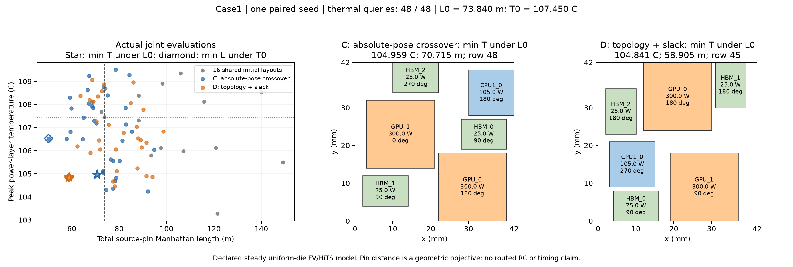

# Case1：相对分离图＋可调空隙，执行通过但质量仍是权衡

新表示 D 已按[冻结协议](atplace-case1-slack-protocol.md)完成单种子、48 次本地热求解。
实现/协议先在 `86ba64913eb9547fca559e2925bd87a546351fbc` 推送并核实远端；清单
SHA-256 为 `825faa0b6e9f41ae41b55218940ca1457cfe029b02c8eb4c7d4f36cbc4b44757`。
直接基线 C 复用经 Chat 审查的 `3cb5769` 记录，没有重跑或选取新种子。
347 项测试、两芯粒 CLI 和完整保存响应回放均通过。

**几何机制成立，稳定质量优势未成立。** 32 次交叉中 29 次产生不同于双亲的合法布局，
但相对 C 主指标只改善 0.119 K，反向距离变差 17.249%；相对较早 B，主指标仍差
1.129 K。保留全部历史赢家，不用表示更灵活或合法率高代替质量改善。

## 共同约束下的实际联合点

原 L0=73.840208806 m；原 T0=107.45047721858577 °C。包含等号。

| 方法 | min T，L≤L0：温度 / 距离 / 行 | min L，T≤T0：距离 / 温度 / 行 |
| --- | --- | --- |
| B：pin 引导，历史参考 | 103.712271 °C / 72.596956 m / 38 | 61.050977 m / 107.333425 °C / 22 |
| C：合法绝对姿态交叉，直接基线 | 104.959490 °C / 70.715295 m / 48 | 50.239777 m / 106.520719 °C / 49 |
| D：相对图＋空隙 | **104.840882 °C / 58.905473 m / 45** | **58.905473 m / 104.840882 °C / 45** |

D 的两个指标恰好选择同一个真实布局 row 45，不是拼接极值。
相对 C：主指标降温 0.118608 K；反向距离增加 8.665696 m（17.248676%）。
相对 B：主指标变热 1.128611 K；反向距离缩短 2.145504 m（3.514283%）。
D row 45 支配 C 的主指标赢家 row 48，但不能支配 C 的更短距离赢家 row 49，
也不能支配 B 的更低温赢家 row 38。本轮不宣布一个全面替代旧方法的赢家。

[完整证据及两个记录](evidence/atplace-case1-slack-v1.json)，
[可导出图](evidence/atplace-case1-slack-v1.pdf)。B 的原始记录仍在
[上一阶段证据](evidence/atplace-case1-crossover-v1.json)。

| 热查询数 | C：min T / min L | D：min T / min L |
| --- | --- | --- |
| 16 | 105.118177 °C / 73.163204 m | 105.118177 °C / 73.163204 m |
| 32 | 105.063238 °C / 64.678496 m | 105.118177 °C / 71.969088 m |
| 48 | 104.959490 °C / 50.239777 m | 104.840882 °C / 58.905473 m |

表中两列是两个约束选点的分别统计；完整 `(T,L)` 和行号均保存在证据里。

## 表示机制与实际成本

冻结前对旧 B/C 全部 99 行做精确编码—解码，位置和方向逐字段相同，证明没有强制
压紧原布局。手算测试覆盖半网格尺寸、90/270 度方向、极端空隙、继承碰撞和预算上限。

D 32 次交叉中有 29 个新完整布局、3 个父布局重构；另 1 次绕过交叉。新布局指变异前
实际状态不同于双亲，并非仅掩码混合。总计 100 个芯粒坐标对不同于两个对应父坐标对。
这说明解码确实生成新位置，而不只换方向；不证明它是热上更好的移动。
当前方案继承一个父代的整套相对图与方向，尚未直接重组图结构。

| 项目 | C | D |
| --- | ---: | ---: |
| 新热求解 / 尝试 | 48 / 48 | 48 / 48 |
| 不同完整布局 / 热缓存命中 | 50 / 2 | 48 / 0 |
| 提议（含共同初始化的 21 次未保留尝试） | 78 | 70 |
| 在线提议 | 41 | 33 |
| 非法 / 完全重复提议 | 0 / 7 | 0 / 1 |
| pin 调用（其中变异预筛） | 258（208） | 212（164） |
| 几何候选检查 | 746,408 | 707,148 |
| 共同初始化几何检查 | 559,192 | 559,192 |
| 交叉完整几何检查 | 2,304 | 96 |
| D 编码内部拓扑对检查 | 不适用 | 960 |
| 空变异集 / 非法上下文 fallback | 0 / 0 | 0 / 0 |
| 完整代数 | 2，另 2 个子代 | 2，无未完成代 |
| 每完整代的完整/热状态多样性 | 16/16，16/15 | 16/16，16/16 |

D 几何检查分解为 `559192 + 96 + 147860 = 707148`。
交叉还做有理数运算和图遍历，96 不能当成与 C 的 2304 严格等价的 CPU 工作量。
D 历时 26.162 s，热求解 19.214 s，pin 预筛 4.162 s；C 历史总时间 61.751 s。
两次机器负载未受控，不据此声称速度加倍。算法工作量与观察墙钟时间分开报告。

最终 Pareto 行 `[3,36,45,46]`。row 45 源于父行 28/15 的新坐标重构，再变异
CPU1_0；没有对变异前布局额外求热，因此不能拆分它们各自贡献多少降温。

## 物理核对与本阶段裁决

48 条实际热输入具有相同非姿态设计签名，均通过原物理/数值准入；逐芯粒面积、
功率、局部 pins、层材料、载板、散热器、环境与 h 未改变，总功率仍为 780 W。
最大能量不平衡 3.44e-7 W，最大原方程相对残差 1.03e-10，最大同矩阵参考解差
1.88e-8 K。后两项用于检查离散方程求解，不等于实测精度。

顶面对流热阻仍为 0.009 K/W、面积平均表面温度的守恒推导仍为 52.02 °C。
有源层峰温范围 103.269–109.343 °C，变化来自固定声明模型中的布局及共形网格。
空隙不是额外散热器；硅尺寸和功率密度没有被算法改小。原始 pin 距离按实际方向
计算，未用中心距离替代，也不声明 RC/STA 闭合。

**验收通过：** 刚体几何的可逆表示、合法解码、同场景同预算执行与全部记录回放。
**尚未通过：** 新表示带来稳定、实质的热—互连质量优势。0.119 K 的单次改善仅按
当前离散模型报告，不展开新的精度活动来包装这点收益。

下一步先请 Chat 审查实际代码、冻结历史、合法性推导、完整联合点和物理解释，再选
一个对质量有区分力的改动。[审核请求已准备但页面尚未提交](atplace-case1-slack-review.md)，
目前没有新阶段独立审核结论。不追加本轮热查询、种子或调整约束。
原始查询/日志位于忽略目录 `results/atplace-case1-slack-v1/`。
