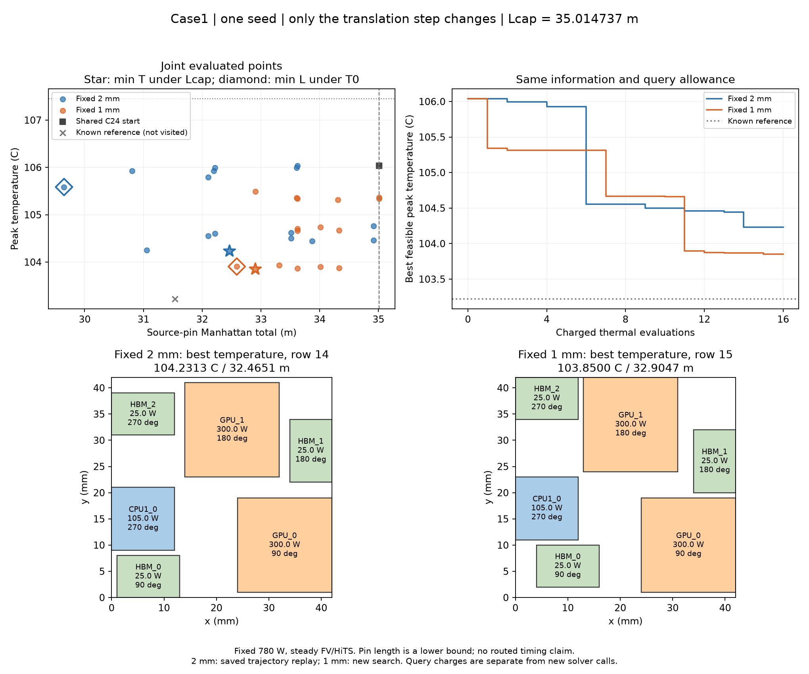

# Case1 步长对照：本次 1 mm 降温，但反向距离变差

**同一 Lcap=35.0147365608 m、同一起点与 16 次收费评价下，固定 1 mm 比固定 2 mm
找到的最低峰温低 0.381266 K；反向距离指标变差 9.916%。** 这支持当前小预算搜索
受步长影响，不能证明 1 mm 普遍更好、固定 2 mm 的最优值更差，或全部历史差距
来自步长。没有追加种子、预算、旋转、混合步长或物理校准。

2026-11-13 开始及发布前 fetch 成功。先取得新 [Chat 复核](atplace-case1-tight-budget-review.md)，
审核目标为 `ec6b829`；随后将新实现、[协议](atplace-case1-step-size-protocol.md)、
计划和审核记录推送为 **`ed21ab131ae56a3bbe859402e0f4b92bae8aa998`**，核实远端 SHA
后才在本地运行。此新步长结果是本地证据，尚未宣称通过下一次 Chat 独立审核。

## 共同条件和联合指标

两组都是 temperature_guided，同 C24 repaired 起点 106.0384887375046°C /
35.0147365608 m，seed=2026111200，原 256 热响应缓存和 479 联合参考状态，
T0=107.45047721858577°C。只有 step_um=2000→1000 改变；原父代规则、pins 修复、
必要布线、功率、材料、边界、网格及预算完全沿用。旧档案不是免费父代或成绩。

| 指标与所选实际行 | 固定 2 mm | 固定 1 mm |
| --- | ---: | ---: |
| L≤Lcap 的最低峰温，°C | 104.2312846089，row14 | **103.8500182714，row15** |
| 同一最低温点的 Lpin，m | 32.4650705288 | 32.9047116196 |
| 同一最低温点距 Lcap 的余量，m | 2.5496660320 | 2.1100249412 |
| T≤T0 的最短 Lpin，m | **29.6490705288，row15** | 32.5891936136，row16 |
| 同一最短距离点的峰温，°C | 105.5857489347 | 103.9051831568 |

主点较共同起点降温 **2.188470 K**，仍比同预算历史已知参考
103.2213747004°C / 31.5360306256 m 热 **0.628644 K**。反向指标增加
2.9401230848 m（9.916409%）；两组主点也互不支配，不能将 1 mm 的最低温与
2 mm 的最短距离拼成一个新布局。两组都达到原温度/距离条件。

图中灰色冷参考未被本轮访问，不能加入在线成绩。2 mm 查询 6–10 的最低温仍优于
1 mm，1 mm 在查询 11 后反超，说明终点结果也依赖有限预算下的搜索进展。
图可用 `python tools/plot_atplace_step_size.py` 从保存记录生成，无新热求解。

## 为什么这一次步长限制有直接证据

固定 2 mm 保留每个中心坐标模 2 mm 的余数。1 mm 最低温实际布局如下（中心单位 mm）：

| 芯粒 | x | y | 朝向 |
| --- | ---: | ---: | ---: |
| CPU1_0 | 6 | 17 | 270° |
| GPU_0 | 33 | 10 | 90° |
| GPU_1 | 22 | 33 | 180° |
| HBM_0 | 10 | 6 | 90° |
| HBM_1 | 38 | 26 | 180° |
| HBM_2 | 6 | 38 | 270° |

GPU1 的 x/y、HBM0 的 x、HBM2 的 y 相对 C24 改变了模 2 mm 余数，因此这个
**已实际求解且更冷的完整状态**不能由当前纯 2 mm 动作到达。它不是仅停留在
“历史参考可能不可达”的推测；但仍未穷举 2 mm 子空间，不能排除其中还有更冷点。

最低温点的祖先链为 0→1→2→7→10→11→12→13→15。GPU1 的 y 依次从 30 mm
增加到 31、32、33 mm。一个直接单变量对子是 row10→11：仅 GPU1 y=32→33 mm，
峰温从 104.6619915276°C 降至 103.8961137446°C，Lpin 从 33.6238035416 m
增至 34.0122855356 m，两点均满足预算。该芯粒高 18 mm，y=33 时上边界恰为
42 mm；从 y=32 再走 2 mm 会越出载体。细步长让算法用到了原几何域内剩余的
1 mm 空间。**原域允许芯粒边界与载体边界齐平，没有新增制造边缘 keepout 假设。**
这不是允许芯粒越界或减少面积换来的温度改善。

布局改变材料分布与热源位置，热矩阵 A(x) 和功率映射 b(x) 随之改变；温度由
同一个稳态边值问题求解，不由 GPU 间距代理直接指定。总功率仍为 780 W，顶部
Robin 参考平均表面温度仍为 52.02°C，不靠减少功率、扩大冷却或改变材料获得收益。
上述矩阵/能量条件说明模型内比较一致，不是对真实封装的校准。

另一个独立限制仍在：共同起点的矩形 HBM2 为 270°，历史冷参考为 0°。
现有保持边界的半转修复不改变长短边朝向，**1 mm 同样不能到达该历史完整姿态**。
以后若检验矩形 90° 旋转，应把它视作改变几何/材料分布的新动作，检查碰撞和真实
pins 并求新热响应，不能当作热中性朝向修复。当前没有追加这个算子。

## 查询与计算成本

| 账本 | 2 mm 基线 | 1 mm 新搜索 |
| --- | ---: | ---: |
| 本比较的收费热评价 | 16 | 16 |
| 本轮实际新增热求解 | 0（历史轨迹重放） | 16 |
| 本轮返回保存的基线响应 | 16 | 0 |
| 在线共同/内部热缓存命中 | 0 | 0 |
| 初始 / 新增父代 | 1 / 16 | 1 / 16 |
| 最大父代深度 | 9 | 9 |
| 几何尝试 | 408 | 408 |
| 提议 / 必要容量检查 | 20 | 25 |
| net 长度计算 | 422400 | 528000 |
| 完整状态重复 | 1 | 3 |
| 距离拒绝 / 必要容量拒绝 | 3 / 0 | 6 / 0 |
| 候选 pins 准备耗时，s | 1.641（历史） | 2.502 |
| 搜索总耗时，s | 9.112（历史） | 11.863 |

本轮新增热求解总计 **16**，比较账本总计 **32 次收费评价**。1 mm 未请求到旧基线
16 输入，因此其外部保存复用为 0；如果命中也会照常收费。共同历史准入为 49.024 s，
另有 2.864 s 的基线策略回放，均为零新热的准备成本，不放进任一在线成绩。
跨时段单次耗时不作加速结论；新组多用 25% 的 net 计算，是实际额外搜索开销。
原核心中的 new_thermal_queries 字段在本比较对应收费评价，外层明确标记其语义。

1 mm 最小已接受长度余量为 0，最差提议超预算 0.7210669808 m；约束确实被执行。
两组最紧必要资源利用率仍为 13.2%，1 mm 最紧 vertical cut 为 9.6381%。
必要条件通过不是详细布通，也不是容量饱和；Lpin 始终是 pin Manhattan 下界。

## 验证、证据与下一步

379 项测试、两芯粒 CLI 和最终完整保存响应回放通过。新增的有意义测试检查：
外部复用照常占查询额度且不注入父代；2/1 mm 对坐标余数类的影响与矩形朝向限制。
两组原始轨迹逐项回放，包括输入身份、选择、拒绝、缓存、联合赢家、成本和来源账本，
回放新增热求解为 0。全部新输入通过既有固定设计与数值准入。

16 个新热响应最差能量残差为 3.397×10⁻⁷ W、相对线性残差 9.577×10⁻¹¹、
对参考线性求解差为 1.974×10⁻⁸ K。沿用既有精度条件，没有为 0.381 K 收益提高精度；
这些是数值一致性证据，不是材料/边界的物理误差上界。真实详细布线与时序仍未闭合。

- [冻结计划](evidence/atplace-case1-step-size-plan-v1.json)，SHA256
  `5296f5757d833c0e2c291cd608ac087ab2381311fd8d4da1e20bef14f1caa8e2`。
- [完整结果](evidence/atplace-case1-step-size-v1.json)，SHA256
  `e39af7fc59d575268c5b273c5294e4753e372d45a7870044e68259268dcab315`。
- [保存响应回放](evidence/atplace-case1-step-size-replay-v1.json)。
- 本地原始输入/热响应：`results/atplace-case1-step-size-v1/`；测试日志与两芯粒报告
  分别为 `results/atplace-step-size-tests.log`、`results/atplace-step-size-cli/`。

这一项验收结论是：**步长造成真实的可达状态限制，1 mm 本次找到更冷的合格布局，
但反向距离与计算开销变差，历史最冷点仍未超越。** 下一项应先让 Chat 核对这份
已发布的单因素证据，再从“细步长局部精修”和“矩形朝向改变”中选择一个具体
未解决机制，不同时增加多种算子，也不把当前结果推广为成熟算法排名。
