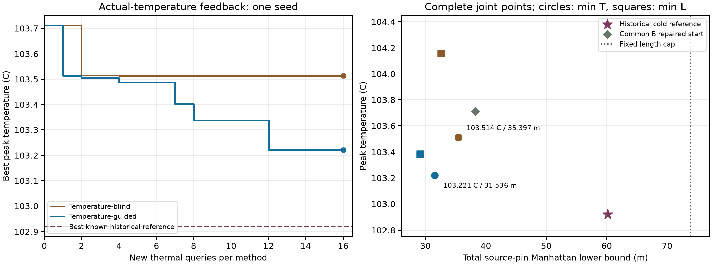

# Case1：真实温度引导的多步位置搜索

本轮完成三个独立修正：精确计算提速、历史冷布局重新准入、相同多步能力下的父代
选择对照。**温度引导比温度盲选择低 0.292725 K，但未超过最冷历史参考。**
反向距离指标改善 10.779%。这是单种子 16+16 新热查询的局部证据，不是全局算法排名。

## 输入、监督与冻结

- 开始 fetch 成功，分析 `50185da8ce4c9ff5b94922411627e908def39b5e`，本地/远端一致。
- [Chat 完整审核](atplace-case1-orientation-review.md)通过上一轮限定结论，发现 B40
  的更冷可行状态，并要求两组都允许多步扩展，以单独识别温度选择的作用。
- 精确 pins 优化先推送 `4f70f2788179f4b30983925d0332ffcc7a0d0f8b`；算法、最终
  [协议](atplace-case1-temperature-feedback-protocol.md)、历史参考和计划先推送
  `f108f72e2a2b9c556061644dc199bbe0ccf4897a`，远端 SHA 确认后才进行新热实验。
- 计划 SHA256：`701acb53c6948ae226d52e14092aade3afc6c872fe1b28fdde7b2275332f4dde`。
  单种子 2026111200，原 L0=73.840208806 m / T0=107.45047721858577°C 不变。
  HiTS 固定 `be59924de3f0c1a3d6d134aea411d1264cfa64c6`，全部求解仅在本地运行。

## 1. 计算冗余已消除，决策未改变

只重新计算被旋转芯粒关联的 nets，并在最后完整重算 pins、检查必要容量。
27 个锚点/候选的初次计时 11.155→2.121 s（含新索引初始化），约 5.26 倍；
net 长度计算减少 48.72%。这不是跨机器速度承诺，也不是热模型改变。

按 Chat 建议扩展到所有历史输入和原固定池，共 255 个不同输入，逐个中间方向选择、
最终姿态、精确 Decimal 距离及 routing screen 与旧全重算完全一致，0 次新热查询。
[初次成本证据](evidence/atplace-case1-incremental-pins-v1.json)、
[255 输入等价证据](evidence/atplace-case1-incremental-history-v1.json)。

## 2. 历史参考已修正，不混入搜索轨迹

同模型 A–F/orientation 的 528 条保存行去重为 246 个完整输入、225 个热几何。
每个输入做一次方向修复，保留 448 个原/修复联合状态，88 个原超 L0 的输入恢复
距离可行性；492 次原/修复必要容量检查全部通过，新增热查询 0。

| 已知参考 | Tpeak °C | L m | 来源 |
| --- | ---: | ---: | --- |
| 原历史主指标 | 103.515212 | 36.805343 | 上一轮局部修复组 |
| 修复历史主指标 | **102.919524** | **60.185154** | B row 40，原 L=81.489902 m |
| 原历史反向指标 | 104.877521 | 35.775123 | 上一轮局部修复组 |
| 修复历史反向指标 | **106.038489** | **35.014737** | C row 24 |

单个历史布局的温度没有因旋转降低；更冷的旧布局因距离恢复可行性重新进入参考集合。
历史中 37 个输入修复后仍超 L0。不能将原 25 点邻域的宽松性推广到全部布局空间。

**在线搜索两组严格只从 B repaired 和 D repaired 开始**：
103.712271°C / 38.228435 m 与 104.840882°C / 53.427681 m。
历史温度作为相同缓存，只有实际生成并通过准入的候选才能进入本轮搜索轨迹；
102.919524°C 单列为参考线，不给任一组免费加入这个赢家。

## 3. 同样的多步能力，只改变父代选择

两组同样做单芯粒 ±2 mm 合法平移、精确朝向修复、实际 pins 与必要容量准入。
新评价点（包括实际生成后命中历史响应的点）均可在两组中成为后续父代。
温度盲组均匀选择父代；温度引导组选当前最低温合格父代。同一父代的候选顺序
由源姿态和固定种子决定，独立于方法调用历史。没有温度代理或 GPU 间距评分。

| 指标及完整选中点 | 温度盲组：T °C / L m | 温度引导组：T °C / L m |
| --- | ---: | ---: |
| min T，L≤原 L0 | **103.514100 / 35.397343** | **103.221375 / 31.536031** |
| min L，T≤原 T0 | **104.158161 / 32.596435** | **103.385127 / 29.082719** |

温度引导主指标比对照低 0.292725 K，相对共同 B 起点低 0.490896 K；距离反向指标
缩短 3.513716 m（10.779%）。主点和反向点是不同布局，不能拼接最低 T 与最低 L。

温度引导主点仍比历史 B40 修复参考**高 0.301851 K**，所以没有获得新的最冷已知点。
其反向点则将历史修复后的最佳距离 35.014737 m 降至 29.082719 m（16.941%），
温度也从该历史反向点的 106.038489°C 降至 103.385127°C。

图左为新热查询检查点的已达到主指标，包含合法生成后允许的历史响应复用；0 点为
共同 B 起点，查询间的廉价缓存事件详见完整记录。图右圆点是主指标、方点是反向指标；
温度上限 107.450477°C 高于所画范围。颜色与左图对应。

## 4. 物理解释与成本

两组主点的 CPU、两个 GPU **位置和朝向完全相同**。差别在三个 HBM 的位置：

| HBM 中心 mm | 温度盲主点 | 温度引导主点 |
| --- | --- | --- |
| HBM0 | (11,6) | (7,6) |
| HBM1 | (37,30) | (37,26) |
| HBM2 | (6,30) | (4,30) |

在固定功率模型下，这些位移同时改变局部热源与导热材料分布，实际热响应因此不同。
这个成对结果也说明仅用 GPU 间距不能解释温度：这里 GPU 几何完全相同，峰温仍差
0.293 K。尚不能将联合位移的效果归因到某一个 HBM，也不宣称是真实封装测量结果。

| 在线成本 | 温度盲 | 温度引导 |
| --- | ---: | ---: |
| 新热查询 | 16 | 16 |
| 实际访问候选 / 上限 | 22 / 128 | 19 / 128 |
| 历史热响应命中 | 5 | 1 |
| 完整状态重复 | 1 | 2 |
| 新增父代 | 21 | 17 |
| 最大父代代数 | 4 | 8 |
| 邻域生成的几何尝试 | 552 | 456 |
| net 长度计算 | 464640 | 401280 |
| 必要布线检查 | 22 | 19 |
| 候选准备 s | 1.887 | 1.639 |
| 在线总耗时 s（含初始化） | 9.773 | 9.393 |

两组共享的历史复核与修复在这次执行中另耗时 47.725 s，0 次新热查询，不归入某一组。
所有计时均是单次本地观察。两组仅有 1 个共同新热几何，32 次实际求解合计 31 个
不同新几何；不跨组共享本轮新响应。两组布线与 L0 拒绝均为 0，访问候选最小距离
余量分别为 19.005 / 37.035 m，因此本轮仍未检验紧互连约束下的热权衡。

## 验证与本阶段裁决

376 项本地测试及两芯粒 CLI 通过。控制组测试验证：改变返回温度不会改变候选轨迹，
以排除偷偷使用温度的排序/准入。255 输入精确实现等价、共同历史输入身份和原响应
归属核对通过。32 条新热输入、全部父代选择、候选/缓存/成本、查询轨迹和最终联合点
均通过保存响应回放，回放新增热查询为 0。

最大能量不平衡 3.507e-7 W，原矩阵最大相对残差 1.031e-10，同矩阵参考解最大差
2.086e-8 K，全部通过原准入；源功率 780 W、材料、封装、边界和网格规则未变。

验收：精确计算加速、历史参考修正和真实温度反馈搜索链已经接通。本次局部对照有
有限温度与距离收益，仍未超过最冷历史参考，不追加预算、种子或算子。
固定 ±2 mm 移动不能遍历全部 1 mm 网格状态，且有限预算不证明局部或全局最优。
真实 Pad、详细布线、RC/时序与实物热校准仍不在当前闭合范围。
2026-11-13 后续已完成 [Chat 独立复核](atplace-case1-temperature-feedback-review.md)：
实际读取 `499cf42`，重算 255 输入的方向决策、41 事件及 42 联合行，接受上述限定
结论；没有要求使现有实验失效或强制重跑。Chat 没有亲自执行本地 HiTS 与测试。

证据：[冻结计划](evidence/atplace-case1-temperature-feedback-plan-v1.json)、
[完整运行](evidence/atplace-case1-temperature-feedback-v1.json)、
[零热回放](evidence/atplace-case1-temperature-feedback-replay-v1.json)。
