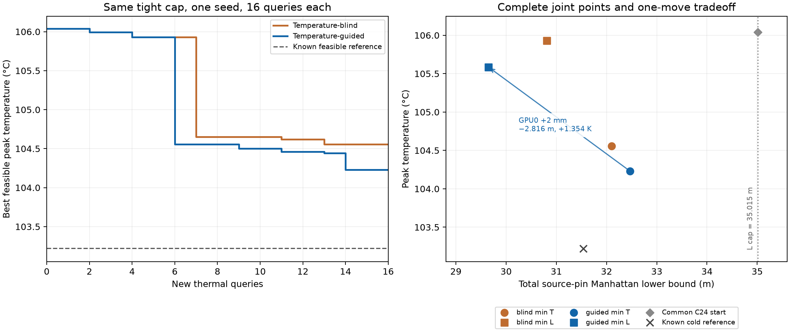

# Case1：紧参考距离预算下的温度反馈结果

**在这次单种子、16+16 新热查询中，温度引导仍有 0.324438 K 的降温优势。**
新距离条件实际拒绝了候选，但这是固定参考 pin 成本约束，不是实际封装容量上限。
两组结果均未超过新预算下的已知历史参考。

## 先复核，再冻结和执行

开始 fetch 成功，本地/远端为 `499cf423ebfa4d0bb2ae0d6c6162ef163c9bf461`。
[Chat 完整复核](atplace-case1-temperature-feedback-review.md)接受上一阶段的代码、
完整轨迹和有限正收益，建议单独以旧历史 C24 repaired 定义新预算，保留原实验不变。
Chat 只读 GitHub，独立重算保存数据，没有远端热求解、新增权限或文件上传。

实现、[协议](atplace-case1-tight-budget-protocol.md)、共同起点与计划先推送
`972fba0bdbf30e90d2b8a242cf89e470668cfa80`，核实远端 SHA 后才执行。
计划 SHA256：`7baafaa653ff46136fa9cb3892652a6f60b621c2717eb089a8a8c82df0b1ddb1`。
单种子 2026111200，HiTS `be59924de3f0c1a3d6d134aea411d1264cfa64c6`，全部本地运行。

唯一共同起点为 C24 repaired：**106.038489°C / 35.0147365608 m**。
新上限严格取其 pin 总长，没有乘任意百分比。共同历史含 256 个物理响应和
479 个联合参考状态，只有实际访问的合格点才能成为父代/成绩。本轮缓存命中均为 0。

## 联合指标

| 指标与完整选中布局 | 温度盲：T °C / L m | 温度引导：T °C / L m |
| --- | ---: | ---: |
| min T，L≤35.0147365608 m | **104.555723 / 32.102383**（row 13） | **104.231285 / 32.465071**（row 14） |
| min L，T≤107.45047721858577°C | **105.928772 / 30.807804**（row 4） | **105.585749 / 29.649071**（row 15） |

主指标改善 0.324438 K；引导组相对共同起点降温 1.807204 K。
引导主点距离比控制主点多 0.362688 m，但仍满足同一预算，不能只用距离排名代替
热目标。反向指标距离缩短 1.158733 m（3.761167%）；两行是不同布局，不能拼接。

新约束下已知冷参考仍是上一轮 guided row 14：103.221375°C / 31.536031 m，
本轮引导主点比它热 **1.009910 K**。已知反向参考仍为 103.385127°C /
29.082719 m，本轮也没有刷新最短距离。因此本轮不是新的全历史最优结果。
B40 的 102.919524°C / 60.185154 m 超新预算，不作为这里的可行参考。

## 约束确实活跃，必要布线仍宽松

零热预检：24 个移动尝试中有 8 个几何合法、8 个通过必要容量，只有 2 个满足新 Lcap。
在线结果如下，拒绝均发生在热求解和缓存访问之前：

| 资源与事件 | 温度盲 | 温度引导 |
| --- | ---: | ---: |
| 新热查询 | 16 | 16 |
| 候选提议 / 上限 | 27 / 128 | 20 / 128 |
| 距离超限拒绝 | 8（29.63%） | 3（15.00%） |
| 必要布线拒绝 | 0 | 0 |
| 完整状态重复 | 3 | 1 |
| 历史热缓存命中 | 0 | 0 |
| 新增父代 / 初始父代 | 16 / 1 | 16 / 1 |
| 最大父代代数 | 5 | 9 |
| 邻域几何尝试 | 408 | 408 |
| net 长度计算 | 570240 | 422400 |
| 候选准备 s | 2.222 | 1.641 |
| 在线总耗时 s | 9.920 | 9.112 |

两组候选最小距离余量均为 −1.408 m；实际接受的新点中，最接近上限的 L 为
34.918383 m，余量约 0.096354 m。约束确实限制探索，但不意味着每个赢家都贴边。
两组最紧必要容量条件仍只是 bin 出口 13.2%，不能称为布线拥塞已成为瓶颈。
预算收紧没有改变线距、层数、终端资源或物理模型。

两组相同的 8 个新热几何分别求解，温度逐一相同；32 次实际求解合计 24 个不同
新几何。两组不共享本轮新响应。共同历史核对另耗时 49.070 s、0 次新热查询；
共同零热预检另有 24 几何尝试和 168960 次 net 长度计算，未记作任一组在线收益。
计时为单次本地观察，不是跨平台速度结论。

## 一次单芯粒移动直接显示热—互连取舍

引导组 row 15 的父代正是其最低温主点 row 14。两者仅有一个变化：
**GPU0 中心 y 从 10 mm 移到 12 mm**，其它芯粒位置、所有朝向、功率、材料参数和
外部热边界相同。

| 状态 | Tpeak °C | Lpin m |
| --- | ---: | ---: |
| row 14，GPU0 y=10 mm | 104.231285 | 32.465071 |
| row 15，GPU0 y=12 mm | 105.585749 | 29.649071 |
| 变化 | **+1.354464 K** | **−2.816000 m** |

这是同一模型内、仅改变一个位置的已求解对照：更短的 pin 距离伴随更高峰温。
移动改变局部热源和导热材料分布，即 A(x) 与 b(x)；保持总功率并不要求峰温不变。
不能将这种几何取舍自动解释为真实 RC/时序取舍，也不能把它说成单个 GPU 的实测结温。

该对子中的两点都满足新 Lcap，所以它直接证明的是局部目标冲突，**不是收紧预算
必然带来多少最优温度代价**。本轮与上轮的共同起点不同，不能将 104.231°C 与
上一轮 103.221°C 之差全部归因于预算收紧。固定 ±2 mm 动作还保持坐标余数类；
C24 与已知冷参考的部分坐标余数不同，当前动作无法访问后者的原始完整状态。

## 验证、裁决与剩余问题

377 项测试、两芯粒 CLI 通过。新增测试专门验证：超预算的低温缓存候选也不能
进入任何一组的父代、结果或热查询。32 条新热输入、完整父代/拒绝/重复事件、
成本与联合赢家均通过保存响应回放，回放新增热查询 0。

最大能量不平衡 3.599e-7 W、原矩阵最大相对残差 9.696e-11、同矩阵参考解最大差
3.023e-8 K，原数值准入全部通过。780 W、45°C 环境、固定顶面 Robin 边界、
源材料和网格规则不变；这些是数值一致性证据，不是物理校准精度。

本阶段验收：在一个预先固定、会拒绝候选的参考 pin 成本预算下，温度引导比温度盲
父代选择更有效地利用了本次 16 查询，获得有限降温与反向距离收益。没有追加种子、
预算、算子或校准，也未达到当前已知最佳联合点。下一步算法问题是有限步长的可达
空间及局部探索效率；尚不能声称稳定优势、全局最优、实际详细布通或热—时序闭合。

Chat 已复核上一阶段并指导本协议；本次新实现和运行结果未再经过独立 Chat 复核。
旧审核页在完整答复后达到会话长度上限，后续审核可用新会话读取已推送 SHA 和记录。

证据：[冻结计划](evidence/atplace-case1-tight-budget-plan-v1.json)、
[完整结果](evidence/atplace-case1-tight-budget-v1.json)、
[零热回放](evidence/atplace-case1-tight-budget-replay-v1.json)。
