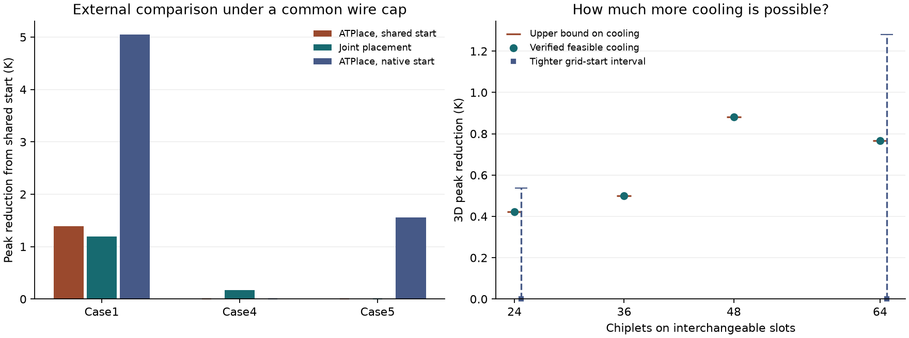

# ATPlace 外部布局对照与几十颗芯粒的三维改善界

## 本阶段结果

同一三维封装、单种子、同一互连上限下，共同起点三例为联合法一胜一平一负。联合法只用 1.10–1.45 s。ATPlace 接受原生初始化时，在 Case1 与 Case5 找到同时更冷、线长更短的布局。两种搜索在本轮预算下都保留了输例。

| 案例 | 方法 | 三维峰温 °C | 该点线长 m | 起点温限下最短已见线长 m | 冷 / 暖时间 s |
|---|---|---:|---:|---:|---:|
| Case1 | ATPlace 共同起点 | 109.607 | 70.350 | 70.350 | 61.09 / 46.41 |
| Case1 | 联合移动 | 109.803 | 69.953 | 69.646 | 1.10 / 1.10 |
| Case1 | ATPlace 原生初始化 | 105.942 | 21.776 | 21.776 | 56.54 / 41.86 |
| Case4 | ATPlace 共同起点 | 129.109 | 245.436 | 245.436 | 178.37 / 122.45 |
| Case4 | 联合移动 | 128.939 | 241.916 | 241.916 | 1.41 / 1.41 |
| Case4 | ATPlace 原生初始化 | 129.109 | 245.436 | 245.436 | 173.88 / 117.97 |
| Case5 | ATPlace 共同起点 | 142.133 | 170.488 | 170.488 | 201.90 / 126.65 |
| Case5 | 联合移动 | 142.133 | 170.488 | 170.488 | 1.45 / 1.45 |
| Case5 | ATPlace 原生初始化 | 140.579 | 118.517 | 118.517 | 216.71 / 141.46 |

Case4 的原生端点为 135.979 °C、80.803 m，因为较热而保留原起点。Case5 的共同起点 ATPlace 导出长度 200.303 m，超过 170.488 m 上限；联合法的可行新点也比起点热。两者的平局来自保留原布局。训练耗时依次为 14.68、55.91、75.25 s。原生初始化与共同起点采用相同三维评分，原生初始化内部先自行求初值；两臂在终端均可保留公共可行解。数据列出每个候选的坐标、角度、双精度线长与验收结果。[审计后逐点结果](evidence/atplace-margin-scale/audited.json) · [原始运行与失败](evidence/atplace-margin-scale/external.json) · [舍入余量对照](evidence/atplace-margin-scale/guarded.json) · [Case4 原设定重跑](evidence/atplace-margin-scale/unguarded-replay.json)

把三个原生端点的实际线长分别用作更紧的上限，从端点继续搜索，三个案例均保留 ATPlace 结果。即使有新落点，四次提议也无法保证降温。[最终端点核验](evidence/atplace-margin-scale/audited.json)

| 原生端点 | 更紧上限 m | 原生端点 → 联合移动后 °C | 降温 K | 附加 / 整个流程 s |
|---|---:|---:|---:|---:|
| Case1 | 21.776 | 105.942 → 105.942 | 0.000 | 1.39 / 57.92 |
| Case4 | 80.803 | 135.979 → 135.979 | 0.000 | 1.54 / 175.42 |
| Case5 | 118.517 | 140.579 → 140.579 | 0.000 | 1.40 / 218.11 |

### 几十颗芯粒时还能降多少

| 芯粒与起点 | 起点 → 最佳峰温 °C | 已实现 / 仍可再降至多 K | 新布局核验 / 伴随行数 | 所选线长 / 上限 m | 含独立复算 s |
|---|---:|---:|---:|---:|---:|
| 24 · 乱序起点 | 47.637 → 47.214 | 0.423 / 0.000 | 2 / 26 | 0.967 / 1.343 | 0.51 |
| 36 · 乱序起点 | 48.082 → 47.583 | 0.499 / 0.000 | 2 / 37 | 2.074 / 3.265 | 0.58 |
| 48 · 乱序起点 | 48.675 → 47.794 | 0.881 / 0.000 | 1 / 49 | 2.410 / 4.703 | 1.70 |
| 64 · 乱序起点 | 48.906 → 48.138 | 0.767 / 0.000 | 1 / 65 | 3.413 / 7.606 | 2.87 |
| 24 · 等功率 | 47.380 → 47.380 | 0.000 / 0.000 | 0 / 0 | 1.343 / 1.343 | 0.18 |
| 24 · 网格起点 | 47.751 → 47.751 | 0.000 / 0.537 | 2 / 25 | 0.163 / 0.163 | 0.52 |
| 64 · 网格起点 | 49.420 → 49.420 | 0.000 / 1.281 | 2 / 65 | 1.922 / 1.922 | 2.38 |

表中“仍可再降至多”为热子问题放松线长后给出的保守值。四个乱序案例的数值余差约为 $10^{-7}$ K，满足预先规定的 0.1 K 判据。每案另有一次共同起点正向求解和一次独立重建整板复算，均已计时。观察行的伴随回代复用同一矩阵分解。仅用连续松弛的加权下界时，四例仍有 0.168–0.227 K 的差，达到 0.1 K 需要结合整数分配。24 颗等功率互换保持功率图和材料分布完全相同，因此可直接确定降温为零。[乱序及等功率证据](evidence/atplace-margin-scale/scale.json) · [紧上限证据](evidence/atplace-margin-scale/grid-start.json)



### 哪种互连能把布局锁住

两个规则网格起点的热提议都超过线长上限；分别保留了 0.537、1.281 K 的热松弛差距。随后只用实际引脚几何复查，区分了两个表面相同的失败。令每条边的长度为 $l_e(v)$，其中 $v$ 是其两颗芯粒在两个不同槽位间的相对位移。计算 $m_e=\min_v l_e(v)$ 和总余量 $s=C-\sum_e m_e$，$C$ 为总线长上限。任何合法布局都要满足每条边 $l_e(v)\le m_e+s$。若满足条件的位移只有一个，该边就锁住两颗芯粒的相对位置。若这些边连通全图，所有芯粒只能共同平移；有限槽位全占满时，唯一可行的平移是零。这是固定槽位固定朝向下可独立检查的充分条件。

- 24 颗 mesh 的 38 条边逐边最短距离之和为 0.162959097 m，已用尽总上限。改变任一边的最短位移至少多用 11.7977 mm。38 条被锁住的边连通全部芯粒，**剩余可降严格为 0 K**。
- 64 颗 folded torus 的逐边最短距离之和为 0.789213 m，上限为 1.921795 m。上述方法锁住 0 条边，两次新布局核验均超限。**已实现 0 K，仍可能改善 0–1.281 K**。在这一例，少量热核验没有把剩余空间判清到 0.1 K。[逐边几何核查](evidence/atplace-margin-scale/wire-rigidity.json)

可复算上述几何判据的核心如下。用规模脚本的 `problem(rows, cols, topology, upstream, False, True)` 读取 `p, start`，长度单位为 µm。原始朝向都为零，`pin_offset_um` 已是全局引脚偏移。下式枚举一条边可能采用的相对位移，不枚举芯粒排列。

```python
pitch = p.size_um[0] + 3000
vectors = np.array([(x, y) for x in range(1-cols, cols) for y in range(1-rows, rows)
                    if (x, y) != (0, 0)]) * pitch
pin = p.pin_offset_um[:, 0] - p.pin_offset_um[:, 1]
length = abs(vectors[None, :, :] + pin[:, None, :]).sum(axis=2)
minimum = length.min(axis=1)
slack = pin_manhattan_um(p, start).sum() - minimum.sum()
allowed = length <= minimum[:, None] + max(0., slack) + .001001
locked_edges = p.pin_chip[allowed.sum(axis=1) == 1]
```

在有 $n$ 个顶点的无向图上用 `locked_edges` 计连通分量，24/64 颗分别为 1/64。上式计入正式准入所用的 0.001 µm 总长数值容差，另留 0.000001 µm 算术余量。这个事后几何诊断单列，未计入前表的热搜索用时。代码、数据与全套 217 项本地回归通过，双芯粒 CLI 复核总功率 3 W、参考峰温 34.1886 °C。

## 运行前约定

本地成功 fetch 到 `145822cdc52a5dfabf0867c4d06909e78cc88a47`，与远端一致。外部布局使用作者 Git 最新 `fe3dbfdaf78dc0ddeac3a2cfc3a85ff0971f88df`。历史档案的服务器时间不参加此次对照。[ATPlace 原文](https://yibolin.com/publications/papers/PLACE_ICCAD2024_Wang.pdf) · [作者实现](https://github.com/PKU-IDEA/ATPlace_pub/tree/fe3dbfdaf78dc0ddeac3a2cfc3a85ff0971f88df)

- 外部组固定 Case1、Case4、Case5，分别覆盖小网表、旧法漏掉 1 mm 的案例、薄板三维排序反转案例。使用额定源功率、固定的原案例起点和其引脚曼哈顿总长度上限、100 µm 间隙。主指标为同一 64 档几何贴合三维有限体积封装的功率层峰温，均匀顶面对流，环境 45 °C，两边使用同一材料与边界。比较达到起点温度时最短的已见线长。原地是共同备选。允许源程序旋转和合法化，联立方法在起点朝向上平移。
- ATPlace 热感知使用其公开分析模型、训练、优化及合法化代码，以共同三维模型提供功率层温度标签。本机 Windows 未安装 WSL，作者发布的 ATSim 为 Linux 二进制；共同模型训练单列为适配实验。固定种子 20261119、CBC 单线程。小预算为 4 个训练布局、1 个留出训练检查、100 步拟合、10 个外层布局迭代、每次整数初始化或合法化限 10 s。主对照把相同起点提供给两法；另跑保留作者自身初始化的热感知对照。热权重取各例作者默认，超线长或不可行的输出如实记录。为满足硬上限，同时保留可行起点；不事后为任一方放宽上限。
- 联立方法一次提出两颗的非固定首选落点，以同一上限最多核验 4 个联合布局，加起点计 5 次三维复算。搜索预估采用中央冷板薄板温差，真实验收及最终选择只使用共同三维模型。各法记录输入读取、进程启动、训练、搜索、温度验收的实测总墙钟，训练单独列出，可区分首次及已训练使用。保留运行失败、退回原地和反向排名。
- 规模组固定 24、36、48、64 颗相同尺寸封装体，在 4×6、6×6、6×8、8×8 的等间距槽位上分别用网格/折叠环面交替。种子 20261119，每案一半芯粒 1.025 W、一半 3.075 W，引脚与外形来自 RapidChiplet 示例芯粒。上限为各自初始布局的引脚总距离。另做 24 颗等功率阴性对照。固定姿态、任意槽位排列。最多 4 个新布局整板核验、每轮整数热子问题限 2 s；重装一次所选布局独立核验。记录冷却上下界、剩余差、实测时间、互连和所有失败。如果剩余差 ≤0.1 K，称已判清到 0.1 K。界限的范围是所述三维模型、固定封装几何及这些槽位排列。

在看到外部组各臂最终成绩前，另约定已有 ATPlace 结果能否继续改善的检查。对每个成功导出的、符合共同几何与原上限的原生初始化热感知布局，把该布局自身的实际线长定为更紧的上限，从其坐标与朝向直接提出至多 4 个联合布局，仍用同一三维模型验收。报告额外时间、包含产生原布局的总时间和无改善的例子。它衡量后处理价值，单列于共同起点主对照。

## 什么能从物理方程推出

对固定材料、边界和占用几何，稳态离散热平衡为 $G(T-T_a)=Bp$。$B$ 把每颗芯粒的功率按矩形与网格的相交面积分配，总输入瓦数守恒。观察点 $x$ 对槽位 $j$ 每增加一瓦的温升为 $R_{xj}=e_x^T G^{-1}B_j$。移动一颗功率为 $p_j$ 的芯粒时，要同时计入原处释放的热和新处增加的热。多人一起移动时，在每一个位置先把带符号的变化相加，再取全板最大值。[三维组装与能量检查](../src/chiplet_floorplanning/package.py)

写成选址规则，起点的局部温度余量为 $h_x=T_{\max}^{0}-T_x^{0}$。把芯粒 $j$ 从 $s_j$ 移到 $d_j$，该处净温升为 $\Delta T_x=\sum_j p_j(R_{x,d_j}-R_{x,s_j})$。整个布局的降温就是 $\min_x(h_x-\Delta T_x)$。在互连上限内选择使这个最小余量最大的联合落点，便同时照顾旧热点和可能出现的新热点。只检查部分位置会乐观高估改善；用整板检查给乐观估计补上可实现的一端。

在规模组，所有槽位始终被等尺寸、同材料的芯粒占满，身份互换保持 $G$ 和 $B$ 不变。设各槽位底功率为 $p_L$，有 $k$ 个槽位另加 $p_H-p_L$。从每个槽位起始最热的单元取一行 $R$。只在这些单元最小化峰温，同时暂时放开互连限制，得到真实受限最优峰温的下界 $L$。程序取三个有效下界的最大值：任一热点凸组合在最便宜的 $k$ 个槽位上放额外功率的值；逐槽强制为高功率所得必要下界中的第 $k$ 小值；限时整数求解器给出的对偶下界。每轮按整数解分配高功率槽位，再在同一功率类内安排芯粒身份，计算旋转后的真实引脚总距离。两端实际引脚距离、几何以及全功率层峰温均通过的解给出可实现峰温 $H$。因此剩余能降的峰温在 $[0,H-L]$ 内。求解超时仍可用已得下界；差距较大时就保留这个不确定性。[热下界](../src/chiplet_floorplanning/placement/slot_margin.py) · [槽位分配、整板核验与独立重装](../tools/scale_slot_margin.py)

自由移动异形芯粒会改变硅片、底填和微凸点的空间分布，导热矩阵也随之改变。外部对照中，薄板温差只用于提出落点，随后为每个可行候选重建八层三维封装。所有峰温都取自功率层全部活动单元，温差以 K 计。三维网格以 64 为基础分辨率，补入实际材料与热源边缘。整块 200 mm × 200 mm 散热器的顶面对流系数取 2777.8 W/(m²·K)，侧面和底面绝热。按实际顶面面积，仅其均温对流热阻为 0.009 K/W。绝对温度属于这个规定的模型。互连指标是每条两引脚网络的曼哈顿长度之和；该指标没有包含绕障布线、RC 延迟与信号完整性。

## 本地复现

主环境为项目 Python 3.12，作者环境为 Python 3.9.25、CPU PyTorch 2.0.1 与其锁定依赖。使用 i7-12700，以单工作线程依次计时。Windows 所附 CBC 的串行引擎用 `threads=0` 选取；外部公开热感知优化阶段保留作者模型和案例权重。共用三维求解器产生的网格标签替代作者的 ATSim 标签。训练的五张图包括四张拟合、一张留出；每张图取外部 64×64 网格中心所在的三维单元温升。两法共同输入起点的获取、环境安装与代码下载在计时区间之外。冷时间计入每种方法实际处理案例输入、训练、搜索、合法化和三维验收的子进程墙钟。复用训练结果的暖时间仍含新进程、读入和终端验收。同一案例的多个外部臂共享一次训练，各自的冷时间各计全额。

```sh
python tools/import_atplace_cases.py --source "$ATPLACE" --output "$CASES"
python tools/compare_atplace_margin.py run --cases "$CASES" --upstream "$ATPLACE" --atpython "$ATPYTHON" --output "$OUT"
python tools/refine_atplace_endpoint.py "$OUT" --upstream "$ATPLACE" --atpython "$ATPYTHON"
python tools/audit_atplace_exports.py "$OUT" --output "$EVIDENCE/audited.json"
python tools/scale_slot_margin.py --upstream "$RAPIDCHIPLET" --output "$EVIDENCE/scale.json"
python tools/scale_slot_margin.py --upstream "$RAPIDCHIPLET" --grid-start --output "$EVIDENCE/grid-start.json"
python tools/plot_atplace_margin_scale.py "$EVIDENCE"
```

预先检出文首所列 ATPlace 提交与下列 RapidChiplet 提交，项目环境设置 `PYTHONPATH` 包含 `src` 与 `tools`，数值库限制单线程。外部案例使用上游原额定功率；规模组的两个功率档、网格间距 3 mm 与四周空间为研究设定，芯粒外形、PHY 坐标、拓扑来自公开源。[RapidChiplet 固定版本](https://github.com/spcl/rapidchiplet/tree/17176f92c91eda629a25bc11bf7959d6b963a23b)

首组乱序起点的四个规模均达到 0.1 K 判据后，增加两个线长压力对照。查看压力实验结果之前固定 24 颗 mesh 和 64 颗 folded torus，使用原网表的行优先坐标作为起点与上限。功率、网表、模型、搜索和核验预算均与对应乱序案例相同。若放松互连所得的最冷模式装不回上限，则报告最好可实现降温与剩余上界，两者都保留。复现时给规模命令增加 `--grid-start`，输出另存 `grid-start.json`。

## 互连计量与外部结果的审计

互连上限按案例分别为 70.350048、245.435602、170.488312 m。总长累加了 Case1 的 3,168 条、Case4 的 7,040 条、Case5 的 7,392 条两引脚网络；对应芯粒数为 6、11、12，功率为 780、1,535、1,020 W。主比较采用各方法所有已见可行点中三维峰温最低者，附带该点自己的线长。外部程序交出的布局较热或超过上限时，方法可保留共同的可行起点。反向指标只在实测峰温不高于该起点的已见点中取最短线长。

Case1 原始共同起点运行导出新布局后，双精度引脚总长超出上限 0.476 µm，因而原始成绩保留起点。为了让数值导出误差不决定胜负，在三个案例的共同起点加权合法化中统一扣除坐标导出余量，每网、每端、每轴预留一份承载面最大坐标的 float32 间距与 0.01 µm 文本误差。物理验收仍采用原上限。Case1 修正后 ATPlace 找到 109.6075 °C，优于联合法的 109.8027 °C。Case4 未加余量的首次计量遭遇适配器参数重名，改名后从保存的同一训练模型完整重跑这一臂。若加权合法化限时无解，仍容许作者本身的纯位移重试，最后独立判定线长和可行性。

Case5 的原生初始化导出了合法布局，但首次终端评分把两个程序的线长报数差误认成了几何错误。上游对 7,392 项长度以 float32 逐项相加，报告 118.519896 m。完全相同坐标与转角按实际引脚以双精度求和为 118.516980 m。复演作者的逐网单精度累加，恢复了其原始报数；该布局远在 170.488312 m 上限以内。审计对两种外部初始化及所有已导出的点均执行同样的复演，将两种报数一并保留。峰温排名、保留起点与互连准入都取统一的双精度值。[作者的 HPWL 累加](https://github.com/PKU-IDEA/ATPlace_pub/blob/fe3dbfdaf78dc0ddeac3a2cfc3a85ff0971f88df/src/opt/place_obj.py#L126) · [最终导出审计](../tools/audit_atplace_exports.py)

作者公开版本默认外层布局 100 轮、热模型训练 1,000 步。本轮限制为 10 轮、100 步。每例留出一张三维标签，ATPlace 在留出图上预测的采样峰温误差依次为 +1.09、+1.52、+5.82 K。终端将合格候选交由同一三维模型复算，从而区分代理指导搜索的误差与最终温度计量。每条外部臂的模型成本含五次三维标签，端点准入后另计起点与端点，联合法至多五次整板核验。两边共享互连上限和热评价标准，各自所用搜索资源与自由度在此明列。小样本训练、小预算时间以及单种子结果只能说明本次运行点的取舍。

## 独立 Chat 审稿

发布并核实 `e3edf78846b50c1f5c84a879e382036a6e3dcc8e` 后，新的 Chat 会话通过已连接的 GitHub 只读检查了从 `145822c` 起的四次提交、上游适配与导出审计、槽位求解与测试、四份数值证据。其对当前证据支撑 ICCAD 完整论文的模拟裁决为 **Weak Reject**。审阅认可限定槽位内的上下界方向、共同评分的胜平负、伴随成本、24 颗位移锁定证明和 64 颗保留的未解区间。热模型的留出误差、压缩训练预算以及不同搜索自由度使外部成绩只能解释为该协议下的实测取舍。[完整审稿](https://chatgpt.com/c/6affc7f2-5f8c-83e8-8d62-606de3ac86ed)

审阅指出，同功率芯粒的身份匹配加交换属于启发式。某次映射超出互连上限时，其他身份排列仍可能实现同一热模式。下阶段最小实验是把有效线长下界或芯粒身份排列的可行性约束放进 64 颗 folded torus 热子问题，沿用 1.921795 m 上限，衡量能否缩小 1.281173 K 区间。审阅未重跑实验、验证本机墙钟或对实物测温。本机另以已发布评分代码从冻结坐标重新生成三个案例的全部 15 张训练及留出标签，三份标签数组的 SHA-256 均与实验存档逐字节一致。原训练签名包含当时整个命令行驱动的文本，后续调整了导出线长审计；复算直接核对热标签内容。七个规模与压力工况的独立整板能量误差最大为 6.57×10⁻¹² W，热点伴随与正向温差最大为 5.78×10⁻¹⁵ K。前者验证热流平衡，后者验证同一个离散方程的数值一致性。
