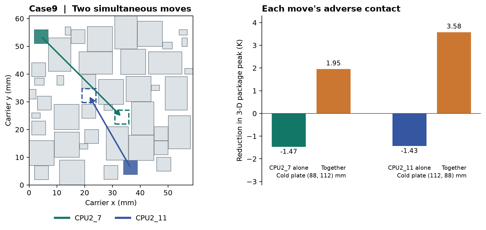

# 散热位置不确定时，哪一次芯粒移动能共同降温？

**结果。** 在单颗芯粒的每个备选落点上，先计算各散热条件下原热点能降多少温。固定热路中，两颗芯粒同时移动对同一测点的温度影响可直接相加。因此可以挑出互相补足的两次功率转移，再检验会不会产生新热点。13 个网表、同一起点互连上限下，单颗平移或中心交换在 13 种冷板位置的薄板模型中全部未达 0.1 K。允许两颗同时平移，4 例提出动作；三维验证中 Case4、Case9、Case10 在全部 15 个已测冷板位置降温超过 0.1 K，Case7 未过门槛。另 9 例留在起点。三例达标均来自 ATPlace，三个 TAP 配置均未选出达标的双移动。

## 事前约定

已 fetch，远端与本机均为 `b9d527239c98c041cc7b20eae925b07053435cb0`。比较同一动作在各冷板条件下相对于各自起点的峰温降幅，取最小值。预设有意义降温门槛 0.1 K。每个基准沿用上轮首个合法归档起点，严格互连上限、固定姿态、1 mm 平移格点、100 µm 间距及可行两芯交换完全相同。覆盖全部 10 个 ATPlace 和 3 个 TAP 配置。TAP 采用含 bump 环的排斥尺寸。各源功率取原始额定的 10%。只用这一个起点和上一阶段对应的单种子设置，全部新方法确定性计算。

冷板脚印 30 × 30 mm，沿用上轮局部冷板材料与换热。不同于前次沿所挑动作安排冷板，本轮所有案例预先用封装中心 (100,100) mm 以及正西、东、南、北各偏移 12 mm。四个方向的面积和材料相同。比较四种一次性选址决策，每种锁定一个实际布局，在相同的五个三维边界上验温。第一种沿用上轮的半空间规则；第二种只按西、东两个起点原热点中较差的预计降幅选择；第三种在西、东之间最大化较差的整板峰温降幅；第四种用相同规则覆盖四个方向。后面两种在最好的预计共同降幅不超过 0.1 K 时原地保留。仅看原热点的对照也使用 0.1 K 门槛。固定中心冷板对所有新规则留出，南北也是东西规则的留出。比较候选时先看降幅，同分取短互连再按枚举次序。

固定导热模型下，一个边界原热点在移动后的温降给出该边界整体峰温降幅的上界。用互易导热响应乘以移出、移入的功率差，先给每个合法动作算出这个上界。按上界从高到低检查整板，剩余上界低于已找到的实际模型降幅时停止。对 Case1 和 micro150 再把所有可行候选在四种冷板下穷举，比对最优降幅与所选布局。记录是否漏解、整板评分次数和只盯原热点的失败。保留所有原地、升温和未达标结果。

预先锁定各臂动作后，用完整三维封装 64 档评价所有案例、动作和五个边界。反向指标为每组满足共同降温 0.1 K 的已验候选中最短实际互连。每个来源取四向规则在四个已知边界中表现最差的一组，以及在留出中心效果最大的绝对变化，各在控制该指标的边界上用 96 档复算起点和终点。另在无源储热、正热导、常物性的稳态链、分支、网格和立体网络上检验热守恒和互易能给出的方向定律，主动找无法共同降温和只盯旧热点造成误判的反例。本轮全部计算在本地。

## 追加的冷板位置检验（首批封装结果后预定）

四向规则在 13 例中移动了 5 例。保持已冻结的四向选择和原始坐标，对所有实际移动者在四条菱形边的中点 (100 ± 6, 100 ± 6) mm 和四个外角 (100 ± 12, 100 ± 12) mm 上重复 64 档起终点对照。另外八例原地的改善恒为零。再逐个移动案例，取已知四向、中心和新增八点中降幅最小的位置，用 96 档复算其起终点。不给算法重选或追加芯粒移动预算。另构造正热导的分支网络，检验在四个外围散热口都降温能否推出中心散热也降温。

## 扩大已知边界后重新选址（对角检验之后预定）

原来五个动作在外角均有一个方向升温。在每个案例上用完全相同的规则重新选**一次**，同时覆盖四向、中心、四个边中点和四个外角，共 13 个离散边界。四向原模型最优降幅已不超过 0.1 K 的案例，可以直接保留起点，因为增加条件只能降低最差收益。在其余案例中锁定新的 13 向提案，再作 64 档三维检查；每个新动作还留出两个偏心位置 (103,91) 与 (91,103) mm。在 96 档复核每个新动作三维实测降幅最小的离散边界。若全部原地，照实记录。另将 ascend910 原四向动作的最差菱形边中点及相邻两个端点，在 96、128 档上复算，用于辨别插值反例是否随网格消失。不同阶段的选择与事后发现分开报告。

## 用两颗芯粒共同改变热源图（单移动十三向结果后预定）

单颗平移或直接交换在 13 例中均未达到十三向模型门槛。固定热路上两次功率转移对每个旧热点的影响可以相加。因此检验一次同时移动两颗不同芯粒能否共同降温。每种已知边界为每颗芯粒各保留一个最能冷却旧热点的平移，单个平移仍须满足原严格上限。合并重复后，从不同芯粒的动作中组成实际双移动，按 13 个边界上两份热贡献相加后的最差值排序。同时检查芯粒几何、含环净距和移动两颗后重新计算的互连成本。每例最多对 24 个有希望达到 0.1 K 的合法组合做完整薄板场评价，选择最差边界降幅最大的组合；没有达标则留在原位。该集合是有限缩减集合。允许任意尺度的合规落点，一步从原地到终点，两颗均从同一起点计算。

对 13 个案例锁定一个提案后，每个实际双移动在 13 个指定冷板与前述两个保留位置上作配对三维验温；还在每个组成动作的模型最差已知边界分别检查单独移动。按每个双移动 64 档最差边界细化至 96 档。报告全部拒绝、已选、未达标和反例。冻结后不追加选址尝试。

## 从热守恒得到的移动规则

在散热条件 $b$ 下，取起点最热的位置 $h_b$。求这个位置对各处单位发热的温度响应，单位 K/W。将这张图在芯粒的新旧矩形上分别取面积平均。对一颗功率为 $P$ 的芯粒，原热点的降温为

$$
U_b=P\big[\overline R_b(h_b,\mathrm{old})-\overline R_b(h_b,\mathrm{new})\big].
$$

固定、线性、互易的热路只须在原热点注入一次单位测试热源，就能取得整张响应图。若同时移动多颗，直接把每颗的 $U_b$ 相加。新的整板最高温至少等于新布局在旧热点处的温度，因此真实的模型峰温降幅 $\Delta H_b\le U_b$。若某个边界的上界都过不了门槛，该动作可以跳过。剩余动作按最差边界的上界排序，用完整薄板场计算实际的最差降幅并检查新热点。这里的布局只改一次；所有候选都从同一个起点出发。连线可能同时连接两颗被移动的芯粒，因此双移动成本必须在最终坐标上重算。

**适用条件。** 旧热点给出上界来自最大值的定义；用功率转移直接计算这个上界，还要求导热矩阵固定。三维封装中移动硅及其周围材料会改变热路。若两个布局在同一离散空间上有导热矩阵 $G_0,G_1$、功率 $p_0,p_1$ 和起点温升 $\theta_0$，严格的变化满足 $G_1\Delta\theta=\Delta p-(G_1-G_0)\theta_0$。因此薄板的排除判据不会自动成为三维封装的不可能性证明。ATPlace2.5D 也用紧凑热响应处理芯粒尺寸；本轮研究的问题是跨边界的共同降温和不同移动的相加与抵消。[ATPlace2.5D 原论文](https://yibolin.com/publications/papers/PLACE_ICCAD2024_Wang.pdf)

### 可以严格证明无法共同降温的一类系统

考虑正热导、连通的固定网络，只有两个可选的理想恒温散热口 $a,b$，每次恰好一个接到环境，其他边界绝热。所有温度均为相对环境的温升。以 $a$ 为零参考，在 $b$ 注入单位测试功率，所得响应为 $\phi$，两口间热阻为 $R=\phi(b)$。反向测试的响应为 $R-\phi$。对任意总功率 $P$ 的非负空间分布 $p$，互易性给出

$$
T_b^{(a)}=\phi^\mathsf{T}p,\qquad T_a^{(b)}=(R-\phi)^\mathsf{T}p,\qquad T_b^{(a)}+T_a^{(b)}=RP .
$$

上标表示哪个口正在散热，下标表示在哪里测温。于是对于**任何**保总功率、保热路的重排，两种条件同时能取得的降温至多为 $(H_a^0+H_b^0-RP)/2$，其中 $H^0$ 是各自的初始峰温。证明只要注意两个新峰温分别至少等于对端测温。对一维链，热流全部经唯一通路去散热口，无源远端达到最高温；上界恒为零。把任意多颗芯粒同时重排，也无法让两端轮流散热时的峰温同时严格变低。对非均匀链，移动方向由沿途累计热阻加权的功率位置决定。该推导使用线性电阻网络与导热网络相同的节点守恒关系。[Doyle 与 Snell 的网络推导](https://arxiv.org/abs/math/0001057)

在分支网络中，共同降温可以实现。三个节点连成一条主干，中点另接一条单位热阻支路。将 1 W 从支路尖端移到主干中点，两端轮流散热时峰值温升都从 2 K 降到 1 K。链、分支、平面网格、立体网格的两种热导和两种功率分配合计 776 个有序起点、6,728 个满足原始互连上限的非原地动作。80 个链起点全部无法共同改善；分支、平面、立体网络分别有 73/168、75/168、144/360 个起点存在共同改善。另有 320 个起点虽有正的理论余量，仍找不到合规有益动作。固定网络单端恒温定理的对象不同于移动有限面积冷板的基准实验。[网络、计数及解析例](evidence/common-move/networks.json)

## 多边界布局验收

下表以每个案例在所列条件中的**最小峰温降幅**判定。ATPlace 的预算是源引脚 Manhattan 总距离（m），TAP 是需求加权中心距离（mm）；两类单位分别比较。实际封装指标用三维有限体积稳态解。每例功率为额定的 10%，所有方法共享同一功率和预算。

| 一次选址规则 | 验收冷板位置 | 共同降温 > 0.1 K | 至少一处升温 > 0.1 K | 最差降幅的跨案例中位数 |
|---|---|---:|---:|---:|
| 原半空间规则 | 西、东 | 0/13 | 11/13 | −1.080 K |
| 仅看西、东两个旧热点 | 西、东 | 6/13 | 2/13 | 0.003 K |
| 检查西、东两种完整薄板场 | 西、东 | 7/13 | 0/13 | 0.138 K |
| 同一东西提案，换边界 | 南、北 | 0/13 | 5/13 | −0.076 K |
| 检查四向完整场 | 四向及留出中心 | 3/13 | 0/13 | 0 K |
| 十三向，单颗平移或中心交换 | 十三向及两个偏心位置 | 0/13 | 0/13 | 0 K，全部原地 |
| 十三向，两颗同时平移 | 同上 | 3/13 | 0/13 | 0 K，9 例原地 |

在 16,231 个满足严格互连约束的非原地单移动和交换中，按上界剪枝后，东西规则总计检查 62 个候选完整场，四向规则检查 151 个；两者的部分边界评价可复用。Case1 和 micro150 的独立穷举得到相同的决策和模型最优值。这些是薄板候选数量，不等于单次求解数或实际用时。MultiGPU 是只看旧热点的直接反例。该规则预测两个旧热点都至少降 3.395 K，三维求解却显示西侧冷板下整板峰温升 9.244 K。所有臂的同边界三维验温共用相同起点，首批 64 档实际计算 210 个不同的“布局、冷板”组合。[预先选择](evidence/common-move/predictions.json) · [三维温度](evidence/common-move/package.json) · [逐例互连及同温限最短距离](evidence/common-move/summary.json)

**在两个端点都冷，不能推出中间也冷。** ascend910 已锁定的四向动作把 die_2 从 (7,43) 移到 (31,32) mm，连接距离从 26.346 降到 24.464 mm。96 档下西、北两种冷板位置分别降温 0.065、0.048 K，两者正中间 (94,106) mm 却升温 0.107 K；128 档三者分别为 +0.130、+0.068、−0.107 K（正值为降温）。四向原先选中的五个动作，在四个外角均至少遇到一处升温，细化后最差降幅范围 −0.466 至 −0.046 K。一个全由单位热阻组成的七节点网络也可使四个外围散热口全部降 1 K，中心散热口反而升 1 K。[对角位置检验](evidence/common-move/holdout.json) · [插值反例细化与十三向决策复核](evidence/common-move/expanded-package.json)

## 两颗同时移动能打破单动作的限制

十三向的候选热图只用起点和各散热口构造，无需沿途试走。各芯粒按每种边界的旧热点选一个有利平移，再配成不同芯粒的动作。13 例一共完整评估了 62 个双移动的薄板候选，4 例选中，9 例停留。其余动作受到互连、几何、上界、短名单或每例 24 次预算限制。下表给出全部实际移动，最差边界按 64 档确定，再以 96 档复核同一对起终坐标。两档比较只细化该边界。

| 案例 | 同时移动 | 互连距离：起点 → 终点 | 13 个已知位置最小降温 | 两个留出位置最小降温 | 64 档最差位置的 96 档降温 |
|---|---|---:|---:|---:|---:|
| Case4 | GPU_0、HBM_4 | 245.436 → 225.491 m | 0.672 K | 1.164 K | 0.755 K |
| Case7 | CPU1_0、Analog_6 | 47.331 → 46.635 m | 0.043 K | 0.309 K | 0.043 K |
| Case9 | CPU2_7、CPU2_11 | 332.929 → 315.965 m | 1.100 K | 2.206 K | 1.102 K |
| Case10 | CPU2_2、CPU2_8 | 154.577 → 153.908 m | 1.475 K | 2.022 K | 1.484 K |

Case9 中 CPU2_7 从 (4.4,53.5) 到 (33.4,24.5) mm，CPU2_11 从 (36.5,6.3) 到 (21.5,32.3) mm。冷板在 (88,112) mm 时，仅第一颗移动升温 1.469 K，两颗一起降温 1.955 K。冷板在 (112,88) mm 时，仅第二颗移动升温 1.432 K，两颗一起降温 3.579 K。在这两个位置，单动和双动各在相同三维条件下重算。Case7 的 0.043 K 在两档几乎相同，保留为一次未达标预测。13 个案例中位数为零；用芯粒配对弥补不同边界下的热负担，是有条件的选址方法。[双移动与组成动作的预先选择](evidence/common-move/pair-predictions.json) · [局部及共同结果](evidence/common-move/pair-package.json)

全部实验在本地完成。总体能量余额误差不超过 $1.6\times10^{-11}$ W。208 项测试及双芯粒 CLI 通过（3 W，34.1886 °C）。来源几何与上一阶段相同。这些数值覆盖冻结起点、所列冷板、固定功率和常物性模型，实际封装测温、详细布线、接口时序尚待独立验证。

## 本地复现

从 ATPlace 源提交导入 CASES，TAP 输入已随仓库发布。使用上一阶段记录的 Python 环境和单线程设置，OUT 为本地输出目录。[导入和环境](direct-relocation.md#本地复现)

~~~sh
python tools/common_relocation.py --cases "$CASES" --output "$OUT/predictions.json"
python tools/common_relocation.py --cases "$CASES" --audit "$OUT/predictions.json" --output "$OUT/package.json"
python tools/common_move_holdout.py --cases "$CASES" --predictions "$OUT/predictions.json" --package "$OUT/package.json" --output "$OUT/holdout.json"
python tools/common_move_expanded.py --cases "$CASES" --evidence "$OUT" --output "$OUT/expanded-predictions.json"
python tools/common_move_expanded.py --cases "$CASES" --evidence "$OUT" --audit "$OUT/expanded-predictions.json" --output "$OUT/expanded-package.json"
python tools/complementary_moves.py --cases "$CASES" --evidence "$OUT" --output "$OUT/pair-predictions.json"
python tools/complementary_moves.py --cases "$CASES" --evidence "$OUT" --audit "$OUT/pair-predictions.json" --output "$OUT/pair-package.json"
python tools/opposing_sinks.py --output "$OUT/networks.json"
python tools/report_common_move.py --cases "$CASES" --evidence "$OUT"
~~~

## 独立 Chat 复核

远端核实 `5a8d65bb38c4ef698c105ebe5f60a18abadca3d7` 后，新的 Chat 会话通过已连接的 GitHub 审查了从 `b9d5272` 起的八个提交，核对各预测文件在冻结版本与结果版本中的 Git 对象一致。审阅者从已提交的起终点温度重新相减，复核了四个双移动的降温、Case9 两个组成动作的反例及 Case7 未达门槛。裁决为有条件通过，适用范围是给定热路的数学判据与所测三维条件的布局收益。Case3、micro150 均用满 24 个双移动薄板评分额度，搜索留下的空白不能当作全局不可能性。审阅未独立运行求解器。[完整 Chat 审稿](https://chatgpt.com/c/6aff22e3-d104-83e8-a3c1-9b7448b6aa3d)
