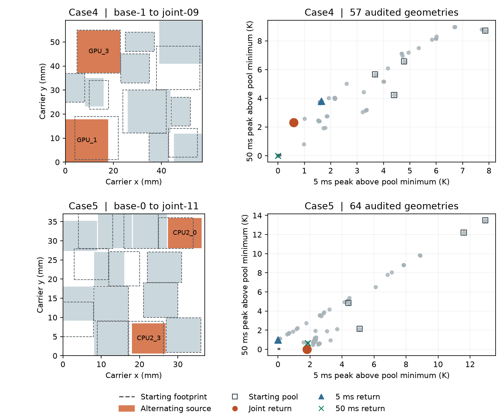

# 从相互冲突的负载生成布局

## 搜索前约定

本机 fetch 后与 GitHub 一致，起点 `a13d5e44e451f2aaecf8cd72e0f7b9010875a688`。使用上轮筛出的两个冲突实例，在 Case4 的 GPU_1、GPU_3 以及 Case5 的 CPU2_0、CPU2_3 上做 5 和 50 ms 等时反相负载。每例固定原有载板、网表、逐芯粒平均功率与瞬时总瓦数。净间距 100 µm，原引脚 Manhattan 总距离上限不变。原预算内几何使用既有最近位置修复，重新计算距离，不合规的修复剔除。

对每种工况计算原合规池最佳峰温，冻结为设计目标。三个搜索从同一组坐标中按各自目标选起点。联合搜索的目标为两种工况中较大的“峰温减对应目标”；两种单工况对照各自只看一个时长。每次从当前布局中找出所见目标超额最大的工况，以该工况下芯粒表面的最高周期温度指导已有热点移动与位置修复算子，每次提交唯一、合规的新几何。候选接受和最终选取沿用各自目标；平手时依次看所见超额之和与距离。三臂均用同一个种子 20261119，同一移动算子、筛选和每臂 24 次新增“布局 × 工况”热评价额度，即联合至多 12 个新几何，每个单工况至多 24 个。所有共同起点的评价、仅用于报告的盲评另记。每次寻找合规提案最多 256 次，若全部失败则报告实际额度。局部生成器与单种子限制可达候选集合。

搜索使用标称边界、32 档网格、每半周期 4 个后向欧拉子步。搜索结束后锁定各臂返回值。对原几何及各臂全部新几何，用 64 档/8 子步重算 5、50 ms，外加未给搜索器的对数中点时长；每个峰温用独立逐步回放核对。主指标为同一距离预算下相对扩大后公共池逐工况最优的最大损失。同时报告原目标是否可同时达到（0.1 K 容限）、达到时最短引脚总距离，单工况搜索结果在另一工况的表现，以及对每臂所生成几何共同重选时的结果，以区分候选生成与选择。公共池结果属于事后比较。细网格用自己的原池/共享池基准。未引入时间相关封装功耗、详细布线或时序模型。

## 物理与决策依据

给定坐标和朝向后，局部热容储存能量，导热与对流把能量传给周围。离散方程为 $C\dot\theta+G\theta=P(t)$，其中 $\theta$ 是相对环境的温升。两种负载的平均功率图相同，线性模型在周期稳态下给出相同的平均温度场。热源轮换时，5 ms 和 50 ms 能形成不同的局部温度摆幅；对空间和相位取最大，偏好的几何就可能改变。对每个提案重建几何贴合网格、热容和导热矩阵。用温度最高的芯粒指导既有推移、对换或旋转操作，邻近芯粒的移动概率使用其平均瓦数；能量平衡和最高温由封装模型求解。固定的引脚 Manhattan 距离上限计入朝向和源网表的每一对引脚。

设 $P$ 为当前预算内已评价布局，$t_s(P)$ 为工况 $s$ 在这个集合中的最低峰温。产品若有明确的温限，直接用该温限；本实验用原有布局的 $t_s(P)$ 冻结设计目标。**能否在两种工况共同交付**取决于是否存在同一个布局 $x$ 满足每一个 $T_s(x)\le t_s(P)+\epsilon$。候选空间扩为 $Q\supseteq P$ 后，任何已经满足这些固定温限的布局仍然达标。若要追问新几何是否还值得按工况专门设计，就需用 $t_s(Q)$ 重算最坏损失。对任何被考察的布局有

$$T_s(x)-t_s(Q)=[T_s(x)-t_s(P)]+[t_s(P)-t_s(Q)].$$

右侧第二项是新布局将该工况的最佳峰温压低了多少，恒非负。因此共同达到了旧温限与足够接近新工况最优是两个可以各自验收的问题。这个关系适用于任意以小为优的标量物理指标和非空嵌套可行候选集。最小化最大损失是既有的鲁棒优化准则。本次检验的研究问题是，在相同物理评价额度下，按当前超额最大的工况生成布局，能否找到兼顾冲突负载的真实坐标。三个搜索结果使用同一套精细热模型评价，与文献中统一末端评价器的实践一致。[最小最大损失定义](https://www.sciencedirect.com/science/article/abs/pii/S0167637703000919) · [TACPlace 的布局对比方法](https://doi.org/10.1145/3716368.3735185)

## 两个冲突实例的本地结果

**同一设计能否达标，和为每种工况分别设计还能省下多少温升，随候选扩大的变化方向可以不同。** 两例均从没有布局达到原联合温限，变为有多个新布局达标。允许专门设计的价值，在 Case4 随新布局的出现而消失，在 Case5 却从 0.691 K 增至 0.988 K。这里的价值指已评价集合中的最小最坏损失。全体工况和设计空间都要指定，才能说一种负载信息是否值得保留。

每例由四个满足 100 µm 间距的起始布局出发。Case4 原布局 2 修复后达 319.927 m，Case5 原布局 5 达 180.517 m，超过各自原上限，未进入搜索。源功率 Case4 合计 803.75 W，GPU_1 和 GPU_3 各以 ±120 W 等时反相变化；Case5 合计 465 W，CPU2_0 和 CPU2_3 各以 ±60 W 变化。搜索从各自所见目标最好的起始布局出发，所有臂都用完 24 次新增布局×工况评价。Case4 和 Case5 分别用 8 次共同初始化评价，搜索后分别做 171、192 次细网格布局×工况回放。两例共 121 个不同引脚布局，其中 Case4 有 47 套不同的具名芯粒矩形，Case5 有 64 套；芯粒转向可改变引脚位置而保持热源矩形相同。

| 网表、总引脚距离上限 | 原池最小最坏损失 → 扩大后（K） | 满足原温限的布局 | 其中最短距离（m） | 满足新池 0.1 K 容限的布局 | 其中最短距离（m） |
| --- | ---: | ---: | ---: | ---: | ---: |
| Case4，319.434 m | 0.720 → 0.000 | 0/4 → 35/57 | 241.545，short-12 | 3/57 | 292.660，long-24 |
| Case5，179.890 m | 0.691 → 0.988 | 0/4 → 41/64 | 141.407，long-08 | 0/64 | 未达到 |

每列温限都在两个时长分别检查。原池 5/50 ms 最低峰温为 Case4 的 90.551/91.272 °C 和 Case5 的 94.417/97.014 °C；扩大后分别降至 86.869/87.045 °C 和 90.013/94.890 °C。固定门槛与重算门槛均各加 0.1 K。比较损失时使用未加容限的逐工况最低温。Case4 的 long-24 在全部三个已算时长都达到公共池最低温。Case5 的 short-24 在 5 ms 最高效，joint-11 在 50 ms 和盲测的 15.81 ms 最凉。

### 算法真正交付的布局

下表给出搜索在粗网格上锁定的**同一布局**重放后的结果。15.81 ms 未给搜索器。最坏损失只在两个训练时长上取最大，并统一使用各自网表的扩大候选池作基准。

| 网表 | 搜索目标、返回布局 | 引脚距离（m） | 5 ms（°C） | 50 ms（°C） | 最坏损失（K） | 15.81 ms 损失（K） |
| --- | --- | ---: | ---: | ---: | ---: | ---: |
| Case4 | 联合，joint-09 | 292.676 | 87.464 | 89.359 | 2.314 | 1.003 |
| Case4 | 5 ms，short-21 | 242.883 | 88.511 | 90.849 | 3.803 | 2.483 |
| Case4 | 50 ms，long-24 | 292.660 | 86.869 | 87.045 | **0.000** | 0.000 |
| Case5 | 联合，joint-11 | 149.090 | 91.834 | 94.890 | 1.821 | 0.000 |
| Case5 | 5 ms，short-24 | 164.728 | 90.013 | 95.877 | **0.988** | 0.726 |
| Case5 | 50 ms，long-14 | 145.586 | 91.861 | 95.553 | 1.848 | 0.497 |

两例联合返回值相对各自起始布局在两个时长均降温。Case4 从 91.271/91.272 °C 降至 87.464/89.359 °C，改变了 5 颗芯粒的中心位置。Case5 从 95.108/97.014 °C 降至 91.834/94.890 °C，移动了 8 颗芯粒并转动 1 颗。在同一个新池基准下，单靠原有几何重选的最小最坏损失分别为 4.403 和 4.848 K。

把每种搜索实际生成的所有布局都拿出来，用细网格事后挑选最佳折中，Case4 联合、短时长、长时长候选池的最坏损失分别为 2.314、3.660、0.000 K，Case5 为 1.821、0.988、1.584 K。细网格重选也无法让联合搜索在两例领先。每臂评价次数相同，但联合生成了 12 个新引脚布局，单工况分别生成 24 个。事后截取三种搜索各自前 12 个提案，沿用当时粗网格所选布局，Case4 三臂的细网格最坏损失依次为 2.314、3.753、2.446 K，Case5 为 1.821、1.651、2.327 K。这项描述性对照显示结论会随资源计量改变。起点也由各自目标选择，现有证据支持比较端到端策略，无法单独归因于移动方向。单种子、每例一个预选冲突位置对及标称封装只覆盖本轮条件。



左图虚线为联合搜索起始布局，色块为返回布局，橙色标出交替活动的两颗芯粒。右图越靠近左下角，两种工况兼顾得越好；原点旁边的小方框表示两种损失都在 0.1 K 内。详细布线可达性、链路时序和实物热边界仍需各自的证据。两个活动时长与一个中间时长不能保证连续谱上的排序。

### 验收与复现

为解释排序，另从四个已锁定的布局重取各芯粒的周期峰温。这八次诊断使用细网格，均复现档案中的全局峰温。Case4 的 joint-09 和 long-24 均在 5 ms 时由功率恒定的 GPU_0 达到峰温，50 ms 时热点转至交替活动的 GPU_3。Case5 的 joint-11 热点由恒定功率的 CPU2_1 转为活动的 CPU2_0；short-24 则在两种时长均由 CPU2_0 达到峰温。可用驱动中的 `measure` 对发布坐标计算 `die_peaks_c`，按各场景行取最大值及其芯粒编号复核。平均功率、活动芯粒名称和连接需求在两个时长完全相同。

全部 363 个细网格几何–工况组合在本机独立按时间步回放。频域与时域峰温最大差 8.53×10⁻¹³ K，最大周期闭合误差 2.43×10⁻¹² K，每步最大储热、散热与输入功率余额低于 6.0×10⁻¹⁰ W。Case5 八个原起点–时长结果与先前的正间距试验相差不超过 1.5×10⁻¹⁴ K。这些检查共用封装和离散方程。几何、预算和每次热评价可根据发布的坐标、朝向与轨迹分别核算。[Case4 全部坐标与温度](evidence/conflict-directed-layout/case4.json) · [Case5 全部坐标与温度](evidence/conflict-directed-layout/case5.json)

使用此前导入的 ATPlace 案例目录 `CASES`，输入摘要保存在每个结果开头。预注册提交为 `e811c62b3f77f75df0caf875f8c48f14871ba54f`。从库根目录设置 `PYTHONPATH=src`，并将 `OPENBLAS_NUM_THREADS` 与 `OMP_NUM_THREADS` 均设为 1。可用下列命令复现数值与图。

```sh
python tools/conflict_directed_layout.py --cases "$CASES" --case Case4 --output results/conflict/case4.json
python tools/conflict_directed_layout.py --cases "$CASES" --case Case5 --output results/conflict/case5.json
python tools/plot_conflict_layout.py --cases "$CASES" --evidence results/conflict --figure results/conflict/layouts.png
```

本机全套 203 项单元测试通过。双芯粒 CLI 校验与评估均通过，参考功率 3 W、峰温 34.1886 °C。

### 独立 Chat 复核

确认远端为 `5824a47e0ad41b2516e38b139b58f07be2a87618` 后，新 Chat 会话通过已连接的 GitHub 读取从 `a13d5e4`、`e811c62` 到该提交的历史、本文、决策代码、实验驱动及两份逐布局 JSON，给出有条件通过。它从证据复算了每臂 24 次评价、原温限的 35/57 和 41/64、新温限的 3/57 和 0/64、各臂实际返回布局的最坏损失以及留出时长的损失。审核为静态复核，热求解只在本机执行。

审阅认可将实际交付与细网格事后重选分开。所见收益由所选起点、移动过程和每次工况求解的成本共同决定。若要判断优先处理冲突工况是否改善候选生成效率，下一项对照应固定同一个起点和同样的几何提案数，分别报告前沿与热评价次数。审阅者还建议比较种子间变化，本项目沿用单种子开发约定。[Chat 原始审核](https://chatgpt.com/c/6aff0108-73c0-83e8-aed7-f7e5d99dca50)
