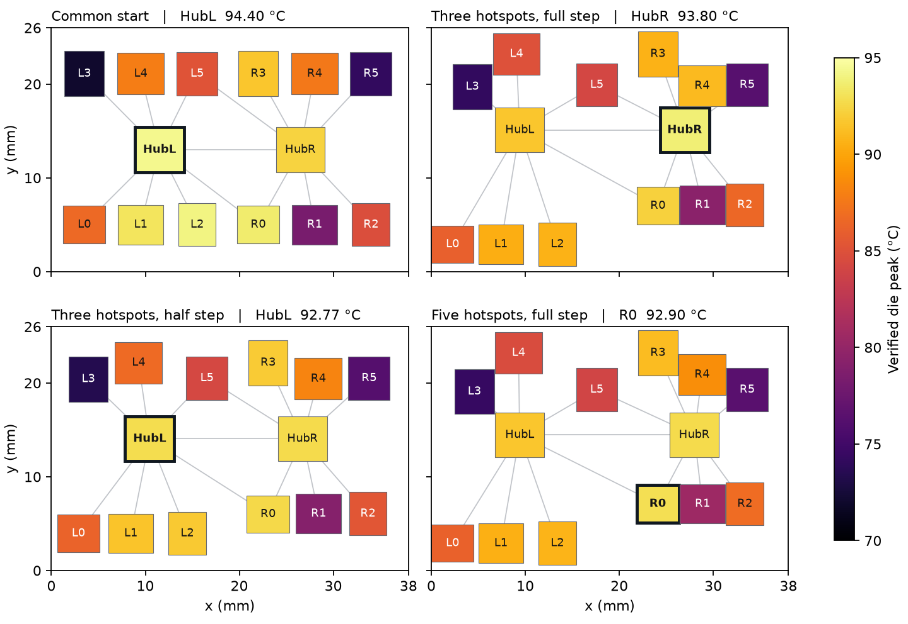

# 连续联合位移中三个与五个热点的对照

## 温度实验前的约定

远端与本地起点均为 `5cfb746`。主基线为严格半径的五热点连续联合位移。唯一的消融把起点实测芯粒峰温排序的前五颗改为前三颗，同温按输入次序。观测集合在起点选一次。两臂都放开每颗芯粒的两个平移坐标，共用铜半空间梯度、固定朝向与矩形分离关系、相同的最小最大温度线性规划、最小总位移平局规则和 1 µm 落点网格。每轴半径为芯粒短边中位数的一半，求方向及最终投影均执行。依次尝试全步、半步，遇到不可行或重复就跳过，保留起点及已核验最佳解。

Case7、Case8、Stagger12P 继承上一阶段的全部输入。新留出网表 DualStar14 有两颗枢纽，各连六颗异构叶节点，另有一组枢纽互连和两组跨簇连接。200 条信号有固定独立引脚，最小同芯粒引脚中心距 84.835 µm。局部链限 16 mm，枢纽链限 20 mm，跨簇链限 25 mm。共同起点的引脚曼哈顿总长 1.7137950888 m 作为上限。已仅根据几何核对起点全部准入条件。它是为本轮预先构造的合成测试，不进入方法选择。[留出输入](../examples/DualStar14) · [坐标、哈希与逐信号上限](evidence/continuous-hotspot-holdout.json)

单种子 20261119，全部在本地执行。每臂从共同起点开始，最多两次新整板核验，整板均使用同一八层稳态模型、64 目标分辨率。主指标为相同总长、逐信号引脚距离、间距、截面与引脚逃逸容量约束下的最低已核验峰温，另报该点互连长度及不高于起点峰温时的最短已见互连。原作者 ATPlace2.5D 使用上一阶段固定的提交和配置，共同起点、五个额外降阶训练标签、100 轮训练、10 个布局优化步、30 s 末端合法化及相同可行化接口。记录训练失败与修复。

每个方法从新 Python 进程启动计时到结果落盘并退出，包含输入、起点整板、搜索、核验和外部训练。逐臂串行，三点和五点在相邻案例交换先后，外部法另列。比较每例实测差值，不把单次用时视为可重复的加速比。保留实际新热点落在观测集外、更少热点带来更高峰温、以及三点并未节时的情形。不增加核验来挑选胜例。此前三例的严格五热点历史坐标用于回归检查。

## 四张网表的三方法比较

共同起点之外，每臂最多两次新整板核验。温度与秒数均来自本轮本地冷启动，每臂独立重算起点。温度取已准入且已核验的最佳布局。三点和五点每例均使用两次。ATPlace 四例均完成作者训练与原生优化，每例另用五个降阶标签，原生出口均需投影。Case8 唯一获准的新点为 84.52682 °C，中点投影没有返回合法网格坐标，实际用一次；其他三例各用两次。全体核验中的最大热收支误差为 7.38×10⁻¹¹ W。

| 网表 | 总长上限 m | 起点 °C | 五点 °C / s | 三点 °C / s | ATPlace + 可行化 °C / s |
|---|---:|---:|---:|---:|---:|
| Case7 | 40.447734021 | 80.68942 | 79.05405 / 1.745 | 79.05405 / 1.626 | 80.68942 / 542.097 |
| Case8 | 43.357548061 | 80.47560 | 78.97854 / 2.080 | 78.97854 / 2.065 | 80.47560 / 714.301 |
| Stagger12P | 1.491328000 | 113.99209 | 110.84223 / 0.886 | 110.84223 / 0.892 | 111.77057 / 118.408 |
| DualStar14 | 1.713795089 | 94.40333 | 92.90275 / 1.014 | 92.77067 / 1.087 | 94.40333 / 161.018 |

每格先列上述最低峰温布局的线长，再列峰温不超过共同起点时的最短已见线长。两个指标分别从同一方法自己的核验记录中读取。

| 网表 | 五点 m | 三点 m | ATPlace m |
|---|---:|---:|---:|
| Case7 | 40.443516 / 40.356924 | 40.443516 / 40.356924 | 40.447734 / 40.447734 |
| Case8 | 43.352290 / 43.305314 | 43.352290 / 43.305314 | 43.357548 / 43.357548 |
| Stagger12P | 1.491320 / 1.489282 | 1.491320 / 1.489282 | 1.491274 / 1.489652 |
| DualStar14 | 1.713787 / 1.709887 | 1.711681 / 1.711681 | 1.713795 / 1.713795 |

[完整逐臂证据，包括核验坐标、热场峰值与训练记录](evidence/continuous-hotspot-results.json)

在这四个案例、这一小预算的冷启动适配下，五热点布局均比外部法已见最好结果更冷，三热点也如此。ATPlace 四例合计 1535.8 s，包含了产生五份降阶标签、从零训练及限时合法化的成本。三点法和五点法不训练模型。本比较没有测试预训练模型在多次任务间摊销后的用时。留出例三点的最冷布局同时比五点最冷布局少用 2.106 mm 总长；在起点温度上限下，五点已见最短解则比三点短 1.794 mm。

## 为什么三点有时与五点产生完全相同的布局

对联合位移 $u$，第 $i$ 个观测芯粒的近似温度为 $t_i(u)=T_i(0)+g_i^T u$。其中 $g_i$ 根据其他芯粒的功率和相对位置，从铜半空间热源解求导。设 $u_3$ 是三行目标的连续最优解。若第四、第五行在 $u_3$ 处都不超过前三行的最大值，则 $u_3$ 同时取得五行目标的最优值。理由是增加两行一方面只能抬高最小最大值，另一方面原解仍能达到原值。重复最优解、投影取整和模型误差仍会影响实际落点与峰温。

在已核验的三点**全步网格坐标**上事后计算“前三行最大预测温度减第四、第五行最大预测温度”，Case7、Case8、Stagger12P 依次为 +1.367、+0.024、+9.246 K。三张旧网表的两种方法均逐坐标复现历史五点全步和半步，且全步分别有 28、36、12 颗芯粒实际移动。Case7 的 CPU2_1 与 Case8 的 CPU1_9 都能在移动后接替起点最高温芯粒，两者原本就在各自前三行里。[原五热点坐标](evidence/continuous-generator-replay.json)

DualStar14 在同一检查中得到 −0.544 K。三点全步动了 14 颗，起点第五的 HubR（92.279 °C）成为新的实际最热点（93.801 °C），同期前三颗的最高实测温度仅 92.215 °C。代理还误排了全、半步，预测分别为 92.148、93.275 °C，核验分别为 93.801、92.771 °C。五点法把 HubR 纳入目标，实际全步为 92.903 °C，最热芯粒换为 R0。五点全步比三点全步冷 0.899 K；两臂用完同样的两次核验后，三点半步反而冷 0.132 K。该结果同时保留了漏报热点、错排步长和最终最佳点三个不同的现象。



每颗矩形按该布局下芯粒内部的最高温度着色，四幅图共用色标。黑框标出该布局的实际最热芯粒，细灰线表示网表中直接相连的芯粒对。

三点法四例合计 5.670 s，五点法 5.724 s，差 0.055 s（0.96%）。三点在两例较快、两例较慢。两种方法生成布局的总时间均为 0.218 s，减少两行目标后，线性规划仍要求解全部坐标、满足全部几何与引脚约束，三维整板的网格规模也相同。这次单次计时没有显示稳定的总时间收益。机器为 i7-12700，实验进程固定同一个逻辑处理器，数值库与作者训练器均配置单线程；完整回归同时在与实验分开的逻辑处理器上执行。

### 为什么外部法的两次单种子结果会不同

逐例比对上次与本次独立冷启动的源文件、降阶标签、送入终端合法化的连续坐标，三例均得到相同输入、相同标签和逐坐标零差。Case7 上次加线长权重的限时合法化未返回解，改用位移目标，本次加权求解返回了解。修复并核验后，上次最好为 79.43675 °C；本次两个新点为 82.78365、81.53750 °C，因此保留 80.68942 °C 的起点。Case8 上次两次原生合法化均失败，转用末端连续坐标投影，获得 80.46035 °C；本次位移目标返回了解，最终保留 80.47560 °C 的起点。Stagger12P 重现上次的 111.77057 °C。保留历史较强结果，不在两次运行之间拼接预算或选择赢家。[核对用哈希、合法化消息与结果](evidence/continuous-hotspot-atplace-history.json)

本轮结论限于固定朝向和矩形相对次序的布局单元。整板核验重新计算每张布局的热源与材料，模型含封装边界与自热。0.132 K 是该离散模型给出的差分；本阶段没有测量其网格或实物不确定度。引脚曼哈顿长度、截面和逃逸容量是可布线的必要检查，实际详细布线与电气时序尚待验证。

## 本地复现

使用主项目 Python 环境和作者 ATPlace2.5D 固定提交 `fe3dbfd` 的独立 CPU 环境。用仓库现有导入器生成 Case7/8 的输入，另两张合成网表直接读取版本库。编排器依照冻结次序启动 12 个独立进程；输出保存每个起点与实际落点、逐芯粒峰温、线长、准入、方法阶段耗时和冷启动总耗时。

```powershell
$env:PYTHONPATH = 'src;tools'
$env:OPENBLAS_NUM_THREADS = $env:MKL_NUM_THREADS = $env:OMP_NUM_THREADS = '1'
$experiment = 'results/replicate-hotspot-count'
$upstream = 'local/atplace-local-baseline'
python tools/import_atplace_cases.py --source $upstream --output "$experiment/source"
python tools/compare_continuous_hotspots.py --source "$experiment/source" --upstream $upstream --atpython local/atplace-env/Scripts/python.exe --work "$experiment/cold" --output "$experiment/result.json"
```
