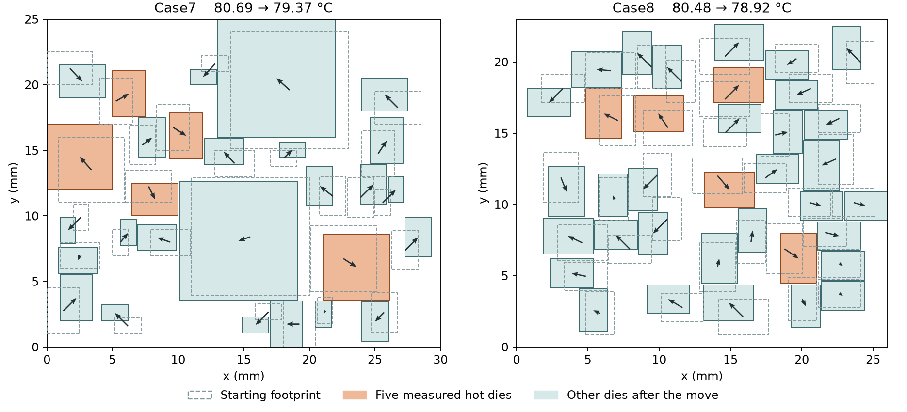

# 连续坐标下的受限散热布局

**结果。** 两个有可行起点的 ATPlace 案例中，先按引脚与几何生成候选、再按温度选取，都保留了起点。改由五个起点热点的带符号温差直接求联合位移，在相同逐网距离和总长上限下，两种温差模型均能降温。只用均匀铜半空间的点源公式，Case7、8 分别降了 **1.63534、1.49730 K**；使用封装伴随分别降了 **1.31713、1.55425 K**。两种导数各赢一例。Case1 在给定引脚、四种朝向、2 mm 逐链距离和 100 µm 间距下，几何上已经无解。三个案例只使用一个种子。



| 方法 | Case7 可行峰温 °C / 该点总长 m | Case8 可行峰温 °C / 该点总长 m | Case7 / 8 从头用时 s | 每例新整板 / 响应 |
|---|---|---|---|---|
| 共同起点 | 80.68942 / 40.44773 | 80.47560 / 43.35755 | 11.79 / 0.50 | 0 / 0 |
| 缩短预算的 ATPlace 原生初始化和优化，允许保留共同起点 | 80.68942 / 40.44773 | 80.47560 / 43.35755 | 1004.46 / 117.96 | 1 / 5，0 / 5 |
| ATPlace 坐标加逐网修复，Case8 加共同起点恢复 | 80.68942 / 40.44773 | 80.47560 / 43.35755 | 1004.80 / 737.02 | 2 / 5 |
| 连续 relation_space 默认阶段分配，出口验逐网 | 80.68942 / 40.44773 | 80.47560 / 43.35755 | 15.27 / 4.74 | 2 / 0 |
| 连续 relation_space 短端配置，评温前验逐网 | 80.68942 / 40.44773 | 80.47560 / 43.35755 | 15.31 / 4.28 | 2 / 0 |
| 加可达约束联合生成，按总长选择 | 80.68942 / 40.44773 | 80.47560 / 43.35755 | 15.39 / 5.05 | 2 / 0 |
| 同十个合法候选，按候选自己的三维投影选择 | 80.68942 / 40.44773 | 80.47560 / 43.35755 | 15.93 / 5.58 | 2 / 10 |
| 起点封装伴随直接生成联合坐标 | 79.37229 / 40.44131 | **78.92135 / 43.35139** | 13.19 / 2.86 | 2 / 5 |
| 同一生成器，均匀铜半空间点源导数 | **79.05408 / 40.44183** | 78.97830 / 43.35200 | 12.71 / 2.04 | 2 / 0 |

**外部参考的原始出口。** Case7 原生 ATPlace 在 10 s 合法化失败，30 s 重试后导出 **78.88181 °C**，低于表中所有 Case7 合格解。该点总长 **51.62201 m**，760 条网超距，最长 36.60620 mm。原生朝向和分离关系内的投影未给出可行点。在共用起点的单元中修复，得到 32.12329 m、零超距、82.67811 °C。Case8 原生初始化在 10 s 和 30 s 均没有给出坐标。让作者优化器使用同一个合法起点后完成了十次解析迭代，加入总长上限的加权合法化超时，原生仅按位移的回退给出 80.39538 °C、45.66310 m、94 条超距。沿其导出朝向修复后，总长 42.74055 m、零超距、81.85902 °C。两例的最冷合格保留点均为起点。五个约化训练标签包含四个拟合、一个留出，原生采样超时后采用共同构造采样。留出温度场 MAE 分别为 1.416、1.438 K，这是相对约化标签的单张误差。计时包含训练、失败重试、合法化、起点构造及三维评分，Case8 恢复另花 618.04 s；这些是单次本机短预算的端到端数值。原生 ATSim 与原论文的算法速度、峰温和最优性不能由此推出。[原生流程与原始坐标](evidence/continuous-reach-external.json) · [共同起点恢复](evidence/continuous-reach-warm.json) · [可行化后的坐标与计时](evidence/continuous-reach-native-repair.json)

两种关系空间都从现有入口运行，固定 MILP 为 2 s、8 次退火步、2 条链。默认阶段分配在 Case7 提交的两点分别有 42、44 条超距；模型峰温也高于起点。Case8 的两个提议均可行，却分别为 85.35244、84.97888 °C。按更紧的引脚约束先生成，再用简化三维响应排名，在 Case7、8 找到的最冷新点分别为 81.81361、83.81734 °C，仍高于共同起点。十张图都能联合移动，单靠成组移动并不足以降温。[连续候选及共同评分](evidence/continuous-reach-results.json) · [关系空间默认配置和逐格出线复核](evidence/continuous-reach-baseline.json)

热响应直接选坐标时，Case7 对 CPU2_0 等五颗最热芯粒建模，Case8 的最高点在 CPU1_1 上。两个整步都保持全部芯粒角色和朝向，28、36 颗均有位移；每个坐标的设计半径均为 1 mm。总曼哈顿位移为 44.962、51.301 mm。半步在两例也降温，各自达到 79.85751、79.48223 °C；在起点峰温限制下已见最短总长分别为 **40.32588、43.30563 m**。整步才是最低温点。两张最冷图的最长单链均约 24.998 mm，全部逐网超限数为零。Case7 的 352 条短档、2,464 条长档均单独验收；Case8 的 2,948 条网均为长档。两张图最大整板切线占用率分别为 10.21%、13.48%，最大单格周界出线率为 5.07%、3.80%。这里的两种切割都只是所声明布线资源的必要条件。[完整坐标、热点身份与能量平衡](evidence/continuous-reach-hot-move.json)

### 可以推广的规律及其边界

把赢家中每颗芯粒的实际位移单独应用于原起点，可直接问哪些运动需要跟随。Case7 的 28 个单动中只有 9 个通过同一几何、逐链和总长检查。CPU2_1 的位移为 (+0.999, −0.643) mm，单动会让 88 条信号超距，最差超出 1.640 mm，并碰到 Analog_6 与 MEMS_3；成组后零超距。Case8 的 36 个单动只有 5 个通过。最热的 CPU1_1 单独朝 (−0.677, +0.999) mm 移动就会碰到 CPU1_7 和 Analog_5。由此能确认这些方向至少需要部分跟随者，完整的最小跟随芯粒集合仍未知。毫米级连续解为避免病态薄网格按 1 µm 输出；在上限边缘的修复后，两个赢家的最大单轴实际位移均为 1.001 mm。[每颗芯粒的单动反事实](evidence/continuous-reach-hot-move.json)

曼哈顿距离不超过 R 等价于对所有四个符号方向 s，满足 s·(引脚一 − 引脚二) ≤ R。朝向固定时，它直接约束两颗中心的**相对**位移。若某个符号方向已经用尽余量，一颗继续拉开时另一颗就必须跟上。沿闭环把这些不等式相加，中心位移全部抵消，约束右端之和为负的环可以排除整个朝向组合。Case1 进一步对每一对相碰矩形检查四种分离方式，连 2.010 mm 的放宽复算也得到相同的九组朝向和 53 个几何节点，无需热求解。这个结论限定在原始引脚、规定的正交曼哈顿路径和净间距下。

在仍可移动的几何单元里，给每处热点保留其起始温度与上升余量。共同位移对第 i 处的一阶影响是各芯粒带符号影响之和。直接最小化这些位置里**最热的那个预测值**，再重建新布局的热路核验，方向才得到物理检验。起点导数省略了移动材料对热导的变化，整步分别低估真实峰温 **1.03442、1.51378 K**。能够找到更冷的点并不使导数成为热界。

还可以直接计算哪些跟随位移不可避免。固定朝向，令某条引脚约束在符号方向 s 上的距离余量为 r。若上游芯粒位移为 d，则下游在同一方向的位移至少为 s·d−r。沿路径累加余量，取余量和最小的路径，正下界除以 |sₓ|+|sᵧ| 就得到下游在至少一个坐标轴上必须移动的距离。用四组有向最短路即可同时处理所有芯粒。再保留起点矩形分离方向时，水平和垂直间隙亦可传递。在 Case7，如果 CPU2_1 走赢家中的向量，仅凭引脚就要求 CPU1_3 至少移动 **0.820 mm**；保持矩形分离关系还要求 Analog_6、MEMS_3 分别至少移动 0.643、0.299 mm。Case8 的最热芯粒 CPU1_1 没有单凭引脚即可判定的跟随者，在原单元内却要求 CPU1_7、Analog_5 至少移动 0.277、0.599 mm。这里的充分证据是正下界；零下界仍可能被总长等其他条件限制。表中逐芯粒记录阈值为 1 µm。全过程只读已核验坐标，无热求解。[逐颗必需跟随量下界](evidence/continuous-reach-hot-move.json)

对任一候选自己的 SPD 离散方程，用试温场 v 计算 `2 bᵀv − vᵀAv`。从真实源加权温升能量中减去这个量等于 `(T−v)ᵀA(T−v)`，恒非负，T 此处为真实温升。除以总瓦数并加环境温度即可给峰温下界。十个几何候选中，两次核验后最多还可能漏 14.8560、13.9398 K。该界没有覆盖追加生成的坐标。对整个连续域，顶面对流必须带走全部输入功率，最高功率层温度至少为环境温度加 `P/(h A_top)`。仅按封装伴随臂的解换算，两例仍可能再降至多 **32.0323、31.7614 K**。这一保证很松，本轮没有判定全域近优。公开原论文也将十个案例明确称为构造基准，相关结果属于规定模型内的数值实验。[ATPlace 案例定义与流程](https://yibolin.com/publications/papers/PLACE_ICCAD2024_Wang.pdf)

墙钟包括从几何准入开始的单次实测，其中 Case7 共用几何修复 11.443 s，Case8 为 0.121 s。各内部臂扣除这项即可得到复用冻结起点时的时间。Case7 的限时混合整数修复可返回不同可行点，实验以已发布的坐标和上限为准。原方法保留全部采样、超距和未改善点。所有比较基于同一单种子，机器上外部与内部作业的执行区间有重叠，秒数只说明这次开销。并行作业均在本机。

## 研究问题与测温前协议

ATPlace 的公开算法联合优化连续坐标、朝向、总引脚距离和温度，并在末端合法化。论文报告的约 1.2 °C 平均误差和 2,575 倍加速针对紧凑模型相对 HotSpot 的热评价。已有跨层 2.5D 研究也联合考虑布局、布线、链路电路和热约束。这里可检验的算法贡献是把逐引脚约束写进联合搜索，并在材料随位置变化时给出有明确范围的界。既有 Case1–8 的温度与线长历史比较、固定槽位的认证率、本文的严格可达可行域分别保存。[ATPlace 原论文](https://yibolin.com/publications/papers/PLACE_ICCAD2024_Wang.pdf) · [Coskun 等的跨层优化](https://people.bu.edu/joshi/files/interposer-nw-iccad-2018.pdf)

给定每颗芯粒的身份、矩形、功率、局部引脚、载板和散热条件，在逐链可达、总长、边界、非重叠与 100 µm 间距都满足时，连续移动哪些芯粒能降低八层三维模型的功率层峰温？精确热分析只花在可能入选的合法点上。芯粒移动会改变材料占用与网格；每一次终点评分重建热路。起点热路上的少量响应只用于预测连续位移的方向。对三维全连续域只报能证明的保守下界，另列选中点的线长、关键链违例、容量必要检查、固定起点温限下最短已见距离、求解次数和实测墙钟。

本机已 fetch 到 `7183a9a`，GitHub 无更新。只在本机运行。事前选择作者 Case1、7、8，分别有 6、28、36 颗不同尺寸的芯粒，实际空白面积分别约 39%、53%、58%。固定作者额定功率、每个引脚的身份和局部坐标。各例采用原载板、环境 45 °C、既有均匀顶面对流的共同八层模型和种子 20261119。论文表 3、4 把 Case1 定为先进 ×32，把 Case7、8 定为标准 ×16。采用 UCIe 1.1 的通道跨度，先进档 2 mm，标准档 10 mm 和 25 mm；在标准案例中，两个端点都属于 Analog 或 MEMS 时指定短档，其余指定长档。该逐链分配是待测设计要求，源网表没有标注实际收发器终端配置。规范的通道长度用于检查源引脚间的曼哈顿必要条件。各信号网络单独核对。另报告所声明 1 mm 网格、水平/垂直各一信号层、2 µm 轨距下的必要布线占用量。几何合格不等于电气或详细布线签核。[ATPlace 原论文](https://yibolin.com/publications/papers/PLACE_ICCAD2024_Wang.pdf) · [作者案例](https://github.com/PKU-IDEA/ATPlace_pub/tree/fe3dbfdaf78dc0ddeac3a2cfc3a85ff0971f88df/cases) · [UCIe 1.1 表 1-1 和 1-2](https://tmng-al.uspto.gov/resting2/api/casedoc/cms/case/99231699/tmdocument/20250612064611159321SPE0011.pdf)

先从历史几何起点构造共用合法初始布局，读取引脚、长度与外形，不依赖热标签。保持该起点总长或更短。原起点不可达时，在固定姿态及一个防重叠关系单元内修复，优先小位移；可用其他已有几何关系作确定性回退。将实际初始坐标、朝向、逐网档位、源指纹及总长写出后才评温。找不到起点的案例报告违约与证明范围，保留原约束。

四臂为作者初始化的 ATPlace 热感知流程、历史连续 `relation_space`、关系空间加引脚约束引导的联合移动、同一联合移动再用温差与余量排序。后两臂使用相同连续几何提议、统一小预算；纯几何按短线，热臂先比较预测峰温再比线长。三个内部臂每例至多两次新三维核验、十个热响应，起点一次共用。外部参考使用作者代码、短训练及原生初始化，五张按各自三维热路约化得到的训练/留出标签单列成本，最终出口与共同起点接受相同审核；记录失败和耗时。只在本模型、可行条件、预算及实测坐标内比较。空间移动需重建热路时，保留未判清的三维余量。先前固定槽位结果只用来解释数值界的适用条件。

### 几何验收与变热路的计算口径

测温前冻结了每条网的上限与准确起点。Case1 先用 (u=x+y,v=x-y) 的引脚差分约束排查 1,024 组相对朝向，仅九组不产生负环。对九组再按冲突矩形的四种分离方向完整分支，53 个线性可行性子问题全部排除，即使放开总长也无法同时满足全部 2 mm 连接和 100 µm 间隙。Case7、8 的历史起点分别有 572、332 条超距网络，纯几何修复后清零。新共同总长上限分别是 40.447734 和 43.357548 m。[冻结起点和逐网要求](evidence/continuous-reach-geometry.json)

在打开新起点温度前，把原协议中的热排序具体化。每个候选按自身材料位置装配同一个三维离散方程，在每层以约 4 mm 面内分区约束试温函数，做一次小系统投影并计一个响应，最多 10 个候选。排序用该场预测的功率层峰温。令 v 为提升回细网格的近似温升，任何试函数都给出严格下界 (T_a+(2b^Tv-v^TAv)/\sum b)，因为真实解使该二次式最大，功率加权平均温度也不超过峰温。它可给已生成候选集提供保守余量，避免在移动异构芯粒时误用固定薄板的证书。每次整板核验独立重新组装、求解完整热路。Windows 本机无作者 ATSim 所需 Linux 运行环境，作者热感知程序沿用原生初始化、拟合、优化和合法化，五份训练/留出标签用上述三维投影提供，各计一个响应。这样三维新整板核验仍最多两次。ATPlace 的原版论文结果和本机训练适配分列。

### 首次未降温后的几何诊断与追加协议

在原样保留第一次对照后，单独最大化两颗高功率密度芯粒在固定朝向、分离关系和全部引脚约束中的四向位移。Case7 的 CPU1_0 向下单动为零、协同可行 4.100 mm；Case8 的同名芯粒向左单动为零、协同可行 4.039 mm。两例相对位置确实改变。十个几何提议都动了全部芯粒，首次对照的投影使用最大坐标距离，许多跟随位移可以在同一目标值下并列。[逐方向证据](evidence/continuous-reach-mobility.json)

在查看追加方法的温度前，冻结一次由热响应直接生成坐标的检验。沿用同一起点、约束和种子。从起点精确热场取温度最高的五颗芯粒，分别求一次伴随。在线性可达多面体内最小化这五个位置的最大一阶预测温度，每个坐标最多移动中位芯粒短边长度的一半。再按同样最优预测最小化所有芯粒的绝对位移和，避免无热学理由的并列跟随。整步和半步各用一次独立三维核验，连同原点取最冷可行点。允许最多五个起点响应和两个新布局。实际功率和材料随芯粒移动，起点导数只指导方向，终端峰温与全域余量仍以三维真值和通用热守恒界为准。单机实测所有运行，保留失败点。

原始对照中的关系空间沿用上一阶段的短端几何配置，预算分配为 `lp_share=1`。另以相同初始化、种子、短端时间和两次新整板预算，从原入口运行默认 `lp_share=0.5` 的连续关系空间，在出口逐项审核引脚并计入所有实际整板费用，检查该阶段分配是否影响胜负。新赢家再作 1 mm 单格四周的必要出线检查；若有赢家被排除，保留原成绩并另报约束后的可行结果。

### 外部输出的等约束修复协议

Case7 原生 ATPlace 已导出一个低温、几何合法、逐网超距的解。为检验把外部解仅作事后淘汰是否掩盖了它的潜力，在读取任何修复温度和 Case8 原生终点前增加一个对照。保留原生输出的独立评分。把其位置作为目标，先在原生朝向和分离关系中求满足逐网和共同总长的最近坐标；该单元无解时，改在同一已冻结的共同起点单元内投影到这些目标。若原生末端合法化失败而解析坐标已保存，只能在共同起点单元内投影，明确标记来源。始终按最大单坐标偏差最小来接近原目标，两个单元都没有可用点则保留失败。只对首个通过全部几何检查的新投影作一次独立整板核验，原生导出与修复合计最多两次，训练仍使用五个约化标签。另报修复开销、单元来源和修复后的成绩。该附加臂是本项目对原生坐标的可行化，单列于原生流程之外。

如原生初始化在 10 s 和 30 s 两次均未返回坐标，在该例加一次共同起点的 ATPlace 对照。保留训练所得的同一模型、十步解析优化、原生转角和加权合法化，给加权合法器相同的总长上限与 30 s 时限。分别留下原生失败、共同起点热优化的输出及前述逐网修复，原始失败、共同起点、训练与修复均计时。共享起点的输出和投影共用两次新整板额度。

## 本机复现

### 同一坐标生成器的温差来源对照（测温前冻结）

几何候选排序与直接生成同时改变了步长、位移选择方式和热信息。两臂都从同一整板起点取最热五颗的温度，保留相同朝向、分离关系、1 mm 半径、逐网和总长约束、最坏预测峰温目标、最小总位移择优、整步与半步的两次新整板验收。只替换温差导数。低成本臂用均匀铜半空间表面点热源的温升 P/(2πkr)，取模型铜扩散板的 k=400 W/(m·K)，芯粒间距离用中心距离，忽略自热平移项及边缘效应，以实际起点温度锚定。它使用零个伴随和两个新整板。

`61952f5` 在打开点源结果前冻结了这项对照。在 Case7，点源法比五个伴随又低 0.31821 K；在 Case8，五个伴随低 0.05695 K。点源臂的半步也能降温，在共同起点峰温上限下其已见最短线长为 40.35692、43.30531 m。两张点源赢家的最大单格出线率分别为 5.07%、4.00%，修正三维热场后的最大功率不平衡低于 3×10⁻¹¹ W。对整个连续域，各方法中最佳实测点的剩余降幅上界更新为 **31.7141、31.7614 K**。这两例支持按热点与互连共同生成位移，在本预算内没有出现必须使用五个封装伴随才能降温的案例。0.05695 K 为声明离散模型内的差值，没有对应实物或网格误差界。[相同生成器的低成本对照](evidence/continuous-reach-half-space.json)

布局生成入口可直接用于另一张矩形双引脚网表。传入已有 `Problem`、合法 `Layout`、按网表顺序排列的每条距离上限（mm）和总预算（m）。返回的每个提议包含步长比例、完整位姿和一阶温度预测，供同一独立三维评价器验收。

```python
from chiplet_floorplanning.placement import heat_directed_moves

model, proposals = heat_directed_moves(problem, start, per_net_reach_mm, total_m)
```

使用固定版本的作者仓库、本文已发布的几何起点和一次种子 20261119。源文件可用仓库已有的 ATPlace 导入器从上游重建。设 `$cases` 为导入的目录，`$upstream` 为作者仓库目录，`$atpython` 为已安装作者依赖的 Python 3.9。共同的 FV 与以下主脚本使用项目 Python 3.12。

```powershell
$env:PYTHONPATH = 'src;tools'
$env:OPENBLAS_NUM_THREADS = '1'
$env:MKL_NUM_THREADS = '1'
$env:OMP_NUM_THREADS = '1'
$geometry = 'docs/evidence/continuous-reach-geometry.json'
python tools/compare_continuous_reach.py --source $cases --geometry $geometry --output results/continuous-local.json
python tools/continuous_hot_move.py --source $cases --geometry $geometry --output results/continuous-directed.json
python tools/continuous_hot_move.py --source $cases --geometry $geometry --gradient-model copper-half-space --output results/continuous-half-space.json
python tools/continuous_mobility.py --source $cases --geometry $geometry --output results/continuous-mobility.json
python tools/continuous_baseline_audit.py --source $cases --geometry $geometry --previous results/continuous-local.json --directed results/continuous-directed.json --output results/continuous-baseline.json
python tools/continuous_atplace_reference.py run --source $cases --geometry $geometry --upstream $upstream --atpython $atpython --work results/continuous-native-replay --output results/continuous-native.json
python tools/continuous_atplace_reference.py warm --geometry $geometry --upstream $upstream --atpython $atpython --work results/continuous-native-replay --external results/continuous-native.json --output results/continuous-warm.json
python tools/continuous_atplace_reference.py repair --geometry $geometry --work results/continuous-native-replay --external results/continuous-native.json --warm results/continuous-warm.json --output results/continuous-repaired.json
```

重做几何求解可运行 `python tools/continuous_reach_geometry.py --source $cases --output results/continuous-geometry.json`。以商业封装验证为目的时，仍需替换研究用逐链档位分配、封装材料与布线层设置，并提供对应实物或版图数据。以上排名不含封装 PDN、力学、RC 时序或详细绕障布线。

本机全套回归运行时发现 229 项并全部通过。另对新增部分集中运行七项，含完整回归发现后加入的路径余量传播与半空间导数检查。双芯粒命令行复算结果为 3 W、34.1886 °C。

## 独立 Chat 审稿

GitHub 确认 `0c6b5bb36ff2650b23d11a424f2fd1f630699950` 后，Chat 自主读取提交链、连续布局记录、几何与各臂 JSON、核心求解代码和测试。按 ICCAD 完整论文标准评为 **Weak Reject**。审阅核对了 Case7、8 的起点、两种导数各胜一例、外部布局的 760/94 条超距及可行化后的温度。它认可固定朝向的路径余量是跟随位移的必要条件，Case1 的结论限于给定引脚、间距、朝向和距离模型；候选热界适用于其自身的对称正定热路。仅两个可行案例、Case8 两种导数的 0.05695 K 差值缺少独立误差验证、全域界仍松，是主要论文缺口。审阅只核对已公开的代码与记录，没有重新执行实验。[被审提交](https://github.com/HaoningJiang-space/chiplet_floorplanning/tree/0c6b5bb36ff2650b23d11a424f2fd1f630699950)

按审阅意见进一步明确：1 mm 是生成器连续优化时的单轴半径，两张伴随赢家经过网格投影和逐网修复的实际最大值为 1.001 mm。Case8 的两份本机原生日志均先记录初始化没有给出坐标，再因作者初始化器返回三个空值、调用方期望两个而退出；这是有界运行的程序路径，不能从异常推断几何不可行。外部墙钟包含训练和失败恢复，比较方法本身的速度时需另作等设置实验。

对于嵌入式液冷，审阅建议固定一套几何、相同互连可行的候选、入口温度及泵功，分别计算正向与反向流动的温度排名。正、反向得到同一赢家同样是有效结果。该提议尚未实验，当前纯导热能量界的推导依赖对称正定性。
