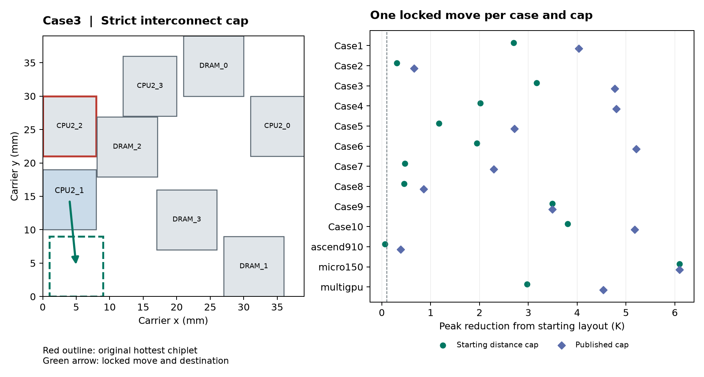

# 从功率、位置和连接预测芯粒落点

在近似均匀顶冷下，按整板热源叠加直接挑一个落点或一次交换，13 个冻结起点有 12 个在不增加互连距离的条件下降温超过 0.1 K。换成局部冷却，同一步移动的温差可以翻号。知道冷板的位置后，在独立留下的 Case3 局部冷却实验中，两种边界分别选中了不同的 CPU，封装验证分别降温 16.75、10.97 K。这里验证的是在给定起点直接作出一次布局决策的能力。

## 实验前约定

本机已 fetch，远端起点 `5b923545858dd33368f83c18416584ae35c182f8`。用前轮的 10 个 ATPlace 网表和 3 个 TAP 配置，各取合规归档中编号最小的布局。额定功率恒定。固定朝向、载板、名义顶冷和 100 µm 净间距，TAP 的几何检查含 bump 环。每例两档距离上限分别为起点的实际距离和前轮发布的宽上限，重合的组只计一次独立对照。ATPlace 用真实源引脚总 Manhattan 距离，TAP 用需求加权平均中心 Manhattan 距离。浮点比较余量为各自距离单位的 10⁻⁹。

在看候选的封装温度前，对所有芯粒分别枚举保持起点坐标余数的 1 mm 二维平移格点，并枚举任意两颗芯粒直接交换中心。只须最终摆放合规。保留起点，可一步跨越其他芯粒。对每一候选，将额定功率按芯粒矩形均匀分布，在所有芯粒中心累加均匀导热半空间的面源响应；另加本芯粒热流密度乘半层硅和 TIM 的面积热阻。使用固定的扩散层导热系数 400 W/(m·K)，以及仓库硅、TIM 的厚度与导热率，不拟合参数。选择最高预测温升最低的候选，同分时优先短距离，然后固定枚举次序。预测改善不足 10⁻⁹ K 时保留起点。记录芯粒、起终坐标、各决策的预测温差与互连距离。在排名时不调用封装求解器。

对照包括仅允许预测最热芯粒参与的同一规则、从相同预算内非原地候选均匀抽取一次（种子 20261119）、距离最短方案，以及与主预测沿相反方向移动同一颗芯粒的诊断。交换时以原编号较小者作方向检查，反向候选优先匹配移动颗数、移动距离，再取短互连。无反向候选则记录缺失。各臂只有一次包级温度评价额度，不按结果重选。所有坐标先写入预测文件，再一起接受独立的 64 档完整有限体积稳态热模型评价。比较同一上限的实际峰温、降温超过 0.1 K 的比例和配对中位数，列出升温超过 0.1 K、近似不变及无合法移动。反向指标是在起点峰温减 0.1 K 的门槛下，已审核候选中的最短实际距离。

每个来源再在 96 档复核主规则降温最大的一组，以及升温最大的一组（若出现升温）。保留细化后的符号和大小。另用具有相反散热边界的一维被动热体做解析反例，检验仅凭功率、相对位置和连线能否保证方向正确。整个实验本地执行。判定范围是一次选址或交换、一个冻结起点和所列热边界。

## 局部冷却反证挑战（见到名义结果后追加，局部冷却实验前冻结）

名义顶冷下，主规则紧预算的 13 组中，12 组降温超过 0.1 K，1 组仅降 0.061 K。追加检验每个来源的首例 Case1、ascend910，保留此前冻结的紧预算水平移动、起点、互连和全部功率。设原地与目的地中心的中点为 M，移动单位向量为 d。在同一扩散板上放置一块 30 × 30 × 6.9 mm 铜冷板，中心分别为 M − 10 mm × d 与 M + 10 mm × d（坐标从载板平移到封装），冷板上表面的 h 固定为 20,000 W/(m²·K)。扩散板未被冷板覆盖的部分绝热。两种位置散热面积、材料和换热条件相同。分别在 64、96 档评价起点与同一个终点，共 16 次本地封装求解；不再选择落点、不合并进原定组。局部冷板是理想化边界扰动，不代表这两款器件的实际冷板。报告全部符号，包括未出现反转的案例。

## 已知冷板位置时怎样改选（局部冷却反例成立后，再次前瞻冻结）

Case1 和 ascend910 都出现移动方向反转。检验给选址规则补入冷板位置是否足以改进决策。在这两例和局部冷却结果尚未知的 Case3 上，沿此前冻结的严格预算动作定义两种接触中心。三例全部功率统一为额定的 10%，使局部散热的常物性比较处于温和温区。起点、几何、互连上限和候选全集沿用。只更换热响应：1 mm 均匀网格上的单层铜扩散板传导，侧面绝热，冷板脚印内按面积散热（半厚扩散板、全厚冷板和对流串联），每颗芯粒的功率按真实矩形交叠面积加载。以整块板上各网格的温升加所覆盖源面积的同一垂直温差，取最大值。每种边界一次矩阵分解，比较所有可行落点，再锁定一个终点，可原地停留。与同一起点和原半空间规则用 96 档三维封装对照；每组只验一个新提案。报告全部六组和互连距离，不按结果挑接触面积或调参。

## 如何从热传导直接确定移动

对给定几何、材料和散热边界，稳态常物性导热方程是线性的。令 $R_{ij}$ 表示芯粒 j 在观察位置 i 引起的单位功率温升（K/W）。观察位置包括移动后的芯粒，也包括原地的邻居。把芯粒移到新位置后，从每个观察点扣去旧热源的贡献，加上新贡献，再检查谁成为最高温点。一般封装中，移动芯粒还会改变材料分布和导热路径，完整三维复核会重新组装导热矩阵。固定几何近似用同一个核预测各候选，相当于忽略了这部分变化。

用 B 表示同一互连上限，S 表示原地、所有合法单芯粒平移和双芯粒中心交换。直接选取

$$
L^* = \mathop{\rm argmin}_{L\in S,\ C(L)\le B}\ \max_i \sum_j R_{ij}(L) P_j .
$$

对于均匀半空间，单位面热源距观察点 r 的响应为 $1/(2\pi k r)$。将它对整个芯粒矩形积分并除以面积，中心处的自热也有限。每颗芯粒另加局部热流密度通过半层硅与 TIM 的温差。对于局部冷板，二维板方程同时包含横向导热和接触区散热，热响应因此取决于绝对位置。两种模型沿用同一条落点选择规则。三维验证独立计算源层所有单元的峰值。ATPlace2.5D 已使用物理紧凑热模型进行布局。本实验检验的是硬互连预算下预先锁定的有限移动与方向反例。[ATPlace2.5D 原论文](https://yibolin.com/publications/papers/PLACE_ICCAD2024_Wang.pdf)

## 额定功率、均匀顶冷的结果

数值是同一案例内起点峰温减去终点峰温，正值表示降温。预算是共同上限，允许方案用更少的距离。每个网表有一个起点，随机对照只有一次抽样，以下结果不能用来估计随机策略的期望表现。

| 预先锁定的选择 | 严格上限，降温中位数 | 严格上限，>0.1 K | 发布上限，降温中位数 | 发布上限，>0.1 K |
|---|---:|---:|---:|---:|
| 全板选择芯粒及落点 | 2.018 K | 12/13 | 4.036 K | 13/13 |
| 仅允许原预测热点参与 | 0.061 K | 6/13 | 2.290 K | 10/13 |
| 同一可行集合随机选一个 | −0.001 K | 1/13 | 0.133 K | 7/13 |
| 选互连最短者 | −0.041 K | 2/13 | −0.041 K | 2/13 |

严格预算中，全板选择与仅动热点逐例配对后，多降温的中位数为 0.471 K，9/13 例优势超过 0.1 K。两档预算在 micro150 重合，25 个不同的“案例、上限”组合中，24 个降温超过 0.1 K；两个来源共 13 个网表。ascend910 严格预算仅降 0.061 K。micro150 的热点规则比全板规则多降 0.013 K，不能用该例宣称全板规则每次都更优。18 组存在合规的同一主芯粒反向诊断，全板方向在其中 17 组多降温超过 0.1 K。部分反向动作本身也降温，方向不唯一。反向诊断只匹配半平面，尽可能匹配步长和参与芯粒数，互连实际用量也可能不同。全部主选择均有合法移动。几何和两种距离按原公式复算通过。



Case3 起点 CPU2_2 最热。将相邻 150 W 的 CPU2_1 从 (4, 14.5) mm 移到 (5, 4.5) mm，热点转到 CPU2_3。封装峰温从 118.173 降至 115.001 °C，源引脚总距离从 224.245 降至 221.666 m。仅移热点降 0.756 K，同一主芯粒的反向候选升 0.790 K。换成“至少降 0.1 K，尽量少用互连”的问题，本组已测方案中最短者用 174.901 m，降 1.970 K。完整的反向指标逐组保存在汇总中。严格预算下的可行平移/交换由 Case5 的 11/16 到 Case10 的 6,789/199；每臂只锁定一个坐标方案作三维评分。同一方案复用后初检共 99 个独立几何求解。按预注册规则细化每个来源降温最大的一组，Case6 发布上限为 5.210 → 5.359 K，micro150 严格上限为 6.092 → 6.439 K。名义实验和细化的最大能量不平衡为 1.8 × 10⁻¹⁰ W。[全部选择](evidence/direct-relocation/predictions.json) · [三维结果](evidence/direct-relocation/package.json) · [配对统计和反向指标](evidence/direct-relocation/summary.json)

## 同一步移动可以升温，冷板位置可以改变该动哪颗

11 节点的绝热导热链每段热导为 1 W/K，单热源 1 W。左端恒温时，热源在 x=3、5、7 mm 的峰值温升为 3、5、7 K；改为右端恒温则变为 7、5、3 K。两个备选终点到固定 I/O 的 Manhattan 距离都是 3 mm。功率、位置和连接相同，只有热汇位置发生变化。因而任何只读取前三项的规则都无法保证在两种封装下选对方向。

在真实基准几何上，Case1 的 GPU_1 向右 3 mm 和 ascend910 的 die_0 向右 2 mm，在起点侧冷板下均升温，在终点侧冷板下均降温。64 与 96 档符号一致。额定功率下 Case1 的理想局部冷板甚至产生超过 400 °C 的模型外推值，不能当作器件工作温度解读。常物性方程的温升与功率成正比。下表采用实际在 10% 额定功率、环境 45 °C 下重算的三维结果，峰温均落在 51–94 °C。两种选址方法和起点使用同一个冷板、功率与严格距离上限。[额定功率反证实验](evidence/direct-relocation/contact.json)

| 案例 | 冷板相对原动作 | 只用半空间的降温 | 加入冷板后选中的芯粒 | 三维验证降温 |
|---|---|---:|---|---:|
| Case1 | 起点侧 | −0.566 K | HBM_1 | 0.070 K |
| Case1 | 终点侧 | 1.627 K | GPU_1 | 1.627 K |
| ascend910 | 起点侧 | −0.720 K | die_3 | 0.683 K |
| ascend910 | 终点侧 | 0.910 K | die_0 | 0.910 K |
| Case3 | 起点侧 | −0.458 K | CPU2_0 | 16.745 K |
| Case3 | 终点侧 | 1.841 K | CPU2_3 | 10.972 K |

局部冷却下的 Case3 为事前未看结果的验证案例。起点侧冷板使 CPU2_0 从 (35, 25.5) mm 移至 (4, 4.5) mm，连接距离 218.066 m；终点侧冷板使 CPU2_3 从 (16, 31.5) mm 移到同一目标点，连接距离 214.012 m。两者均低于 224.245 m。6 组中 5 组降温超过 0.1 K，Case1 起点侧仅降 0.070 K。这里每次只比较同一有限动作集合，固定散热片材料、固定姿态、固定功率图。局部冷板来自人为控制实验，不能外推为某种商业封装的测量结果。布线容量、实际绕线、接口时序和芯粒内部非均匀发热尚未在本轮选择中验证。[六个冷板预测](evidence/direct-relocation/sheet-predictions.json) · [局部冷却的三维复算](evidence/direct-relocation/sheet-package.json)

## 本地复现

以 ATPlace_pub 的固定提交导入 Case1–10，TAP 输入使用仓库附带的几何与连接需求。设定 `PYTHONPATH=src`、`OPENBLAS_NUM_THREADS=1` 和 `OMP_NUM_THREADS=1`。下例中 CASES 为导入目录，OUT 为本地新输出目录，后者须先建立。[ATPlace 原始网表](https://github.com/PKU-IDEA/ATPlace_pub/tree/fe3dbfdaf78dc0ddeac3a2cfc3a85ff0971f88df/cases)

```sh
python tools/import_atplace_cases.py --source "$ATPLACE_CHECKOUT" --output "$CASES"
python tools/direct_relocation.py --cases "$CASES" --output "$OUT/predictions.json"
python tools/direct_relocation.py --cases "$CASES" --audit "$OUT/predictions.json" --output "$OUT/package.json"
python tools/report_direct_relocation.py --cases "$CASES" --evidence "$OUT"
python tools/relocation_contact.py --cases "$CASES" --predictions "$OUT/predictions.json" --output "$OUT/contact.json"
python tools/relocation_sheet.py --cases "$CASES" --predictions "$OUT/predictions.json" --output "$OUT/sheet-predictions.json"
python tools/relocation_sheet.py --cases "$CASES" --predictions "$OUT/predictions.json" --audit "$OUT/sheet-predictions.json" --output "$OUT/sheet-package.json"
```

本地完整回归 206 项通过。双芯粒 CLI 校验与评估通过，参考峰温 34.1886 °C，总功率 3 W。

## 独立 Chat 复核

远端核实 `b79d9435d42c4c148515b029f28676645d7e404b` 后，新 Chat 会话通过已连接的 GitHub 检查了从 `5b92354` 起的六个提交、代码与数值证据。审阅者核对了两档预算的达标数、中位数、Case3 的具体落点和距离，以及 ascend910 冷板反例的两个符号。裁决是在所列动作、模型与互连上限内支持直接选址；普适的移动方向缺少依据。13 个起点共享于两档预算，同一案例的两行统计相关；每臂各一次三维验证，快速模型筛选全板候选也有计算成本。连续位置、姿态和多芯粒联合重排仍在本实验空间以外。Chat 没有独立重跑实验。本机再次核对了两套预测与审计文件间的摘要、全部 123 个已评候选臂的实际距离，以及两个边界反例中八项降功率热场峰值的线性缩放。[Chat 审阅原文](https://chatgpt.com/c/6aff0a17-6630-83e8-9de4-7572e3259322)
