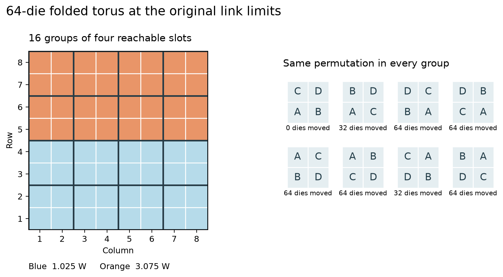

# 总引脚长度与最长单链同时受限时，跨行换位能降温吗？

**64 颗 folded torus 的固定槽位降温上限为 0 K。** 最多移动六颗时只剩起点。放开移动颗数，整个 64 颗槽位排列空间中恰有八个合规身份排列，其中一个不动、两个移动 32 颗、五个移动 64 颗。八个都把同样的功率放在同样的位置，三维模型的峰温为 **49.419553 °C**。24 颗 mesh 只有原始身份映射，峰温为 **47.750947 °C**。上轮仅限总长时得到的 48.960936 °C 布局需要至少 47.191 mm 的最长单链。[上轮反例](wire-slot-selection.md) · [本轮原始布局和求解记录](evidence/dual-cap-joint-placement.json)



### 为什么跨行仍可能完全不改变温度

把每颗芯粒连向它在合法布局中能占据的所有槽位。若一个槽位可能接收的芯粒功率全相同，该槽位的热源就已确定。如果每个槽位都如此，固定材料、接触、边界及芯粒内发热分布时，三维稳态方程的热导矩阵与功率向量都不变。因此整个温度场相同，任何选址算法都不能降温。若某个槽可以接收不同功率，才值得比较热场。功率图能变化本身不足以保证峰温会下降。

64 颗的合法目的地正好组成十六个 2×2 小块。图中的 A–D 是一个小块内的原始身份，所有小块必须同时采用右图中同一种置换。每一小块原本都由四颗 1.025 W 或四颗 3.075 W 芯粒组成。即使全板 64 颗一起动，冷热功率也无法跨过两类槽位的分界。16 个小块和八种变换是从真实网表、固定朝向及引脚约束解出的结果，搜索代码不使用网格尺寸、拓扑名称、冷热行号或小块规则。[固定槽位实现](../src/chiplet_floorplanning/placement/linked_slots.py)

反过来固定起点峰温，64 颗能达到的最短总长是 1.921795192846 m，最长单链为 16.086124 mm。八种排列的总长只相差浮点舍入量。24 颗的相应值为 0.162959096890 m 和 4.288397 mm。这两项反向指标在固定槽位的完整排列域也已判清。

### 两条独立的几何核验途径

- **完整枚举。** 为每条网建立两端可同时占据的槽位对。逐次删除找不到相容邻居的落点，传播满占槽位的一对一要求。已失去原槽的芯粒数给出必动颗数下界。剩余候选分支不重不漏，叶节点直接核算全部引脚距离。64 颗限六颗移动用 73 个搜索节点，放开后用 85 个节点便结束，低于 5,000 节点限额。仅保留最长链约束时也是同样的八个映射，全都满足总长。24 颗的两项检查各在根节点结束。非均匀六槽、三档功率、旋转及重复网络的全部 720 种身份排列用于独立核对计数和每张热图的最短实现。[穷举测试](../tests/linked_slots_unittest.py)
- **逐颗反证。** 另一个程序直接计算两端引脚的世界坐标，只使用最长链和互斥，不用总长或主枚举的候选集。强制某颗热芯粒进入任一冷槽，64 颗有 16/32 颗直接产生矛盾。其余 16 颗各自固定到 32 个冷槽之一，512 个分支全部矛盾。24 颗的 12 颗热芯粒都能直接排除。因而在本例中，单链上限自身已经锁住了功率图。两个程序均不需要额外热核验。[独立引脚检查](../tools/check_power_crossings.py)

### 落点可连续移动时

允许相邻两排的 1–3 对芯粒互换次序，所选芯粒的纵坐标连续可选，保持横坐标、固定朝向及 100 µm 间隙。64 颗的全部 147 组连续约束均无双上限可行点。即使取消总长限制，所有组中能达到的最短“最长单链”仍为 **26.434 mm**；单独取消最长链限制，各组能达到的最小总长为 **1.928386 m**。若要求冷热两组跨界，共 21 组，最低总长升至 **1.963186 m**。这些分别为两个单独优化问题的下限，不把它们当作同一份布局。24 颗的 45 组也均无可行点，单独的两项下限为 16.407 mm 和 0.201771 m。两芯粒解析对照能够在 100 µm 间隙下得到 1.1 mm 最短连线。[连续坐标约束与逐网计算](../tools/continuous_row_exchanges.py)

这个连续对照覆盖上下相邻、列连续且横坐标不变的 2、4、6 颗交换。二维自由落点、改变朝向和其他连续协同移动仍可能产生更冷的可行布局。引脚曼哈顿长度是明确的几何约束，实际布线、链路延迟及温度实测需要各自的验证。

### 算法、预算和可复算性

完整回归退出后，四种方法在同一台本机顺序运行。表中报告每个方法从读入实例到独立重建的墙钟。共同输入读一次，将用时计入每一臂，Python 启动和导入在计时外。所有合法赢家都是起点，每例反向指标也是同一布局。

| 方法 | 64 颗最佳峰温 °C | 64 颗总用时 s | 24 颗最佳峰温 °C | 24 颗总用时 s | 每例额外 FV 实耗 / 上限 |
|---|---:|---:|---:|---:|---:|
| relation_space，槽位投影适配（主基线） | 49.419553 | 6.555 | 47.750947 | 2.433 | 0 / 2 |
| 至多六颗联合换位 | 49.419553 | 0.581 | 47.750947 | 0.225 | 0 / 2 |
| relation_space，原生小预算运行 | 49.419553 | 7.091 | 47.750947 | 3.141 | 2 / 2 |
| 连续纵坐标的跨行交换 | 49.419553 | 2.928 | 47.750947 | 0.780 | 0 / 2 |

这次主方法在两例均没有峰温优势。固定槽位主基线各送入 4 个提议，投影后只剩起点。原生基线各花两次额外 FV，其中一次重算链起点，一次对应不同的连续布局。64 颗的该点为 49.445756 °C、1.793792 m、18.986670 mm；24 颗为 47.769795 °C、0.122959 m、8.288670 mm。两者总长均有余量，最长链均超限。完整排列诊断在 64 / 24 颗另用 0.086 / 0.002 s，独立逐颗反证另用 2.297 / 0.020 s，均没有额外热求解。把 64 颗新方法与完整枚举相加，当次得到原布局并证明固定槽位无进一步改善共约 0.667 s。用时是一次同机观测。两种基线保留了昂贵的整数与线性优化初始化，且历史版的主实验使用 1,000 次 FV。

主基线直接调用仓库 `placement.methods.relation_space` 的短线长种子、退火与布局优化入口。固定槽位臂在评价前投影并检查双上限。原生臂接受连续几何与自身提出的朝向，按原入口收费，最后用相同双上限选最冷点。共同的八层模型使用相同起点和 64 网格分辨率。每臂均可使用两次额外 FV，起点和最终独立复建另各一次。这两个特定网表能完成精确枚举，搜索在一般网表上的最坏开销仍呈指数增长。[旧算法入口](../src/chiplet_floorplanning/placement/methods.py) · [早期冻结的外部比较](atplace-comparison-v2-plan.md) · [对照驱动](../tools/compare_dual_cap_slots.py)

本轮只在 Windows 本机运行，第三方网表取 RapidChiplet `17176f92c91eda629a25bc11bf7959d6b963a23b`。在项目环境使 `src`、`tools` 可导入，线性代数线程设置为 1，运行以下命令。证据保留每个候选的坐标、两项引脚量、热峰值、全部八个合法身份映射、逐颗跨功率检查以及所有连续交换族的优化结果。原生方法的不可行候选保留在同一轨迹中。

```sh
python tools/compare_dual_cap_slots.py --upstream local/rapidchiplet-holdout --output results/dual-cap.json
python tools/plot_dual_cap_slots.py results/dual-cap.json results/dual-cap-reachable-slots.png
```

本地全套发现的 219 项测试通过，补入两芯粒连续解析对照后，两个针对性测试均再通过。双芯粒 CLI 验证与评估通过，3 W、34.1886 °C。正式结果中两例独立复建的最大能量不平衡为 1.04×10⁻¹² W。

## 独立 Chat 审稿

Chat 通过已连接的 GitHub 静态读取从 `7181cdc` 至 `f3aea067dc3e9a69356dd373495f419d716935d7` 的四次提交、原始 JSON、主搜索、独立引脚检查、连续 LP、基线入口与测试。审稿确认 64 颗全部八个见证、唯一功率图、24 颗唯一布局、真实费用与墙钟，检查剪枝后支持两个实例的固定槽位 **0 K** 结论。补充实验在观察前一项结果后分别预先声明。两种几何检查共享输入与引脚定义。两档功率的逐颗反证适用范围窄于可处理多档功率的主枚举。Chat 没有运行仿真。[ICCAD 复核原文](https://chatgpt.com/c/6affd32b-c9ac-83e8-92c1-d6a88ddd9472)

完整论文评级为 **Weak Reject**。审稿将数学正确性、可审计性均评为 4/5，认为泛化性及可改善案例上的搜索优势仍需实验证明。按意见明确了槽位投影适配使用 `lp_share=1.0`，原生小预算运行沿用默认分配。0.667 s 只包括主方法与全排列诊断，额外 2.297 s 的逐颗反证单独计费。最有区分力的后续比较是先用几何证明双上限内至少存在两张功率图，再检验相同 FV 预算下各算法能否找到更冷的可行点。

## 运行前固定的比较

已 fetch，远端和本地 main 均为 `7181cdc3fda0b9550fe8983dab2142f47be7212b`。本机使用上轮的 RapidChiplet 提交、原网表、功率、固定朝向、槽位、八层三维热模型和起点。种子 20261119。64 颗 folded torus 的上限从原始身份布局读取，分别为 1.921795192845845 m 和 16.086124265754524 mm。24 颗 mesh 同样取起点两项原值，0.162959096890245 m 和 4.288397286585401 mm。长度容差沿用 10⁻⁹ m，最长链容差 10⁻⁹ mm。总长与最长单链都按同一完整布局的真实方向引脚逐网计算。只做本地实验。

1. 主基线使用仓库已有的 `relation_space`。对固定槽位，用最小总中心位移的一对一指派把其候选落到槽位，保留芯粒原朝向，两项互连均合规才可收费核验。另运行未做槽位投影的原生入口，独立报告原生几何下的可行点和用时。单起点，两次额外 FV，最后独立重建。缩小几何搜索预算至 MILP 2 s、2 条各 8 步退火链、1 轮 LP（batch 6、3 层）。共同槽位适配把小预算全留给种子与 LP 提议，避免从连续 SLP 绕过槽位准入。原生入口保留默认 LP/SLP 分配。单机 HiGHS 代替历史服务器 Gurobi。早期外部比较的 1,000 次求解不计入本轮。
2. 新方法允许任意位置的 **至多六颗芯粒** 同时换位，可跨行、跨列、包含多个不相交的小环。若某颗移动后到原来邻居的单链超长，该邻居也必须移动。结合槽位互斥传播这些必要条件，逐网核算完整布局的总长和最长链。按不同槽位功率图保留实现。用起点各槽内热点的响应对合规热图排序，每核验一图把真实新热点反馈，至多两次。没有不同的合规功率图可以提前停止。
3. 所有臂分别收费和计时，主指标是双上限下最低三维峰温，反向指标为不超过起点峰温时已见最短引脚总长，记录对应最长单链。总墙钟含输入、候选生成、筛选、热核验与最终独立重建。单次墙钟只描述此次运行。共用预算上限，记录实耗。
4. 若六颗内无降温，另做一项不调用热求解器的诊断。允许任意数量芯粒换位，用每条网的可达槽位、槽位互斥与总长判定枚举，最多 5,000 个分支节点。若完成，记录全域可行身份映射与功率图；若未完成，只报告已搜索范围及见证，不将超限当作不可行。与主算法的时间分开。
5. 几何算法先用小问题对照全排列，实验保留未达预算、连续域和离散域的差异。24 颗对照应复现固定槽位的零降温。0.1 K 仍为已有实际比较门槛。

## 补充几何交叉检查

在首次几何枚举看见 64 颗的 8 个可行映射全为同一功率图之后、运行以下独立检查之前，另记一个可证伪的问题。若要改变两档功率图，至少一颗高功率芯粒必须落到原有低功率槽。对每颗高功率芯粒分别强制这一条件，仅用固定朝向的每端实际引脚世界坐标和最长链约束做相容性传播，检查无需总长或热求解能否逐颗导出矛盾。未能排除时保留未决分支。结果和耗时单列。

## 补充连续跨行对照（执行前）

固定槽位的零降温已知，原生 relation_space 在小预算试跑中保留起点。为检验落点是否受离散化影响，在相同两例上补一臂，不改变主基线。分别在每条相邻行边界，选 1、2 或 3 个连续列，一次互换这些列中两排芯粒的上下次序。每颗换位芯粒的 y 坐标连续可选，须跨过两行中线，x 与朝向不变，其他芯粒原地。考虑载板边缘与全部同列间距（100 µm），线性规划在原单链上限下最小化真实引脚总长；若该最小值超过总长上限，则整个对应连续布局族不可行。记录不可行类型、最接近的违约量和可行代表。若有新代表，按不同芯粒间功率乘积除以中心距离的和由小到大选最多两个（几何导热启发式），用原三维模型核验，计入起点和最终独立复算。其他连续换位仍开放。独立引脚检查另保留高功率芯粒允许整组冷槽时未能判掉的分支，逐个冷槽固定再检查。全程单种子。
