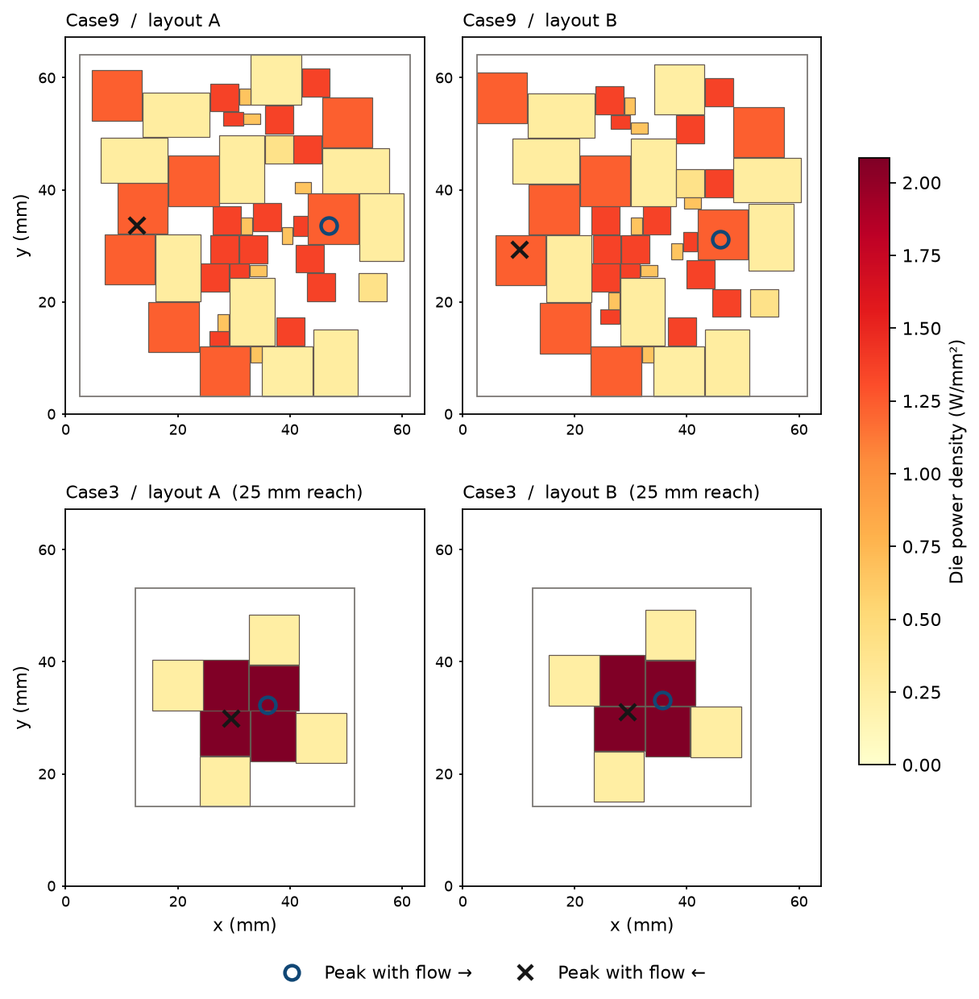

# 固定流道与泵功的布局排名实验

## 翻转是否可分辨

Case9 的两张布局在粗、细网格均翻转。正向 A 胜，反向 B 胜。反向细网格温差比两图网格改变量之和仅大 0.035 K。两方向的温差都小于事前冻结的试件偏差筛查尺度，实物赢家仍然未定。Case3 在 25 mm 热对照中仅细网格翻转，粗网格两方向均由 B 胜。这个对照保留为数值反例。

| 案例 | 入口端与流向 | 细网格 A / B 峰温 °C | 粗网格 Δ K | 细网格 Δ K | 两图网格改变量之和 K | 试件筛查加网格 K |
|---|---|---:|---:|---:|---:|---:|
| Case9 | 左 → 右 | 81.87567 / 82.67650 | −0.77860 | −0.80083 | 0.37900 | 13.98323 |
| Case9 | 右 → 左 | 84.03265 / 83.47051 | +0.56631 | +0.56214 | 0.52682 | 14.13106 |
| Case3（25 mm） | 左 → 右 | 101.46758 / 101.40416 | +0.02042 | +0.06342 | 0.79517 | 14.39941 |
| Case3（25 mm） | 右 → 左 | 101.26417 / 101.27862 | +0.06627 | −0.01445 | 0.73379 | 14.33803 |

Δ 为 A 减 B，负数表示 A 更冷。Case9 反向后两张图都变热，A 上升 2.157 K，B 上升 0.794 K，二者的差别足以换赢家。正向两图的峰都落在 GPU_4，反向 A 移到 GPU_7，B 移到 GPU_6。Case3 两图的热点都由 CPU2_0 移到 CPU2_1，排名却未能从网格变化中分辨出来。热点换芯粒和布局决策改变是两个可分别检验的结果。两次网格之差是经验数值尺度，试件绝对误差的两倍用于保守筛查，二者均不提供这块研究板的已知误差上界。相同器件上的差分误差仍待测定。[逐次原始结果](evidence/flow-reversal-results.json)



非均匀芯粒负载下，四张图的两个流向都恢复了先验混合出口温升。全部 16 个工况的最大排热误差为 2.5 × 10⁻¹¹ W。两级网格所有计算中，Case9 流体主体 / 硅顶壁最高为 57.08 / 83.10 °C，Case3 为 52.40 / 99.66 °C。均低于假设的出口最低绝压 0.20 MPa 所对应的饱和温度 120.21 °C。这项核对覆盖本模型解析到的温度尺度，实物界面局部温度尚无测点。[NIST 的水蒸气表](https://www.nist.gov/system/files/documents/srd/NISTIR5078-Tab3.pdf)

单种子 2026111401。用于结果表的两例各有 8 个整板热工况，含组装和求解分别为 52.545、10.126 s，合计 62.671 s。初版线性求解器在 Case9/A 两个粗网格流向完成后，细网格正向长时间未完成，整次尝试耗时 28 分 37 秒，进程峰值约 6.13 GiB。两个粗网格流向随后原样重算。因此本阶段实耗是 16 个不同工况、18 次完成、另一次在分解中终止；前一次耗时应计入开发成本。新求解器只调整稀疏分解排序与主元策略，同一 119,136 维矩阵对制造解的最大偏差为 2.3 × 10⁻¹⁴，12 个试件固体测点换解法后最多改变 4.4 × 10⁻¹² K。预算、布局和筛查尺度沿用原冻结版本。

## 查看新温度前的约定

已 fetch，远端与本机同为 `ff3cb63`。主例为 ATPlace Case9，对照为 Case3。沿用旧冷板实验的唯一种子 2026111401 与 Case9 的 1.25 倍、Case3 的 1.1 倍总长上限。A 取各例旧冷板对应设计的坐标目标，B 取同例旧冷板在 1.0 倍上限的目标。旧图允许矩形接触。用同一个可行分离单元，在 100 µm 净间距和逐网约束下投影到两个历史目标。保留每颗芯粒的身份、功率与原网表引脚。先提交两张不同的布局及每根网的预算，再评分。选图没有读入新模型温度，也没有构造镜像双胞胎。

Case9 采用上一阶段的标准连接分档：Analog/MEMS 之间 10 mm、其他 25 mm，属于设计假设。Case3 原为先进 ×32，在固定引脚、2 mm 可达和 100 µm 净间距条件下无可行布局。原条件的阴性结果保留。Case3 的热对照在单独声明的 25 mm 几何预算下进行，全部原始引脚与旧总长上限保留；这个替代预算没有对应的 ×32 PHY 签核。[芯粒与接口原始定义，表 3、4](https://yibolin.com/publications/papers/PLACE_ICCAD2024_Wang.pdf)

两个案例共用同一块 64 mm 长的研究用流道阵列。144 条平行支路，槽宽 231 µm、深 713 µm、节距 467 µm。相邻端口间的供回液歧管按段计算，两个外部端口分居对角。歧管截面 24 × 24 mm，位于芯粒承载区之外。两端交换端口，其余几何、25 °C 入口、0.20 W 水力泵功、各颗功率和材料完全相同。沿用导热层的芯粒、微凸块、TIM 和铜扩散板，在近芯粒侧硅中介层下方增加刻槽和绝热封盖。110 µm 硅顶壁向槽底与两片侧壁换热，侧壁按硅肋片效率折算；封盖换热忽略。每条流道沿程计算有向焓输运。使用室温附近水性，主计算冻结 35 °C 黏度。端部合计一个动压的局部损失，几何相同时反向取同一系数。额外热量只由流体带出。本研究几何没有对应的 TSV 布图或实物。

先按质量守恒、各支路压降和机械耗散核对流量与泵功，再以均布热负载核算出口混合温升。用 Qu 与 Mudawar 的独立铜试件作尺度核对，100 W/cm²、15 °C 入口，在图 4–7 的 Re 226、890、1454 处读压降、出口温升和四处铜壁热电偶。测点读图留 1 K 余量。试件流道截面相同，长度、材料、歧管与芯粒封装不同。[原文、表 1 和图 4–7](https://engineering.purdue.edu/mudawar/files/articles-all/2002/2002_1.pdf)

主指标为每个流向的有符号差值 Δ=T峰(A)−T峰(B)。每个案例固定四个布局/流向组合，四次主求解再用相同四点细网格核对，横向与流向目标分辨率由 48 加密至 96。两方向 Δ 异号才记排名翻转。逐方向的数值分辨尺度取两张布局各自网格峰温改变量绝对值之和。物理模型另列保守经验筛查尺度，为外部试件最大固体测点绝对偏差加 1 K，再乘二用于两图作差。以两个尺度之和比较两方向的 |Δ|。跨材料、跨器件迁移的尺度没有实物覆盖保证，达不到就记未分辨。不追加布局或扫描泵功寻找翻转。

## 先行核对

几何证据在 `d2a1325` 推送。Case9 A/B 总长为 80.0195/76.9057 m，均低于 103.9835 m。Case3 热对照 A/B 为 32.1492/32.2003 m，上限为 34.3362 m。四张图均满足本臂逐链要求与两种必要布线容量检查。

Case9 有 44 颗芯粒、7,656 根信号。按事先选定的端点分档规则，这张网表上的信号全部落入 25 mm 档，两张图的最长引脚间曼哈顿距离均为 25.000 mm。Case3 有 8 颗芯粒、8,448 根信号。对原 2 mm 条件，利用方形载板的整体旋转对称性检查 16,384 种相对朝向，只剩 1 种通过引脚差分约束，再经 5 个矩形分离线性规划节点排除。25 mm 热对照的最长链分别为 12.314、12.001 mm，若恢复 2 mm 上限，两图分别有 5,860、5,864 根信号超距。总长是同一几何下界的逐信号之和。

0.200 W 时计算的端口压差为 10.6290 kPa，总流量 1.128986 L/min。144 条支路流量为 7.840179–7.840193 mL/min；在所选大截面歧管下分配极接近均匀。支路和歧管的最大 Re 为 383、1084。反向独立重建供回液路径，两方向质量、压力、耗散均闭合。1548 W、680 W 分别应使混合出口温度升高 19.8050、8.6999 K；这两项守恒值留给后续非均匀芯粒功率解交叉核对。水力工作单独计量，0.20 W 的黏性生热相当于混合温度约 0.0026 K，忽略。研究工况假设出口绝压 2 bar，另记录液体与硅顶壁最高温度用于单相检查。

| 铜试件 Re | 压降，模型 / 实测读图 kPa | 混合温升，模型 / 实测读图 K | 四个固体测点最大偏差 K |
|---:|---:|---:|---:|
|226|6.84 / 5.5|42.01 / 41.5|2.74|
|890|40.73 / 30|10.67 / 10.5|4.57|
|1454|74.02 / 70|6.53 / 6.5|5.80|

公开试件提供总流量而非各槽实测流量。模型将试件按相同支路平均分流，水力包含充分发展沿程损失及一个动压的入口/出口合并损失。原论文实测端面之间还有多级集流腔。中间工况压降偏高约 36%，近乎相等的模拟支路流量不构成实物均流验证。实际壁温的近似针对槽底与两片导热肋，忽略铜试件的局部测温孔/深槽以及二维入口流动。由 12 个固体测点计算出的两图热误差经验尺度为 **13.604 K**。没有用这些数据拟合系数。[冻结布局](evidence/flow-reversal-layouts.json) · [逐槽流量、压降、出口与外部试件测点](evidence/flow-reversal-precheck.json)

## 如何解释流向

换热闭合采用矩形槽恒热流充分发展 Nusselt 数，入口段借用 Sieder–Tate 型平均换热的 1.86 系数，通过立方混合连接两种极限。对长度积分量作差得到每段平均系数，再用肋片效率折算三面有效湿周。这是研究板采用的近似，三面加热的矩形入口与原始圆管实验边界有差异。[Shah 与 London，第 VII 章](https://www.sciencedirect.com/book/monograph/9780120200511/laminar-flow-forced-convection-in-ducts) · [Sieder 与 Tate](https://pubs.acs.org/doi/10.1021/ie50324a027)

流体段的稳态能量方程为 `ṁᵦ cₚ (Tᵦ,j − Tᵦ,上游) = Q壁→段`。把各段相加给出总出口焓升，但求局部峰温仍要保留上游顺序及固体横向扩散。交换端口同时改变上游热量的累积方向和热入口换热系数的分布，两项的独立贡献未在这个实验中辨识。恒黏度近似使流量分配由几何和泵功独立确定，实物中的温黏反馈可能引起重新分流。

## 本地复现

安装仓库并按 README 从 ATPlace 作者提交 `fe3dbfd` 导入网表。下面三步依次重建布局、水力与试件检查、以及四张布局的温度。布局冻结只读旧阶段的坐标目标和互连信息。检查文件包含端口泵功、入口、流道尺寸、逐支路流量和冻结布局指纹。

```sh
python tools/freeze_flow_layouts.py --source results/physical-calibration/atplace-import-v1 --output results/flow-reversal-layouts.json
python tools/flow_reversal.py check --checks results/flow-reversal-checks.json
python tools/flow_reversal.py evaluate --source results/physical-calibration/atplace-import-v1 --checks results/flow-reversal-checks.json --output results/flow-reversal-results.json
```

核验程序直接使用库中事先提交的布局文件。第一步的本机输出应与该文件逐字节相同。粗细网格共解 16 张整板温度场，耗时记录包括固体组装、有向固液矩阵组装与求解。独立铜试件、测试套件与初始几何投影单列。
