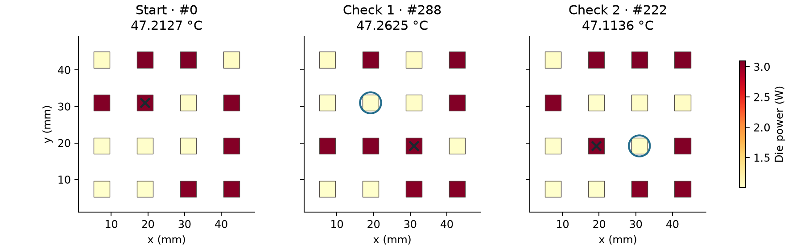

# 新热点能否指导第二次布局核验

## 六组负载逐项验收

六个负载的第一次单热点核验全部出现新的最热位置；其中三次是另一颗芯粒接管峰值，三次是原最热芯粒移到新槽位后继续最热。把新热点加入排序，六组中四组改变了第二次检查的布局，**两组比继续只看旧热点取得更低峰温**。两次核验之间，单热点反馈六组的剩余上界均缩小；两次后仅一组能排除再降 0.1 K。[在线选择与逐步上界](evidence/switch-pool-online.json) · [全池逐图峰温与实际漏失](evidence/switch-pool-reference.json)

各列均为同一双引脚上限下的三维峰温，单位 °C。每种负载都在同一张预先冻结的 713 图、秩 15 的网表上运行。

| 热源分布 | 起点 | relation_space 槽位 | 盲抽 | 固定旧热点 | 单热点反馈 | 近峰反馈 | 全池最冷 |
|---|---:|---:|---:|---:|---:|---:|---:|
| 中央对角 | 47.78077 | 47.78077 | 47.71806 | 47.73241 | 47.50643 | 47.49465 | 47.49461 |
| 中央相邻 | 47.83310 | 47.83310 | 47.53025 | 47.48823 | 47.48823 | 47.49273 | 47.48819 |
| 相对边缘 | 47.49536 | 47.49536 | 47.49527 | 47.48376 | 47.48376 | 47.31897 | 47.31897 |
| 相对角点 | 47.32263 | 47.32263 | 47.32263 | 47.32263 | 47.32263 | 47.32263 | 47.32215 |
| 棋盘 | 47.19322 | 47.19322 | 47.19322 | 47.17136 | 47.17136 | 47.17136 | 47.17136 |
| 随机平衡 | 47.21270 | 47.21270 | 47.17958 | 47.19220 | 47.11362 | 47.11362 | 47.11362 |

### 第一次的错误是否改变第二次选择

“新峰超旧点”取第一张核验图上最热位置与起点热点位置的温差。“第二步额外降温”相比第一次核验后已经见到的最低峰温，保留共同起点；“相对静态收益”与固定旧热点同样查两个新布局。两者有差别才说明收益可归因于反馈。其余温差、实漏、上界均以 K 计。

| 热源分布 | 新峰超旧点 | 首查编号 | 二查编号 静态 / 反馈 | 第二步额外降温 | 相对静态收益 | 反馈剩余上界 一查后 → 二查后 | 单热点实漏 | 近峰实漏 |
|---|---:|---:|---|---:|---:|---|---:|---:|
| 中央对角 | 0.84065 | 532 | 533 / 691 | 0.22598 | 0.22598 | 0.83762 → 0.61160 | 0.011824 | 0.000045 |
| 中央相邻 | 0.64645 | 117 | 118 / 118 | 0.00449 | 0.00000 | 0.64634 → 0.59580 | 0.000047 | 0.004539 |
| 相对边缘 | 0.88669 | 101 | 221 / 221 | 0.00000 | 0.00000 | 0.86775 → 0.71697 | 0.164789 | 0.000000 |
| 相对角点 | 1.10550 | 590 | 712 / 63 | 0.00000 | 0.00000 | 0.76220 → 0.72138 | 0.000484 | 0.000484 |
| 棋盘 | 0.42556 | 339 | 242 / 73 | 0.00000 | 0.00000 | 0.40024 → 0.01857 | 0.000000 | 0.000000 |
| 随机平衡 | 0.56620 | 288 | 255 / 222 | 0.09908 | 0.07859 | 0.46657 → 0.36246 | 0.000000 | 0.000000 |

**真正的芯粒交接。** 随机平衡负载起点最热的是身份 8。只看旧热点时，图 288 的预测为 46.696319 °C，但另一槽位的芯粒 6 达到 47.262516 °C，比原布局 47.212698 °C 还热。将这个新位置反馈后，原来拟查的图 255 温度下界从 46.696640 抬到 47.192203 °C，仍可能改善起点，但在排序中让位给图 222。潜在改善图由 192 张降到 105 张。图 222 移动 10 颗芯粒，独立重建峰温 **47.113618 °C**，总长 0.280973442 m、最长链 19.307056672 mm。同预算静态对照查图 255，只到 47.192203 °C；反馈因此多降 **0.078586 K**。事后它确实是池内最冷，但自己的余量仍有 0.362458 K。最后一次反馈将潜在改善图由 14 张降到 2 张，最低下界却未变，说明排除更多候选与收紧最差保证也应区分。



**相同芯粒移动也会使旧测点失效。** 中央对角负载在图 532 仍由芯粒 10 主导峰温，但它从槽位 10 落到槽位 8。新位置把图 533 的下界从 46.894324 抬到 47.732737 °C，已高于当时最佳 47.732410 °C，可以直接排除。第二次转选图 691，得到 **47.506429 °C**，较静态对照多降 **0.225980 K**，距全池最冷仍差 0.011824 K。图 691 的实际引脚总长 0.254157056 m、最长链 19.307056672 mm。

**失败条件。** 两侧边缘热源的第一次核验出现高出旧测点 0.886692 K 的新峰，但加进这一点后，364 张候选仍有希望，第二名的选择也没有变。两次单热点核验后仍实漏 **0.164789 K**。近峰臂第一次便选中了池内最冷的图 105，最终自己的剩余上界仍有 0.496260 K。相反，中央相邻负载的近峰臂比单热点高 0.004492 K。相对角点负载中，新信息改变了第二次布局，却没有改善起点，整个池的可降空间本来就只有 0.000484 K。棋盘负载里两种单热点臂第一次已找到最冷解，第二次反馈主要使上界从 0.400239 降到 0.018569 K。

### 成本与可判定范围

下表的漏失在同一热模型内按六工况逐例计算。总时含输入、共同起点分摊、读池、追踪与方法运行。最后一列另为同池方法计入一次实际几何生成。整板与热响应两种费用按求解次数分别报告。

| 方法 | 新整板 / 响应合计 | 达到池内最冷 / 自行判清 | 平均实漏 K | 最大实漏 K | 复用池总时 s | 从头总时 s |
|---|---:|---:|---:|---:|---:|---:|
| relation_space 槽位投影 | 0 / 0 | 0 / 0 | 0.154816 | 0.344912 | 13.414 | 13.414 |
| 同池盲抽 | 12 / 0 | 0 / 0 | 0.088355 | 0.223454 | 0.334 | 0.600 |
| 固定旧热点 | 12 / 6 | 1 / 0 | 0.080285 | 0.237804 | 0.336 | 0.602 |
| 单热点反馈 | 12 / 18 | 2 / 0 | 0.029524 | 0.164789 | 0.347 | 0.613 |
| 近峰反馈 | 12 / 60 | 3 / 1 | 0.000845 | 0.004539 | 0.361 | 0.628 |

所有组的单热点臂各用 2 次新核验、3 个响应，近峰各用 2 次与 10 个。六工况的差异是受控工作负载差异，均值没有独立网表样本的统计含义。两种热点臂各自的起点、核验、反馈均计时，六个共同起点累加 0.2534 s，网表输入 0.0360 s，冻结池生成 0.2661 s。仅决策与记录部分，五臂分别为 13.1244、0.0151、0.0170、0.0282、0.0427 s。单轮定序计时，关系空间是早期方法的小预算槽位投影适配。盲抽与关系空间的自主余量只使用环境温度这一保守下界，完整逐例值见在线记录。

反向指标是同一起点峰温限制下的最短已见总长，单位 m。最后一列给出参考最短布局本身的峰温。最低线长和最低温度可能来自不同布局。

| 热源分布 | relation_space | 盲抽 | 固定旧点 | 单点反馈 | 近峰 | 全池最短 | 最短布局 °C |
|---|---:|---:|---:|---:|---:|---:|---:|
| 中央对角 | 0.30135 | 0.22734 | 0.28097 | 0.25416 | 0.28419 | 0.15333 | 47.78064 |
| 中央相邻 | 0.30135 | 0.22734 | 0.26060 | 0.26060 | 0.26060 | 0.10292 | 47.72612 |
| 相对边缘 | 0.30135 | 0.22734 | 0.28419 | 0.28419 | 0.28419 | 0.15333 | 47.47480 |
| 相对角点 | 0.30135 | 0.30135 | 0.30135 | 0.30135 | 0.30135 | 0.20375 | 47.32252 |
| 棋盘 | 0.30135 | 0.30135 | 0.25738 | 0.25738 | 0.25738 | 0.20697 | 47.18508 |
| 随机平衡 | 0.30135 | 0.28419 | 0.28419 | 0.28097 | 0.28097 | 0.20375 | 47.20445 |

离线参照在所有在线结果写出后运行，复用了六份共同起点场，全阶段另用 10 个源响应和 2 次独立整板重建，额外耗时 0.0919 s。15 维基的条件数为 11.02；每张图按 289 个功率层节点取最大值，逐一核对所有已验候选与单点、近峰的逐图下界。热源求解残差最大 2.67×10⁻¹⁵ W，独立重建的最大能量不平衡 2.40×10⁻¹² W，全部在线候选与参照温度相差至多 7.11×10⁻¹⁵ K。参照共享同一固定八层三维热路；没有做实测校准、详细布线或跨芯粒时序判定。第二套只按身份次序逐条验引脚的几何检查访问 118,878 个前缀，也得到了完全相同的 713 个排列。223 项既有回归、一项新增反馈对照测试和双芯粒 CLI 均在本机通过。

## 独立 Chat 审稿

Chat 通过已连接的 GitHub 静态复核冻结提交 `1f85097` 和结果提交 `58dce62`。完整 ICCAD 算法论文评级为 Weak Reject，几何与数学、实验协议各 4/5，因果对照 3.5/5，新颖性 3/5，可推广性 2/5。审核确认热点位置六次切换、身份三次交接、四次改选和两次优于固定旧热点。关系空间只测了槽位投影适配；13.414 s 不代表原生连续布局器的普遍耗时。单热点自行判清 0/6，近峰在中央相邻负载的负例也须保留。[审稿会话](https://chatgpt.com/c/6affd32b-c9ac-83e8-92c1-d6a88ddd9472)

### 审稿后追加的等成本对照协议

已有六组真值已公开。这项补充是事后控制实验。沿用全部布局、负载、评价、编号、预算、平局规则和单热点反馈的原始结果。固定起点温场上属于芯粒的网格节点，按温度降序、节点编号升序排列，每个起点芯粒仅取首次出现的位置，取前三颗芯粒各自最热的节点。先只用原热点，第一次整板核验后加预定第二点，第二次后加预定第三点用于收紧余量。核验反馈臂在完全相同的时刻加入实测热点。两臂都支付三个独立响应、两次新整板核验，首次候选必须相同。补充臂单独运行和计时，先写线上结果，再读原参照，报告全部六例。后续换独立拓扑才可检验迁移性。

## 从热守恒到第二次选点

对同一个线性稳态封装，功率从起点 p₀ 换到 p，位置 i 的温差为 rᵢ·(p−p₀)，rᵢ 是一次伴随求解得到的 K/W 响应。各芯粒移动的影响先带符号相加，整板峰温再取所有位置里的最高值。想使峰温下降 g，等价于每个位置的温差都不超过其旧温度余量减去 g。单独照顾旧热点只检查了其中一项。

设 L(p) 为已观察位置中最高的候选温度。整板核验暴露了位置 j 的新峰值后，可以对所有未查布局做同一项更新：**L′(p) = max[L(p), Tⱼ(p)]**。下一次选 L′ 最低的合法布局。若 j 将原本最看好的布局抬到另一布局之上，第二次的移动方向才会随反馈改变。发现新热点本身不能保证找到更冷的点。设 U 是至今核验过的最低峰温，包含起点。因为 L 只上升、U 只下降，**U−min L 不会增大**，它给出当前选择最多还能漏掉多少降温空间；已核验布局的 L 用真值回填。这个结论对任意有限候选集合成立。用一行响应算出所有候选的 Tⱼ(p) 还需要布局共享同一热路。

## 本地复现

离线参照以第一组起点功率为原点。其余五组起点减去它，分别得到已知功率差 d₁…d₅，对应温场差由六份已收费的起点场直接相减。由于所有真实布局总功率相等，16 槽的可变功率位于维数 15 的零和空间。正交分解在该空间中补入十个方向；每个只求一个热响应，将这十列与五个已知温差列合并。每个布局功率差在这 15 列基上分解，再由相同系数组合温差，对全部功率层单元取最大值。这里的 4,278 个评价是代数组合与取最大值，额外求解右端按十个计。六个起点共同支撑这个事后参照，单工况的布局算法不能免费使用另外五份温场。

RapidChiplet 固定在 `17176f92c91eda629a25bc11bf7959d6b963a23b`。本机 Windows、Python 3.12、i7-12700，主要方法以同一顺序串行计时。冻结池可用 `python tools/switch_pool_geometry.py --upstream local/rapidchiplet-holdout --output results/switch-pool-geometry.json` 重建，并比对候选指纹。数值实验按下列命令使用已发布的池。

```powershell
$env:PYTHONPATH = 'src;tools'
$env:OPENBLAS_NUM_THREADS = '1'
$env:OMP_NUM_THREADS = '1'
$env:MKL_NUM_THREADS = '1'
python tools/compare_hotspot_switch.py --upstream local/rapidchiplet-holdout --geometry docs/evidence/switch-pool-geometry.json --online results/switch-pool-online.json --reference results/switch-pool-reference.json
```

## 测温前冻结

本机于 2026-11-20 fetch 成功，远端 main 与本地均为 `86fbd8ff3cbcdf900eb7a1c4490de8bd1ad71af7`。先推送协议和完整几何清单，再读温度。只用种子 20261119。[冻结的功率、引脚、身份和候选顺序](evidence/switch-pool-geometry.json)

- 使用 RapidChiplet 原生 4×4 mesh 的 16 颗芯粒、24 条方向引脚链路。起点在规则网格中交换身份对 (0,1)、(6,7)、(8,9)。比较都守住这个起点的 0.30134796376275025 m 总长、19.307056671752825 mm 最长单链、原朝向和槽位。选起点时只看几何数量。在 5,120 个搜索节点内完成全排列域的剪枝枚举；只限最长链有 1,426 解，加总长剩 713 个。候选按身份落槽向量排序，0 为起点。各负载的 713 个功率图均不同，变化矩阵的秩均为 15。枚举指纹 `3240ca6d4e7b488de324201eb232d338a462092506b3475c71345c25343986d6`。
- 冻结六种等总功率（32.8 W）负载，不按观察到的温度选例。为使多个位置可能竞争峰值，前四组各设两颗主热源，分别位于起点中央对角、中央相邻、两侧相对边、两对角角点。主热源 5.125 W，其余芯粒平分余下功率，再按身份加零和微扰。另保留棋盘和单种子随机平衡负载。六组一齐报告。同一工况的所有方法共享一次起点整板温场；方法间不传递候选真值或响应。
- 每方法、每负载最多 **2 次新整板核验和 10 个独立热响应右端**。对照为同一 relation_space 小预算槽位投影入口、同池盲抽、仅按起点热点排序的静态对照、逐次加入真实新热点的单热点方法，以及距峰温 0.1 K 的近峰方法。沿用先前的几何参数、近峰节点排序和 4/3/3 行配额，主目标为两项互连约束下最低整板峰温，保留起点。静态对照在第一次真值揭晓后仍按原热点选未查候选，与反馈臂的首次选择一致。每次按热点温度下界最低选布局，平局取短线再按池次序。按池内最冷点判实漏；反向指标为不超过起点峰温的已见最短引脚长度。
- 对每次核验记录入选编号、整板峰温、旧测点温度、真实热点位置及芯粒身份、累计最佳、剩余降温上界、实际用时。用已知节点中的最高温作为每张图的下界，已验图回填真值。分别报告回填之前、回填之后、加入新响应之后的界。峰值必须严格超过旧热点对应温度才算真正切换（数值阈值 10⁻⁷ K），另计跨芯粒、性能差距与 0.1 K 工程门槛。用第二次的“迄今最冷”对第一次、同预算静态对照，并保留没有进一步降温或仍漏解的情况。
- 实漏用同一固定线性三维封装的离线数值参照取得。先将所有在线结果写出，再启用参照。六份已经支付的共同起点温场给出五个独立功率差及对应温差，各自线上只能读自己的一份。离线把这五个差分当作已知列，再解剩余十个正交热源方向，刚好覆盖 16 槽固定总功率的 15 维空间，评价全部 6×713 个峰温。参照对全阶段额外收费为 **10 个响应，以及中心对角和随机平衡两组最冷图至多各 1 次独立重建**。它复用了六份起点，单列成本，不作为具有单工况在线预算的竞争者。检查功率重构、全部在线已付费核验、逐图热下界与独立三维峰温。如精度不够则保留误差区间。若旧热点在第一步即判清，或新热点暴露但第二步没有实益，也原样报告。
- 用时分别计起点、读池、方法和从头建池。六负载共用的一次几何成本只加一次，relation_space 自行生成布局。目标是检验反馈的实际收益与失败条件；单机一次墙钟只作描述。真实引脚曼哈顿量、固定姿态/热路和合成功率限定了结论的适用范围。
