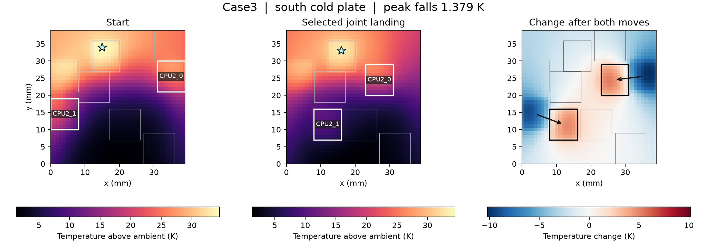

# 用温差和余量生成联合落点

开始前 fetch 成功，远端与本机均为 `7c94537aa141d014feb090e110c03db711da83ef`。本阶段检验生成能力。基线保留上一版从起点生成的整个候选池和选择程序。

## 运行前约定

- 保留 10 个 ATPlace、3 个 TAP 的单种子起点、10% 功率、四向冷板、原互连预算、1 mm 平移格、固定朝向与 100 µm 间隙。取相对同一起点在各边界下的峰温降幅，再对四个降幅取最小；超过 0.1 K 才移动。优先最大化该降幅，另对达到门槛的终点比较最短互连。只在各自案例内比较互连。
- 对每个观察位置，用旧峰温减该处原温度得到余量。根据每个起点和落点脚印的带符号功率转移，利用热路的伴随响应计算该处温差。每颗芯粒先提一个单移落点，再允许另一颗在所有可用格点为该落点补偿，直接比较两者合计后的最小余量。联合终点检查间隙、封装边界和实际互连。候选在搜索时生成，不读上一版终点或候选温度。
- 核对提案的全场峰温，如果出现未观察的限制位置，将其带回提案生成器。对照组只用起点热点来生成。每例至多核验 24 个不同的联合落点；原池不足 24 个时双方均采用原池数量的上限。另报告只允许使用与旧反馈算法相同实际联合核验次数时的结果。分别记录廉价位置筛查、整板核验和导入、生成、选择在内的总用时。
- 旧池、旧反馈及上一版单移温差缓存选择均作对照。同种子三轮端到端计时，轮换顺序，不把代码启动、写报告、事后审计混入搜索。事后独立重建坐标和互连、复算候选、辨认池外终点；对新旧执行终点用三维封装检查四向及留出中心。对平移格点少的 Case5 穷举相同几何域中的双移动，主动寻找生成器漏掉的更冷终点。区分部分位置给出的乐观估计和真实峰温。

首轮开发实验显示独立生成会在 Case7、Case9、multigpu 的薄板比较中退步。保留原约定的所有方法和结果，追加一个保护旧解的部署对照。先实际运行旧反馈搜索，再用同一总核验预算中尚未花掉的次数生成新落点，起点保持一致，复用冷板分解和已核验温度。只有通过整板比较且优于当前解才更新，计入两段生成和核验的实际用时。此项为观察到退步后追加，仍用同一组案例。[上一轮固定池对照](transfer-bound.md)

在运行到此的逐步重放中，三个退步案例的旧最优两端都没有被选作第一个落点。再冻结一个直接修正该限制的对照：每颗芯粒永久保留在各冷板原热点处降温最多的单移落点（旧生成器的出发点），并保留当前所有观察点下最好的那个单移落点；任一保留落点均可与另一颗的任意合规格点配对。独立生成和核验，仍使用同一小预算，不运行旧算法来获得起始解。检验旧池是否被这组组合实际覆盖，记录达到核验次数上限或所有剩余乐观估计都已被当前解压住。本项同样是看见开发结果后追加。

在确定上述选择规则后，加一个只用于证伪的池外挑战。在每个确实移动的终点，依次只把一颗的落点再沿上下左右偏移 1 mm，最多八个挑战。保持另一颗落点、起点平移格、单芯粒可放位置和联合互连上限，排除主方法已经核验的动作。事后揭晓独立整板峰温，增益最大的一例另算三维；挑战结果不反馈给搜索。

## 哪两颗可以一起移

设 $h_b(x)=T^\mathrm{peak}_{0,b}-T_{0,b}(x)$ 为冷板条件 $b$ 下位置 $x$ 的起点余量，$u_{a,b}(x)$ 为移动 $a$ 对该位置造成的带符号温差。若要使每种边界的整板峰温至少降 $g$ K，则搭档移动 $d$ 必须满足

$$u_{d,b}(x)\ \le\ h_b(x)-g-u_{a,b}(x).$$

在固定线性稳态热路上，对**所有**位置和边界满足它，就足以实现这次降温。发热从旧脚印移出、在新脚印加入，功率守恒。考察少数位置时，最小剩余余量 $\min_{b,x}(h_b-u_{a,b}-u_{d,b})$ 是对真实降温的乐观估计。一个观测点的单位热响应只需求一次；在芯粒旧、新矩形脚印上分别积分、按实际功率缩放，就能得到每个落点带正负号的温差。

1. 从每块冷板的起点热点出发。对每颗芯粒保留使每处原热点最冷的落点，以及使当前最紧余量最大的落点，均须单独满足互连上限。
2. 针对每个保留落点，让另一颗芯粒在其可放的整个 1 mm 平移格上选择目的地。按上式评估两颗一起移动后的余量，并直接检查联合终点的互连与间隙。第二颗允许单独超出互连上限，只要联合动作满足上限。所有热提案都从同一个起点直接生成。
3. 对余量预测最好的联合动作求四个整板峰温。如果某处实际比预测更热，就把该处加入观测点，重新挑选搭档。保留核验过的最好解，至多核验预定次数。只要剩余提案的乐观估计都小于当前已核验降温，便可以收工。

第一步保留下来的每个原热点落点，在后续轮次都可以选。同一互连预算下，本轮独立核对旧池的 295 个双移动，全部可由这些落点和合法搭档生成。如果在预算耗尽前已压住这个集合中其余提案的上界，所得薄板解至少与旧池最优一样冷。只有达到这一停止条件才有这项结论。每颗都不含保留落点的组合，以及进入另一颗已腾空位置的动作，仍可能更冷。有限位置给出乐观估计，搜到一个能降温的动作也不能替代这个停止条件。[生成器](../src/chiplet_floorplanning/placement/joint_generation.py) · [比较与核对](../tools/generate_joint_landings.py)

## 同样互连预算下的峰温

表内为从相同起点出发、四种冷板中最小的峰温降幅（K）。旧池一列的反馈与单移动缓存算法选中同一布局。“生成”指保留各原热点落点的方法。“三维”是选中布局在另外组装的 64 档封装模型中的四向最差降幅。ATPlace 比较源引脚曼哈顿距离之和（m），TAP 比较需求加权的平均中心距离（mm）。表中两个成本分别是所选终点和该例上限。[逐次提案与坐标](evidence/joint-generation/search.json) · [独立复算](evidence/joint-generation/audit.json)

| 案例 | 旧池 | 生成 | 三维旧池 | 三维生成 | 所选互连 / 上限 |
|---|---:|---:|---:|---:|---:|
| Case1 | 0 | 0 | 0 | 0 | 70.350 / 70.350 |
| Case2 | 0.439 | 0.585 | 0.174 | 0.529 | 114.569 / 130.052 |
| Case3 | 0 | 1.379 | 0 | 0.528 | 179.586 / 224.245 |
| Case4 | 0.491 | 0.901 | 0.354 | 1.150 | 224.787 / 245.436 |
| Case5 | 0.1003 | 0.1003 | 0.183 | 0.183 | 166.616 / 170.488 |
| Case6 | 0.176 | 0.694 | 0.349 | 0.519 | 154.135 / 161.886 |
| Case7 | 0.284 | 0.284 | 0.272 | 0.272 | 46.630 / 47.331 |
| Case8 | 0 | 0 | 0 | 0 | 49.460 / 49.460 |
| Case9 | 1.697 | 1.697 | 1.489 | 1.489 | 315.965 / 332.929 |
| Case10 | 1.795 | 2.244 | 1.802 | 2.303 | 147.977 / 154.577 |
| ascend910 | 0.149 | 0.219 | 0.186 | 0.215 | 25.301 / 26.346 |
| micro150 | 0 | 0.844 | 0 | 0.674 | 34.800 / 36.300 |
| multigpu | 0.254 | 0.322 | 0.148 | 0.205 | 27.556 / 27.778 |

**Case3 的联合降温来自两个可直接检验的方向。** CPU2_0 从 (35,25.5) 移到 (27,24.5) mm，CPU2_1 从 (4,14.5) 移到 (12,11.5) mm。单独移动时，四向最差峰温分别升高 0.477 和 0.498 K；同时移动时，四向均降温至少 1.379 K。限制条件出现在南侧冷板。该条件下最终热点原有 0.194 K 余量，第一颗在此处增加 0.363 K，第二颗减少 1.548 K。按同一地点核算，$0.194-0.363+1.548=1.379$ K。这个例子说明只保留单独就能降低整板峰温的动作，会错过互补的移动。

图中两幅温度图共用温标，星号标记各自的峰温。右图蓝色为降温、红色为升温、箭头从旧中心指向新中心。薄板网格覆盖整个载板并向外延伸，图中只显示芯粒载板区域。

## 生成与核验的总用时

每例从头读入相同起点，单线程完成建模、合法格点和候选生成、互连筛查及热核验。下表为完成全部 13 例的三轮中位数，括号内为范围。单种子相同，轮次用于计时。每核验一个联合终点，要计算四个冷板温度场。旧缓存法对 28 个联合动作评估峰温，其实际开销为 204 个单移动场、8 个近并列复核整板场和 16 个补充测点。胜负比较的是同例、同互连上限下执行后的最差峰温。[全套计时](evidence/joint-generation/search.json)

| 生成和选择方法 | 总用时 s（范围） | 联合动作核验 / 评估数 | 相对旧池更冷 / 持平 / 更热 |
|---|---:|---:|---:|
| 旧池反馈补点 | 5.006（4.995–5.027） | 28 | 0 / 13 / 0 |
| 旧池，上一版单移动响应缓存 | 5.120（5.043–5.214） | 28 | 0 / 13 / 0 |
| 每颗一个折中落点，固定起点观测 | 2.447（2.437–2.473） | 96 | 6 / 3 / 4 |
| 每颗一个折中落点，热点反馈 | 2.166（2.130–2.176） | 27 | 7 / 3 / 3 |
| 同上，每例至多旧反馈实际核验数 | 2.113（2.074–2.188） | 22 | 7 / 3 / 3 |
| 先算旧解，余下次数生成 | 5.551（5.527–5.604） | 49 | 7 / 6 / 0 |
| **保留各冷板落点并允许自由搭档** | **2.539（2.532–2.539）** | **47** | **8 / 5 / 0** |
| 同上，每例至多旧反馈实际核验数 | 2.363（2.342–2.375） | 27 | 7 / 5 / 1 |

保留各冷板落点时，13 例都在各自的次数上限前耗尽可超越当前解的提案，共核验 47 个终点，每例 1–9 个。8 个赢例的终点均不在旧池；其中 6 例比旧池多降超过 0.1 K。13 例配对额外降温的中位数为 0.069 K。相较较快的旧反馈，端到端节约 2.467 s（49.3%），三轮配对分别节约 49.28%、49.49%、49.31%。47 次核验多于旧反馈的 28 次。把每例的实际核验上限也压到旧反馈用量后，共用 27 次，中位额外降温 0.029 K；Case7 少降 0.0215 K。耗尽预算时覆盖旧池的结构仍在，但不能据此宣称峰温不会退步。

计时衡量整套实现。新实现对两次平移的互连先加单移成本，只对两颗之间的共有链路按相对位移精确修正；同时用数组比较搭档。完整方法累计进行 11,388,490 次可行配对评分（含不同观察轮次的重复），另求 38 个补充测点。旧代码生成和排序候选的实现不同，因此不能把全部 49.3% 节约归给热余量公式。单落点的固定观测对照与反馈对照使用相同实现；补充位置后核验从 96 降至 27，Case10 的降温从 1.395 K 提高到 1.878 K。

## 反例和成立范围

- **只保留每颗的一个折中落点会丢解。** 初版独立生成相对旧池为 7 胜、3 平、3 负。Case7、Case9、multigpu 分别少降 0.042、0.407、0.105 K。重放每次新增观察点前后，三例的旧最优均没有一个端点入选当时的单颗首选。Case9 的旧动作一直有 1.697 K 的乐观降幅，采样热响应没有排除它，先挑落点这步让生成器无法提出它。
- **保留各冷板落点也会错过更冷的邻居。** 事后核验 44 个未在主方法中试过、仍在原预算内的相邻联合布局，6 例共 7 个方向取得进一步降温。Case4 保持 HBM_4 的目的地，将 GPU_0 从已选的 (15,15) mm 改为 (14,15) mm。互连从 224.787 降到 224.100 m（上限 245.436 m），薄板四向最差降温从 0.901 增至 1.167 K。三维也从 1.150 增至 1.248 K。这里热判断成立，但两个落点可以共同避开所保留的首选集合。反之，Case5 在相同单颗静态可放区域中穷举 175 个满足联合预算的双移动，新旧方法都找到 0.10029 K 的最优动作。两项审计的计算均在部署计时外。
- **冷板位置会改变排序。** 四个用于搜索的方向上，最终生成器的 8 个薄板改进在三维复算中也优于旧布局。留出的中心冷板下，Case10 的三维降温从旧布局的 2.422 K 变为 1.555 K，即使它在四向最差值上多降了 0.500 K。四向均超过 0.1 K 的案例由 9 增至 11，加上中心后由 6 增至 8。允许搬动芯粒改变热路、功耗随温度变化或需要动态峰温时，须重新建立对应的热响应。实际封装测温、详细布线和时序均不在这次峰温比较内。

反向看互连效果，Case2 的旧池中达到 0.1 K 的最低成本为 106.686 m，新生成并核验的动作中有 103.166 m。Case10 则从旧池的 122.531 m 变为新核验动作中的 136.309 m。当前生成目标是给定上限下的最冷布局；这些最低成本都是实际可达的终点，只有旧池一项对整个旧池进行了穷举。ATPlace 原论文也按合法几何同时报告最高温和互连。本次使用其网表，采用共同起点、硬互连上限和四向最差降温，自行设定的功率与冷板条件未复现论文的温度数值。[ATPlace2.5D，ICCAD 2024](https://yibolin.com/publications/papers/PLACE_ICCAD2024_Wang.pdf)

## 本地复现

使用仓库既有的 ATPlace 导入目录和 TAP 输入。将 `PYTHONPATH` 设为 `src`，将 `OPENBLAS_NUM_THREADS` 和 `OMP_NUM_THREADS` 设为 1，令 `CASES` 指向导入目录、`OUT` 指向输出目录。脚本复核输入摘要、原始起点与转角。比较阶段从旧记录取每例的两个预算整数；独立生成器看不到旧候选坐标和最终温度。保护旧解的组在计时中自行运行旧算法。完整证据保留各次候选的初始预算、实际互连、四向温降与补充观测点，审计文件按摘要对应此次搜索。[输入来源](direct-relocation.md#本地复现)

~~~sh
python tools/generate_joint_landings.py --cases "$CASES" --repeat 3 --output "$OUT/search.json"
python tools/generate_joint_landings.py --cases "$CASES" --audit "$OUT/search.json" --output "$OUT/audit.json"
python tools/plot_joint_generation.py --cases "$CASES" --search "$OUT/search.json" --case Case3 --output "$OUT/case3.png"
~~~

独立程序也可直接使用 `JointLandings`，传入具体芯粒、含间隙与封装边缘规则的可放几何、起点、连线需求和成本上限，通过 `observe` 提供每个观测位置的热响应，`propose` 返回两颗芯粒编号、绝对落点、联合互连和预测的降温上界。本地全量回归 214 项通过，双芯粒 CLI 校验与评估通过，总功率 3 W，参考模型峰温 34.1886 °C。
