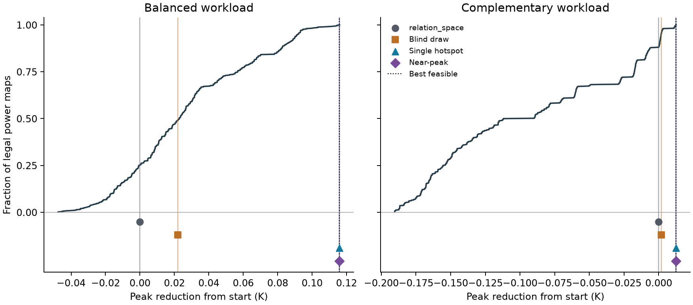

# 512 张合法功率图下的联合布局选择

## 在同一互连预算下找到多冷、还漏掉多少

单热点在两种负载下均用一次新布局核验找到全池最低峰温。主负载从 **48.959602 降至 48.843675 °C**，对应编号 494，48 颗芯粒协同换位。反向负载从 **48.549395 降至 48.536900 °C**，对应编号 412，36 颗协同换位。两个布局的总长均为 **1.394118411 m**，最长链 **16.086124266 mm**，均守住起点的双上限。参照方法对每个最冷布局及反向指标布局重新构建三维模型，各花两次核验。两个工况都在其他方法结果已落盘后才计算参照。[各臂结果、已验布局及全部热下界](evidence/large-pool-online.json) · [512 图的参照峰温和复算](evidence/large-pool-reference.json)

下表“实漏”是已验最佳与全池最冷点的差。“自界”只用本臂可见的信息，是剩余可能降温的上界。盲抽与关系空间基线只给出环境温度下界，自界较松。响应列对热点法记伴随右端，对功率方向法记正向右端。同一次起点求解供各臂使用，新核验计数不含起点。

| 负载 | 方法 | 峰温 °C | 比起点降 K | 实漏 K | 自界 K | 新核验 / 响应 | 复用冻结池总时 s |
|---|---|---:|---:|---:|---:|---:|---:|
| 主 | relation_space 槽位投影 | 48.959602 | 0 | 0.115927 | 3.959602 | 0 / 0 | 3.5873 |
| 主 | 同池盲抽 | 48.937554 | 0.022048 | 0.093879 | 3.937554 | 2 / 0 | 0.1811 |
| 主 | 单热点 | 48.843675 | 0.115927 | 0 | 0 | 1 / 1 | 0.1805 |
| 主 | 近峰 | 48.843675 | 0.115927 | 0 | 0 | 1 / 7 | 0.1881 |
| 主 | 独立功率方向 | 48.843675 | 0.115927 | 约 0 | <2×10⁻⁸ | 2 / 10 | 0.3677 |
| 互补 | relation_space 槽位投影 | 48.549395 | 0 | 0.012495 | 3.549395 | 0 / 0 | 3.5722 |
| 互补 | 同池盲抽 | 48.547384 | 0.002011 | 0.010484 | 3.547384 | 2 / 0 | 0.1632 |
| 互补 | 单热点 | 48.536900 | 0.012495 | 0 | 0 | 1 / 1 | 0.1630 |
| 互补 | 近峰 | 48.536900 | 0.012495 | 0 | 0 | 1 / 7 | 0.1708 |
| 互补 | 独立功率方向 | 48.536900 | 0.012495 | 约 0 | <2×10⁻⁸ | 2 / 10 | 0.3460 |

两种负载成对使用同样的随机抽样编号 499、351，盲抽均保留 351。独立参照显示，在数值容差内两组最冷点均唯一。因此从 511 张新图中盲抽两张，抽中最冷点的概率是 2/511，约 0.39%。这是对已冻结有限集合的计数，实验仍只用一个种子。relation_space 各提出 4 个候选，投影后均只有起点。比较适用于这一真实调用的槽位适配；固定槽位的穷尽性不能外推到原生连续放置。



### 为什么单热点能判清，也什么时候会误导

主负载在起点节点 4460 的温度最小的合规图为 494，核验后该节点仍达到整板峰温；互补负载在节点 4568 与图 412 得到同样的等号。此时其他图的整板峰温至少为各自在该节点的温度，故没有其他图能更冷。该证书只需要在被选布局上接触到真实峰值。主负载中这个旧热点只在 261/512 张图上给出真实峰温，互补负载只在 230/512 张上吻合（10⁻⁷ K 容差），旧热点的最大低估分别达 0.054210 和 0.059676 K。近峰法增加六个响应，得到相同布局和相同剩余量。

芯粒身份按行号从零开始编号。主负载在第 0、1、2、3、5、6、7、9 行同时交换相邻列；互补负载改为第 0、1、3、7、8、9 行。两者的总功率、网表、位置、可行动作完全相同。**直接把主负载最优动作 494 用到互补负载会升温 0.156915 K**；反之，把动作 412 用回主负载只降 0.025888 K。主负载有 383 张图优于起点，互补负载只有 61 张，且整个池的可降空间只有 0.012495 K，低于此前 0.1 K 的实际改善门槛。其第一和第二名只差约 0.000006 K，物理上不宜据此强调唯一身份排列。

反向指标要求不高于各自起点峰温。全池最短合规解分别为主负载编号 118（1.110972964 m，48.890868 °C）和互补负载编号 417（1.181759326 m，48.547674 °C），均有独立三维核验，最长链为 16.086124266 mm。单热点和近峰已验点在这一温度上限下最短都为 1.394118411 m，同池盲抽两组都能达到 1.323332049 m。只选最冷图会错过具有实质线长收益的折中点。

### 耗时、数值精度与可推广范围

表中总用时含输入与共同起点、读取和核对冻结清单（同池方法）、选择和实际核验。主／互补负载的共同起点分别耗时 0.1691 / 0.1510 s，读池分别为 0.0081 / 0.0081 s。只看决策阶段，盲抽为 0.0038 / 0.0041 s，单热点为 0.0032 / 0.0039 s，近峰为 0.0108 / 0.0117 s，功率方向为 0.1904 / 0.1869 s。两负载共用的几何生成另耗 **1.0479 s**。若从零做完整双工况，把这一次成本加回各同池方法，relation_space / 盲抽 / 单热点 / 近峰 / 功率方向分别约 **7.160 / 1.392 / 1.391 / 1.407 / 1.762 s**。基线不支付全池枚举费用。首次生成包含其输入构建；此合计按保留冻结文件、再运行的工作流计算，不含解释器启动及报告写出。所有臂在回归结束后顺序计时，尤其毫秒级差异只代表本次运行。

按源方向求解时，两组分别只需对 1,025 个功率层节点中的 253、290 个计算 512 个布局的温度，等于 129,536、148,480 个节点–布局组合。只进行 10 次热源响应，未逐图解 512 次整板方程。各在线方法报告的全部下界都与参照逐项核对。独立复算的最大能量不平衡小于 10⁻¹¹ W，数值余量约 10⁻⁸ K。本机原有 221 项回归、2 项新增功率方向测试和双芯粒 CLI 均通过。新增测试用直接全场求解核对精确峰温，也核对秩超预算时零次响应、零秩情况和节点筛除。

**可推广的是两个条件。** 对同一个固定线性热路，只要最低观测温度的可行布局在所观测位置达到整板峰值，便可判清它在池内最冷。若合法功率变化的秩不超过响应预算，也可从源方向评价所有合法图。这里 10 个响应上限是在只见几何秩为 10 后选定，主负载与互补负载来自同一构造网表，所得证据不能推出任意高秩功率空间或移动散热路径上的速度和降温优势。两项互连上限仍是方向引脚曼哈顿长度；未做走线拥塞、时序核验或实物温度标定。

## 两种花费热响应预算的办法

记 A 为接到环境的稳态热导矩阵，B 将槽位瓦数按面积分摊到芯粒层。相同槽位始终由相同外形、材料和片内发热形状的芯粒占用，所以这些排列的热路相同。布局从 p₀ 改为 p，温差满足 AΔT = B(p−p₀)。功率可以在不同位置一增一减，所有真实工况的芯粒功率为正，总功率守恒。

**按位置求响应。** 在已观察的一个节点求一次伴随，可得它对所有合法功率图的温度。在几个节点上取最大值是对整板峰温的下界。因此若当前整板已验最低值为 U，各图的下界为 L，最多还能再降 max(0, U−min L)。已验图用自己的整板数值回填。更多观察点有机会收紧这个界；选择哪一个新布局去核验也会随之改变。

**按功率变化求响应。** 把所有 p−p₀ 并成矩阵。如果只有 r 个独立方向，则线性系统只需 r 个有符号热源响应，就能按各布局的系数组合出任何位置的温度。这些有符号输入表示两个真实排布之差。实现用奇异值分解找方向，不使用本例的行号或已知最冷布局。若秩超过预算，精确算法会在求解热响应前停止。为避免拼出每图的整张温场，先在各系数的取值区间计算各节点可能的最高、最低温度。某节点的上界低于另一节点的下界，就可将它从所有峰温比较中删去。功率重构若有很小残差，按残差相对于各槽正起点功率的最大比例乘起点最大温升，即得相应的温度误差上界；计算另外保留 10⁻⁸ K 的数值余量。这是固定离散模型内的数值判断。

两种求解分别沿测温位置和功率变化方向复用同一热系统。芯粒数量、合法功率图数和功率变化矩阵的秩是三个不同的量。在这张网表上，每一行物理上允许两种排布。直接逐引脚验算 1,024 种行组合，得到与通用分支枚举完全一致的 512 个见证。合规总长从短到长共五档，数量分别为 2、18、72、168、252。这个结构使“候选池很大”和“热源有很多独立自由度”可以分别检验。

## 本地复现

一台 Windows i7-12700 本机，Python 3.12，数值库线程设为 1。使用 RapidChiplet 提交 `17176f92c91eda629a25bc11bf7959d6b963a23b`。以下命令使用已发布的冻结池。重新生成几何可运行 `python tools/large_pool_geometry.py --upstream local/rapidchiplet-holdout --output results/large-pool-geometry.json`，按布局清单指纹比对。脚本先保存两种负载四个在线方法的结果，才调用独立参照。

```powershell
$env:PYTHONPATH = 'src;tools'
$env:OPENBLAS_NUM_THREADS = '1'
$env:OMP_NUM_THREADS = '1'
$env:MKL_NUM_THREADS = '1'
python tools/compare_large_pool.py --upstream local/rapidchiplet-holdout --geometry docs/evidence/large-pool-geometry.json --online results/large-pool-online.json --reference results/large-pool-reference.json
python tools/plot_large_pool.py --online results/large-pool-online.json --reference results/large-pool-reference.json --output results/large-pool-temperature.png
```

## 测温前冻结的协议

2026-11-20 已 fetch。远端 main 与本地均为 `78f2c7e1cbc05e410618e9691c2afff893b52989`。先用几何筛选，提交本协议、全部身份见证和候选次序后才读取温度。唯一种子为 20261119，实验只在本机运行。[冻结的引脚、起点、功率与 512 个布局](evidence/large-pool-geometry.json)

- **一张新的 60 颗网表。** 10×6 圆柱连接，沿用 RapidChiplet 的水平 folded ring 和垂直 mesh 端点，合计 114 条双端网。按第 0 行起算，每隔两排翻转一对排内相邻列，即第 2、3、6、7 行中，每颗芯粒与旁边一颗互换左右。固定朝向、占用槽位、芯粒间隙。取这个真实起点的引脚总长 1.3941184111892326 m 和最长单链 16.086124265754528 mm 为全程上限。这个起点专为保留多种联合动作而构造；常规网格起点的总长更短，为 1.110972963689174 m。
- **两个关联负载。** 主工况用此前的 balanced_ramp 规则，随机一半高功率、另一半低功率，再按芯粒编号加零和扰动。反向工况取每颗功率为两倍平均值减原功率，两者总功率均为 123 W，功率随身份移动。两组在同一冻结几何池上运行，无温度参与选例。实际引脚几何枚举在 6,206 个节点完成。仅最长链允许 1,024 个排列，再加总长剩 512 个；两组均有 512 张不同功率图。候选按身份的槽位向量字典序排序，0 为真实起点。指纹为 `842a3712623edf4a4d4b844d9ef7e7cace5f381491556f4d8aca0ffab642d5c2`。
- **统一限制。** 每个工况的起点场只算一次，作为共同输入。每种方法最多另做两次整板核验，不为最终点追加免费复算。每种方法最多求 10 个热响应右端，无论正向或伴随，多个右端逐个记账。每种方法独立选择，响应和核验结果均不跨方法共享。固定环境、八层线性稳态热路采用同一封装和相同网格。功率层最高温为评价目标。引脚曼哈顿长度只反映几何互连。
- **在线比较。** 主基线为已有 relation_space 的槽位投影适配，用实际入口和之前的小预算几何参数（MILP 2 秒、2 条各 8 步退火链、1 轮 LP、lp_share=1）。保留其自行提出的合规点。同池盲抽用这个种子从 511 个新图中不放回取两个。单热点臂在起点和每次已买到的温场中只用实际最热单元。近峰臂在距峰值 0.1 K 内，按温度从高到低，优先保留不同芯粒上的热点，再按温度补足。始终保留实际最高节点。起点分配最多 4 个新响应，后两次各 3 个，同一点从缓存复用。两种热点法均选观察节点预测峰温最低的图，平局选短线，再按冻结次序。已核验点回填整板真值，按真实最低峰温与所有图热下界之差报告剩余上界。价格相同的反例和未收紧的证书一并报告。
- **事后判定实际漏失。** 几何筛选时已发现 512 张功率图减去起点后的矩阵秩为 10。作为独立限额参照，在上述方法的选择和计时已保存后，用同样的 10 个响应预算解 10 个独立有符号热源方向。在固定热路中以线性叠加评价这些图。先以节点温度上界排除不可能成为峰值的单元，再在剩下的位置取最大值；记录实际算了多少节点与布局组合。原始功率重构误差由正热响应和起点温升给出统一的温度误差界。用独立重建的三维求解核验所选最冷布局，至多两次，不逐一对 512 张图做整板核验。此参照单独计时，也是一条受相同预算约束的布局选择规则。若秩或数值条件不允许判清，保留区间。反向工况的选择不读取主工况的温场或身份推荐。
- **判定口径。** 每次核验保留坐标或唯一编号、峰温、总长与最长链。主报预算内最低峰温、各方法自己的剩余上界及相对独立参照的实际漏失，另报起点峰温下最短已见总长。总墙钟包含初始三维场和建模、输入及在线费用。另列已冻结池的读取成本、从头生成该池所需的几何成本；relation_space 自行生成候选，无需为全池枚举付费。对盲抽及 relation_space，环境温度是保守热下界。单次定序墙钟为描述性量。工况互补，另列两者实际动作，避免将相关结果视为独立重复。
