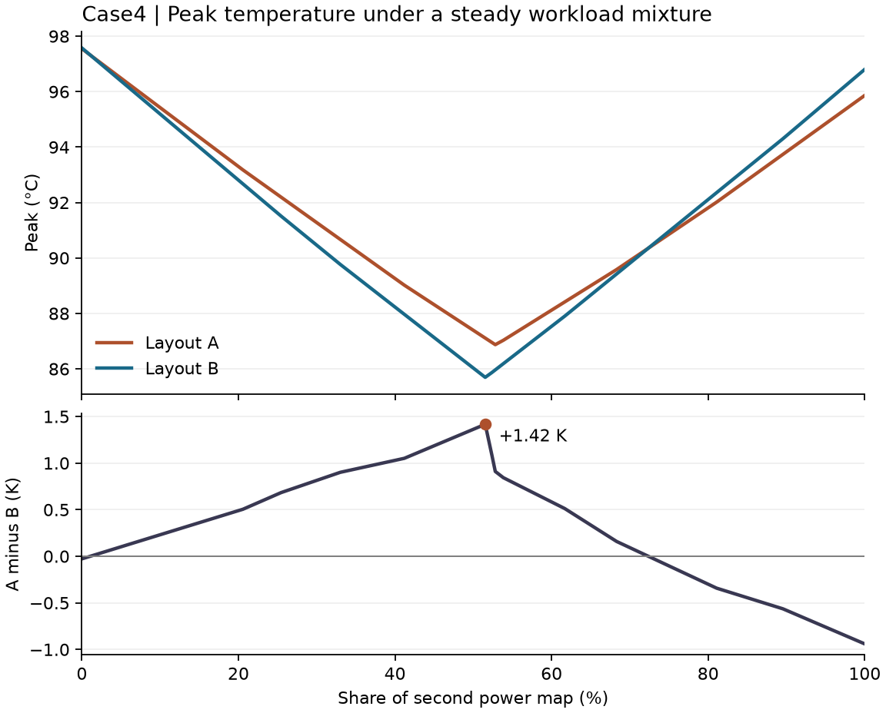

# 两个布局在连续稳态负载下，什么时候可以安全替换？

## 运行前约定

成功 fetch 后从 `b136adba989e997e232bee4c0b012d24c402e00e` 开始。前次研究给出同一布局的热上界；这里问给定同一互连预算，比较两个布局需要检查哪些负载。对每个布局固定材料、边界、网格和空间热源位置。两个非负功率图按比例混合，每个比例单独达到稳态。

预测：要得到候选 A 相对基准 B 的最大峰温差，只需检查两个端点及 **B 的最热点位置交替时**的混合比例。检查 A 的热点交替不是必要条件。若该最大值 ≤ 0，A 在任意混合下均可替代 B。第二个预测更具风险：这种区别在实际网表几何的有限布局池中可能改变布局选择。

- 先用两个对称被动二节点网络作解析反例。A 的热阻矩阵对角/非对角为 2/1.4，B 为 2.1/0.2 K/W，两个端点各向一个节点输入 1 W。检查能量平衡、可实现性和中间排名。
- 使用本机导入的 ATPlace Case1–10。每例从同一整数种子 20261119 初始化，现有合法放置器在 1 mm 网格、零附加净距上产生六个不同的有标号芯粒足印。最多 30 次调用，有生成失败则公开记录。用第五短的总引脚曼哈顿长度设为共同上限，保留所有达标布局（含并列）。该预算来自几何，未使用任何温度。这里的长度是逐引脚下界。
- 芯粒均给名义功率的 25%，选名义功率最大的两颗（同值取输入次序），分别单独加上两者较小名义功率的 75%，得到两个等总功率端点。这是合成活动迁移，功率逐颗不超过名义值。
- 每个合规布局在 48 网格上求两个端点的完整功率层温度场。对所有有序布局对比较端点最大温差与精确最大温差；用 1001 点等距扫查全部配对独立检查实现。记录端点误判次数、超过 0.1 K 的次数、最大漏估。每例另选一个有序对直接重解最不利混合：优先取端点判可替换的配对中最大漏估，其次取全部配对中最大漏估。对十例中上述见证漏估最大的两个案例，用 96 网格重新比较并独立求解其最不利混合。公开两档端点和最坏温差。
- 选择规则为最小化最坏温差：对每个混合比例，以同一预算池内当时最冷的布局为参照。对照只看端点与检查整个区间两种选法，平手选较短的布局，再按生成编号。报告更换布局的例数、最坏温差实际减少多少，以及所选布局的长度。候选池结果不外推为全局最优。0.000001 K 用于数值符号判定，0.1 K 是本实验报告量级的第二门槛。

十例共享模型与协议，配对之间重复使用相同布局。历史中已多次使用这些案例；本轮是对新命题的事前检验。独立验证仅在本机运行。

## 三种负载的追加检验约定

两负载初筛已看到 Case8 换布局。为查明它的决策意义，再用 96 网格对 Case8 的**整个原预算池**重选。随后检验规律是否依赖只混两种负载。选项目重点 Case3 和两负载换选的 Case8，复用相同的布局、种子和预算，取名义功率最大的三颗芯粒轮流增加活动，增量取三者最小名义功率的 75%，背景仍为 25%。48 网格上对全部有序配对，比只检查三条边（每条边连续优化）与检查整个三角形的最坏温差。独立按每 2% 一格的三角形网格扫描。直接重解每例中三角内部相对边界漏估最大的见证。若案例都没有明显的内部反转，也如实报告。

正控制选三节点、三种单位功率图：A 的对角/非对角热阻为 2/1，B 为 3/0.1 K/W。预期 A 在三条边上均可替代 B，在三种热源同时活动时反转。以上追加实验使用已有案例结果选择检验对象，不视为新案例的盲测。

## 回到 Case3 的实际接口预算

前两组使用源网表引脚和合成计算活动。最后一项直接复用已公布 NAS MPI 负载形状和局部 PHY 功率，检查规律在项目原有布局决策中能给多强的结论。源数据共有三套设计，纯负载下的原有结果已知。本次用前期移动实验的 31.6969223896 m 总引脚预算、25 mm 单根 CPU 信号距离、0.20 TB/s 有效吞吐，选择全部达标的已发布逐边配容设计。对四种归一化 NAS 需求及其全部稳态混合，芯粒基础热源固定，按每个设计已发布的路由比例混合局部端口发热。重新计算 64、96 网格的完整温度场，核对公开的纯模式峰温；检查最冷选择能否在整个四模式混合空间保持优势、至少冷多少，以及为此多用多少引脚长度。每档直接复算最小保证温差的见证。该算例是存档重用，互连能耗是模型值。

## 规律和算法

**比较 A 能否替代 B，最值得检查的是 B 的热点换位置的负载。** 在两个功率图之间，端点加上这些交替点就能给出 A 比 B 最多热多少。顺序有意义：要找 B 比 A 最多热多少，应以 A 为参照。

一个可以直接使用的特例：如果 B 有同一个位置在两种纯负载下都最热，那么该位置在所有混合下都最热，只比两个端点就够了。若两个布局只保存了各自的峰温标量，通常无法识别这个条件；保存两张带位置的端点温度场即可。

对每个布局分别写稳态能量守恒 `Gθ = P`，其中 θ 是相对于环境的温升。材料、散热边界和几何都固定时，线性方程保证每个位置在两种功率图之间的温度是直线。峰温是所有位置温度的上包络。设基准 B 在一个区间内由同一位置达到峰温。在这个区间，候选 A 的峰温减去 B 的峰温是凸函数，最大值可在区间端点取得。对所有区间取最大即得结论。候选 A、基准 B 各自可有不同网格、导热矩阵和热点位置，只需共用负载定义、温标及峰温的物理定义。使用有限个空间观测位置时，上述检查是有限的。[凸函数的逐点最大值与仿射运算，Boyd 与 Vandenberghe，第 3 章](https://web.stanford.edu/~boyd/cvxbook/)

在任意个纯模式的凸组合上，权重变成向量。基准某一位置最热的区域由线性不等式定义，最大温差可在该区域的一个顶点取得，包括负载空间内部的顶点。计算时不必构造整张分区图。记 a、b 分别为两布局某个位置在各纯负载下的温度向量；对 A 的每个可能热点，求最大 t，满足每个 B 位置均有 `t ≤ (a−b)·w`、`w ≥ 0`、`Σw = 1`，然后取最大的 t。两负载用斜率排序构造上包络，多负载用小型线性规划。模型内结论适用于固定散热条件的稳态仿射热响应；快速切换涉及热容和负载历史，温控调频、随温度变化的泄漏或风扇控制也需要各自的响应模型。[实现](../src/chiplet_floorplanning/placement/dominance.py)

应用到选择时，令 `R(A) = max_w [T_A(w) − min_B T_B(w)]`；B 遍历同一线长预算下的有限候选池。把最内层改写成 `max_B (T_A−T_B)` 后，两个取最大可以交换，因此所有有序配对的验算即可给出每个布局的最坏落后温差。选择 R 最小者。若 A 替代 B 同时还要求线长不增加，另查 `L_A ≤ L_B`。只查共同预算回答的是同一预算下的温度选择。

为何要写明“稳态”？取两个从环境温度开始的单节点封装。A 的热阻为 1 K/W、热容为 0.1 J/K，B 为 2 K/W、10 J/K。A 在任何恒定正功率下的稳态温升都是 B 的一半，然而同加 1 W 阶跃，0.1 s 时按 `θ(t)=PR(1−exp(−t/RC))`，A 已升温 0.632 K，B 只升温 0.010 K。单凭稳态胜出无法推出短脉冲期间也胜出。

## 实验结果

**被动热网络。** 两节点控制中，A 在两个端点都冷 0.10 K，在各发 0.5 W 时却热 0.55 K。两套导热矩阵都有正的节点间导热和对环境导热，每次输入 1 W、排出 1 W。三节点控制更强：即使三条边上的所有混合都已检查，A 仍可在等比例三模下热 0.267 K，而所有边上的最大温差为 −0.050 K。原因是分摊负载后，两套布局的集中热点减弱程度不同。

**十例几何。** 每例六个合法布局，按线长保留五个，6–61 颗芯粒，共 200 个有序配对。端点筛选接纳了 65 次替换，连续负载推翻其中 5 次，涉及 Case1、2、4、10；4 次超过 0.1 K。每个基准需要检查的含端点混合数最少 3、中位 4、最多 14。1001 点独立全单元扫描对最坏温差的最大漏估为 0.00793 K。表中温差为 A 减 B；负值表示 A 更冷。两组见证中的 A 都同时使用更短的引脚总长度。[源案例](https://github.com/PKU-IDEA/ATPlace_pub/tree/fe3dbfdaf78dc0ddeac3a2cfc3a85ff0971f88df/cases) · [坐标、端点曲线与全部配对](evidence/layout-dominance-v1.json)

| 事前选择的复核对 | A / B 引脚总长 (m) | 网格 | 端点 0 / 1 温差 (K) | 最坏时第二种功率图占比 | 最大温差 (K) |
|---|---:|---:|---:|---:|---:|
| Case4，3 对 2 | 292.953 / 319.434 | 48 | −0.220 / −0.980 | 51.4% | +1.403 |
| 同一对 | 292.953 / 319.434 | 96 | −0.028 / −0.940 | 51.5% | +1.416 |
| Case10，0 对 4 | 154.333 / 187.808 | 48 | −0.628 / −2.119 | 47.2% | +0.263 |
| 同一对 | 154.333 / 187.808 | 96 | −0.077 / −2.164 | 46.8% | +0.378 |



Case4 细网格见证的直接稳态解为 A **87.111 °C**、B **85.694 °C**。Case10 为 76.744 和 76.366 °C。两次都只改负载权重，总输入功率分别一直为 608.75 和 326.5 W。

**选点的实际效应。** 十例中九例得到同一选择。Case8 在 52.827 m 预算下从布局 2（52.827 m）换到布局 4（46.153 m）。48 网格的最坏落后温差从 0.470 降到 0.395 K；整个候选池在 96 网格上重选，仍然从 2 换到 4，从 0.493 降到 0.402 K。两档收益均小于 0.1 K。第二轮把第三颗芯粒纳入活动迁移，在 Case3 和 Case8 中各查 20 个有序对，完整三角形比连续检查三条边多找到的最大温差分别为 0.097 与 0.090 K。两例中都没有发现边界判可替换、内部却被推翻的配对。三节点解析控制给出了这种情况在物理上可发生的例子。[全部三模配对、直接重解和 Case8 细网格选点](evidence/layout-dominance-simplex-v1.json)

**有端口约束的 Case3。** 三个存档布局中两个达到 31.696922 m 和 25 mm 的预算，均安装 (4,3,2,1) 个模块、共用 0.20 TB/s 吞吐目标。短布局用 25.991 m，长布局用 28.374 m，第三个需 32.781 m。在四个 NAS 模式的一切稳态混合下，长布局比短布局至少冷 0.939 K（64 网格）和 0.783 K（96 网格），代价为 2.383 m 引脚距离。96 网格中，保证值出现在 68.9% IS 加 31.1% WH；直接重算分别是 107.688 和 108.471 °C。在共同的 109 °C 温限下，两套皆达标，因此短布局仍是这两个选择中用线最少的。这个应用沿用以实跑通信量确定的需求形状、建模的端口功耗、固定的计算功率和路由。它评价两个已知坐标在连续负载空间的温度余量。[逐边容量、长度、纯模式与最坏混合](evidence/case3-nas-dominance-v1.json)

## 本地复现

用 `tools/import_atplace_cases.py` 从上述固定版本导入十个案例。安装本仓库及 NumPy、SciPy；生成图另需 Matplotlib。下列 `CASES` 代表导入目录。

```text
python tools/layout_dominance.py --cases CASES --output results/two-loads.json --figure results/case4.png
python tools/layout_dominance_simplex.py --cases CASES --two-mode results/two-loads.json --output results/three-loads.json
python tools/case3_nas_dominance.py --case CASES/Case3.json --output results/four-loads.json
```

本机复算两次的十例配对记录逐项相同；用 A、B 两条曲线所有折点的并集独立核对 200 个最大温差。原有全套 192 项测试及新增 4 项专项测试通过。双芯粒 CLI 校验与评估通过，3 W、34.1886 °C，时序未运行。
