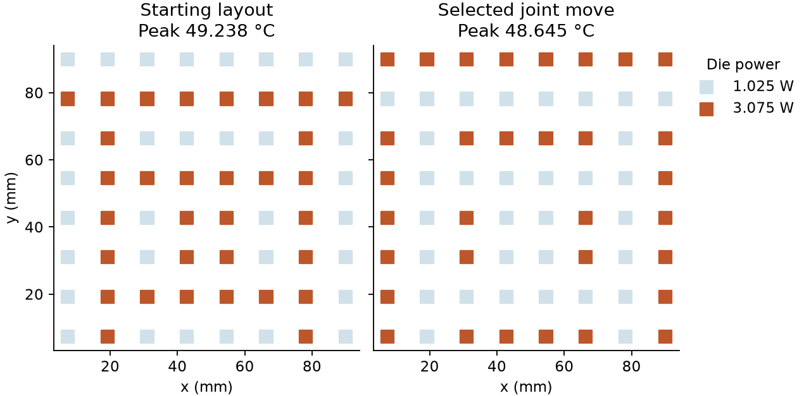

# 互连双上限允许改变功率图时，能否靠两次核验降温？

## 双上限下的布局结果

原 64 颗 folded torus、原功率身份在全部八个合法排列中始终保持同一功率图，前轮 **0 K** 结论保持成立。这轮只改变工作负载的芯粒功率分配。向内工况仍用同一张 128 链网表、131.2 W 总功率、1.921795193 m 总长和 16.086124266 mm 最长链。算法选中了一个具体的跨行布局：十六个 2×2 块同时把四个身份各移到对角槽，全部 64 颗都跨一行。数值峰温从 **49.238322 降至 48.644897 °C**。两项引脚长度都与起点相同。一幅图对应一个完整布局，颜色为芯粒功率。



表中“近峰”取上一张整板温场中距峰温 0.1 K 内的功率层单元。所有方法共用单种子和每例至多两次新布局核验。前六行及后两行分别对应初始协议与之后预先公布的非对称检验。所有六例的方向分组、随机种子和留出网表都在阶段开始时固定，并列和近峰两条选择规则为后续分阶段增加。每组都在温度评价前公开了各自的几何清单。[六例原始结果](evidence/movable-power-results.json) · [两例扰动结果](evidence/movable-power-asymmetric-results.json) · [扰动几何清单](evidence/movable-power-asymmetric-geometry.json)

| 工况 | 合规功率图 | 起点 °C | relation_space 槽位 °C | 近峰 °C | 近峰降温 K | 盲抽降温 K | 槽位基线 / 近峰总用时 s |
|---|---:|---:|---:|---:|---:|---:|---:|
| 64 torus · 向内 | 8 | 49.238 | 49.238 | 48.645 | 0.593 | 0.317 | 3.912 / 0.348 |
| 64 torus · 向外 | 8 | 48.645 | 48.645 | 48.645 | 0.000 | 0.000 | 3.794 / 0.343 |
| 64 torus · 棋盘 | 2 | 48.894 | 48.894 | 48.894 | 0.000 | 0.000 | 3.746 / 0.323 |
| 64 torus · 随机 | 8 | 48.971 | 48.971 | 48.843 | 0.128 | 0.128 | 3.786 / 0.325 |
| 64 圆柱 · 同一随机功率 | 2 | 48.971 | 48.971 | 48.843 | 0.128 | 0.128 | 3.703 / 0.614 |
| 24 mesh · 随机 | 1 | 47.702 | 47.702 | 47.702 | 0.000 | 0.000 | 2.380 / 0.098 |
| 64 torus · 向内加扰动 | 8 | 49.236 | 49.236 | 48.652 | 0.583 | 0.311 | 3.798 / 0.341 |
| 48 torus · 随机加扰动 | 8 | 48.399 | 48.399 | 48.399 | 0.000 | 0.000 | 3.128 / 0.268 |

反向指标取各工况起点峰温为上限。八例近峰方法在该上限内找到的最短总长分别等于各自起点值：64 颗 torus 为 1.921795193 m、圆柱为 1.201047844 m、24 颗 mesh 为 0.162959097 m、48 颗 torus 为 1.424192805 m。对应布局的最长链分别为 16.086124、16.086124、4.288397、16.086124 mm。相同的随机功率在 torus 与圆柱**选中完全相同的身份映射**，均为 64 颗芯粒在相邻列间同行换位，改变了 32 个槽位的功率。圆柱只剩两张合规图，盲抽也一定覆盖另一张。这是连接图改变后仍允许相同动作的对照，两项 0.128 K 关联，不能当成两份独立的热优势证据。

## 少算哪些响应，会漏掉什么

| 方法 | 八例总用时 s | 新布局核验合计 | 热响应行数 | 降温 ≥0.1 K 的工况 | 达到固定槽位最冷值 | 在本臂内判清剩余量的工况 |
|---|---:|---:|---:|---:|---:|---:|
| relation_space 槽位投影 | 28.247 | 0 | — | 0 | 4 | — |
| relation_space 原生 | 29.386 | 16 | — | 0 | 4 | — |
| 盲抽合规图 | 2.309 | 12 | 0 | 4 | 6 | 3 |
| 单个热点 | 2.346 | 11 | 18 | 4 | 8 | 5 |
| 每颗芯粒的起点热点 | 2.953 | 5 | 437 | 4 | 8 | 8 |
| 全部并列热点 | 2.337 | 10 | 24 | 4 | 8 | 7 |
| 距峰温 0.1 K 内的点 | 2.660 | 7 | 228 | 4 | 8 | 8 |

近峰规则八例共 7 次新核验，另外使用 228 次伴随反解。用时比槽位投影基线少 90.6%，比同池盲抽多 15.2%。盲抽在向内和其扰动副本分别漏掉 0.277、0.273 K。单热点已经找齐八个最冷值，近峰的收益在于给出更紧的剩余降温上界。在每个芯粒上都取起点热点也能判清八例，用时 2.953 s。只有 1–8 张功率图时，38 次伴随回代可能比按图全部回代更贵。本轮遵守核验预算，未计时遍历所有图的全场求解，不能推出一般性的全场加速比。两个 relation_space 入口是各自独立的小预算运行，历史 1,000 次求解的表现仍单独保留。槽位投影在八例都没有消耗额外热核验，原生入口各用两次但都保留起点。

- **方向可反转。** 向内工况可以降 0.593425 K，交换同一批芯粒的高低功率，向外工况已经最冷。棋盘工况有两张不同功率图，整板峰温在数值容差内相等。新的 48 颗、不同功率的工况有八张功率图，零降温结论覆盖全部。24 颗 mesh 的零降温则直接来自几何上唯一的解。
- **完全并列是一个特殊条件。** 单热点在向内与向外案例做完两次核验，仍分别留下 0.195382 和 0.138578 K；把相同峰温的点都纳入，六个原工况的剩余量全部归零。打破并列后，64 颗向内扰动案例上同一规则留下 0.198468 K；用 0.1 K 窗口、38 行响应和一次新布局整板核验将剩余上界收紧至数值零，且选中同一个跨行配置，实际降 0.583325 K。相反，在 48 颗扰动例，只取单热点也能判清。0.1 K 窗口用于选点，停止和证书仍按 10⁻⁷ K 量级处理。
- **工作负载和规模限制。** 向内与向外工况刻意让功率与可达 2×2 分组相关。沿编号加扰动的向内例继续使用同一动作。盲抽与单热点共享相同的完整几何生成器，更能检验温度信息带来的增量。几何最多搜索 1,862 个节点、最多留下八张不同功率图。这些结果没有覆盖一般二维连续落点、大量合法功率图与独立实测工作负载。

本机使用 i7-12700、Python 3.12.16、NumPy 2.5.4、SciPy 1.18.1。完整回归完成后，各臂顺序单独计时。每臂含一次输入构建、自己的候选生成与过滤、热系统构建、全部前向和伴随求解及最终独立三维复算。共同三维起点和复算各一份另计在次数之外，时间均已计入。计时起点在 Python 导入之后，不含解释器启动、第三方网表克隆、预先发布清单和写实验报告。墙钟来自单轮，臂顺序固定，没有统计置信区间。Windows 下将项目 src、tools 加入 PYTHONPATH，数值库线程设为 1，RapidChiplet 固定在 17176f92c91eda629a25bc11bf7959d6b963a23b。 单独发布八例几何清单的原始时间合计 0.639 s，在线各臂再次做几何生成所需的时间算在上表。额外核对了 56 次“方法 × 工况”的峰温和反向指标：从保存的坐标逐网重算两项引脚量、独立重建最冷点、检查同一功率图跨臂核验的一致性，并从已存温度下界逐项复算剩余量。三维封装复算最大能量不平衡 1.06e-11 W。221 项本地回归通过，双芯粒 CLI 的 3.0 W 输入守恒、峰温 34.188607 °C。

## 从热平衡到一次联合布局选择

在固定封装、材料、接触、边界和功率分布形状下，令 `A` 为接到环境的稳态导热矩阵，`B` 把各槽位的瓦数按面积分到热源单元。把芯粒身份同时指派给槽位后得到功率向量 `p`。热量守恒给出 `A (T−Tamb) = B p`。因此位置 i 的温度为 `Tamb + rᵢ·p`，其中一次伴随求解给出 `rᵢ = Bᵀ A⁻ᵀ eᵢ`，单位 K/W。联合移动在该处的温差为各槽位功率变化乘以对应热响应的**带符号之和**。移动前后的芯粒总功率保持不变，局部仍可升温或降温。

操作上先用实际引脚和槽位互斥找出能同时放得下的身份组合。在已观察的热点集合 S 上，`L(p) = maxᵢ∈S (Tamb + rᵢ·p)` 是该布局真实峰温的下界。选 L 最低的布局做一次整板核验，把它的热点也加入 S。这一次求得的响应可以评价全部布局。若当前已验最低峰温为 U，则其余布局最多还可再降 `max(0, U − min L)`，已验布局的 L 换为整板核验所得峰温，计算时保留数值容差。几何枚举完整时这个界覆盖所有固定槽位的指派。没有用芯粒离中心的远近决定搜索方向。中心距离仅用于构造一对可控的正反工况。

把它写成布局规则更直接。设旧峰温为 P，位置 i 的温度余量为 `mᵢ=P−Tᵢ`。目标降温 g 可行的充要热条件是对每个 i 都有 `rᵢ·Δp ≤ mᵢ−g`。旧热点余量为零，所以只要任何一个旧热点没有降温，峰温就不可能严格下降。原本较冷的位置还有余量，它们也可能在协同移动后接管峰值。选少数位置先检查这些必要条件，整板补查暴露的新热点。这个条件适用于不同连接图和功率向量，具体哪几颗能一起移则由各自的引脚与槽位决定。

改变芯粒热导、厚度、散热路径或温度依赖功耗会改变这一计算的前提。这里每颗芯粒几何、材质及片内均匀供热形状相同，环境温度为 45 °C，使用八层线性三维封装、顶面对流与底面绝热。热点取遍功率层活跃单元。峰温经选中布局独立重建复算。两项互连量是方向确定的实际引脚的曼哈顿长度，本轮没有走线拥塞、通道时序或实测温度判定。

## 补充观察规则（单热点试算之后）

冻结清单后，单热点选择在向内工况降了 0.593425 K，向外工况保留起点。两次核验后两者仍分别可能再降 0.195382 K 和 0.138578 K。随机角色在两张 64 颗网表上都降了 0.127863 K，棋盘与 24 颗对照为零。在读取其他比较臂结果之前，增加一条只改变观察位置的规则。已付费的温场若在多处同时达到峰温，保留距该峰温 10⁻⁷ K 内的所有功率层节点，把这些节点的响应同时用于其他可行布局。容差沿用本阶段的数值平局标准。比较同样两次核验下的可行峰温、剩余上界、观察行数和端到端时间。记录该规则在本阶段的开发来源，单列原始冻结比较。

## 破坏并列热点的检验（新工况运行前）

六个冻结工况的比较中，并列热点规则用 0–6 行响应就判清了固定槽位最优。为专门检验这个结果对精确对称的依赖，增加两个尚未评价的工况。第一个为同一 8×8 torus 的向内功率，第二个为 6×8 folded torus 的同种子随机平衡功率。对两者都在芯粒身份 i 上添加 `0.0205 × (2i/(N−1)−1)` W。扰动总和为零，最小功率仍为正。这是已知的稳态输入变化，两组工作的起点均取各自原身份的总长及最长链。记录完整功率向量，发布新的几何清单后再做热求解。

七种方法在相同预算下对照。新增一臂保留已求温场里距峰温 **0.1 K** 内的全部功率层节点，仍使用原有两次核验和数值停止标准。0.1 K 来自此前声明的实际决策分辨率。检验它补回了哪些实质性的剩余降温上界、是否导致更多伴随计算，以及在不同功率和不同网表上能否稳定缩短总时间。原六例和新增两例全部报告，不改变最初冻结的臂和工况。

## 实验前冻结

几何阶段在读取新工况温度前完成。四个 64 颗 folded torus 工况依次有 8、8、2、8 张合法功率图，几何均为同样的八个身份排列。留出的 64 颗圆柱图有 256 个满足最长链的身份排列，加总长上限后剩 2 个，分别产生不同功率图。24 颗 mesh 仍只有起点。六次搜索全部穷尽，故表里的多个热图确实对应固定几何模型中的不同引脚合规候选。此处几何检查仅包含指定的槽位、朝向、间隙和引脚双上限。[冻结的完整几何清单](evidence/movable-power-geometry.json)

2026-11-20 已 fetch，远端与本地 `main` 同为 `782a1657c190a81c30056443cfd03eb49e20583a`。只在本机运行。承接[双上限的零降温结果](dual-cap-joint-placement.md)，先发布以下选例与选择规则，再把不含温度的几何清单推送到 GitHub，然后揭晓热结果。

- 主例沿用 8×8 RapidChiplet folded torus 的 128 条实际引脚连接、原始身份槽位、朝向和三维封装，全阶段只用种子 20261119。上限仍是起点实际的 1.921795192845845 m 总长、16.086124265754524 mm 最长单链。每个工况在同一网表上重新分配 32 颗低功率、32 颗高功率的工作角色，分别为 1.025 W、3.075 W，总功率均为 131.2 W。功率随身份移动。这些是控制实验的输入。
- 在读取新温度前固定四个 64 颗工况。每个已知 2×2 可达组中，两颗离载板中心最近的芯粒设为高功率（按槽位网格距离平方，平距取原编号小者），取其补集作为反向对照。第三个工况按行列之和的奇偶交错，主动找“有不同热图但峰温相等”的反例。第四个工况取固定种子的随机排列前一半为高功率，不用可达组信息。
- 留出同规模的新连接图。水平使用 RapidChiplet folded torus 的原始水平方向网，垂直使用同网格 mesh 的原始垂直方向网，组成单轴折叠环绕的圆柱连接。用同一份随机功率，与 folded torus 配对。另在原 24 颗 mesh 上用同一生成规则作刚性对照。每张网表都守住各自起点的精确总长与最长链。这两例的温度均不用于改方法。
- 第一阶段仅做几何。每例列出至少两张不同合法功率图的身份见证（若存在），保留完整候选清单、网表指纹、功率和原始引脚两项上限。统一 5,000 个分支节点上限，若未穷尽，只给已访问集合的结论。所有六例均保留。前一阶段的六颗移动上限会排除原网表中的任何变化，本次由所有芯粒一起选合法落点。
- 同一热预算比较五臂。主基线为上轮的 `relation_space` 槽位投影适配，另报其原生小预算连续布局。三个共同几何池臂分别为从起点全局最热点开始、从每颗芯粒的起点热点开始、固定种子均匀抽取不同的合规功率图。各臂保留起点，至多两次新候选整板核验，共同起点和最终独立复建另各一次。盲抽不读取热点。其余两臂每次取已观察位置中预测峰温最低的未核验图，平局依次取最短总长和固定枚举次序，并加入新核验场的最热位置。核验过的图以真值作为下界。若已见最低真值与所有其他图的下界相差不超过 10⁻⁷ K，可以提前结束。
- 主要指标是双上限下最低整板三维峰温，反向指标是在不超过起点峰温时达到的最短总长，报告同一布局的最长链。另报全部墙钟、伴随行、实际候选核验数，以及最佳已见点尚可再降多少的上界。几何完整时才能将此界用于所有槽位排列。0.1 K 沿用上轮的实际改善门槛。完整温度场最多核验两次，不另做完整池的热穷举。硬件资源、输入构建、几何枚举、观察响应和最终复算按臂计时。独立发布几何清单的一次离线时间另报。

## 独立 Chat 审稿

Chat 通过已连接的 GitHub 静态复核了从 `782a165` 到 `aec31d3720d04a27f8b9e85b4846367dfabd5dad` 的提交、选例顺序、两组几何与温度 JSON、几何枚举、热点选择及 relation_space 入口。审稿认可固定槽位内的降温结果和剩余上界。向内工况的单点核验结果、0.195382 K 未决量和近峰的 38 行响应均获抽查。论文整体 **Weak Reject**，数学与实现 4/5、评测严谨性 4/5、新意 3/5、代表性和实际 EDA 适用性各 2/5。审稿仅静态读取，所有实验仍由本机完成。[完整 ICCAD 复核](https://chatgpt.com/c/6affd32b-c9ac-83e8-92c1-d6a88ddd9472)

独立意见特别区分“找到”与“判清”：单点法 8/8 找到最冷值，5/8 能凭自己的记录判清；近峰法两项都是 8/8，付出 228 行伴随响应。审稿提出功率相同的多个身份映射可能使起点代表的语义混淆。审稿后逐项核对，两份冻结清单中全部八例的第零项都是原身份排列；驱动也先将真实起点写入候选，若同功率图由另一个较短身份实现，会将它另列。当前数据无需纠正。可在今后扩大候选池时进一步覆盖并列和数值停止边界。

最有区分力的下一步是在测温前冻结拥有数百张合法功率图的案例，维持两次新布局核验，同时事前限制伴随回代或墙钟。按相同几何池比较盲抽、单热点、近峰及直接整板评价的实际成本，把最佳温度、剩余可降温上界和累计时间随池规模一起报告。离线计算的参考最优值应对在线算法隐藏。这轮最多八张功率图、功率人为构造、计时单次，规模化收益仍待检验。

## 本地复现

在项目环境中，使用该仓库已有的 RapidChiplet 检出和固定几何证据。结果写入本地 results 文件夹。compare 会重新枚举并比对几何及网表指纹。

```powershell
$env:PYTHONPATH = 'src;tools'
$env:OPENBLAS_NUM_THREADS = '1'
$env:OMP_NUM_THREADS = '1'
$env:MKL_NUM_THREADS = '1'
python tools/compare_movable_power.py compare --upstream local/rapidchiplet-holdout --geometry docs/evidence/movable-power-geometry.json --output results/movable-power-results.json
python tools/compare_movable_power.py compare --challenge --upstream local/rapidchiplet-holdout --geometry docs/evidence/movable-power-asymmetric-geometry.json --output results/movable-power-asymmetric-results.json
python tools/plot_movable_power.py --output results/movable-power-layout.png
```

用 geometry 替代 compare，可以将只含引脚、功率与几何见证的新清单写入 --geometry 指定的本地路径。绘图默认使用 docs/evidence 内已发布的结果。用 --evidence 可以指定同时存有几何与结果的其他目录。
