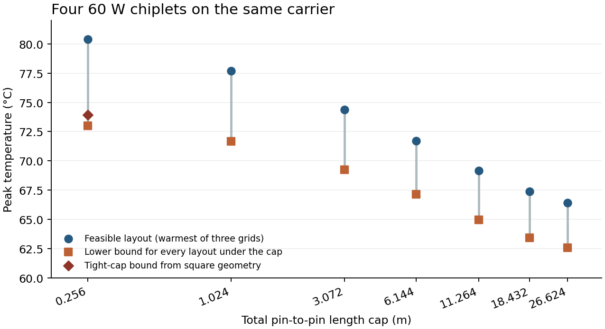
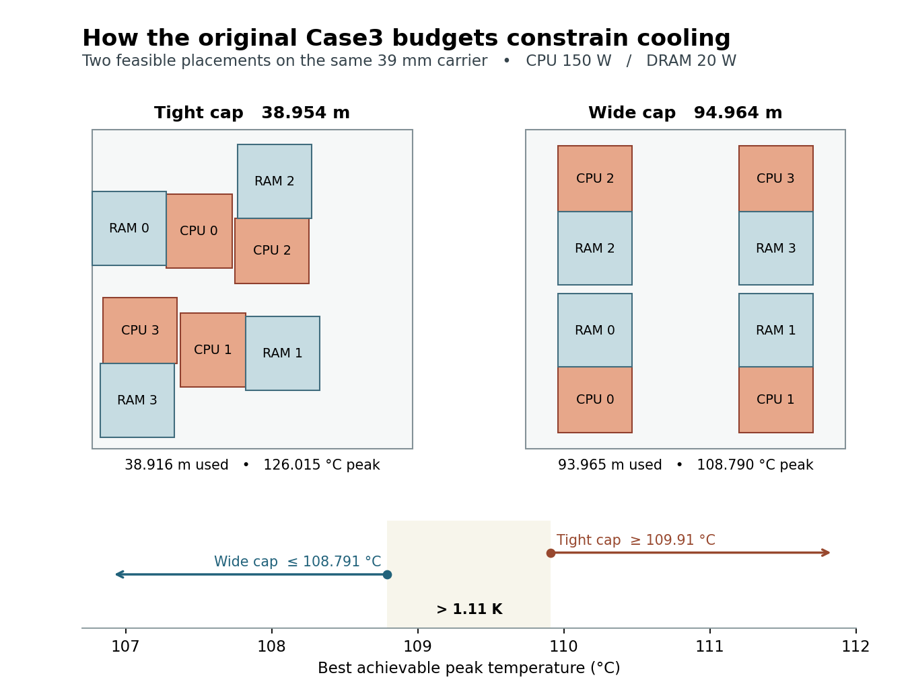
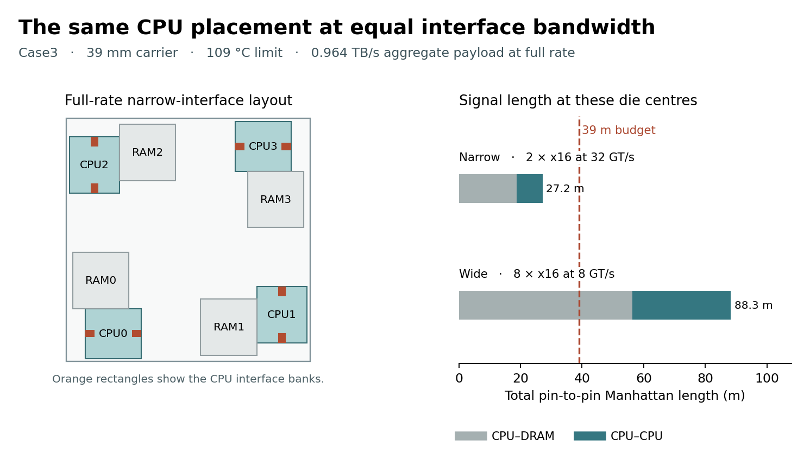
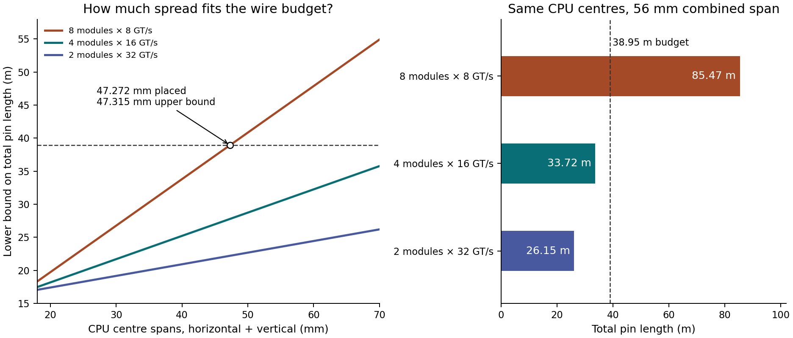
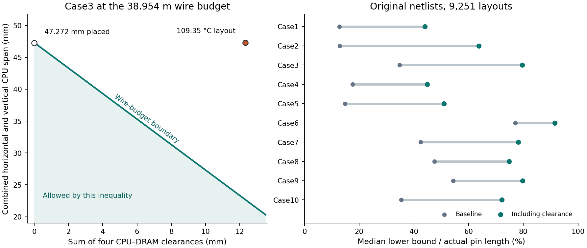
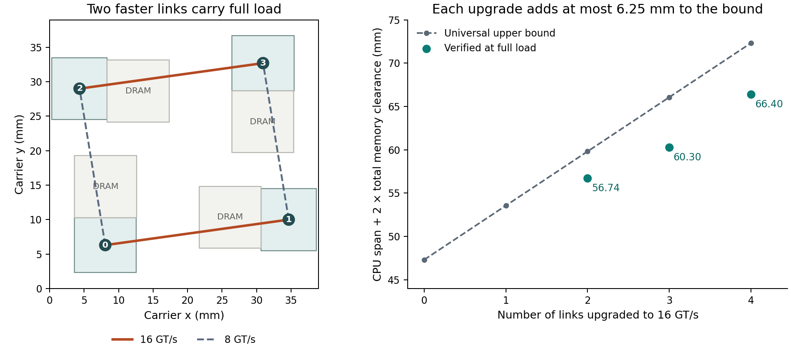
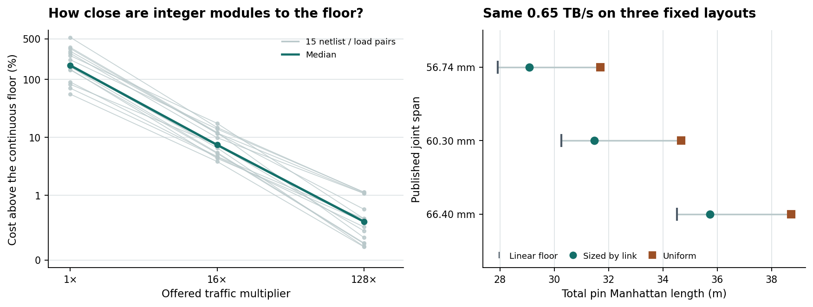
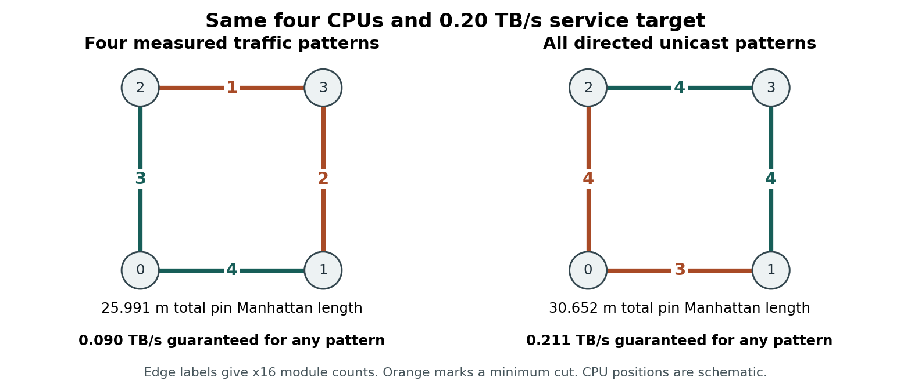

# Overall：研究记录与逐项验收

目前已建立能运行的布局、热、互连和时序研究组件，**R3 接通的是简化稳态热模型
与中心距离代理；新的 Case1 小验收已接通源 pin 距离与热评估**。真实端口—走线—温度相关功耗/延迟—时序约束
尚未在这个优化实验中闭合。不能把组件测试通过或算法分数改善写成完整物理闭合。

用户在 2026-11-12 要求汇总全部记录并一点一点验收。本页是持续更新的总入口；
历史结果保留，通过的范围、失败和未完成项分别记录。验收用于定位下一项修改，
不重新扩大为制造签核或无止境精度校准。

截至 `56f3af6`：Case1–10 算法比较、接口温度敏感性、封装/负载杠杆已有有限模型内的
结果，真实封装校准与完整接口 setup/hold 闭环仍未完成。上一轮边缘 pin 取温与接口
输入身份缺陷已修复；最新直接搜索与吞吐量工具又复现三项 P2，涉及布局身份、不可行
结果汇总及并列排名，见文末及[证据](evidence/code-review-56f3af6.json)。94 项测试通过
不能替代这些边界检查，也不等于新耦合方向已经验收。

## 当前验收表

| 顺序 | 要回答的问题 | 当前裁决 | 证据及下一步 |
| --- | --- | --- | --- |
| 1 案例 | 到底在优化什么系统，哪些是源数据、哪些是假设？ | 当前三例的尺寸、功率、需求与锁定配置逐项一致；限定来源验收通过 | [案例与物理验收](case-physical-acceptance.md)、[论文实验对照](paper-experiment-comparison.md)。论文默认 45 mm 与代码配置 50 mm 分开说明；ATPlace 案例是作者构造的公开基准。 |
| 2 热物理 | 布局变化是否真正改变材料/热源，热量是否有明确去路？ | 简化稳态边值问题与数值记账通过；真实封装有效性仍有限 | [FV 契约](tap-fv-contract.md)、[准入](tap-fv-admission.md)、[敏感度](tap-sensitivity-results.md)。固定功率、均质材料、明确 Robin 边界；同矩阵解一致不等于独立物理验证。 |
| 3 指标 | 所谓优化收益是否来自满足同一约束的实际布局？ | 指标迁移及独立 Chat 核算通过 | [定义](tap-r3-metrics.md)、[历史重算](tap-physical-metric-results.md)、[审核](tap-physical-metric-review.md)。主指标为共同距离预算下的配对降温，保留选中布局、约束满足情况与全部三档。 |
| 4 算法 | 改进算子是否提高布局质量，而不只是提高合法率？ | R3 执行与比较验收通过；稳定算法优势未通过，Chat 同意此裁决 | [正式结果](tap-online-r3-results.md)、[审核](tap-online-r3-review.md)：18 次全部完成并通过回放，复用 27 条旧基线。合法变异减少拒绝，但主指标收益 0 / +0.374 / +0.150 K，MultiGPU 反向距离指标中位数变差 9.962%。 |
| 5 扩展 | 在更多芯粒与实际 pin 位置下是否仍有效？ | B/C 已审查；D/E/F 本地执行通过，未形成稳定质量优势；按用户决定保留待审核 | [表示](atplace-case1-slack-results.md)、[候选预筛](atplace-case1-guided-slack-results.md)、[约束选择](atplace-case1-constrained-selection-results.md)：F 的种群可行数 4→12→16，选择目标已对齐；但较 E 变热 0.090 K，反向距离增加 9.934%。保留 B/C/D 更好联合点和有限负结果，不用可行数代替温度质量。 |
| 6 耦合结论 | 是否证明真实热—时序耦合改变布局决策？ | 未证明 | [三布局晶体管/STA结果](xyce-three-layout-results.md)。 Linux 复现与接收端 setup/hold 扣除后排序判定不变，但裕量约 10 ns、效应仅几 ps，见[扣除结果](receiver-constraint-plan.md)。需要明确接口、通道、工作点和约束后再回答；R3 不承担这个尚未接通的问题。 |
| 7 必要布线与边界稳健性 | 当前候选能否通过有限资源检查，降温是否依赖单一热边界？ | 本地验收及 Chat 独立复核通过限定范围；绝对温度准入在两档边界下失效 | [分项结果](atplace-case1-routing-boundary-results.md)、[独立复核](atplace-case1-routing-boundary-review.md)：Chat 重算 173280 条必要条件并审查边界与输入身份；三档扰动仍是 B < D < E < F < base。必要切割检查不证明详细布通；本次不包含 D/E/F 完整算法历史复审。 |
| 8 热等价朝向与候选生成 | 能否先低成本改善 pins，再把热预算用于位置变化？ | 本地及 Chat 限定验收通过；额外降温未通过，反向距离改善 | [结果](atplace-case1-orientation-results.md)、[Chat 完整复核](atplace-case1-orientation-review.md)：两组主点同为 103.515212°C；修复组该点距离 36.805343 m。反向指标 38.228435→35.775123 m（6.418%），但不是同一个主点。共同四起点、单种子、每组 16 次查询，不与旧冷启动搜索排名。 |
| 9 第一性原理与历史利用 | 为什么没有额外降温，算法还有什么直接问题？ | 重复全局 pin 计算已修复；遗漏的冷布局已重新准入 | [详细分析](atplace-first-principles-analysis.md)：255 个输入精确等价，长度计算减少 48.72%，初次本地计时 11.155→2.121 s。按 Chat 指出的 B40 扩展检查 246 个历史输入，88 个恢复距离可行性；主已知参考更新为 102.919524°C / 60.185154 m，均无新增热查询。 |
| 10 温度反馈位置搜索 | 相同多步能力下，温度引导父代能否找到更冷位置？ | 本地及 Chat 独立复核通过限定收益，较温度盲组冷 0.293 K；尚未超过历史最冷参考 | [完整结果](atplace-case1-temperature-feedback-results.md)：共同 B/D repaired 起点，各 16 新热查询，温度引导达到 103.221375°C / 31.536031 m；反向距离 32.596435→29.082719 m（10.779%）。历史 102.919524°C 只作参考，不免费混入搜索轨迹。376 项测试、255 输入等价与完整回放通过。 |
| 11 紧参考距离预算 | 距离约束活跃后，温度反馈是否仍有降温优势？ | 本地及新 Chat 有限正收益验收通过：较温度盲组低 0.324 K，未超过同预算历史参考 | [完整结果](atplace-case1-tight-budget-results.md)、[独立复核](atplace-case1-tight-budget-review.md)：C24 共同起点、L≤35.0147365608 m、各 16 新热；两组分别拒绝 8/3 个超距离候选。引导主点 104.231285°C / 32.465071 m，反向距离改善 3.761%。377 测试及完整回放通过，Chat 核对 ec6b829，未发现致失效错误。 |
| 12 搜索步长 | 固定 2 mm 是否限制小预算下找到更冷布局？ | 本地单因素验收通过：1 mm 低 0.381266 K，但反向距离变差 9.916%；新结果待独立复核 | [完整结果](atplace-case1-step-size-results.md)：同 C24、原 256 响应缓存及每组 16 次收费评价，重放 2 mm 基线，仅新增 16 次本地热求解。1 mm 主点 103.850018°C / 32.904712 m，仍比历史参考热 0.628644 K。379 测试、CLI 与两轨迹回放通过；该新冷点不在 2 mm 坐标余数类内，但未穷举 2 mm 子空间。 |
| 13 代码与评估成本 | 逐阶段叠加的代码与 16 次热查询预算是否反映真实约束？ | 否；已重构并删除旧代码，复现改为绑定提交 | [复现说明](code-history-and-replay.md)：冻结源文件哈希链迫使每个想法新增一层文件；新 `placement` 核心对全部 519 个历史 Case1 布局峰温差 ≤1.6e-8 K。一次 FV 评价约 0.25 s，pin 长度 numpy 75 µs（原 Decimal 12 ms）；每臂 16 次查询仅约 4 s 计算。未冻结的 2000 个构造随机合法布局诊断（eex005，17 s）峰温 100.68–110.25°C，最冷点 L=92.6 m；同距离下未超过历史参考，且最短 46.8 m，达不到 35.0 m 紧预算。下一步：按算力计预算，检验叠加热代理误差，求 Case1 参考前沿，再扩展 Case2–10。 |
| 14 Case1 参考前沿 | 真实算力下同一模型能到哪里？叠加代理能否替代 FV？ | 历史各阶段远离可达前沿；代理只可排序预筛 | [结果](case1-reference-front-results.md)：单种子 2 万次精确 FV、236 s。紧预算 L≤35.0147 m 得 102.6681°C / 26.175 m（历史参考 103.2214°C / 31.536 m）；L≤60.185 m 得 100.7165°C（历史 102.9195°C）；T≤102.9195°C 仅需 23.800 m（历史 60.185 m）。冻结必要容量筛查全部通过，最大利用率 17.3%。叠加代理 Spearman 0.965，但平均偏高 1.76 K、标准差 0.74 K，不作结果温度。近似参考前沿，非全局最优，不是同小预算算法比较。 |

## 历史记录的含义

| 工作线 | 已得到的证据 | 不能据此推出的结论 |
| --- | --- | --- |
| Windows、OpenSTA 与多案例平台 | [本地入口](windows-local.md)、[42 组时序参数和四热输入](local-multicase-results.md)、[多 Lane](multilane-timing-results.md)、[共享路由](shared-routing-results.md) | 软件可运行和逐路径记账正确，不等于高速 chiplet PHY 或真实封装签核。 |
| Pad、通道与源模型 | [Pad 诊断](pad-diagnostic-results.md)、[来源审计](pad-provenance-results.md)、[被动通道](passive-channel-results.md)、[温度模型](local-temperature-capability.md) | 保留模型不一致与不可用工作点；未将失败的 Pad 模型自动准入。 |
| 公开测量与 TTC | [实测拟合](measured-calibration-results.md)、[观测算子](ttc-observation-results.md)、[空间对照](ttc-spatial-results.md)、[稳态数值](ttc-numerical-closure-results.md)、[瞬态](ttc-package-transient-results.md)、[边界](ttc-package-boundary-results.md) | 条件拟合、特定网格数值闭合不等于目标 chiplet 封装的材料/边界已被实测校准。 |
| 联合决策与晶体管对照 | [决策基准](integrated-decision-results.md)、[成对布局](paired-transistor-layouts.md)、[异温 Fabric](xyce-three-layout-results.md) | 有温度交互不等于最优排序反转；已测候选未证明真实联合优化优势。 |
| TAP 几何、路由与 IHP | [独立几何域](tap-geometry-domains.md)、[粗图路由](tap-global-routing-results.md)、[IHP 局部访问](tap-ihp-local-access-results.md) | 粗粒度可路由、局部 Pad 几何通过不等于完整详细布线、回流和电气约束通过。 |
| 热求解器与边界 | [原生 HotSpot 拒绝证据](tap-native-boundary-audit.md)、[当前 FV/HiTS](tap-fv-admission.md) | 原生配置曾存在边界污染内部系数；已明确拒绝。当前模型通过守恒，不宣称复现原生温度。 |
| 搜索结构与基线 | [有限域参考](tap-algorithm-reference-results.md)、[移动结构](tap-search-structure-results.md)、[45 次在线基线](tap-online-pilot-results.md) | 小域连通性和经验 Pareto 改善不证明大域全局最优或稳定优于成熟方法。 |
| 指标修正与监督 | [物理指标迁移](tap-physical-metric-results.md)、[R1](tap-online-r1-review.md)、[R2](tap-online-r2-review.md)、[指标审核](tap-physical-metric-review.md) | Chat 独立读代码/重算证据与本地实际运行分别记账；批准下一阶段不等于研究问题已解决。 |

完整受版本控制的记录索引见 [research-record-index.json](evidence/research-record-index.json)。
该索引包含历史计划、结果、审核、图和紧凑证据及其 Git blob 标识；索引完整不代表
本轮重新独立审核了每一条旧记录。本地原始查询/日志在忽略目录 `results/`，源码依赖
在 `local/`，不把受限模型、环境或大批中间文件提交到 GitHub。

## 接下来的修改顺序

冻结 R3 已完整收尾并经 Chat 审核，保留负结果，不追加种子或事后修改权重。Case1
pin—几何—热链已接通，四向布局状态与热缓存已分离；其三布局检查经 Chat 独立复核后，
已按[冻结协议](atplace-case1-search-protocol.md)完成[单种子小预算比较](atplace-case1-search-results.md)：
同一 NSGA-II 框架，仅比较合法变异与 pin 预算引导，每方法 16 个共同初始热查询加 32 个
在线新热查询，共 96 次。执行与回放通过，主指标及反向指标本次均有收益，但 pin 引导
多花约 5.28 s。332 项测试和两芯粒 CLI 通过；没有追加种子或改变阈值。
Chat 已读取完整代码、结果及相关 Git 历史，独立重算全部 99 行并验收当前有限正收益。
合法双亲交叉已按[冻结协议](atplace-case1-crossover-protocol.md)完成一次同种子、同初始化、
同成本上限的 48 热查询，复用冻结 B 基线；339 项本地测试、两芯粒 CLI 和完整结果回放通过。
[结果](atplace-case1-crossover-results.md)是主指标变热 1.247 K、反向距离改善 17.708%，
不能用零非法提议宣布总体改进。36 次交叉有 24 次退回父代，其中 19 次是不同布局没有
合法混合，下一项应针对具体机制而不是继续强调合法率。
已明确 h 作用面积为 200×200 mm，对流热阻是 0.009 K/W，不将它误称为 0.1 K/W 实测
封装边界；48 次热输入核对尺寸、逐芯粒功率、局部 pins、材料及边界均保持不变。
Chat 已独立复核本阶段 Git 历史、99 行布局、2,304 个交叉掩码和物理边界推导，
认可执行及权衡结论。依其建议又完成现有日志的零热查询冲突蕴含图诊断，19 次不同
父布局的六个继承变量全在一个 SCC，故只允许整套继承 A 或 B。这个分组依赖父代，
不是永久芯粒组或热耦合分组。341 项测试通过；物理/搜索执行代码未因诊断改变。
针对绝对姿态继承造成的锁定，已实现[相对分离图＋可调空隙表示](atplace-case1-slack-protocol.md)：
继承一套可行几何关系，重组相对空隙后解码刚体坐标，不改变芯粒面积、功率或热边界。
旧 B/C 全部 99 个布局可精确编码还原；347 项测试和两芯粒 CLI 通过。
已按冻结计划完成 D 对 C 的单种子 48 查询实验，全部记录回放及固定物理签名核对通过。
[结果](atplace-case1-slack-results.md)：D 29/32 次交叉产生新合法状态，主指标较 C 降温
0.119 K，反向距离增加 17.249%；较 B 主指标变热 1.129 K，反向距离缩短 3.514%。
同一个实际 row 45 被 D 的两个约束指标选中。代码结果已推送；[Chat 审核请求](atplace-case1-slack-review.md)
已准备，但页面点击发送后仍停在输入框；2026-11-13 用户选择先保留待审核，目前尚无独立审核结论。
本轮不追加种子/热查询；几何表示机制成立，不等于稳定质量优势。

2026-11-13 用户要求继续后，已实现[空隙重组的距离预算引导 E](atplace-case1-guided-slack-protocol.md)：
每次最多四个合法重构候选，用实际 pin 距离优先选择满足原 L0 的候选，温度仍由原热
模型求解。保留 D 为直接基线、物理条件和 48 热查询额度不变。352 项测试与两芯粒 CLI
通过；已完成 E 的 48 次本地热求解及全部候选池/事件/实际热输入回放。
[负结果](atplace-case1-guided-slack-results.md)：距离可行布局 17→22，主指标反而变热
0.185 K、反向距离增加 5.749%；103 次新增交叉 pin 预筛没有形成最终质量收益。
14 次选中可行点中 1 次被变异移出预算，频数不能解释全部温差原因。保持历史更好联合点，
下一项单独检验无约束 Pareto 选择压力与固定 L0 下降温目标是否错位。
Chat 保持待审核，不将本地验证称为独立审核。

用户随后明确要求将选择规则对齐固定距离预算下的降温目标。已实现并冻结
[F：约束温度选择](atplace-case1-constrained-selection-protocol.md)，父代和生存者均优先
保留 L≤L0 的布局，再比较实际温度；不可行时先减小距离超额。直接沿用 E 的交叉和
变异，保留全部已评估布局用于反向指标和档案。356 项测试及两芯粒 CLI 通过，
F 的 48 次本地热查询、完整保存响应回放及两代实际选择排序核对均完成。
[结果](atplace-case1-constrained-selection-results.md)：种群可行数 4→12→16（E 为 4→10→13），
主指标却较 E 变热 0.090 K，反向距离增加 9.934%；相对共同初始点仅降温 0.001936 K。
历史 B 同模型中已有更冷可行点，不把选择对齐或可行性提高宣称为算法质量进步。
保留负结果，当前不追加预算、种子或选择启发式，Chat 继续待审核。
对影响布局决策的物理不确定性，用少量最终候选做独立同条件
对照或有界敏感度核查。需要真实时序结论时，再单独接通明确的接口/通道与时序约束。

用户随后要求先补必要布线约束、再检查最终候选的热边界。已完成
[容量筛选与边界验收](atplace-case1-routing-boundary-results.md)：热求解/缓存前检查
真实源 pins 的有限截面、bin 出口及理想终端接入资源。原 F 48 行全部通过，最紧
所检验条件为 264/1500=17.6%，两个联合赢家不变。没有调低容量制造冲突，也没有
将条件通过称为实际布通；旧优化器保留冻结状态。本轮用旧档案筛选，新增优化热查询 0。
实施/协议/筛选先推送 `a63da67`，364 项测试与两芯粒 CLI 通过后，按固定五候选、
三边界扰动完成 15 次本地热求解。功率与其他物理条件固定，排序均为 B、D、E、F、base。
B/F 相对同边界 base 降温分别为 3.33–4.07 / 2.11–2.54 K；冷却减半及加入一档
TIM/spreader 面热阻后，五候选都超过原绝对 T0，故只验收测试场景内相对收益的
一致性。保留 B/D 优良联合点，不追加种子、容量档或精度校准。详细路由和真实
时序仍未接通，Chat 继续待审核。

2026-11-13 已通过现有 Chrome 网页接口取得完整 [Chat 复核](atplace-case1-routing-boundary-review.md)，
实际审核远端 `c78c810`。本轮必要布线与边界处理通过独立限定复核；之前 D/E/F
完整算法历史待审核的状态不因此改变。Chat 建议结束这轮物理检查，仅增加热等价
朝向修复。已实现一次源顺序扫描：不改变命名物理边界，正方形四向、矩形半转；
实际 pins 重新评估并检查必要容量，物理热身份和完整布局状态分开保存。
370 项测试和两芯粒 CLI 通过，包含旋转前后实际热矩阵/功率向量相同的检查。
零热验收复现 B/D 距离 38.2284345476/53.4276809224 m，温度沿用同物理问题的
103.7122705749/104.8408820399°C。原 B/D 的 ±2 mm 单芯粒移动产生 13+12=25 个
合法候选；原朝向 21 个满足 L0，修复后 25 个满足，全部通过必要布线。
实施与[冻结协议](atplace-case1-orientation-protocol.md)已先推送 `e983b64`，随后按共同四起点、
共同顺序完成两组各 16 次本地热查询，32 条实际输入/响应、事件、成本和联合指标
通过保存响应回放。两组同样降温 0.197059 K 至 103.515212°C，修复没有额外降温；
修复组主点距离 36.805343 m，反向点则为 104.877521°C / 35.775123 m，较控制组反向
距离缩短 6.418%。不拼接两项最小值，不把 21→25 个距离可行候选当作降温优势。
这次修复额外花费 300 次候选 pin 计算，未证明总体加速或稳定搜索优势。
[完整结果](atplace-case1-orientation-results.md)保留这项有限正/负结论；不追加种子或算子。
该阶段后来已通过 [Chat 完整复核](atplace-case1-orientation-review.md)，并由审核指出
历史 B40 经方向修复已提供更冷参考。纯朝向不改变单个热几何的温度，但可使旧冷点
重新满足距离预算；后续实验必须区分历史参考、响应缓存与实际搜索父代。

从第一性原理进一步推进后，已将方向处理与热几何搜索分离。精确 incident-net 更新
先推送 `4f70f27`；按 Chat 指出的历史 B40 修复同名义物理模型的整个已有档案，
225 个热几何保留 448 个联合状态，88 个输入恢复原距离准入，没有新增热查询。
Chat 要求两组都能多步扩展，以避免对照混合两个因素；同时分开历史参考、缓存和
实际起点。已按[最终协议](atplace-case1-temperature-feedback-protocol.md)先推送
`f108f72`，再只在本地完成单种子各 16 查询的温度盲/温度引导对照。
[结果](atplace-case1-temperature-feedback-results.md)：温度引导较对照低 0.292725 K，
反向距离改善 10.779%；主点仍比历史参考热 0.301851 K。两组主点 GPU/CPU 位置相同，
温差来自这次 HBM 联合位置变化所改变的热问题，不以 GPU 间距代理解释全部温度。
376 项测试、255 输入旧/新 pins 决策等价和 32 条响应/完整策略回放通过。当前没有
紧距离约束下的优势或全局最优证据，也未完成真实 Pad/时序闭合。保留有限正负结论，
不追加种子、预算或算子；本阶段随后已通过 [Chat 独立复核](atplace-case1-temperature-feedback-review.md)，审核 SHA 为 `499cf42`。

2026-11-13 对 `499cf42` 的 Chat 完整审核已结束：255 输入的逐步方向决策、41 个候选事件、42 个联合行和实际父代选择独立重算通过。未发现须使上一实验失效的错误。按其建议，新阶段以 C24 repaired 的固定 pin 成本为唯一预算和共同起点，保持旧物理模型；实现与计划先推送 `972fba0`，377 项测试及两芯粒 CLI 通过后，仅本地执行 16+16 小预算对照。真实容量上限与参考几何成本要求严格分开。

紧预算[结果](atplace-case1-tight-budget-results.md)与 32 条保存响应回放已完成：
温度盲/引导的主点分别为 104.555723°C / 32.102383 m 与 104.231285°C / 32.465071 m，
引导降温 0.324438 K，反向距离改善 3.761%。两组分别拒绝 8/3 个超预算候选，
必要布线均通过且最紧利用率仅 13.2%，不称实际路由容量已饱和。引导组主点到
其反向点只移动 GPU0 的 y 坐标 +2 mm，距离降低 2.816 m、峰温上升 1.354464 K，
提供模型内局部热—互连取舍证据。两点都在预算内，且本轮起点与上轮不同，
因此不能据此量化收紧预算的最优温度代价。当前引导主点仍比同预算已知参考热
1.009910 K，固定 2 mm 动作的坐标余数限制仍在。不追加预算或种子；原 Chat
在完成上一审核后达到会话长度上限，紧预算阶段随后使用新会话完成复核。

2026-11-13 新 [Chat 审核](atplace-case1-tight-budget-review.md)实际读取 ec6b829 与
冻结 972fba0 的差异，核对两组账本、父代选择、联合赢家和物理解释，接受有限正收益。
按其建议冻结[步长对照](atplace-case1-step-size-protocol.md)，仅将固定 2 mm 改为
1 mm；旧核心、起点、阈值、共享知识和预算保持不变。旧基线完整重放，新组仍将
外部保存响应记为收费评价，实际本地求解数另计；379 项测试和两芯粒 CLI 通过。
预检合法邻居 8→16、距离合格 2→8，但这不预示降温结果。HBM2 的矩形朝向也
限制历史冷参考可达性；本轮不同时加入旋转算子，先完成这一个问题的验收。

协议先推送 `ed21ab1` 并核实远端后，已按原预算完成 1 mm 的 16 次本地求解；
[结果与完整回放](atplace-case1-step-size-results.md)通过。主点由 104.231285°C /
32.465071 m 改善至 103.850018°C / 32.904712 m，低 0.381266 K；反向距离从
29.649071 m 增至 32.589194 m（变差 9.916%），net 计算增加 25%。本次新冷点的
四个坐标改变模 2 mm 余数；直接对子 GPU1 y=32→33 mm 在原 42 mm 载体域内
降低峰温 0.765878 K，而 +2 mm 会越界，说明细步长确实用到了边缘剩余空间。
保持原允许齐边的几何域、780 W 与热边界，没有额外放宽物理条件。未超过历史
103.221375°C 参考，也未穷举 2 mm 子空间，不作普遍算法优越或全局最优结论。
新结果待下一次 Chat 复核，再单独选择细步长精修或矩形朝向扩展，不同时堆叠。

## 2026-11-13 热校准与真实时序的接口检查

问题：全局峰温和总 pin 距离改善，能否推导局部器件温度、逐通道 setup/hold 改善？
本轮分析代码 `a17455b97a606879720507c1433f2bf795cce8ef`；开始和记录前 fetch 均成功，
origin/main 与该版本一致。未改求解器或优化器，仅对两个已发表的 Case1 固定布局
各做一次原 FV 求解，保持输入哈希、1 mm 间隙、64 网格分辨率及原热边界。
[紧凑证据](evidence/thermal-timing-gap-analysis-v1.json)记录选点、输入身份和观测定义。

| 观测 | 历史冷参考 | 当前 reference front 选点 |
| --- | ---: | ---: |
| 全局功率层峰温，°C | 103.221375 | 102.668106 |
| 总 pin Manhattan 距离，m | 31.536031 | 26.174834 |
| 最长单 net pin 距离，mm | 20.081001 | 21.709002 |
| HBM_1 区域峰温，°C | 87.592598 | 89.263543 |
| HBM_1 区域面积加权均温，°C | 83.173086 | 83.882855 |

全局峰温下降 0.553269 K、总距离下降 17.0002%，但 3168 条 net 中有 528 条变长，
最长的单条增量为 3 mm；HBM_1 区域峰温上升 1.670945 K。通过范围是同模型内的
反例：聚合指标改善不蕴含逐芯粒、逐 net 改善。区域温度未映射至实际 Pad/晶体管，
pin 距离没有详细路由，不能据此宣布真实时序恶化，也不否定原指标下的布局收益。

热证据保持分层：[TTC 实测拟合](measured-calibration-results.md)及
[观测协议核对](ttc-observation-results.md)支持特定试验载体的条件预测；风冷热容
弱可辨识、传感器位置与功率切换观测歧义仍在。重新读取原论文第 10 页确认了
100°C 保护断电及已知传感器位置的观测，末端温度不能自动视作恒功率稳态。
该载体参数不能直接迁移至当前 chiplet 封装。已有少量
[边界检查](atplace-case1-routing-boundary-results.md)支持测试点相对排序稳定，但
固定温度上限在弱冷却/附加接触热阻下失效，不追加同类精度或边界扫描。

时序方面，本轮只重算历史紧凑报告，未重跑 PDK/SPICE/STA：96/96 路径对排序稳定，
85/96 有可分辨热交互；绝对布局对窗口差的 STA/Xyce 分歧最高 45.244699 ps。
[三布局实验](xyce-three-layout-results.md)的窗口未扣独立表征的接收器 setup/hold，
不能改称物理裕量。直接读取固定 Basilisk SDC 又确认其特定四分之一周期关系，
不应套用历史演示的半周期假设。原始晶体管波形及受限 PDK 未在本机重新验证。

下一项修改限定为选定一个有来源的接口，固定匹配的端点/库、真实时钟相位及工作
条件，接通逐通道走线、局部温度、早晚到达和接收约束，在少量固定布局上检验是否
影响约束满足及决策。当前算法比较继续保留已声明的 FV/pin 指标；真实封装绝对温度
与真实 setup/hold 仍未验收。本轮记录不主张新增优化器收益或全物理签核。
生产代码和已有输入未变，复用同一 SHA 的 64 项测试及两个示例 CLI 通过证据；
新增两点峰温与发表值相差低于 1e-6 K，net 总数和聚合算术检查通过。

## 2026-11-14 最新代码深度审查

问题：新增向量化 FV、CG 求解、逐芯粒指标和冻结比较计划是否引入执行或比较错误？
分析 `34001c5e0290afa799b1e4a17d10835f2c086941`，开始及结束复核的 origin fetch 成功，
远端与分析版本相同。沿当前输入、几何、热求解和搜索/报告链检查，
[审查证据](evidence/code-review-34001c5.json)记录以下两项**已复现、未修复**的问题：

- P1：`package.solve_spd` 使用 `cg(..., rtol=...)`，但依赖仍允许 SciPy 1.11。
  在隔离的 SciPy 1.11.4 中运行原分层两芯粒 CLI，直接报
  `TypeError: cg() got an unexpected keyword argument 'rtol'`；无法进入直接法回退。
  下一项应统一最低依赖与所调用 API，或兼容已声明版本，并验证最低依赖。
- P2：`epsilon_search` 的阶段切换清除了全局轮数停止状态，末尾又覆盖停止原因。
  两芯粒、三长度阈值、`max_rounds=1` 的实测中，Pareto 搜索在 1 轮停止并报告
  `round_cap`；epsilon 执行 3 轮、7 次求解，并错误报告 `stalled`。
  FV 求解预算没有超支；问题是轮数上限及记录不一致。下一项应保留跨阶段的全局
  停止状态，将阶段预算/停滞重置与全局轮数限制分开。

通过范围：SciPy 1.13.1 环境的 65 项现有测试和两个示例 CLI 通过；六种算法分别完成
6 次 FV 预算的 Case1 烟测，局部温度数组与布局对应，逐芯粒最大峰温与全局峰温一致。
另对比较工具执行了单方法、4 次求解的 freeze/execute/report 全流程。
六个固定输入（含旧 LP 边界案例、分层示例及 Case1/8/10）对照向量化前的循环组装：
节点、右端及边界相同，矩阵最大相对差低于 2.1e-16；新 CG 与直接法最大温差
低于 6.7e-11 K，均通过原守恒及残差检查。十份冻结计划的参考文件哈希均匹配。

本轮只提交审查记录，不修改生产代码，不重跑完整 Case1–10 比较；数值等价证据
不扩展为真实热校准或时序验证。原始日志和隔离依赖保留在忽略的
`results/deep-review-34001c5/`，没有改变全局 Python 环境。

## 2026-11-14 拓扑 LP 精确提速（不影响进行中的比较 v2）

比较 v2 中 topology_lp 每种子 1184–2060 s，其余方法 15–30 s；FV 预算相同，时间几乎全在 LP。
原因是每条网络一个变量（Case6：5632 条网络、11304 变量）。同一芯粒对的网络只依赖中心差，
按芯粒对聚合为凸分段线性上镜图后变量降到几十到几百，最优值不变（新增与逐网络 LP 的等价测试），
扫描起点改为最短解中分离度最大者。v2 冻结在 `bbff17f`，照原代码完成并如实报告耗时；新写法用于之后的实验。

## 2026-11-14 修复：审查两项与比较 v1 中止

- 比较 v1（`e58532f` 代码、`34001c5` 计划）在 Case4/6/1/5 的 `topology_lp` 中止：
  FV 解未通过 1e-8 W 残差检查。取出 Case4 失败布局复现：LP 顶点按 1e-3 µm 取整，
  加上 1 nm 安全余量，芯粒边缘相距 1 nm，网格出现 1e-6 mm 薄片单元，
  矩阵对角线跨度 5e-11–8.6e6；CG 残差 9.7e-6 W，直接法 2.4e-7 W，二者温差仅 4e-8 K。
  检查按设计拦截了病态问题，不是求解器错误。修复：LP 布局角点吸附到 1 µm 网格
  （取整单调，整数 µm 尺寸、间隙与载板下保持合法；仍逐个精确检查合法性），删除余量重试。
  Case3 已完成的结果在旧代码下产生，不使用；全部十例以修复后代码重新冻结计划
  （阈值与参考前沿不变，只换代码提交）并重跑。
- P1：最低依赖改为 SciPy ≥ 1.12（`cg` 的 `rtol` 自 1.12 起提供）；在 NumPy 1.26.4 /
  SciPy 1.12.0 隔离环境中 67 项测试与两个示例 CLI（含分层示例）通过。
- P2：轮数上限改为跨阶段全局：`restart` 不清除 `round_cap`，epsilon 遇到即停止，结束时保留该原因。
  新增回归测试：三阈值、`max_rounds=1` 下 Pareto 与 epsilon 都只跑 1 轮并报告 `round_cap`。

## 2026-11-14 修复后的继续审查

分析 `bbff17fa0241d7009d3363af2a4e19378df9d1a7`，开始和结束检查的 origin fetch
均成功、远端一致。问题限定为上一轮修复是否完整，以及合法输入能否完整走完报告链。
[本轮证据](evidence/code-review-bbff17f.json)保留复现参数与结果，不修改生产代码。

- 已关闭：依赖下限改为 SciPy 1.12，解决此前允许 1.11 却使用 `rtol` 的不一致。
  原 100 次求解预算、`max_rounds=1` 的 epsilon 复现现在正确停止于 1 轮。
- P2，修复仍不完整：阶段预算耗尽和全局轮数上限同时发生时，`keep_going` 优先记录
  `budget`，随后 `restart` 又清除它。将原两芯粒复现的预算改为 7，其余保持相同，
  Pareto 在 1 轮、3 次求解停止；epsilon 仍执行 3 轮、7 次求解并报告 `budget`。
  需要在进入后续阶段/提议前直接检查累计轮数，不能仅依赖停止原因字符串。
  FV 次数没有超出总预算；本项针对全局轮数限制。
- P2，新发现：比较报告的相对距离差直接除以最优距离，未定义零基线行为。
  两个 1×1 mm 芯粒在 2×1 mm 载板齐边放置，各 1 W，一条网络的边界 pin 重合，
  是当前 `gap=0` 域内的合法输入，Manhattan 下界为 0。实际执行参考前沿、freeze、
  execute 均完成，report 在 `run_method_comparison.py:167` 报 `ZeroDivisionError`。
  应保留绝对距离差并明确零基线下相对差未定义，或规定其他明确语义；不添加任意
  epsilon 分母。本例是支持域内的合成输入，不声称现有十个 ATPlace 前沿存在零基线。

通过范围：当前环境 67 项测试通过；Case1/4/6 各一个固定父布局的六点 LP sweep，
共 18 个候选均在 1 µm 角点网格上，实际 FV 求解均通过原残差和守恒检查。
原固定布局 CLI 及其全部求解模块/示例相对上一轮未改变，复用两例 CLI 通过记录。
本轮未重跑完整十案例比较，未将有限数值检查扩展成物理校准或时序结论。
原始日志与输入保留在 `results/deep-review-bbff17f/`；两项问题已在下一提交修复：
`restart` 不再依赖停止原因字符串，epsilon 进入每个阈值阶段前直接检查累计轮数（`out_of_rounds`），
`finish` 在总预算未耗尽时把达到轮数上限记为 `round_cap`；回归测试增加预算 7 的复现，旧代码下 epsilon 跑 3 轮、新代码 1 轮。
报告新增绝对距离差 `length_gap_m`，最优距离为 0 的阈值不给相对差（已注明未定义），新增零基线报告测试。
正在运行的比较 v2 冻结在 `bbff17f` worktree，不受影响；其十例前沿最短距离均大于 0。

## 2026-11-15 链路可达距离 × 布局 × 温度：新颖性核查与可行性检查

[核查记录](link-reach-novelty.md)：现有热感知布局都用线性线长；PlaceIT 由布局推出拓扑，但没有温度，长度上限只是单一阈值；
Hetero-IF、CLIPGen、ThermoDSE 都不做布局与温度的联合。公开数据显示，链路能耗与可达距离在 2–4 mm（硅中介层/桥）与 10–25 mm（有机基板）
处分档，跨一到两个数量级。前沿检查：全局最冷布局几乎没有 ≤ 4 mm 的网络（中位数 14–51 mm），最短布局有 14–72%。
限定：ATPlace 的 pin 不是边缘 PHY，正式实验需先建立链路映射与分档代价模型。

## 2026-11-15 链路可达距离的热代价：一阶约束（R = 2 mm 下 3 例 ≥ 5 K，6 例找不到可行布局）

[计划与结果](reach-cost-plan.md)，证据 [reach-cost-v3.json](evidence/reach-cost-v3.json)。
要求所有通信芯粒对的矩形间隙 ≤ R 后，与不限距离的最冷布局比，峰温代价如下：
- R = 2 mm：Case1 5.5、Case2 1.9、Case3 14.9、Case4 20.9 K，其余 6 例没有找到可行布局；
- R = 4 mm：5 例 ≥ 5 K，3 例找不到；
- R = 25 mm：0–4.2 K。
这比冷板耦合（1–2 K）大一个数量级，线长代理看不到它。

v1、v2 的贪心下降在多芯粒例子中找不到可行布局。v3 改用精确的可达距离 LP 加拓扑下降。这些都是运行后修正，判定规则不变，三版都报告。
限定：
- 单种子；
- 链路长度是矩形间隙，没有带宽密度与边缘长度限制；
- 结果不说明实际设计应怎样在硅桥与有机基板之间分档。
下一步是分档混合联合优化，需要另写冻结计划。

[深入分析](reach-tier-analysis.md)：
- v3 的统一档位把 Analog–MEMS 这类低速链路也强制为 2 mm，"找不到可行布局"有人为放大的成分。
- 链路能耗只占封装功率的约 1%，不构成取舍；只看桥的数量也没有取舍。
- 真正的取舍是：热芯粒对之间的带宽，与它们必须相邻带来的温度。另一个候选是 HBM 被迫相邻时的内存温度上限。
- 下一步先按链路类型拆分代价（已在 eex005 运行）。

**新颖性更正**：Coskun、Kahng 等人的 TCAD 2020《Cross-Layer Co-Optimization of Network Design and Chiplet Placement in 2.5D Systems》式 (3) 已对每条链路施加可达长度约束，并与热感知布局、µbump 边缘开销、链路流水线和网络拓扑联合优化。
"可达距离与温度冲突"不是新问题；分档混合相对该文是扩展。详见[核查更正](link-reach-novelty.md)。
HBM 温度上限与 GPU 邻近的问题也已有工作（Karfakis、Gupta 等人的 embedded isolators，结论是布局作用有限，主要耦合经均热板）。这条线不再作为主问题，见[分析](reach-tier-analysis.md)第 5–6 节。

## 2026-11-16 与 ATPlace2.5D 的 10 例正式对比

[计划与结果](atplace-comparison-plan.md)，两种热模型（我们的 FV 与 ATPlace 的 ATSim）双向评估：
- **正式判定（冻结前沿）：无优势**。两种模型下各胜 3 例（Case1、3、5），ATPlace 胜 0 例。
- **补充（新方法 relation_space，计划外，单种子，1000 FV）**：两种模型下各胜 7 例（Case1、4、5、6、7、9、10），ATPlace 胜 0 例；同线长下最大降温 1.8–14.0 K。
- ATPlace 默认参数下 5 例训练失败；放宽采样时限后 Case5、6 成功，Case8–10 在 600 s 下仍失败。
- 新方法每例 42–1,017 s；ATPlace 每例 646–6,859 s。

**后续审查更正（`2e01a85`）**：上述为现有脚本的输出，尚不能接受为原六点协议的
完整十例判定。Case8–10 各缺五个热感知点；relation_space 的七胜中有两胜只对比了
线长模式。完整七例中为五胜。见本文末尾状态复核与
[逐例计数证据](evidence/code-status-2e01a85.json)。

## 2026-11-16 方法论文（路线 A）：新方法、与 ATPlace 的对比进展、两轮评审修正

**方法**：`relation_space` = 整数规划选朝向与相对位置关系（有 Gurobi 时用 Gurobi，否则 HiGHS）+ 精确线长 LP + 线长退火 → `topology_slp`（拓扑探索 + 伴随梯度序列 LP，每步精确 FV 确认）。
详见[速度与质量分析](method-speed-quality-analysis.md)和[基线说明](atplace-baseline.md)。

**已有证据**
- 我们的 FV 与 ATSim 排序一致：Spearman 0.973–1.000，去掉例相关偏移后残差标准差 0.08–0.84 K。
- 短线长端：Gurobi 版在 Case1–5、7 上追平或短于 ATPlace 线长模式（Case5 41.49 对 41.16 m，Case7 9.90 对 11.02 m）。
- 初步对比（6 例，冻结前沿）：我方胜 3–4 例，ATPlace 无胜例。
- ATPlace 默认参数下 Case5、6、8、9、10 训练热模型失败；采样时限放宽到 120 s 后 Case5、6 成功；放宽到 600 s 后 Case8、9 仍失败，只有线长模式结果。

**评审修正**
- `18e6b30`：SLP 链超出预算（预算 12 时实际 16 次）。已在 `04413cc`、`d72354b` 修正，此前的 topology_slp 结果报告的 FV 偏低最多约 14%，只作开发参考。
- `6e2e644`：6 项 P2，已在 `8dbf545` 修正，每项附带在旧代码上失败的回归测试：
  - 多模式评估器与 SLP 混用；
  - 被裁掉的任务被标成已尝试；
  - 去重忽略旋转；
  - 命令行参数类型；
  - `--length-caps-m` 未传入搜索；
  - 零功率时热点移动崩溃。
  受影响的 rs-grb-v2 与变体对比 v3 已停止，以修正后的 rs-grb-v3、bench-slp-v4 为准。

## 2026-11-16 芯粒内部功率不均匀时的朝向：上界筛查判"值得校准"

[计划与结果](intra-die-orientation-plan.md)：计算芯粒的一半承担 80% 功率（上界模板），只做 180° 翻转，位置不变。
- 朝向收益 ≥ 3 K 的有 4 例：Case3 16.6、Case4 5.8、Case5 5.1、Case9 4.0 K。
- 事后分析：收益集中在紧凑布局上，Case3 的压缩代价从 31 K（均匀）变为 23 K（最优朝向）。所以线长与温度的取舍曲线会变，但只在少数几颗大功率芯粒紧密排列时明显。
- 冻结的"布局后悔"指标在构造上不敏感，已如实注明。
- 下一步要确认真实芯粒的功率分布是否足够不对称。

## 2026-11-16 芯粒内部朝向的校准：不确定，只对 CPU+GPU 同片的异构芯片成立

[计划与结果](intra-die-orientation-plan.md)：不对称阈值 f\* = 0.65，即至少 3 例朝向收益 ≥ 3 K 所需的最小 f。
- 实测的 APU（CPU 与 GPU 同片，红外反演）等效 f = 0.74–0.76，超过阈值；
- 按功能拆开的同构芯粒（Zen 4 CCD、GH100、Sapphire Rapids 瓦片）按公开布局估计 f ≈ 0.5–0.55，低于阈值。
判定"不确定"：只有一种芯粒达标。对现有的同构芯粒基准，朝向基本无关；只有含异构大芯片的封装才值得继续，而这需要新的基准。

## 2026-11-16 可达距离代价按链路类型拆分：来自计算芯粒之间

[计划与结果](reach-split-plan.md)：只约束计算–计算链路时，代价为 5.1–18.9 K（Case9 未找到可行布局）；只约束计算–内存链路时为 −0.1 到 0.5 K（Case9 为 3.9 K）。
判定 A 成立（5/5），B 不成立（0 例）。两者的后续都已因文献覆盖而取消，只作记录。

## 2026-11-15 文献地图：先查空白再选题

[文献地图](thermal-placement-literature-map.md)把与布局、温度一起优化过的量列成表，包括线长、面积、应力、链路与拓扑、HBM、封装材料、架构粒度、液冷，并标出我们已做过的实验。
第一轮针对性检索的结果：
- 光芯粒位置以热调谐功耗为目标（调谐功耗取决于温度摆幅，而不是峰温）：未找到 2.5D 布局先例。近邻都是运行时方法（PROWAVES、LIBRA、RingAware），候选；
- 瞬态布局：粗算显示互热经均热板的时间常数约 3 s，毫秒级突发不受布局影响，很可能退化；
- 供电与布局：已有部分工作，风险中等。

## 2026-11-15 冷板分开对联合设计：值得做（3 例确属耦合），但只有 1–2 K，泵功几乎不省

[计划与结果](cold-plate-joint-plan.md)：冻结判定"值得做"（4 例 ≥ 1 K）。按原种子复现分开设计的风冷搜索做对照后，
Case3 的 1.61 K 属搜索差异；Case5 1.17、Case9 2.07、Case10 1.26 K 确属冷板耦合（这些联合布局在风冷下热 0.5–7 K）。
泵功节省在拟合误差（±25%）以内或只有 3–19%。收益上限受冷却液进出口温升（约 11 K）限制，作为主问题偏弱。

## 2026-11-15 自热与互热分解：更正"布局只是二阶修正"的推断

证据：[self-mutual-v1.json](evidence/self-mutual-v1.json)，代码 `tools/self_mutual_split.py`。十例全部前沿布局，风冷、名义功耗，
把最热芯粒的温升拆成自身功耗与其他芯粒的贡献（单位响应叠加，与冻结峰温一致）。

| 例 | 互热占比（中位） | 最短布局 自热 / 互热 | 上限内最冷布局 自热 / 互热 |
| --- | --- | --- | --- |
| Case1 | 31% | 36.1 / 29.5 K | 40.5 / 20.3 K |
| Case2 | 12% | 28.9 / 6.2 | 28.8 / 5.6 |
| Case3 | 35% | 39.7 / 52.0 | 44.4 / 38.9 |
| Case4 | 55% | 35.4 / 49.1 | 21.9 / 49.2 |
| Case5 | 48% | 45.3 / 59.1 | 46.3 / 45.0 |
| Case6 | 64% | 19.8 / 50.5 | 20.0 / 35.7 |
| Case7 | 46% | 13.8 / 23.7 | 20.0 / 14.4 |
| Case8 | 57% | 13.8 / 21.3 | 14.1 / 19.1 |
| Case9 | 76% | 20.1 / 75.4 | 19.6 / 59.8 |
| Case10 | 71% | 19.1 / 61.5 | 18.7 / 48.2 |

此前推断"2.5D 中自热主导、互热只占 10–30%，所以布局只是二阶修正"**不成立**：除 Case2 外，互热占最热芯粒温升的 31–76%，
多芯粒例子（Case6/9/10）超过六成；最短与最冷布局的差别主要来自互热（Case9 互热 75→60 K）。
所以布局对温度是一阶旋钮。前面的旋钮之所以与布局可分或退化，原因应改为：它们不改变"把高功耗芯粒彼此分开、放在扩散条件好的位置"
这一最优结构（整体缩放 R 或 p、同一批芯粒仍是热源），而不是布局的作用本身小。
冷板的结论不受影响：它引入的位置不对称受冷却液温升（约 11 K）限制。

## 2026-11-15 可承受的持续功耗挪移 b_max：不确定（增益 ≤ 0.025），鲁棒模式方向停止

[计划与结果](boost-headroom-plan.md)：把每例功耗缩放到满载基线留 5 K 余量，求每个候选在所有闲置模式下都不超温的最大挪移倍数。
满载最优布局本身已能承受 1.2–1.6 倍；换布局最多提高 0.025（Case3/6/9），且满载更热。判"不确定"（Δ = 2 K 为退化），不进入直接搜索。
即鲁棒模式检验中 1.6–3.1 K 的收益只出现在全部超温的区间，达标边界上消失。运行中曾短时超出进程上限，已停止重跑（确定性计算，结果相同）。

## 2026-11-15 持续功耗模式的鲁棒布局：按规则"值得做"，但全部不达标且只在 boost 1.5 出现

[计划与结果](robust-modes-plan.md)：以所有模式、所有芯粒的最大超温为目标，与同温限的满载基线比较（审查 `082379a` 后的运行前修订）。
直接搜索三例：Case3 增益 1.60 K（来自冻结前沿）、Case9 3.08 K（来自鲁棒搜索）、Case5 0，按冻结规则判"值得做"；
反向代价为满载峰温 +2.2、+4.3 K。但三例在满载下就超温 16–31 K，鲁棒布局与基线都不达标；交叉评估中 boost 1.0/1.25 下增益几乎全为 0。
扩展前应先校准功耗口径（使满载恰好达标）与持续挪移上限。

## 2026-11-15 多型号布局筛查：低配型号比满配更热，但最优布局基本不变（不确定）

[计划与结果](sku-floorplan-plan.md)：按 AMD EPYC 9004 官方数据表（9654 与 9554 同为 360 W，12 对 8 个 CCD）定义满配、2/3、1/3 三档，
在八例冻结前沿上用叠加精确枚举所有启用组合。低配型号在每个例子都比满配热 5–38 K，所以"只按满配签核"是错的角；
但满配最冷的布局在多型号目标下的后悔值只有 1/8 例 ≥ 1 K（设计少装 Case10 1.17 K，屏蔽 Case3 1.19 K），两种启用方式都判"不确定"。
后悔值是前沿内下界。

## 2026-11-15 负载直接搜索：芯粒闲置类场景强耦合，LLM 阶段几乎无耦合

[结果](coupling-search-plan.md#a-结果2026-11-15eex0059f56049审查修正后重跑)：每个场景下用 lp_epsilon 直接搜索（1000 次 FV，单种子）。
声明组 4/5 个目标后悔值 ≥ 1 K（Case9 gpu_idle 8.42 K、Case3 6.14 K、Case10 3.50/1.41 K），判"值得做"；
前沿内为 0 的两个对照也达 4.51、3.21 K，所以前沿内下界严重低估了"整颗芯粒闲置"类场景。
LLM 组（预填充 0.9、解码 0.55 TDP，有出处）15 个目标中 12 个 ≤ 0.03 K，两个阳性（1.62、1.07 K）含约 0.6 K 搜索噪声，判"不确定"。
即：能改变布局的是闲置场景，而它们的频率与权重没有公开校准。

## 2026-11-15 液冷冷板：长度—泵功取舍存在，流向耦合不确定

[计划与结果](cold-plate-tradeoff-plan.md)：十例前沿 1340 个布局，冷板 h 取 1e4/2e4/4e4，四个流向，三档流量。
h = 2e4 时，7/10 例的最短布局在 2 L/min 内达不到目标峰温，而放宽到 1.25×Lmin 时约 1 L/min 就够（按校准的 Q^2.85，泵功至少相差 7 倍）；
流向只在 Case9 产生 1.75 K 的后悔值。[新颖性核查与数据校准](cold-plate-literature-calibration.md)：未找到 2.5D 芯粒布局加冷板流量与泵功的联合工作；
泵功指数按 Milpower M3001 数据表校准为 Q^2.85。同日[逐芯粒功耗旋钮](coupling-search-plan.md)判"退化"。

## 2026-11-15 负载与最优布局：不确定，3/46 个场景后悔 ≥ 1 K（下界）

[计划与结果](workload-leverage-plan.md)：十例前沿 1340 个布局，按声明的活动系数（存储闲置、计算半载、只用 CPU/GPU、同类芯粒半数闲置）
重分配功耗（主族保持封装功耗预算，睿频上限 1.5×）。名义最优在 27/46 个场景中仍是最优，但 Case10（3.14、1.73 K）与 Case3（1.62 K）
出现明显后悔，未达"至少 3 例"的门槛，判"不确定"。后悔值只在名义前沿内计算，是下界。

## 2026-11-15 布局与封装杠杆：温度层面基本可分，联合优化不构成新问题

[计划与结果](package-leverage-plan.md)：十例前沿 1340 个布局 × 7 个封装变体（顶面 h ×0.5/×2、TIM 1/8 W/mK、铜盖 0.5/2 mm）。
按冻结规则判"不确定"，实际没有任何例、任何变体达到交互阈值：布局杠杆相对变化最大 19.1%（阈值 30%），
最优布局换编号的 6 处优势都 ≤ 0.063 K。封装偏移（+4…+30 K）大于布局杠杆（0.6…16 K），两者可以分开决定。
文献初查（BU DATE'18、TCAD'20、ThermoDSE 2026 等）未见以性能为目标的布局—封装联合优化，但本结果说明在这些案例上它在温度层面没有实质联合。

## 2026-11-15 topology_lp → epsilon 组合单种子筛查：不确定，按计划停止

[计划与结果](lp-epsilon-plan.md)：十例、单种子、1000 次 FV、同一提交重跑三方法。温度方向组合明显更好
（中位 Δ −0.46 K，23/28 个上限优于两者），但长度差中位 11.3%，比 topology_lp 高 8.7 个百分点，超过冻结的 5 个百分点，
判"不确定"，按冻结规则停止，不追加种子。原因分析见[比较 v2 结果](method-comparison-v2-results.md)：
topology_lp 赢在紧长度上限，epsilon 赢在松上限，两者机制互补。

## 2026-11-15 按实际温度计时：前沿上没有超过 1% 的更优选择，主要作用是签核覆盖与裕量回收

[计划与结果](interface-margin-plan.md)：十例参考前沿 1340 个布局，中继线模型 D = (L + D0)(1 + γ(T − 25 °C))，
γ ∈ [−0.1, 0.4] %/K，关键网络代价。180 个格点中 90 个最优编号不变、90 个编号改变但优势 <1%（最大 0.403%），无"改变"；
前沿上关键网络长度跨 1.8–6.8 倍，温度项最多约 12%。Case5/9/3/4/10 分别有 97/77/23/10/3% 的前沿布局 pin 超过 125 °C 签核角；
γ = 0.3 %/K 时长度最优布局的回收量 −2.5% 至 +12.2%。不进入晶体管级核对。候选只来自总长度＋峰温前沿，
不保证包含最大网络延迟的最优布局，不能推广为热感知时序普遍无用。

## 2026-11-15 IHP 串行链路的事前估计：条件性估计，按优先级暂不建链（经审查更正）

[合同与估计](ihp-serial-link-contract.md)。原记录（`063585e`）把 11 ns 相位差当作约 10.8 ns 裕量，
并宣称热不可能改变 setup/hold，审查指出两处错误，已更正：锁定 SDC 中接收端口的 setup/hold 预算约 2.05/0.55 ns
（`SL_MAX_SKEW` 0.55 ns），还未扣除内部路径与触发器约束；typ→slow 混合角的平均变化不是局部温度敏感度的上界。
在"敏感度 ≤0.9 %/K、Pad 温差 ≤1 K"的条件下差分偏斜约 ≤31 ps，约为偏斜预算的 6%，不是可忽略的量级。
结论只到"按研究优先级暂不建链"，不作为热不能改变时序可行性的证明。

## 2026-11-15 "收紧时钟到临界"的事前分析：在本 fabric 上不成立，不执行

目的是回答热是否改变时序收敛。用已复现的三布局证据（[扣除结果](receiver-constraint-plan.md)）先做零成本推算：

- 时钟 PWL 周期 20 ns，launch 在 CLK 上升沿、capture 在反相时钟上升沿，是半周期路径。
  路径延迟与周期无关时，setup/hold 裕量随半周期 P 平移 (10 ns − P)，布局差与 I_T 不变，
  所以收紧时钟本身不产生新的排序信息，只给出各布局的临界半周期。
- 临界半周期 P* = 10 ns − 最小裕量（setup 限制，两时间步一致到 0.1 ps）：
  rot180 冷 261.0 / 热 246.2 ps，rot90 223.2 / 212.5 ps，rot270 157.5 / 146.2 ps。
  热态反而快 10.7–14.8 ps：capture 时钟经反相器与缓冲器，升温后变慢的程度超过数据路径，相当于正向时钟偏斜。
- 但 dfxtp_1 的 Liberty 最小脉宽在实测 CLK 斜率 0.056 ns 下为高 231–234 ps、低 262–267 ps。
  rot90/rot270 的 P* 低于最小脉宽，rot180 冷态仅与之持平：先失效的是触发器脉宽，与布局无关，
  而且已远在 Liberty 表和本链条验证过的工作点之外。
- 结论：本 fabric 的数据路径只有约 0.1–0.3 ns，无法构造"热决定是否收敛"的临界点；
  把周期压到 0.5 ns 级只是在测触发器极限。回答该问题需要数据延迟与周期可比的路径，
  即真实芯粒间接口（驱动、Pad、封装通道、接收），对应已起草的 IHP 串行链路时序合同，而不是本 fabric。

## 2026-11-15 方法比较 v2 完成（Case1–10）

[结果](method-comparison-v2-results.md)：`bbff17f` 代码，六方法 × 三种子，每次 1000 次 FV，180 次运行全部完成。
长度方向 topology_lp 在 29 个温度上限中 28 个最短（中位差 8%，其余方法约 50% 以上）；
温度方向 epsilon 与 topology_lp 中位差 1.49/1.52 K 并列，跨种子差异 0–6 K，三种子无法区分，二者都明显好于其余四种。
1000 次 FV 的运行在 13/28 个长度上限上比参考前沿（Case1–5/6–8/9–10 分别 12000/6000/3000 次 FV）更冷，参考前沿对较大案例不是近似最优。
topology_lp 每种子中位 688 s（旧逐网络 LP），之后改用 `d788b20` 的等价快速写法。

## 2026-11-15 旧时序链 Linux 复现与接收端 setup/hold 扣除

[计划与结果](receiver-constraint-plan.md)，[证据](evidence/receiver-constraint-three-layout.json)。

- 复现：`d180f66` 原代码在 eex005 上逐级重建（自编译 OpenSTA 2.2.0、ngspice 46、XyceNF 7.10）。
  决策基准与路由见证逐位相同；384 个冷/热窗口差 ≤0.13 ps；96 条路径冷/热排序全部 stable，与原证据相同。
  热交互判定 85→94：翻转的 9 条只有 0.2–0.55 ps，处在两时间步筛查阈值边缘，亚 ps 交互不视为可复现。
- 扣除接收器约束（Liberty，斜率双线性、温度线性，U=0）后冻结筛查下判定全部不变；
  约束冷→热变化 −5.3…+4.9 ps，为窗口热变化的 30–45%，对 I_T 修正最多 ±3.3 ps。
  rot180–rot90 有 2 条路径的布局优劣在扣除后反号，最差 hold 由"rot90 好 8.8 ps"变为"rot180 好 0.9 ps"，
  后者低于模型不确定度，不可判定。
- 两处运行前估计错误：约束热变化只在估计区间下端（实测斜率在表的快端）；
  布局间约束差 ±25–42 ps 而非 ≤1.3 ps（漏掉了布线导致的斜率差）。
- 晶体管级门槛通过（25/100 °C 与 Liberty 差 2.8–29.1 ps，均在 max(15 ps, 25%) 内；审查后修正判据重跑，结果逐位相同），
  但下降沿弧的约束温度变化只有 Liberty 的 55–65%。
- 边界：裕量约 10 ns，热与布局效应只有几 ps，无路径接近失败；顺序 6"耦合结论"仍为未证明。
  回答"热是否改变时序收敛"需要把时钟收紧到临界的新设计点，另行冻结计划。

## 81bb3f0 → 063585e：第一性原理与验证器检查

本轮从 `81bb3f0aa7fa2ee6b8df0ed684c88102a30a4a7a` 开始，开始和结束 fetch 成功；
收尾时 HEAD 与 origin/main 均为 `063585ea86202de1f11d5a4683c2baf571d5ebc1`。
新增提交只改串行链路结论与状态文档，已补审；代码、测试和示例输入不变。
[审查证据](evidence/code-review-81bb3f0.json)分别记录数学计算、观测有效性和实验成本；
不改生产代码，不重跑晶体管表征或完整十案例比较。

- P2 代码缺陷：`characterize_receiver.Simulator.run` 在稳定区间的 Q 全为 NaN 时，
  `mean` 和 `ptp` 都为 NaN，两个 `>` 拒绝条件均为假，仍可返回有限 clock-to-Q。
  保持原检查器、仅用合成波形替换外部执行/读取的负对照中，该无效试验返回 0.1 ns，
  满足参考 0.1 ns 的 110% 判据。另一个全有限毛刺波形先在 0.1 ns 交叉、返回旧值、
  1 ns 才稳定交叉，也被记成 0.1 ns，说明首交叉不保证及时稳定捕获。
  下一项应先拒绝非有限数据，再明确并检查有效转换/回穿条件。原始历史波形未在本机
  重放，尚不能据此断言已发表 gate 数值受影响；代码缺陷和实际影响分开记录。
- P2 结果描述错误：方法比较 v2 把参考前沿统一写为 2 万次 FV。十份计划的参考哈希
  均与保存的前沿相符，其中 Case1–5 实际为 12000 次、Case6–8 为 6000 次、
  Case9–10 为 3000 次，预算与实际次数相同。Case10 的比较是单次运行 1000 对参考
  3000 次，不能写成 1000 对 20000 次。六种方法的温度/长度差中位数及未达上限数
  均按已发表 JSON 重算一致；需要纠正的是参考成本描述和相应效率解释。
- P2 物理推论/约束错误：`063585e` 用 11 ns 相位差推出可用裕量约 10.8 ns，
  再宣称热不可能改变 setup/hold。锁定来源的 Basilisk SDC 实际另设输入延迟
  min=0.55 ns、max=44/2−1.5−0.55=19.95 ns；相邻 DDR 采样边沿间隔 22 ns，
  因而接收端口的 setup/hold 预算分别为 2.05/0.55 ns，尚未计入内部数据/时钟路径、
  触发器约束与不确定度。这不是已实现裕量，也不能由发送时钟相位差替代。
  typ→slow 同时改变 P/V/T，端点平均变化不证明局部温度敏感度上界；一个正值、
  光滑、单调的数学反例即可在端点平均低于 0.9 %/K 时给出相邻 1 K 超过 31 ps
  的变化，该反例不是 IHP 器件模型。通道/驱动尚未限定，不能推出完整链路无影响。
  可以按研究优先级暂不建链，但应撤回“已证明不可能”的表述，保留为条件性估计；
  本审查既未证明该链路会失效，也不要求因此重启表征。

通过范围：75 项现有测试通过，含前两项修复的回归测试；聚合 LP 在包含重复折点、
反向网和内部网的 120 网合成输入、200 个中心坐标样本上，与逐网络绝对值目标的
最大差为 1.14e-13 mm。它核对的是固定旋转下目标函数等价，不是布局全局最优。
本机直连取得锁定版本的 Liberty，哈希与证据一致；核实 ns 单位、CLK/D 斜率轴及
20–80% 定义，复算全部 768 项约束/裕量数值，差异为 0。两份时序工具源码哈希也与
已发表证据一致。180 次比较运行均绑定对应计划，最大 229 轮、epsilon 最大 139 轮，
未触及冻结的 2000 轮上限，因此旧轮数边界缺陷没有在这些运行中触发。

热模块与固定布局 CLI 未改变，复用之前的守恒、边界和两例 CLI 通过证据；这些检查
不改变真实封装校准与真实接口时序尚未验收的范围。原始负对照及复算文件保留在
`results/first-principles-review-81bb3f0/`，上述代码、结果描述与物理推论问题均待处理。

## d898800：继续审查与研究进度评判

分析版本 `d89880062c0d784c4abff7ac2476ad8f83464526`；开始 fetch 成功，HEAD 与
origin/main 一致。[证据](evidence/progress-review-d898800.json)。本轮不改生产代码。

上轮三项的处理状态已核对：原 NaN 负对照返回 None，毛刺负对照从 0.1 ns 改为
1 ns、不能再通过 0.11 ns 判据；参考预算描述已更正；IHP 的绝对无影响结论已撤回，
改为带假设的优先级决定。这不等于已用新判据复核历史晶体管表征原始波形。

新发现两项 P2：

- `placement/thermal.py:107` 的 `searchsorted(..., 'right')` 在芯粒右/上边缘选择
  外部填充材料网格，左/下边缘却选芯粒内网格，未使用 pin 所属芯粒确定界面侧。
  导入器允许 ±50% 边缘 pin；4 mm 正方形、20 W、居中对称模型的合法输入中，
  左/下取温 62.189526°C，右/上 49.351638°C，相差 12.837888 K。该次热平衡误差
  仅约 2.1e-13 W，说明守恒通过不能替代观测位置检查。应明确所属芯粒一侧的取样
  或界面重构规则，并核对反射/旋转对称性。十份当前源案例共 107800 个端点均不在
  精确边缘，本轮未证明这项缺陷影响已发表 1340 布局结果。
- `tools/interface_margin.py:48` 未核对源案例与冻结 `case_sha256`。现有检查只是旧
  NPZ 元数据对旧摘要，以及新算峰温对旧峰温；pin 不进入热方程，所以仅修改 pin
  就能绕过检查。负对照把网络从 5 mm 改成 3 mm，输入哈希已变，分析仍通过，
  输出甚至同时包含新关键网络 3 mm 和旧总长度 0.005 m。应复用既有案例身份核对，
  并对新算长度与冻结值核对；无需另建一层协议。当前十份本地案例哈希、十份前沿
  摘要哈希与已发表证据相符，未发现历史结果确实用了错误输入。

本轮 80 项测试及两个示例 CLI 通过。对已发表 JSON 的独立统计核对得到 1340 个布局、
180 格点，90 个 unchanged、90 个 indistinguishable、0 个超过 1% 的 changed；
最大优势为 0.4033229%。γ=0 的全部对照正确；超 125°C 比例复算一致，保存峰温与
冻结前沿一致。
这次核对没有重跑全部逐网络代价：本机没有原始 1340 布局数组，紧凑报告也不包含
全部逐网络温度/距离，所以不将统计与哈希核对写成全量独立回放。

| 工作线 | 本轮阶段评判 | 下一步的实际边界 |
| --- | --- | --- |
| 软件与数值核心 | 可用于限定模型研究；仍有上述局部缺陷 | 修两项可复现问题，做对应回归；不无条件重跑整个实验 |
| 六方法算法比较 | 十例、三配对种子、180 次运行已完成，已有描述性质量结论 | 收敛现有结果；温度方向尚未证明 LP 稳定优于 epsilon，冻结比较仍是旧 LP 写法 |
| 热物理 | 简化稳态边值问题的实现有数值证据 | 目标材料、接触与散热边界未由真实封装验证；不阻塞已声明模型内的算法工作 |
| 温度相关接口排序 | 已完成有限候选、有限参数网格的敏感性负结果 | 90 格点实际换了最优索引，但收益低于声明分辨率；不能说所有最优布局完全相同 |
| 真实热—时序联合优化 | 尚未闭合 | 归一化 max-net 代价没有完整数据/捕获时钟路径、接收约束与真实 slack；physical_qualified 仍为 false |

候选集本身也是范围限制：按总 pin 长度与峰温筛出的前沿，不保证包含最大网络延迟
最优点。例如网络长度 [10,1] 的总长优于 [6,6]，最大网络长度却更差；不能从这批
候选上的有限负结果推断全部布局或真实接口没有热收益。端点均温与统一 γ 仍是声明
假设，不应继续把敏感性模型叫作已证明的物理上界。

建议顺序：先完成两项局部修复并限定结果表述，再把现有六方法证据收敛为算法结论。
若开发 topology_lp 与 epsilon 的组合，先做一个配对开发种子，看到明确收益再做
最多三个种子的主比较。真实时序保持独立未完成项；决定继续时先固定一个有来源的
接口、参考平面、数据/时钟路径和接收约束，不以增加代理网格或重复校准代替该定义。

## 56f3af6：直接搜索与吞吐量工具的代码审查

分析 `56f3af64f63e011e0da493ad35211b5cdcca596b`；开始及收尾 fetch 成功，HEAD 与
origin/main 一致。[复现证据](evidence/code-review-56f3af6.json)。不改生产代码，
不运行完整新搜索或单位功率响应实验。

上一轮两项负对照已通过：四个对称边缘 pin 均读到 62.189526°C，镜像差为 0；
改变 pin 的案例在求解前即因哈希不符被拒绝。对应修复是 `072d7c3`。

本轮三项 P2 均待修复：

- **布局身份与长度约束**：`tools/workload_search.py:81–85` 从 NPZ 取坐标，却直接
  使用另一份摘要中的名义峰温和长度。案例 JSON 哈希无法识别 NPZ 坐标被换。
  实际 FV/几何负对照中，把合法布局的网络从 5 mm 换成 7 mm、保留旧摘要后仍被接受，
  在 6.25 mm 上限内被记成 5 mm；名义峰温也沿用旧值 63.426329°C，而实际为
  63.200504°C。这样会混淆后悔值、反向代价和可行性。应在选点前绑定布局身份，
  核对新算长度和名义峰温，而不是只信任旧指标列。负对照只用一个已知布局替代昂贵
  随机搜索，保留实际 FV、几何、准入、选点和报告代码。
- **不可行结果汇总**：`tools/throughput_knob.py:135` 把“最冷基准不可行、另一布局
  可行”写成 loss=None；`:98` 又把全 None 的集合经 `all([])` 判成 degenerate。
  两个被动线性热响应矩阵的对照中，名义峰温 100°C 的布局因固定存储功耗无法满足
  限温，101°C 的替代布局却可提供正算力 10.236774（声明的归一化指标）；程序仍
  汇总成“退化”。应单列这种可行性改善，并把完全没有可比较数据的情况记为证据不足。
- **Spearman 的并列值处理**：`tools/throughput_knob.py:141` 的双重 argsort 给相同
  吞吐量分配了不同排名。三个布局名义峰温为 75/65/55°C、都达到活动上限、吞吐量
  同为 11.447142，却输出 Spearman=1。常量序列的相关性应未定义；有并列值时应使用
  平均秩。否则会把功耗上限导致的平台区解释成完美排序相关。

94 项现有测试、两芯粒 validate/evaluate 和分层两芯粒 evaluate 通过。对已有记录
另作独立标量复算：60 个非基准封装变体全部指标一致，28 个绝对杠杆变化超过 0.3 K，
但 0 个达到冻结交互条件，判定仍 uncertain；46 个预算负载场景有 3 个后悔值 ≥1 K，
只涉及 Case3/Case10 两例，判定仍 uncertain。源文件哈希、20 份摘要引用、前沿编号
及十份本地案例身份相符。换热/TIM 单调性、负载功率上限、仅降功率时温度不升检查
均通过；这是保存数组与记账复核，不是重跑全部 1340 个布局。

当前分析提交没有发布直接搜索和吞吐量实验结果，不能据此声称历史封装/负载结果
已经受上述新缺陷影响。热响应矩阵对照验证软件边界，不是实际封装实验。下一项应
先修这三处具体问题并做对应回归，再按原冻结计划解释新结果；无需重跑已通过且
输入未变的旧封装/负载实验。原始对照保留在 `results/code-review-56f3af6/`。

每一项验收只记录：**问题、输入与版本、直接证据、通过范围、未完成项、下一项修改**。
保留负结果；默认开发一个种子、主比较最多三个。物理模型需要表达相关现象、满足
基本定律，精度要求应由决策差异决定。

## ee3c78e：持续功耗模式的鲁棒布局提案评估

问题：能否把部分芯粒闲置时的布局取舍，改为不依赖模式出现频率的最坏模式优化？
分析 `ee3c78e23659a1719f2f5a5be730d9b424e779ce`；开始 fetch 成功，HEAD 与
origin/main 一致。[标量复算与来源](evidence/robust-mode-assessment-ee3c78e.json)。
本轮仅评估提案、复算已发布指标，不冻结新实验、不运行新搜索或热求解。

**接受范围。** 可以研究“在明确允许持续的功耗模式下，满足每颗芯粒温度上限，并尽量
降低互连代价”。该目标不需要模式概率。应明确功耗/性能服务要求和允许的热降频幅度；
允许短时进入某模式，不等于要求无限期维持该功耗。现有稳态模型不能证明“几十秒达到
稳态”，也不能仅凭各模式稳态安全推出任意模式切换过程安全。本阶段可限定为持续模式
稳态热裕量，不以新增完整瞬态校准作为推进算法的前置门槛。

固定互连预算 B 时，目标可写为 J(x) = max_{m,i}[T_i(x,p_m) − T_i,max]，L(x) ≤ B；
T_i 取芯粒内最高温，温差单位 K。若温度上限相同，等价于最小化各模式的最高温。
反向指标是在所有模式均满足温限时最小化 L，沿用现有互连代理的定义，不称其为布线或
真实时序。降低 J 仍不等于已经可行，必须报告温限、裕量和是否达标。

**已有信号的修正。** 对 `workload-search-v1.json` 的两个已保存候选，分别计算
max(满载峰温, 目标模式峰温)；场景候选的满载温度由名义最优峰温加反向代价恢复。
两候选均满足原来同一互连预算，已核对场景后悔值的算术一致性。

| 案例与目标模式 | 满载优化候选的两模式最坏温度 | 场景优化候选的两模式最坏温度 | 最坏温度改善 |
| --- | --- | --- | --- |
| Case3 / even_idle | 142.442 °C | 136.299 °C | +6.143 K |
| Case4 / even_idle | 127.743 °C | 127.140 °C | +0.603 K |
| Case5 / even_idle | 145.534 °C | 141.562 °C | +3.972 K |
| Case6 / gpu_idle | 105.713 °C | 110.092 °C | −4.379 K |
| Case9 / gpu_idle | 121.073 °C | 125.268 °C | −4.195 K |
| Case10 / cpu_idle | 111.043 °C | 115.625 °C | −4.583 K |
| Case10 / compute_half | 107.951 °C | 108.935 °C | −0.984 K |

Case9 的场景改善 8.415 K 并不是鲁棒改善：场景布局的满载代价反而使两模式最坏温度
升高。Case3、Case5 已有正信号。此表仅比较两候选、两模式，既不是完整模式集的结果，
也不是直接 minimax 搜索；不能据此断言 Case9 没有更好的折中布局。数值来自简化模型，
不构成实际封装温度验证。

**公开资料能约束什么。** [AMD 的 MI300 Smart Shift 说明](https://www.amd.com/en/blogs/2023/how-amd-is-advancing-the-30x25-energy-efficiency-g.html)
确认 CPU/GPU 可共享功耗预算，但未给出任意计算芯粒的 1.5 倍上限。
[NVIDIA Grace 调优指南](https://docs.nvidia.com/dccpu/grace-perf-tuning-guide/power-thermals.html)
说明 GPU 取“显式 GPU 上限”和“模块预算扣除 Grace 实耗后余量”中的较小值；这个描述
不能外推为任意方向、任意芯粒的自由挪移。[JUPITER 部署文档](https://apps.fz-juelich.de/jsc/hps/jupiter/batchsystem.html#cpu-limiting-options)
给出每个 GH200 的 680 W 总预算、默认 100 W CPU 上限及可再平衡的配置，是具体系统
实例，不是 ATPlace 芯粒的校准。以上页面于本轮通过托管 Web 检索读取。

因此应冻结包级预算、共享组/方向、各芯粒持续上限和闲置残余功耗；统一功耗计量边界，
避免把 I/O、内存或稳压损耗重复计入。无法取得芯粒级数值时，把 1.5 倍保留为声明假设，
用少量上限敏感性确定鲁棒收益出现的阈值，不将厂商机制写成该倍率的实测依据。
相同封装 TDP 与不同 CCD 数也不能单独证明实际每颗 CCD 功耗恰好提高 1.5 倍。

**与多型号的关系。** 两者可共用多功耗图评估框架，但启用位置可由设计者选择时，
“先选位置再对型号取最坏”与外部给定启用组合的最坏情况不同。当前
`sku_floorplan.layout_peaks` 只改功耗、保留全部芯粒几何，所以响应复用直接覆盖的是
芯粒仍在的逻辑屏蔽/闲置；物理少装芯粒还会改变导热材料和边界，不能当作同一个热问题。

**性能盈亏平衡与下一项。** 若替代布局在闲置模式获得可比较性能收益 g，在满载损失 c，
忽略切换代价、以时间份额 q 加权时，净收益为 qg − (1−q)c，临界 q*=c/(g+c)。
无需知道真实 q，但 g、c 需要性能模型或测量，不能用摄氏度差直接代替。现阶段优先报告
热裕量和互连质量。建议下一项先将已有布局并集按完整冻结模式集重评，再用 Case3、Case5
作正信号候选、Case9 作强场景收益对照，进行一个开发种子的公平直接搜索；沿用相同
互连上限、物理参数、共享初始化与可比较预算。该建议尚未成为新的冻结运行计划。

## 8d2be3d：鲁棒模式实现审查与完整场景交叉检查

问题：新加入的最坏模式目标能否给出有效、公平的布局比较？本轮起始 fetch 成功，
HEAD 为 `658f8e7`。会话中观察到另一写入者修改并发布代码，未覆盖其改动；重新 fetch
后按干净且与 origin/main 一致的 `8d2be3da198192fc5023b7ce331cc3db196ee4c7` 审查。
用户随后要求优先审核代码，本轮不修改生产代码、不启动优化搜索。
[复现证据](evidence/code-review-8d2be3d.json)。

发现三项可复现代码问题及一项比较目标混淆，均待处理：

- **P2，基准未检查共同互连上限。** `tools/robust_modes.py:78–84` 重算保存布局
  的长度，但只用名义峰温核对 N；`:56–62` 仅筛选替代候选，不检查 N 本身。
  一个真实 FV/导入/NPZ 路径的负对照将芯粒旋转 180°，热几何和名义峰温
  51.909216°C 不变，pin 长度由 2.7 mm 变成 4.3 mm；工具仍接受它作为
  3.375 mm 预算下的基准并完成报告。应绑定保存坐标与长度，明确拒绝超预算基准。
  当前八例已发布 N 的长度均已独立重算，和保存值一致且在上限内；此缺陷尚未证明
  当前运行确实使用了超预算基准，不需要因此重跑正确输入下的热求解。
- **P2，空评估被判为退化。** `tools/robust_modes.py:65–67,123–129` 对无直接
  搜索结果的列表调用 `all([])`。实际 CLI 指定 `--cases 7`（输入记录不含 Case7），
  会静默跳过并成功输出 `cases=[]`、`verdict="degenerate"`。只运行交叉评估案例时
  也没有直接搜索证据，不能给出该判定。缺数据应明确记录，而非研究负结果。
- **P2，零功耗接收者引发除零。** `workload_leverage.py:54–57` 把名义功耗为零的
  计算芯粒加入接收集合。合法名义功耗 [2.5, 0] W、活动系数 [0.2, 1]，应保留
  [0.5, 0] W 并放弃剩余预算，实际生成 [NaN, NaN]，随后热输入解析失败。
  应排除无功耗余量的接收者。该缺陷早于本提交；当前十例没有零功耗计算芯粒，
  尚未发现其影响已发布案例。
- **P2，满载基线与多模式目标不一致。** `robust_modes.py:20,84,105` 用历史
  “满载绝对峰温最低”的 N 对比逻辑 105°C、存储 95°C 温限下的最小超温量 J。
  在 Case9 两个真实保存布局中，只考虑满载且 boost=1，绝对峰温较低的布局是
  120.496265°C，但 J=19.138471 K；另一个布局峰温为 121.072945°C，却有
  J=16.072945 K。由此可报出 3.065526 K 的“收益”，完全不需要模式变化。
  这不是说当前保存 N 已报出该值，而是实际布局构成的目标混淆负对照。应补充
  相同温限下的满载单模式 J 基线，旧绝对峰温基线另报；候选集合扩张和搜索质量
  带来的收益也须与模式效应区分。

**完整场景对旧信号的影响。** 在不可变 `658f8e7` 热实现快照上，对 Case3/5/9
全部保存的负载搜索优胜布局，重新求解完整声明场景库（含奇/偶互补闲置）及
boost=1.0/1.25/1.5。核对案例哈希、坐标长度、原名义/目标模式峰温、包级功率
与芯粒功率上限；boost=1 时所有芯粒温度均不高于满载。原始复算见
`results/robust-mode-independent-658f8e7/`。本机没有完整名义前沿 NPZ，因此本检查
不覆盖所有前沿布局，也不声称直接鲁棒搜索或全局最优。

| boost=1.5，完整声明场景库 | 保存的满载优化布局最坏温度 | 保存的原场景优化布局最坏温度 | 原场景布局的改善 |
| --- | --- | --- | --- |
| Case3，even_idle 优化布局 | 142.442°C | 144.188°C（odd_idle 决定） | −1.746 K |
| Case5，even_idle 优化布局 | 145.534°C | 155.292°C（odd_idle 决定） | −9.758 K |
| Case9，gpu_idle 优化布局 | 131.973°C | 137.475°C（cpu_idle 决定） | −5.502 K |

这修正了上一节“两模式下 Case3/5 已有正信号”的适用范围：那是两模式信号，扩展后
原场景布局的优势消失。新计划 `robust-modes-plan.md:45–46` 中“完整模式集下收益
应不小于原量级”的推断不成立；扩大模式集使各布局的最坏温度不降，但不会保证两个
布局之间的差值增加。当前结果仍不能排除新的折中布局，应保留原冻结预测并追加修正，
不要将此表解释成鲁棒优化已退化。

**验证与下一项。** `8d2be3d` 的 85 项单元测试通过；两芯粒 validate/evaluate 通过。
这些通过项没有覆盖上述负对照。模式叠加与单模式独立求解一致，尚未发现热矩阵复用的
计算错误；外部热验证与真实时序仍未完成。下一项先修三处具体代码问题、统一比较目标，
再执行已有边界内的鲁棒实验，不重复旧校准、不据未完成实验增加种子或扩张案例。

发布前重新 fetch 后 HEAD 为 `cf6182c`：删除已结题的 `workload_search` 工具和三个测试，
鲁棒工具及计划仅修改历史引用，以上受审执行逻辑未变。该提交的剩余 82 项测试也通过。
用户确认 `8d2be3d` 的鲁棒实验已在 eex005 运行，冷板实验也仍在执行；本审查未连接或
操作远程任务。保留现有运行的冻结协议与原始结果作为开发证据。即使原始收益满足
“至少两例 ≥ 1 K”，也应先补同温限、同目标的满载基线，区分模式收益与候选/搜索差异，
再据此决定是否扩大案例或增加种子；不追溯改写已运行的实验条件。

## 3551261：当前算法的方法改进分析

问题：当前代码的方法上应优先改什么？开始 fetch 成功，分析
`35512614f709426dcbb8fa0ecfa8c007adab7c9f`，HEAD 与 origin/main 一致。
主线现已转为 MILP/关系退火初始化与伴随灵敏度 SLP；历史鲁棒实验修订和完成结果见
`robust-modes-plan.md`，其工具已移入历史复现，不能继续按旧代码给出待修问题。

[方法分析](method-speed-quality-analysis.md)和[局部诊断证据](evidence/method-review-3551261.json)
记录本轮范围、四个保存布局的 pin 近似/变异诊断与一个小型预算负对照。
最先处理的是 `topology_slp` 的实际求解预算：报告 20 次实际执行 28 次不同热状态，
报告 40 次实际执行 46 次求解/分解（44 个不同热状态）。链完成后截断记录不能限制
已发生的计算；这是新确认的 P2，尚未修复，也未据此追溯断言历史温度结果错误。

方法优先级：先加入直接面向冻结线长预算的 min T SLP，再用近约束热点及对偶信息
指导关系/旋转变化、由 LP 合法化；随后自适应细分 MILP 中平均 pin 误差大的网络簇。
Case3 一个已保存布局的平均 pin 下界低于精确长度 29.83%，其他三例为 1.02–2.61%；
这只是同布局近似差，不是全局优化损失。候选保留、信赖域模型误差反馈和只计算必要
伴随梯度可作为后续成本改进。建议一个配对种子的 Case3/9/10 累积消融，尚未冻结运行。

85 项单元测试与两芯粒 CLI 通过，本轮不改生产代码。局部诊断不证明建议算法已经
提升质量；一个边界梯度探针因步长变号仍不确定，已保留，未据此扩大物理校准。
数值一致性和 FV/ATSim 排序相关仍不构成实测热验证或真实时序签核。
发布前 fetch 成功，HEAD 已推进至 `af9d051`（增加参考前沿 CLI 的方法参数透传）；
受审的四个优化/热评估核心文件逐一核对未变，以上证据继续适用。

## 0ef1f47：SLP 新目标、热点变异与调用接口的细致审查

问题：新增 length/both 目标和热点关系变异能否按配置正确运行，预算修正是否成立？
开始 fetch 成功，按与 origin/main 一致的 `0ef1f47` 审查（完整 SHA 见
[证据](evidence/code-review-0ef1f47.json)）。本轮不改生产代码、不启动主比较或远程任务。

**已修复项。** 对上轮实际求解调用插桩复查，20/40 次预算的实际调用与报告均为
20/40 次。`04413cc` 的派发前预算限制在本对照中成立，旧超预算问题不再列为未修。

**新确认的六项 P2。**

1. `methods.py:396–403` 的 SLP 只求名义绝对温度，并直接向 evaluator.cache 写入
   die_peaks.max()。当 Evaluator 配置了 modes，缓存契约却是最坏超温量 K。
   四芯粒、名义/半功耗两模式、统一 50°C 温限的真实求解对照中，16 个记录有 6 个
   与全新 modes 评估器重算不符，恰差 50 K，例如缓存 90.757974、正确超温量
   40.757974 K。应实现一致的模式目标与梯度，或先明确拒绝该组合；不能混写单位。
   当前名义单模式运行不触发此对照，不能据此宣称其已有温度数据错误。
2. `methods.py:385–395` 在预算切片前将全部 jobs 加入 tried，因此未派发的任务也
   被永久视为已做。调度负对照仅将链替换成“做一次真实灵敏度求解、返回不变起点”，
   其余探索/派发逻辑不变：预算20，32个可选任务仅执行5个 peak 任务；随后在花费
   15次时停滞，27个任务未执行，length 任务一次都没运行。应仅标记实际派发的任务，
   保留暂未分到预算的目标。此为受控调度复现，不是完整优化实验的质量结论。
3. `methods.py:385` 用 thermal_key 去重 SLP 任务，但相同热几何不等于相同 pin
   优化问题。真实两芯粒对照保持矩形和坐标不变，仅把第一颗旋转180°；thermal_key
   完全相同，100°C 上限下四步 SLP 得到的最短长度却分别为1 mm和3 mm。因此先尝试
   一种方向会屏蔽另一种可能更好的方向，影响旋转/热点消融。SLP任务应使用完整布局
   与 pin 方向身份；热状态键仍可用于热结果复用。
4. `run_reference_front.py:61` 将所有 method-option 转为 float。真实 CLI 输入
   `targets=length` 报 ValueError，`caps=2` 报整数类型 TypeError；新目标和整数参数
   不能通过该入口配置。应按方法参数保留字符串、整数和浮点类型。
5. `run_reference_front.py:62` 未向方法传入 --length-caps-m，只在输出阶段使用它。
   同一四芯粒输入、同种子、4个初始布局、12次预算，CLI 的 epsilon 即使给出宽松
   线长上限也只算4次初始布局并记 stalled；直接调用并转交该上限后算满12次、留下
   12个布局。应显式转交适用的搜索约束，避免把“没有搜索”误解为 epsilon 提前收敛。
6. `lp.py:560–563` 的热点 push 在去掉热点自身权重后直接归一化。当合法功耗为
   [40,0,0,0] W、热点就是第一颗时，权重总和为0，实际抛出
   `ValueError: probabilities contain NaN`。应无目标时换用其他动作或返回空候选。
   这是新热点算子的零功耗边界，与此前已处理/移除的功耗挪移函数不是同一问题。

**验证与范围。** 89项现有测试、两芯粒 validate/evaluate 和分层两芯粒 evaluate
均通过；这些通过不覆盖上述调用组合、去重/未派发路径及 CLI 类型问题。真实求解
对照保留在 `results/code-review-0ef1f47/`。本轮未发现新的 FV 守恒或线性求解失败，
也未完成全库或所有历史实验的审查；物理材料校准、模式切换与真实时序仍不在本轮范围。

下一项先修任务身份与派发、方法接口和上述合法边界，再解释 length/both/hotspot 的
收益；保留已经修正的实际预算计数，不因本轮发现无条件重跑输入和执行路径未受影响的
旧实验。以上六项尚未由本审查修改。

## 2026-11-16 深入复查：六项修复通过，ATPlace 收集与判定仍有三项问题

**问题与版本。** 本轮审查 `1b685d78e7b262aed7e0f3119db889de42b3da6b`，开始及
发布记录前 fetch 均成功，本地与 origin/main 一致。先逐项检查 `8dbf545` 对上一节
六项 P2 的修复，再检查当前搜索入口、SLP 调度及 ATPlace 重跑/汇总路径。
证据：[code-review-1b685d7.json](evidence/code-review-1b685d7.json)。本轮不修改生产
实现，不启动远端实验。

**已接受的修复。** 上一节六项问题对应的回归测试全部通过；实际 FV 调用预算测试
也通过。当前 SLP 明确拒绝多模式评估器，未派发任务保持可选，任务身份保留朝向，
CLI 保留参数类型并转交线长上限，零功耗邻居有退路。旧问题不再列为当前未修项。

**新确认的三项 P2。**

1. **重跑后新布局可能配上旧 ATSim 温度。** `atplace_sweep.py:81–97` 覆盖
   layout.json 后，仅凭 atsim.json 存在就跳过评温；`score_only` 同样只查文件存在。
   受控复现保留真实 sweep 文件操作，仅替换外部训练、布局、评温进程：首轮六次
   评温；第二轮布局已变，评温调用为零，全部沿用首轮结果。测试桩的 90/110°C 只
   用于识别新旧结果，不是实际 ATSim 温度。进一步让第三轮六个布局任务全部失败，
   六份旧布局仍被目录扫描找到，而 FV/compare 不检查当前 timing.json 的失败状态。
   应使用独立运行目录，或以布局及评温配置身份验证缓存；收集当前轮成功点，显式
   保留失败记录，避免新布局/旧温度和新失败/旧成功混用。
2. **失败点被移除，冻结六点分母变成成功点分母。** `atplace_compare.py:53–69,
   127–133` 只接收已落盘且合法的点，按 len(atp) 归一化，不检查六个预定标签和
   训练失败记录。十例合成输入每例仅留下一个被我方支配的 WL 点，另外五个热感知
   点缺失，真实 compare() 仍输出 D_ours=1、双模型十例全胜、advantage。按冻结六点
   口径目前只知道 1/6 的点被支配，其余未知，不能据此作完整比较判定。当前研究
   记录已存在热模型训练失败，因此这条路径有实际适用场景，但本控制没有证明已有
   六例汇报发生了胜负翻转。应报告预期/成功/失败/非法点数，将剩余点统计明确标成
   描述性结果；未满足完整性规则时暂不作冻结判定，不能把缺失点擅自当胜或负。
3. **案例子集也被赋予十例的最终结论。** `atplace_compare.py:73–81,137–139`
   接受 --cases 子集后，仍直接应用“至少7例胜/至多3例胜”等十例阈值。真实汇总
   对照只传 Case1（六个点全部齐全）、双模型均我方胜，输出却是 no_advantage，
   忽略九个尚未评估案例。
   应先核对冻结的完整、去重案例集及双模型结果；进度子集只报告已完成计数和
   incomplete/provisional，不套用最终无优势判据。

**方法层的边界诊断，未升级为新 bug。** 当前近似灵敏度强制所有芯粒共同平移的
导数为零；固定封装边界不必满足这一对称性。对既有四芯粒测试布局做有限次数的
共同平移，24/48 网格与 ±0.5/1 mm 步长得到小幅、网格敏感的变化，y 方向甚至变号。
这不足以证明有实质优化损失，不据此要求新校准或重跑。现阶段继续把它作为已声明
的近似方向建议，由实际 FV 检查候选；不要将梯度相关性表述为完整几何导数验证。

**验证与接受范围。** 95项测试及文档中的两芯粒 validate/evaluate 全部通过。
受控脚本与原始输出在 `results/code-review-1b685d7/`；证据文件区分真实求解、
合成统计与外部进程桩。尚未检查远端重跑目录是否真的混用了旧结果，所以不能将
本轮代码缺陷直接等同于已有实验温度错误。外部热校准与真实时序仍未在本轮验证。

**下一项修改。** 先修结果身份与完整性判定，再发布 ATPlace 最终优势结论。
已有布局本身可保留：只对身份不匹配的结果重评温，并按修正后的规则重汇总；不因
这三项问题无条件重跑输入、布局和评分身份都可确认的实验。三项实现问题本轮尚未修改。

## 2026-11-16 状态复核：三项问题未修，新发布比较已经走到缺失点路径

本轮成功 fetch，分析提交 `2e01a85c6a41b8344d165c17d7caf05928026e68` 与 origin/main
一致。对比 `72fb2ab`，ATPlace sweep、compare 及其测试文件的 Git blob 完全相同，
上轮三项问题仍未修改。本轮只复核已发布结果及计划，不查询远端进程状态。

重新从两份 JSON 的全部原始点计算带裕量支配，逐例输出与脚本一致；问题在比较完整性，
不是这些支配比例的算术。两份结果均只有 Case1–7 的六点基线齐全，Case8–10 各只剩
一个 WL 点。按已存评分，旧冻结前沿在完整七例中双模型各胜三例；relation_space
各胜五例（Case1、4、5、6、7），另在 Case9、10 胜过唯一的 WL 点。后两例不能据此
宣称胜过未能生成的热感知布局。原六点协议下的最终十例 verdict 尚未获完整证据支持。
证据：[code-status-2e01a85.json](evidence/code-status-2e01a85.json)。

`2e01a85` 已冻结指定 relation_space、种子2的 v2 计划，但沿用上述基线；仅换种子
不会修复结果身份或缺失点判定。下一项仍是修三处实现并明确失败处理规则：完整案例
报告布局质量，失败案例报告基线运行失败和已有 WL 对照；若要把失败计入最终胜负，
须明确区分新的失败计分规则与原六点布局质量协议。无需为状态核对重复校准或重跑
全部布局。本轮没有核实旧 ATSim 缓存是否混用，因此既不认证也不否定已存温度身份。

## 2026-11-16 ATPlace 正式比较 v2（relation_space，种子 2）

[计划与结果](atplace-comparison-v2-plan.md)，证据 [atplace-compare-rsg4-v2.json](evidence/atplace-compare-rsg4-v2.json)。
- 脚本输出 advantage（两种模型各胜 8 例，负 0 例），但按基线完整性限定：
  - **六点齐全的 Case1–7：两种模型各胜 6 例，持平 1 例（Case2，ATPlace 略好但小于裕量），负 0 例**；
  - Case8–10 的 ATPlace 只有线长点：Case9、10 胜过该点，Case8 持平。
- 同线长下最大降温 2.0–13.8 K；墙钟快 1.3–14.7 倍。
- ATSim 分数按修改时间核对，无旧分数配新布局。
- **评审三项问题已修（`cd4336e`）**，三份比较用修复后的脚本重新汇总（不重跑）：v2 为 incomplete、完整 7 例各胜 6 负 0；v1 冻结前沿完整 7 例各胜 3；v1 补充完整 7 例各胜 5。
- 同次修复：`placement_core` 的停滞测试预算 50 太紧，HiGHS 下 relation_space 恰好花满预算、Gurobi 下停在 48，结果依赖求解器；预算改为 500，两种求解器都通过。方法本身无改动。

## 2026-11-16 继续审查：普通缺失路径已修，失败优先级与缓存身份仍有遗漏

**版本与范围。** 开始 fetch 成功，分析 `cb2d2808db820af6ed8c880acbaa7e76c7817e3b`，
当时与 origin/main 一致。发现工作区正在新增工业案例代码后，将全部正式复现和验证
固定到该提交的独立 git archive；不修改、不审定正在编辑的工业案例实现。
证据：[code-review-cb2d280.json](evidence/code-review-cb2d280.json)。

**已接受部分。** `cd4336e` 已覆盖普通缺失点、案例子集及本机重写布局后的缓存路径。
三份新汇总均为 incomplete；逐项核对，计入完整的案例各有六个点且没有失败标记。
v2 的“完整七例中双模型各胜六例”与这些记录一致，不因下面的条件性漏洞撤销。

**仍可复现的三项 P2。**

1. `atplace_compare.py:75–83,148–154` 对失败状态使用了两个不一致的集合。
   评分会排除 timing 标记失败的点，但 completeness 仍以旧 FV JSON 的 legal 行
   判完整。真实 compare() 对照：每例旧 FV 有六行，重跑后五个热感知点失败，仅 WL
   分数存在；程序输出 scored=6、failed=5、complete=true，最终仍判双模型十胜、
   advantage。应让当前失败状态优先，并用同一个有效点集合计算完整性和评分；
   train_failed 也必须一致地作用于这两条路径，矛盾的旧输入应拒绝或标不完整。
2. `atplace_compare.py:55–59,154` 在某例六点全部失败或非法时，先调用 outcome()
   并除以零，来不及返回 incomplete。实际空 FV 列表对照得到 ZeroDivisionError。
   无可评分点时应输出不可用指标（如 null）、失败计数与 incomplete，而不是胜负。
3. `atplace_sweep.py:32–34,110–121` 仅凭 score.mtime >= layout.mtime 复用缓存。
   受控 score_only 连续两次传入不同评温配置，第二次不调用评温，保留第一份结果；
   布局内容变更但保留源文件时间戳时也仍准入。这类情况会出现在保留时间戳的拷贝中。
   应绑定布局内容及实际评温配置/版本，或用独立不可变目录重新评分。mtime 能发现
   一部分新旧混用，不能证明分数身份。本控制的配置/温度是进程桩标识，不是实际
   ATSim 数值，也未证明当前已存温度受污染。

**第一性原理结论：当前 phase-power 的鲁棒目标严格退化为预填充目标。**
每颗芯粒都有 P_prefill >= P_decode >= P_idle：GPU 为 540/240/60 W，每个工作 HBM
为 22/16/13 W。固定布局 L 下，节点温升为 G(L)^(-1) B(L) P；有散热路径的被动
导热网络具有非负响应，源分配 B 非负。因此每个节点、每颗芯粒的峰温都保持这个
次序。冷却、环境和各芯粒温限在阶段间相同时，对任意支持的 L：

`max_phase,die(T_die(L, phase) - limit_die) = max_die(T_die(L, prefill) - limit_die)`。

这比人工布局上观察到“预填充始终最坏”更强。三个合法布局、既有 h、不重新拟合的
九次 FV 求解均核对了上述次序，鲁棒目标减预填充目标均为 0 K；全布局结论来自
单调性证明，而非三个样本。**不等于分别优化各阶段必得相同布局**，只说明当前
联合最坏超温目标与预填充目标相同。HBM 功耗占比升高而绝对功耗仍下降，不能制造
新的最坏模式。后续应先剔除功耗逐分量被支配的模式；互不支配是产生多模式取舍的
必要条件之一，仍不保证有布局收益，功耗变化也须有实际机制支持。

**验证与下一步。** 固定快照上 102 项测试及两芯粒 validate/evaluate 通过。原始
控制在 `results/code-review-cb2d280/`。三项实现遗漏本轮未修改；优先统一有效点集合、
处理空集、建立结果身份，再解释新比较。现有 phase-power 无需新增种子或布局搜索
来验证已由输入次序决定的鲁棒收益；这不阻止有独立问题的单阶段算法比较。未新增
外部物理校准或真实时序证据。

## 2026-11-16 工业案例（H100 类、4 GPU + 16 HBM + 2 IO 类）

[计划与结果](industrial-cases-plan.md)，证据 [industrial-v1-assess.json](evidence/industrial-v1-assess.json)。
- 四例（两个案例 × 紧、松中介层）都判为"找回人工"：方法不知道人工布局，前沿最短端就是产品排法本身；每例 27–213 s。
- **运行后发现**：散热强度标定到人工布局 GPU 85 °C 后（h 7,000–34,000 W/m²K），布局对温度的影响很小：最凉的布局只凉 0.5–4.4 K，线长代价为 2–268 倍。热感知布局的价值依赖散热条件，需要对散热强度做扫描来量化。
- G2 紧中介层首次运行因随机采样失败，计划外改为只用整数规划起点后重跑（`e62047b`）。
- 同批修复：评审 `cb2d280` 的三项问题（有效点集合统一、全失败不崩溃、温度缓存按内容核对）。

## 2026-11-16 文献：Chiplet3D 已做"卷积热核进整数规划"

[精读与差距分析](chiplet3d-analysis.md)。arXiv 2607.09742（Bei Yu、T.-Y. Ho 组，两层 3D）已把平移不变卷积核写进 Gurobi 整数规划，因此"热核进整数规划"不能称首创。
他们的薄弱处：核精度（场相关 0.43–0.97）、无边界修正、无温度硬约束（先压温度后压线长）、仿真器不在回路、没跟 ATPlace 比、基线口径不对称、温度不现实（140–280 °C）、Case6 不收敛、参数和代码未公开。
我们的扎实之处与待补项见文中对照表：位置相关核加 FV 验证的硬约束、复现其方法作第二基线、散热强度扫描。

## 2026-11-16 核误差筛查 v2 与散热强度扫描

- [核误差筛查](thermal-kernel-screen-plan.md)：按位置分格（5 × 5 锚点）的核判为**部分可用**（5/7）。达标例子中排序相关 0.95–1.00、去偏误差 ≤ 1.3 K，与"芯粒单独放在实际位置"的精确叠加几乎相同；Case7（0.60）、Case9（2.06 K）不达标。核在 6/7 例中平均高估温度。9 × 9 锚点诊断在跑。
- [散热强度扫描](cooling-sweep-plan.md)：**部分成立**（9/12 例减半）。绝对收益全部随散热增强单调下降，但相对收益（13–32%）基本不变；强散热下 ATPlace 例子仍有 4–17 K 收益。工业 G1 收益小主要是功耗结构所致。

## 2026-11-16 热约束整数规划 thermal_space：三版均未超过 relation_space

[计划与结果](thermal-milp-plan.md)。固定网格版无明显差别（胜 1 负 2）；自适应网格版更差（胜 0 负 10）；自适应 + 按 FV 校正上限更差（胜 1 负 9）。
核约束在所有 FV 验证中都安全，校正后上限能落到目标附近；但每个核是一次完整 FV，求核占去 108–976 次预算，精修不足。最凉端在 Case4、7、9、10 有 1–3.5 K 收益。
要继续，需把求核成本降一个数量级以上（粗网格求核或互易性伴随求解），并另立冻结计划。

## 2026-11-16 最新更新的第一性原理复核与下一步

**问题与版本。** 最新更新是否证明了新的物理优化机会，下一步做什么？本轮 fetch origin
成功，分析 `f26d4c14b7af7701e94715e23b03e0bb56beb1c6`，当时 main 与 origin/main 一致。
检查最近的工业案例、散热扫描、三版热核 MILP、自由 PHY 与面积筛查；
[紧凑证据与复现](evidence/first-principles-f26d4c1.json)。本轮只做本地小控制和复核，不启动新远端实验。

**物理与优化定义。** 固定布局/材料/边界时，稳态模型为 `G(L) θ = P`；
源功率须等于边界散热，正导热与被动边界是必要条件。线性叠加要求同一个 G。
改变芯粒位置、移除芯粒或改变物理中介层尺寸通常改变 G；这些操作不能当作只改变 P。
有限接口分配 q 在当前固定功耗、均匀芯粒模型中不直接改变温度，只有它改变允许的布局
才会带来热收益。若另加入 PHY 功耗，必须明确来源和空间分配，避免与原芯粒功耗重复计入。
外部热校准与真实时序仍缺失；本轮数值控制不扩展物理模型的验证范围。

**已确认的判断。**

1. **自由 PHY 只通过了乐观上限筛查。** `C_relax ≤ C_feasible_opt`，所以已报告的
   33–93% 中位节省是可实现收益的上界，不能从“大上界”推出“大收益”。
   参考平面控制：两颗 10 mm 芯粒相隔 1 mm，中心到中心 11 mm，自由外部连线 1 mm，
   表面节省 90.9%；若原端点是固定内部逻辑锚点，加上两段各 5 mm 的内部接入后仍是
   11 mm。此为条件几何例子，不断言 ATPlace pin 的真实来源，也不是能耗/布线结果。
2. **工业 G1 的线长端是已知下界控制。** 每条跨芯粒线至少长 gap = 200 µm，
   170 条线的下界是 0.034 m，人工布局恰好达到。接口位置按该排布构造，因此“找回人工”
   验证了优化实现，但不能证明一般工业优势。继续保留为负对照。将 h 拟合到假定的
   85 °C 是场景参数化，不是由实测温度完成的外部标定。
3. **“热核带保证”被反例否定。** 6 × 6 mm、100 W 单芯粒、30 mm 方形中介层、
   2 × 2 核格、FV resolution = 64，中心 (3, 3) mm 合法，核 90.57794 °C，
   FV 91.83155 °C，低估 1.25361 K。格内锚点不包住所有位置；不同单芯粒几何的核
   也不共享同一 G。另一次 cap = 91 °C 的 MILP 实际解通过 FV，故不声称已发布解不安全。
   收回普遍上界表述，保留候选生成 + FV 复核；不据此重启核成本/物理校准项目。
4. **面积筛查尚不能把搜索失败算物理不可行。** 当前 MILP API 丢弃求解状态，
   `None` 不能区分证明无解与限时无 incumbent。前者才是 infeasible，后者是 unknown。
   仅几何装不下也不是热优化的新贡献。首轮命名错误已在 f26d4c1 修正，本轮没有宣告
   重跑后的面积结论；保留其既定运行，等完整有效结果再解释。

**原文与新颖性。** [TCAD 2020](https://www.bu.edu/peaclab/files/2021/01/tcad-journal-cross-layer.pdf)
IV-B、IV-C5 已将微凸点开销、有限 pin-clump 容量/分配纳入热感知布局与网络协同优化。
[2026 pin-assignment](https://arxiv.org/html/2607.15005v1) 的 §3.2–3.3、§5
包含有限候选焊盘、联合布局分配、以及“其他布局器 + 同一分配器”基线和 RDL 布线验证。
因此收回“加 PHY 槽位和温度就是新问题”的推断；这些文献的配置、目标和验证层级也不能
与我们的代理指标直接混比。[UCIe 官方 Q&A](https://www.uciexpress.org/post/introduction-to-ucie-webinar-q-a-recap)
说明 x16 模块及控制/时钟开销；不能把每条 Bookshelf net 任意等同一条可独立移动的物理 lane。

**下一步只做一个有界问题：可实现接口资源是否导致布局与热目标的实质耦合？**
保留 relation_space + 完整 FV 作为基础，不扩展 thermal_space 主线。先固定面积、功耗、
散热与通信需求，避免把面积/冷却变化一起混进收益。分两段推进：

- 先定义并实现固定布局上的有限接口分配：兼容的端口/模块、可用槽位、容量、占位、
  固定参考平面与内部接入代价或合法性。无公开模块映射的用例明确标为合成机制控制，
  不将 net 数直接包装成实测带宽。先用小规模精确分配建立可行收益下界，验证约束。
- 只有有限分配仍改变共同互连预算下优选的布局，才投入联合搜索。比较固定端口布局、
  顺序优化、反复交替优化、联合优化；后三者使用相同端口可行域、代价和初始条件。
  联合收益主要对强交替基线报告，不能仅对固定端口基线报差。
  可用外层位置搜索 + 内层精确分配作为原型；现有 LP/SLP 固定了 pin offsets，
  仅替换 Evaluator 的代价回调不足以让其内部搜索正确优化新代价。

先选择 G1 已知下界负对照、低接口资源压力的多热源对照、以及有资源竞争的多热源机制例，
按结构选例，不按自由 PHY 节省排名选例。开发各 1 个种子；共用初始布局，既计 FV 次数
也报告分配/搜索墙钟。运行前冻结共同互连预算 B 与温限，按 TAP-R3 口径保留联合点：
同 B 下的温度改善、同温限下的代价改善，异质温限另报 `J = max_i(T_i − limit_i)` 与
实际达标状态；有已冻结多模式需求时再对模式取最大值，不凭空添加新功耗模式。
以既有 1 K / 10% 为工程效应阈值，精确的 B、温限、资源档位须在新搜索前冻结。
若只有固定布局的端点代价下降、没有相对强基线的布局/热收益，就保留为分配后处理，
停止“新热布局问题”论证；出现实质收益后再扩例、最多 3 个配对种子，并明确与上述原文的差异。
这是下一阶段建议，尚无该阶段实验结果，不宣称论文新颖性已成立。

**验证与接受范围。** 分析提交上 124 项 unittest 全通过（67.708 s），两芯粒
validate/evaluate 通过，参考峰温 34.1886 °C；仍输出 uncalibrated、timing=not_run。
本轮更新研究口径和紧凑证据，不改生产算法，不用数值测试替代热校准或实际链路/时序验证。

## 2026-11-16 尺寸联合优化与物理验证的第一性原理复核

**问题与版本。** 上次复核后主线已转向尺寸与布局联合优化。本轮 fetch 成功，起始
HEAD = origin/main = `fcffd7f09b61b05c79ac0112b149e6387dfae3dc`，用 Git 归档固定代码后验证。
期间 `b50044e1dae0597bc1e254cb47f193969679deba` 发布 physics_checks 及其 3 项测试；
与本轮保存的草稿逐字相同，纳入审阅。后续 JSON 序列化修复已由其他进行中工作发布为
`130481548988dccf423c0b9912ee9274cf51b074`；检查增量只改变序列化和对应测试，
不改变本轮发现。[控制证据](evidence/first-principles-sizing-b50044e.json)。

**接受范围。** 可以继续研究固定热结构下的中介层尺寸/形状搜索。当前证据不足以宣称
“满足实际温限的最低成本工艺选择”，也不足以宣称“热效应推动了跨光罩技术切换”。
需要先修结果的物理含义和比较协议，不需要另开一个校准或大规模搜索项目。

1. **温限的绝对参考值丢失。** 代码保存 `offset_i = limit_i - min(limit)`，
   输出 `score = max_i(T_i - offset_i) = J + min(limit)`，并把移位后的每芯粒温度也放入
   die_peak_c。固定温限下这个分数用于排序是等价的，但既非实际峰温也非最坏超温量 J。
   两芯粒控制：真实温度 91.29435/57.60440 °C，报告变为 81.29435/57.60440；
   温限 95/85 °C 时 J = −3.70565 K，温限 85/75 °C 时 J = +6.29435 K，
   两组温限却都只留下 [10,0] K 偏移。Problem/运行结果必须保留绝对温限、原始温度、
   J 和达标状态。基线最凉点作为 T_cap 是相对性能门槛，不是给定硬温限。
2. **失败项从分母消失，能改变研究判定。** `verdict(['ours'] + ['unavailable']*59)`
   返回 effective、胜率 100%，而非完整 60 组合的 1/60；全 unavailable 返回 ineffective。
   未完成目录也未进入分母。应对冻结组合清单报告完成/未知/失败，禁止完整性不足时发布整体判定。
   此外全部成本为 inf 时，reticle_decision 仍选出 option=None 的“最低成本解”，应为不支持/未知。
3. **面积单调成本与独立工艺选择均未实现。** 在默认成本函数中，面积从 2,831.399
   到 2,831.401 mm²，模型成本从 772.814 到 364.220 USD，源于强制从硅拼接切换到 RDL。
   六个面积档可作离散探索，不能以成本单调性声称覆盖成本轴；应明确采样并覆盖相关技术边界。
   工艺标签由尺寸唯一决定，未在同一尺寸上优化工艺；FV 也始终使用同一硅中介层。
   故当前技术结果只属成本情景，不能解释成各工艺的实际热可行性。先限制到现有硅热模型
   支持的范围，后续确需比较其他工艺时再显式加入其结构和代价，避免同时扩大所有建模任务。
4. **“成本参数改变技术选择”不是“温度导致技术切换”。** 构造两个温度和线长完全相同的
   候选（80 °C、1 m；50 × 56 和 50 × 57 mm），18 参数组仍得到 stitched/rdl_bridge 切换。
   这验证了参数敏感性，未验证热因果。需同一候选集、同一参数下比较有/无温限或温限逐步收紧
   的选择；并固定互连预算。当前 candidates 还丢弃了线长，不能把筛出的成本最优点直接作为
   同互连预算下的最优点。不同方法应分别保留，再解释合并候选池的决策。
5. **尺度和失效类型混用。** 旧 scaled_case 对两边各乘 0.85，面积约 0.7225；
   新 sizing factor 和 physics_checks 预测用的是面积比例。物理验证 3 对错了扰动幅度。
   旧面积筛查“6/10 正信号”还包括两例未证明不可行；明确的 ≥ 3 K 温升只有 4 例。
   未找到布局不等于无限温升，不能与可行解温升一起按热敏感性排序。
6. **新搜索结果不够复核。** run_sizing 只持久化每点 length_m、peak_c；
   坐标、朝向、实际每芯粒温度、实际求解次数、代码/输入身份均丢弃。
   应复用 run_reference_front 的布局归档；若既有运行未另存布局，只能作为探索性标量证据，
   后续代表点需重建并验证，不能声称已保存可复核的三目标联合点。

**附加的有界物理控制。** 90 × 30 mm 的衰减案例实际用 110 mm 均热板，原计划写 100 mm。
在同一 1 W 布局中仅改该尺寸，峰温 45.591384 与 45.591867 °C，差很小；本轮不据此声称
它解释了实验趋势。理论的指数远场近似也带拟合偏差：将精确 K0 函数送入当前拟合，
在 λ = 45.898 mm 时得到 57.756 mm（+25.8%）。五组理想控制仍通过冻结规则。
[NIST 的大参数展开](https://dlmf.nist.gov/10.40)说明了近似适用域；可以直接用已有 g(r)
增加精确 K0 拟合对照，不需追加 FV。有限边界、多层厚度和变化的观察芯粒结构仍是解释条件，
不能从这个近似的偏离直接推断 FV 违反导热定律。

**下一步顺序。** 先补绝对温限/原始温度/布局归档，再修完整组合统计与有限成本筛选，
统一 linear_scale 和 area_factor。随后用现有结果做“相同成本参数，有无温限”的配对分析，
以及共同互连预算下的实际达标统计；需要补搜索时只选代表点、开发 1 种子。
保留既定运行及原标签，但在这些问题处理前只发布探索性结果，不据此给工艺或整体有效性结论。
本轮仅修研究记录与证据。收尾时工作区已出现绝对温限修复草稿，本轮保留原样，
未将该草稿或其结果导出兼容性计作已完成验收；以上发现绑定所列已发布版本。

**验证。** fcffd7f 隔离快照的完整 135 项测试通过（73.408 s），两芯粒 validate/evaluate
通过（参考峰温 34.1886 °C）；b50044e 新增的 3 项测试单独通过，1304815 的 4 项
physics_checks 测试亦通过。已有测试没有覆盖上述反例与报告语义。
代码/数值通过不等于实物热标定或真实时序验证。

## 2026-11-16 一维热代理进入 MILP 的第一性原理复核

**问题与版本。** 上轮修订已在 6972a34 合入；本轮重点核查新 proxy_space 是否实际优化了
经过验证的热代理，以及如何衔接异质温限。fetch origin 成功，起始与分析提交均为
`3e9238bb0bf04bcd82e64e4e4600ccc3c8803a22`，当时 main 与 origin/main 一致、工作区干净。
用 Git 归档固定代码，进行小控制和现有证据重算；[复现与证据](evidence/first-principles-proxy-3e9238b.json)。

**已完成的修订。** 绝对温限存储、硅中介层默认范围、缺失组合计为 incomplete、技术判定
加入共同线长预算和有/无热门槛配对、面积倍率纠正，以及尺寸搜索布局归档均已合入。
不重复上轮控制。本轮发现仍需区分“功能已接入”和“各环节优化的是同一个问题”。

**核心推导。** 给定封装与材料假设时，候选布局的完整 FV 评估由 G(L)θ=P 给出；一维代理把多维几何
压缩成尺寸自热项和中心距离，是一种有验证域的近似。对 r≥3 mm，g(r)=exp(c−r/λ)/sqrt(r)
满足 g'<0、g''>0；但 g(||x||) 在二维位移上的两类曲率 g'' 与 g'/r 异号。
现有 MILP 通过不重叠方向的轴向距离及切线包络处理几何，实际定义了不同于欧氏代理的目标。
切线构造本身没有因此失效，问题是两种指标不能无条件交换其上限、排序和验证结果。

1. **已确认的 cap 指标错误。** 4 颗 6 × 6 mm、各 50 W 芯粒，13 × 13 mm 中介层、
   gap=0：欧氏代理的两个端点 81.26667/82.82068 °C；轴向 MILP 的可达下界 82.34904 °C。
   每颗中心坐标均在 [3,10] mm，所以每条投影至多 7 mm；切线包络递减，故每颗芯粒互热
   至少是另外三颗的 150 W × envelope(7 mm)，加自热即得下界。
   proxy_space 实际生成的 cap 为 81.57747、81.88827、82.19908、82.50988 °C，前 3 个
   均低于下界。通过公共方法完整运行复现：前 3 次无解，最后 1 次有解；总预算 60，实际 59 次
   FV、27 个布局。这是确定的模型内不可行，不是把求解超时误记为不可行。
   应从同一个包络模型得到 low/high/cap，并同时保留包络值、欧氏估计和完整 FV 值。
2. **代理表示会改变排序。** 两颗 6 mm 方形、各 100 W，40 mm 方形中介层。
   中心 (14,20)/(26,20) mm 的欧氏/包络为 97.08556/97.05867 °C；
   中心 (15.5,15.5)/(24.5,24.5) mm 则为 96.76936/98.74909 °C，排序相反。
   两者 FV 为 97.45941/97.45343 °C，近乎持平，因此不把此例解释成具有显著实际热收益；
   它只证明既有欧氏排序相关性不能转移给轴向包络。先用已有样本重算后者，无需额外 FV。
3. **异质温限尚未进入新全局目标。** `ThermalProxy.peak_c` 与 MILP 只看绝对峰温；
   Evaluator/SLP 在给定 limit_c 时已优化 J。功耗 [100,80,20] W、温限 [95,85,95] °C 的
   合法机制例中，代理更偏好 92.74213 °C 的布局（真实峰温 93.05518 °C），但其 J=+0.83018 K；
   另一布局代理 94.56734 °C（真实峰温 94.63728 °C），J=−0.16629 K，全部达标。
   即便峰温预测/排序正确，目标不一致仍会给错全局偏好。当前冻结 ATPlace 对比不含异质温限，
   该控制不否定其结果；扩展前需统一 J，或显式拒绝未支持的输入。低温限零功耗芯粒也应是
   观察对象，J 变量须允许负值。最终 FV 仍按真实 J 评估，不声称当前归档的 J 被代理污染。
4. **中心代理存在可见盲区。** 两颗 20 × 4 mm、各 100 W，50 × 40 mm 中介层，
   中心固定在 (15,20)/(28,20) mm，只改朝向 [90,90] → [0,90]，都合法。
   代理不变（76.87356 °C），FV 为 76.52653/78.15577 °C，差 1.62925 K。
   该例隔离了朝向/近场足迹影响，说明全局优化产生的新布局必须继续经过 FV；不据此增加
   大规模校准或否定代理的候选生成价值。

**保留的正证据。** 对 physics-v2-proxy 已有数组重算，7 例各 40 个样本的代理最小点都
选中了 FV 最小点，样本内选择后悔值均 0 K；仅随机子集 Spearman 0.922–0.992。
最大绝对误差各例为 0.150–3.903 K，因此排序效果与硬温限认证是不同问题。
新的代理方向有实证基础，但应该验证实际进入优化器的表示和它主动生成的候选，而不只引用
原始中心距离公式的相关系数。单源衰减拟合是对声明 FV 的参数拟合，不是外部实物校准。

**尺寸分析的剩余问题。** 40 × 40 mm 的硅方案成本有限，基线两点为 (1 m,100 °C)、
(10 m,80 °C)，当前分析独立选出 L_cap=1.1 m、T_cap=80 °C，无候选同时满足，返回 unsupported。
应区分工艺不支持和热/互连门槛未达。如果要匹配基线，用共同线长预算内的最凉基线点；
若门槛是独立硬约束，则保留门槛并报告未达，不能把空集作为光罩方向的有效负证据。

**下一步与验证。** 最小优先级是修 cap 的指标一致性，其次让全局阶段服从与最终评估相同
的温限目标；然后用已有布局检查轴向包络，确有必要才做少量投影方向的单种子对照。
不重启逐格核或全套物理校准。145 项完整测试通过（83.311 s），两芯粒 validate/evaluate
通过（34.1886 °C）；这些测试没有覆盖本轮 cap 和目标不一致控制。本轮只更新分析与证据，
未改生产代码或启动/停止远端实验；热标定和真实时序范围不扩展。

## 2026-11-16 proxy_space 冻结对比：无明显差别

[计划与结果](proxy-space-plan.md)，[证据](evidence/proxy-space-px-v1-vs-rs-grb-v4.json)。3e9238b，种子 2，1000 次 FV，ATPlace Case1–10，
对照 relation_space rs-grb-v4。按冻结规则胜 0、负 0，判定**无明显差别**，运行前的"改进"预测不成立。
最凉端 7 例更凉（最多 −5.30 K，Case4），3 例更热（最多 +2.46 K，Case1），但前沿中段与基线基本重合。
校准每例 11–14 次 FV；代理与 FV 平均绝对差 0.85 K（43 个布局，最大 3.17 K）；46 次代理整数规划中 3 次无解。墙钟 1.1–2.7 倍。
本次运行用的是 cap 指标未修正的代码；补充的 ATPlace2.5D 对比未做。

## 2026-11-17 修复代理约束与尺寸判定的一致性

**问题与版本。** 继续上轮已证实的问题，落实最小代码修复。会话开始 fetch origin 成功，
main 与 origin/main 均为 `5aa50a99ee9b285ee35468d932bcac2f7a6c3f3a`，工作区干净。
该提交只补充旧版 px-v1 结果，未修复所列代码问题。
[验证证据与文件哈希](evidence/proxy-consistency-fix-20261117.json)。

**已验收。** MILP 与固定布局包络共用系数，cap 端点来自同一包络；有异质温限时全局阶段
优化 J，包含零功耗观察芯粒并允许负余量；记录分开保存欧氏代理、包络、完整 FV 目标和实际峰温。
尺寸比较从共同互连预算内的实际基线点取相对温度门槛，保存联合点，区分门槛未达与
预算内无受支持候选；未完成的光罩判定保持 incomplete。

**控制证据。** 四颗 6 mm 方形、各 50 W、13 mm 方形中介层的同一密集控制，旧版 4 个 cap
仅 1 个有解，修正版 4 个都有合法候选（总预算 60 FV，实际 60）。合法化取整的最大正向包络偏差
约 0.00033 K，严格 cap 状态如实为 false；这些候选的 FV 均超过代理 cap，也如实报告。
零功耗低温限观察芯粒的控制能得到负 J 的可行解，并使布局为其温限增加间距。
同一尺寸基线 (1 m,100 °C)/(10 m,80 °C)，旧版门槛 1.1 m/80 °C 并误报 unsupported；
修正版选择实际点 (1 m,100 °C)，状态 ok。缺 5 个面积档的 CLI 控制保持总体 incomplete。

**验证与范围。** 13 项聚焦测试、150 项完整测试（104.940 s）通过；两芯粒 validate/evaluate
通过（参考峰温 34.1886 °C）。旧版隔离快照的两项代理回归失败，尺寸问题以直接函数控制复现
（整组新测试直接放入旧版时，尺寸模块因缺少新函数而导入失败，未把该导入失败当作行为证据）。
本次只验收代码目标和判定的一致性；未启动远端实验、未修改 FV、未增加物理标定或时序证据。

**保留结果与下一项。** px-v1 仍为旧版 3e9238b 的胜 0、负 0，不声称修复已提升布局性能。
修正了“Case9 欧氏代理较热证明 MILP 远未最优”的推断：没有包络目标、界和终止状态，无法这样判断。
下一项先用已有布局比较轴向包络的样本选择后悔值；若值得做修正版比较，先冻结共同物理门槛，
以一个配对种子和相同 FV 预算运行，保留实际联合布局与达标状态，不先重做全套校准。

## 2026-11-17 共同预算下复核 proxy_space v2

**问题与版本。** 上次修复之后，90be7ce 已补包络诊断与线长扫描，f8e5175 补 ATPlace 训练
重抽适配。起始 fetch 成功，本地与 origin/main 均为 `f8e51755040bc62db9e101d6a34457182161bca0`。
工作区有 cosize 未提交草稿，保留原样；本轮在已发布归档上复核，不把草稿算作已验收代码。
[分析](proxy-budget-review.md)，[证据与复现](evidence/proxy-budget-review-f8e5175.json)。

**新证据。** 利用已有 20 个按线长排序的前沿点，逐个前缀模拟共同线长预算：Case3/Case9 的
轴向包络最大选点损失为 2.610/2.101 K，即使其前沿 Spearman 为 0.983/0.997；Case1 为
1.481 K，但来自代理同分，不是严格反序。全部 40 点上后悔值为 0 不能排除中段选错。
旧表末列其实是前沿/随机组均值，已明确标注；Case3 包络减欧氏的实际范围为 0.967–6.583 K，
因此不能当作逐布局常数，也不能用常数校正修复排序。

**预算口径。** 新 MILP 行约束聚类线长，最终评价用逐引脚曼哈顿和，两者不是同一个指标。
已发布代码的两芯粒控制满足 28 mm 聚类预算，但逐引脚值为 38 mm；历史 Case3 最短样本为
14.688 m / 31.215 m。最终 Evaluator/SLP 仍按逐引脚值评价，未据此判归档失真；
需要收窄“全局阶段在相同最终预算内优化”的表述，补候选实际长度与达标状态。

**接受范围。** 保留代理候选生成和 v2 冻结 A/B；将“主要问题是衔接、不是代理精度”改为待检验假设。
建议先作逐引脚后检，必要时对违规候选加入按引脚位移符号生成的有效线性切割，再考虑更多投影。
草稿的“校准与 carrier 尺寸严格无关”也需改为近似：3 次单芯粒控制自热系数变化约 0.6%，
支持有限复用的可行性，未证严格独立；没有因此扩大校准或改动草稿。

**验证与下一项。** 已发布归档 10 项聚焦、154 项完整测试（86.516 s）及双芯粒 CLI 通过
（34.1886 °C）；预算诊断未新增 FV，尺寸依赖控制 3 次。本轮只更新分析、说明与可复现证据，
未改生产实现或操作远端实验。外部热标定与真实时序证据未增加。
下一项是实际预算约束与候选覆盖的有界验证，保留旧结果并按原冻结规则解释在途实验。

## 2026-11-17 proxy_space v2：仍无明显差别；代理转用于尺寸协同优化

[计划与结果](proxy-space-plan.md)。诊断（不新增布局 FV）：
- 轴向包络在 ATPlace 例子前沿上的排序相关 0.983–0.998，但预算内仍有最高 2.61 K 的选点损失，
  高相关性不能排除表示误差的影响；
- 全局与局部阶段的衔接也是待检验因素；14/43 个原始候选留在 px-v1 前沿的现象不足以单独确定主因。

v2 改为线长预算扫描并用双向精修，主比较 B vs A 胜 0、负 2（Case9、10 的代理 MILP 在 300 s 内未找到解），判无明显差别。
最凉端 8/10 例更凉（最多 −6.9 K）。消融 A（只改精修目标）相对 rs-grb-v4 胜 2、负 0。
结论：固定尺寸下不以代理全局阶段为主方法，代理转用于中介层尺寸、光罩方案与布局的协同优化。

## 2026-11-17 最新历史复核：冻结判定、预算和尺寸基线

**问题与版本。** 起始 fetch origin 成功，main 与 origin/main 均为
`af855d276825f2a95672c94c3ff86f39151ef64e`。逐项复核 788a958 的 v2 结果、dfce8b4 的 cosize、
39af6bc 的单源场叠加及 af855d2 的多方向代理。已有 lp.py / proxy_unittest.py 多方向草稿和
polygon_milp_check.py 未提交，本轮保留原样；隔离归档只纳入本轮修复。
[反例、文件哈希与验证](evidence/research-fixes-af855d2.json)。

**确认并修复。** (1) 空集或部分案例可误触发采用，复现差又不参与准入：两个模型筛查现在要求
完整冻结 7 例及数值复现通过。(2) cosize 的校准和偏移测量绕过预算：0 预算旧版仍求解 11 次，
现为 0；每条认证链也按剩余预算截断。(3) 盲基线把紧凑最短线布局的外包框当作试验载板，
首次热失败即退出：现保留允许的载板空间，并按成本顺序尝试其他曝光场候选。
(4) fixed_aspect 获选布局未归档：现保留坐标、朝向、长度、J、每芯粒超温与来源序号。

**关键控制。** 两颗 6 mm 方形、各 100 W，温限 102 °C、线长预算 0.030 m：
旧盲基线在 12 × 6 mm 上以 J=+6.172 K 结束；修正版在相同 100 次预算内找到
8.5 × 15.9 mm、J=−0.294 K、长度 0.0124 m 的达标设计（实际 12 次），独立复算通过。
该反例说明旧盲消融可能夸大热代理收益，不能由它直接推断正式案例的胜负。

**验收范围。** 新 cosize 输出标为 `cosize-v2`，与旧试跑分开。已有完整筛查重新判定，
多方向仍采用 K=8，单源场叠加仍 reject；不重复这两项 FV 活动。收窄了热路径归因：
固定 G 的线性叠加仍成立，删去其他芯粒则改变 G；现有数据未量化哪条路径贡献了多少热流。
全局最优、实物热标定与真实时序仍未得到证明。

**验证。** 修正版隔离归档的 168 项完整测试通过（122.914 s），其中包含 6 项新增回归；
双芯粒 validate/evaluate 通过（参考峰温 34.1886 °C）。新增控制在旧归档产生 4 项行为断言失败，
另 1 项因获选布局序号缺失而失败，均已修复。未提交的多方向 MILP 草稿不在这份通过证据内。

**下一项。** 按完整 10 例清单验证多方向 MILP 的可求解性，再使用修正版基线解释尺寸比较。
本轮不启动、停止或改写远端实验，不将尚未提交的方向变量草稿算作已采用的搜索算法。

## 2026-11-17 cosize-v3：先解决候选中断与比较口径

**问题与版本。** 起始 fetch origin 成功，分析
`959f8785db4b24513933b2e539ecfbb272b166c8`，本地 main 与 origin/main 一致且干净。
最新计划记录 v2 的 16 个 cosize 任务中只有 6 个得到设计，随后转向锚点和固定载板子问题；
本轮引用该已提交记录，没有重新查询远端运行状态。问题是如何让有限预算产生可认证的成本改进。
[分析与有界改进顺序](cosize-v3-first-principles-review.md)，
[小控制证据](evidence/cosize-v3-review-959f878.json)。

**新证据。** 真实四芯粒 FV 控制的参照温限故意设低 0.5 K：fixed_aspect 未复核锚点，仍报
J=0、认证通过、FV=0；主方法正确报 reproduction_mismatch。新 anchored 路径预算 0 仍求解 1 次。
明确注入 MILP 超时后，合法起点被丢弃，五步形状族只试一次且 FV=0。汇总器在 17 个冻结组合中
仅有 7 个胜、10 个结果缺失时也可输出 effective。这些是有界实现控制，不是正式案例的性能结论。

**方法判断。** 保留固定载板分解，先统一锚点认证与前置预算、给基线同样的连续初始化、保存已有候选，
将超时/未找到与证明不可行分开。成本单调不等于有限时搜索成功率单调，首次失败不应排除整个形状族。
建议有限尺度候选加局部细化、优先覆盖成本档位变化，MILP 各阶段共享总时限。当前实现仍待这些修正。

**接受范围与下一项。** 优先完成原计划 Case1 atp_cool、Case6 atp_wl 的一个种子试跑；先检查可认证
候选产出和耗时，再决定正式 17 组合。试跑可加入相同外层候选、relation_space 内层的有界对照，区分
形状自由度和热代理的贡献。建议尚未修改冻结协议，也没有启动新运行。当前 T_ref 是参照质量门槛，
不代表器件绝对安全温限。未改生产代码；只运行小控制并审核文档差异，不重复全套测试或热标定。

## 2026-11-17 cosize-v3.1 实现复核：异常传播、成本候选池与配对

**版本和边界。** 起始 fetch origin 成功，main 与 origin/main 均为
`1e66680b6a72be32fd8f5eb9fdc85a56e17fa29a`，初始工作区干净。33ad191 已采纳上一轮的主要修正，
1e66680 清理旧实现。本轮检查期间 cosize.py、run_cosize.py、cosize_unittest.py 出现并行修复草稿，
涉及锚点容差、relation_space 单次预算和全成功后的细化；保留这些改动，复现与测试在发布版本的独立
归档执行。[控制、输入与验证](evidence/cosize-v31-review-1e66680.json)。

**仍需修复的具体问题。**

- `try_carrier` 的 relation_space 路径没有处理“没有合法起点”的正常搜索失败。
  两颗 6 × 6 mm 芯粒放到 10 × 10 mm 试探载板，真实采样/MILP 返回无解后抛 RuntimeError，
  会沿 family/anchored 传播，导致整个 cosize_rs 任务没有结果文件。应返回 not_found 并保留之前的
  认证结果，其他尺寸/形状继续；不要吞掉无关的求解或物理模型错误。
- `cosize_compare.certified` 只读 history 和 best。主方法一旦用新设计替换 best，已复核的原载板
  只留在 anchor 中，重定价时被遗漏；fixed_aspect 的锚点却仍在 history。构造成本控制：原载板
  52 × 33 mm，候选 41.1 × 41.1 mm，默认成本分别 $235.888/$232.474；seam_yield=0.95 时为
  $244.375/$258.644。遗漏锚点使汇总判负，保留锚点应为持平。这是成本候选池控制，不是新的热布局
  实验。修复时从已通过复核的 anchor 补入原载板，重新汇总即可，不需要重跑 FV。
- 配对字段不含 seed、fv_budget，也允许双方必需字段同时缺失。本地控制中 seed 2/1000 FV 与
  seed 3/100 FV 仍通过 mismatch 检查。至少应要求必要身份字段存在、种子和冻结预算一致，实际消耗
  次数仍可不同；没有据此断言现有正式文件已经混配。

**已发布版本与草稿的区别。** 发布版锚点 J=+9.99e-10 K 已通过复核，却被基线的 J≤0 再次拒绝；
当前草稿已加入锚点容差修复，不能再把它描述为无人处理的问题。另外预算只有 1 次时，基线验证了锚点
后仍返回 best=None，主方法则保留锚点，属于剩余的小预算返回问题。发布版 relation_space 会把整个
形状族剩余预算交给单个尺寸；当前草稿已加入 rs_share，但尚不把草稿算作本轮已验证发布结果。

**验证与下一项。** 发布归档的 11 项 cosize 相关测试全部通过（100.044 s），上述未覆盖路径仍可复现。
本轮只更新复核记录，不修改生产代码或并行草稿，不操作远端实验。优先补正常搜索失败的返回路径和
成本重定价候选池，再收紧配对口径；这不要求扩大热标定或增加随机种子。

## 2026-11-17 cosize-v3.2 继续复核：候选交接与内层预算

**版本与已修复项。** 起始 fetch origin 成功，main 与 origin/main 均为
`5d0495c427de36e25bda1adc9a25773436d60679`，工作区干净。上一轮的无合法起点异常、重定价丢锚点、
缺失/不一致种子与预算配对已修复；9 项聚焦测试通过（0.073 s），原来的两芯粒装箱失败控制现返回
not_found、FV=0。[本轮控制和复现输入](evidence/cosize-v32-review-5d0495c.json)。

**新增问题 1：后续代理候选覆盖真实线长达标候选。** `fixed_carrier` 在检查轴向解的真实引脚预算前，
先用非空的 polygon 解覆盖它。两颗方形芯粒的控制中，两个布局几何相同，只改第二颗的 180° 朝向，
聚类线长都为 24 mm，实际引脚线长分别为 24/44 mm，预算为 28 mm。真实 FV/SLP 认证中前者通过、
后者未通过；注入这两个合法 MILP incumbent 并让第二次求解耗尽剩余时限后，函数返回 44 mm 候选，
丢掉可认证的前者。这是候选交接控制，不是新的 Gurobi 性能测量。应独立保留实际线长达标候选，
后续解超预算或超时时可回退；必要时在既定 FV 预算内认证多个候选。

**新增问题 2：cosize_rs 的份额不足以越过初始化。** 当前 Case1/Case6 默认配置每尺寸给 relation_space
20–23/17–20 次 FV，但 `run_front` 固定先生成 24 个随机和 24 个线长下降起点，`topology_slp` 先评分
整个起点列表。四芯粒真实控制用 20 次 FV 时，20 次都用于起点评分，TopologyLP.sweep 与热 slp_chain
均调用 0 次。控制只缩短无 FV 的几何种子预处理，不改变初始化数量或评分顺序。正常能生成足够不同
样本且映射起点未认证时，这个对照不会执行后续布局前沿搜索，不能支持“代理优于 relation_space”的
归因。应按每尺寸份额限制初始化数量，优先保留延拓/MILP 起点，为局部搜索保留预算；先修正两个有界
对照的解释，不由此推断全部主比较无效，也不增加全局 FV 上限。

**新增问题 3：过宽的异常捕获隐瞒执行失败。** 新 `except RuntimeError` 将 run_front 内所有该类型异常
都当作“无合法起点、0 FV”。故障注入在真实完成一次 FV 后抛 RuntimeError，结果仍为 not_found、FV=0，
未保留错误信息。应只捕获明确的初始化失败类型；数值/进程等执行错误应传播或单独报告，并保留实际
消耗。该控制不声称正式运行已经发生数值故障。

**验收边界与下一项。** 本轮没有修改生产代码、冻结协议或远端任务，新增的是审核证据。先补候选保留、
内层初始化份额和异常分类的针对性回归；无需据此重做热标定。原有小预算下基线不返回已复核锚点的问题
仍留在上一轮记录，本轮未重复计为新增发现。检查后期 lp.py/thermal.py 出现延迟伴随求解的并行性能
优化草稿，保留原样；本轮控制和测试仍只覆盖上述发布归档，不把草稿计为已验证实现。

## 已知最好表、逐轮淘汰设计与序列对热约束复核

起始 fetch origin 成功，本地与远端 main 均为 `a366f8a88f2cfd89c07b602e938b7c591b3e9b37`。从已提交的 18 行逐方法成本重算，排除全部 fixed_aspect 的历史并集对 v3.2 基线是 13 胜 2 负 2 平，含基线的并集为 13 胜 0 负 4 平，两者各有一个组合双方均无有限成本设计。Case1 wl 包含 fixed_aspect 的正方形最好成本与自由形状相差 9.34%。这些终点可解释组合选择，早期淘汰能力仍需逐轮轨迹。

建议把墙钟和 FV 两项资源分别封顶，所有方法使用同一核数。17 个臂的原草案即使用累计预算仍会超过 1000 次。给出最多 7 臂、4 轮、912 次搜索 FV 的可执行账目，每臂从第一轮使用自己的拓扑机制，注明存档恢复和晋级规则。沿用 v5a 的四例门槛与 18 例配对规则，设计仍处于审阅阶段。[设计决议与计算](cosize-best-known-and-design.md#5-对第-2-节的设计审阅)

对实际运行的本机原型 B 审阅了投影割线、锚点序列、移动、真实线长和开销计数。Case8 锚点整体平移 2.4 mm 时长度和成对代理保持相同，FV 峰温上升 0.01118 K，一次锚点偏移无法证明全域 FV 上界。对偶 ID 与排列位置混用、运行线长参数与参照相差 16.14 µm、终点只打印舍入指标，均需纳入本次探索结果的解释。本轮复核沿用现有案例输入与后台任务，未启动新的布局试跑。[数学、脚本身份与复现数据](cosize-best-known-and-design.md#6-原型-b-的数学和实现复核)

## 2026-11-17 v6 冻结后复核：四轮能访问哪些载板

起始 fetch origin 成功，当时为 `06fba8b`。审阅期间再次 fetch，确认本地与远端均为 `b4fc2a5cd9f656395ec065a83935a149b319ffd7`。该提交记录首批试跑因结果字段重名而中断，已修复并安排按原协议重跑。用实际 Case8 cool 锚点从 CLI 执行 1 次 FV，JSON 已成功写出。现有 3 项 portfolio 测试通过。本节评估的是已发布搜索逻辑，尚无四例重跑的已提交判定。[冻结协议和作业记录](cosize-v6-plan.md)

**Case8 cool 的拓扑搜索达不到目标成本档位。** 在 26 × 23 mm 原载板、总芯粒面积 249 mm² 的实际输入上，直接驱动 `rs_arm` 四轮。只替换布局搜索和映射返回，枚举每个形状完整的 16 条认证成功/失败序列，保留实际尺寸取整与成本重算。假设每一轮都获晋级，原比例能访问的最低成本为 $24.4279，1:3 和 3:1 均为 $24.4559，均高于冻结门槛 $19.7230。原比例连续四次成功时，尝试的成本依次为 $41.67、$36.45、$31.76、$26.63。每轮只访问一个尺寸，第四轮的 192 次 FV 仍花在同一载板上。这里的最低成本是枚举所得的调度可达界，实际认证还需满足线长与 FV 温限。另两类机制仍有机会过线，例如修复臂的原比例面积列表包含 $19.5468 的载板。不能用四例的总胜负归因于拓扑搜索能力。[搜索实现](../src/chiplet_floorplanning/placement/portfolio.py)

**实现对结果解释的影响。** 在修复臂给定两个递减面积 900、800 mm²，注入先失败后成功的认证结果，细化阶段在空集合上求 `max`，导致整次搜索抛出 ValueError。两个面积都成功时则直接结束。另一个晋级控制中，修复臂线长达标、超温 0.1 K 的记录位于 `stages`，排序只读取顶层 `best_j_k`，因此它输给了超温 0.5 K 的 rs 臂。联合尺寸臂还会把所有布局均超线长时的温差传给这个排序键。应保留同一候选的实测温差与长度，仅对满足线长上限的记录比较热差，并与实际认证成本分开。

**同预算比较。** 模拟耗时控制中，墙钟上限 5 s、每个搜索调用固定耗时 12 s，驱动仍接纳了截止后返回的候选并继续调用，到 48 s 才停。独立 fixed_aspect 的 CLI 路径没有接收墙钟上限，汇总器也会接受核数、时限及代码版本不同的两份 v6 记录。正式配对前应共用截止时间，保存截止前的认证布局，并在比较时核对代码和实际资源配置。该控制不能据以判断真实试跑已超时。[运行入口](../tools/run_cosize.py) · [汇总器](../tools/cosize_compare.py)

**原型 B。** 从本机保存的 3000 步终点坐标独立重做同载板 64 网格的 SLP 修复。12 次 FV 后同一合法布局峰温 83.89960 °C、引脚总长 10.045001910 m，成本 $20.1914，高于历史 fixed_aspect 的 $18.7839。B 共用 25 次 FV，修复前已用 6004 个 LP 和 1885 s；历史 fixed_aspect 用 829 次 FV 和 1222 s。支持节省 FV 的单例观察，整体计算效率还需同机同预算比较。[Case8 结果](cosize-best-known-and-design.md#7-原型-b-修正后的-case8-cool-结果探索性本机未冻结不计入判定)

**处理顺序。** 按冻结规则保留当前四例，区分完整结果、执行异常与超时，四例未齐不能宣布通过；未过就按计划收束 v6。后续设计可把已知可行锚点与芯粒总面积形成的区间用于选尺寸，让机制在相同尺寸提议上比认证能力。例如在 Case8 原比例，先试区间中点 $25.81，若通过，再试下半区中点 $19.55，两次即可尝试门槛以内的载板。该值取自面积与成本函数，其布局可行性尚待验证。下一轮应先验证这种调度能到达哪些成本档，以及在同样预算下何时首次得到达标布局。

## 2026-11-17 v7 草案复核与 Case8 目标载板上的布局

起始 fetch origin 成功，分析版本为 `191ce93e3011127b3134f91baeccd95a052f8ca5`。复查时 Git 中尚无冻结版 `b4fc2a5` 四例重跑的完整判定。当前 main 的修复臂异常和晋级字段已有针对性回归；运行这两项控制及汇总器的六项测试，八项通过。

在两个预先提出的 Case8 cool 载板上单独检验映射修复。原始 ATPlace 锚点在两处均未映射出合法起点。用历史原型 B 的修复布局起步，按比例映射至 21.9 × 19.3 mm 后，8 次 FV 未找到满足引脚线长的布局；同一起点映射至 19.5 × 17.3 mm 后，7 次 FV 找到合法布局。用独立 FV 求值器复核后者，峰温 84.34304027 °C，引脚总长 10.01932991 m，成本 $19.54679。把历史 B 布局居中平移至第一个目标则直接满足约束。两个目标均有可行布局，先试目标的映射失败不足以排除更便宜的目标。历史起点不参与正式配对。坐标、朝向、逐芯粒温度及输入哈希存于本机 `results/review-191ce93/case8-two-target-control.json`，文件 SHA-256 为 `f8b66a961d1718275a8cb17d119b21042734b98262dcde5969655fa1f24cef9b`。

建议以可证明的约束更新永久下界，预算内未找到的目标保留更小尺寸的探测机会；自由形状联合 MILP 的输出按实际尺寸计入全局候选。现有代码仍需统一锚点前的绝对截止时间，并在正式配对时核对代码与求解器时限。试跑门槛与 v6 冻结副本均未修改。[双尺寸控制与 v7 四项建议](cosize-v7-draft.md#6-草案审阅与-case8-双尺寸检查未冻结)

## 2026-11-17 v7 结案复核与 Case6 父布局的几何限制

起始 fetch origin 成功，冻结搜索版本为 `8ea821695afd7943608f8df95485e8ab38af2839`；复核期间同步到发布结果的 `0b8bfc42b12609f4754befaa8d3323d57f25bd40`。从 moe 的完成记录读取四例 v7 和 Case6、Case8 两例 v6 输出。按保存坐标重新核对四例 v7 最好点的几何、峰温、引脚总长和成本。Case1、8、10 过成本门槛，Case6 未过，按冻结计划收束。Case10 的获选设计在截止前已经认证，实际用时超出上限 57 s。Case8 首次过线来自原比例的 relation_space，3:1 得到最后的最低成本。

Case6 的关键对照是在相同 42.1 × 45.5 mm 父载板上，只替换两版保存的布局，再映射至同一 40.1 × 43.4 mm 目标。v6 的线长 MILP 经修复后留下至少需要 43.0 mm 高的分离关系，7 次 FV 后达标。v7 的父布局有一条 44.0 mm 高的芯粒链，映射在 FV 之前失败。对 v7 已保存的 41.1 × 44.5 mm 布局，只试由该几何界选出的 40.6 × 44.0 mm 网格目标，8 次 FV 后独立验证成本 $260.58773、峰温 115.05246 °C、引脚总长 29.577320311 m。这是事后诊断，冻结结果仍是 $273.68614。它支持用父布局的最小跨度解释修复能覆盖哪些尺寸；跨案例收益仍待独立数据。原始结果、复核及布局仅在本机 `results/review-8ea8216/`，本轮未启动新一轮算法试跑。[逐目标记录与对照](cosize-v7-plan.md#6-从保存的布局复核-case6-的失败位置事后分析)

## v8 正式运行前的独立复核与对照

起始 fetch origin 成功，审阅的本地与远端提交均为 `b13d38ad4b0eb43a86f47b74be1347fd4fa6de6e`。读取 moe 上 Case3 wl 的实际冒烟 JSON，在本机 64 网格上用保存的坐标与朝向重新检查。32.6 × 32.6 mm 获选布局合法，峰温 133.21091630 °C，引脚总长 33.5675235212 m，成本 $99.10687。整例确实用满 60 次 FV。另从 v7 已归档的 Case6 wl 42.1 × 45.5 mm 父布局出发，两位审阅者分别在 40.1 × 43.4 mm 目标重现了一次翻转、10 次修复 FV 后达标的结果，J 为 −3.71236 K、引脚总长为 29.5773042724 m。这是开发案例的单目标验证。现有调度与比较器的 12 项测试均通过。正式 18 组合未启动。[运行前计划](cosize-v8-plan.md)

**不可行证明。** 同形状面积减小时，取整后的宽、高均不增加。小载板上的布局原样放入大载板仍可满足几何和线长约束，因此仅含这些必要条件的松弛问题在大载板上确实不可行时，可以向下剪枝。实现对两个后端未识别的状态都使用数字字符串。在 SciPy 回退路径给实际 `fixed_carrier` 注入 `status=4, x=None`，得到 `['4'], 'proven_infeasible'`，将未知错误误作 Gurobi 状态 4。以真实的 1 × 1 mm 不可装箱控制检验得到 `['infeasible'], 'proven_infeasible'`。建议在各后端先转换为有明确语义的结果，只传播有效证明。此故障注入未表明 moe 冒烟发生过误剪。[求解器状态转换](../src/chiplet_floorplanning/placement/lp.py) · [SciPy 状态定义](https://docs.scipy.org/doc/scipy/reference/generated/scipy.optimize.milp.html)

**父布局与时限。** 在单形状调度注入失败、失败、成功、失败、成功、失败，实测先认证的 22.8 mm 方形父布局被旧队列中后来成功的 37.6 mm 方形替换，最后一次搜索从较大父布局继续。全局最优仍保留。队列应忽略超出已认证上界的旧目标，且仅在改善时更新用于延拓的父布局。另在 5 s 截止的控制中，线长 MILP 于第 6 s 返回，随后代码仍启动 13 次 FV 的修复。返回的目标确实未入池，但记录仍给出 `first_certifier=milp_wire`。建议在求解返回后、修复开始前再查绝对截止时刻，仅给按时接受的目标填写首个认证阶段。2400 s 是候选接纳窗口，进程退出还可能等待在途调用。[目标调度与级联](../src/chiplet_floorplanning/placement/schedule.py)

**正式判定。** 用同一目录的 36 份合成输入走真实比较 CLI。7 胜、0 负、11 平时，默认模式漏算 Case8 cool，报 17 例有效；显式传 `--with-case8-cool` 得到 18 例 partial。再把一份原本打平的基线设为 `reproduction_mismatch`，程序将它计为方法胜，18 例从 7 胜变成 8 胜并判有效。v8 入口应固定 18 项，并将复现失败的必需配对计入缺失。正常执行后未找到设计的对局继续按原规则计分。[比较器](../tools/cosize_compare.py)

**14 例的解释。** 维持事先给出的 18 与 14 两套分母。14 个组合排除了四个反复试跑的组合，其中 Case1 wl、Case6 cool、Case8 wl 与开发组合共享同一物理案例，Case3 wl 已做冒烟，全部 18 个组合的历史结果也已用于设计分析。应将它们表述为“四个开发组合之外的结果”，并披露暴露范围。计划遗漏“14 例有效、18 例未达标”的可能情形，例如这 14 例 6 胜 0 负 8 平、四个开发组合全部负时，代码分别判 effective、partial。应在看正式结果前写明此时子集达标、总体未过，并保持 incomplete 为未完成判定。两套阈值都达标能支持在这个基准上的表现，推广到新芯片的结论还需要独立数据。[18 个组合的历史记录](cosize-best-known-and-design.md)

**翻转适用范围。** 当前贪心每次要求最大超限严格减少。两条并列关键链可能需要先保持同样的最大超限，再翻转第二条链才放得下；这种局部失败会交给下一阶段。代码从原父布局读分离关系，而按比例映射会先缩放中心坐标，再选分离轴。跨长宽比时两者可能不同，所以记录翻转贡献时应注明所用的父关系，以及零翻转后只做线长 LP 的情形。建议修正上述剪枝、调度和计分问题后再冻结，沿用原定一次正式比较。

## 2026-11-17 v8 方法复核 · 一个已认证布局能否直接移入更小载板

起始 fetch origin 成功。分析冻结提交 `76173f3` 在 moe 上已完成配对的 Case1、2、3 wl。按正式历史顺序回放每个组合的 18 个目标。同一长宽比族从正式锚点开始，只在正式记录认证成功时更新父布局。对每个目标尝试一次刚性平移，让载板中心重合，保持芯粒在封装内的位置、朝向和芯粒间距。精确检查边界和芯粒相交，合法时在正式 64 网格上重算 FV 和引脚曼哈顿总长。输入案例与锚点的 SHA-256 已与正式记录核对。下述回放仅解释方法，没有改动正式作业和计分。

| 正式组合 | 回放目标数 | 父布局可直接移入 | 刚性平移后满足全部约束 | 其中正式搜索未认证 |
|---|---:|---:|---:|---:|
| Case1 wl | 18 | 0 | 0 | 0 |
| Case2 wl | 18 | 5 | 1 | 1 |
| Case3 wl | 18 | 0 | 0 | 0 |

**Case2 wl 给出了可按时间顺序复现的漏解。** 第 13 个目标在 52.4 × 49.6 mm 以映射修复得到 $617.27 的布局。第 16 个目标 46.4 × 43.8 mm 用的正是这个父布局。正式级联消耗 68 次 FV，四个阶段均未认证。将已有坐标整体平移 (−3000, −2900) µm，在同一目标用一次 FV 得到 80.39350064 °C，低于 80.39520164 °C 的参照。引脚总长 15.349162851 m，限值 15.349187890 m，几何合法，模型成本 $343.57128。正式 v8 的最优仍是 $617.27。作为另一项同尺寸对照，在基线曾尝试的 50.4 × 47.7 mm 上，同一套 v8 坐标平移后也满足约束，热余量 0.00950 K。后者使用了另一方法的布局，只用于验证该尺寸存在解。

**实现原因。** `cascade` 在居中平移前要求目标宽高均不小于父载板。沿同一长宽比向下搜索时，这会跳过实际占用外框能放进去的解。回放中的 54 个目标都没有执行正式的 `move` 阶段。Case2 第 16 个目标还暴露出一个数值细节。用保存的浮点载板边长直接求平移量会引入舍入误差，两颗原本相切的芯粒被计算为重叠 3.64 × 10⁻¹² µm。在 0.1 mm 载板网格上先把两侧载板尺寸还原成整数 µm 再求半差，严格几何检查得到零间隙。用原始记录中的目标载板尺寸进行 FV 复算也通过。保留严格几何检查即可。相关入口为 [目标级联](../src/chiplet_floorplanning/placement/schedule.py) 和 [几何检查](../src/chiplet_floorplanning/placement/geometry.py)。

**数值解释。** 对 Case2 单独在 96、128 网格上重算各自的同一 ATPlace 锚点，第 16 个目标的刚性平移解分别低于对应参照 0.00446、0.00146 K，正式 64 网格余量为 0.00170 K。基线正式最优布局在 64 网格低于参照 0.00221 K，在 96、128 网格分别高于对应参照 0.00192、0.00504 K。这些是同一稳态封装模型内的数值对照，毫开尔文级余量不能支持真实封装安全性或制造裕量的结论。正式结果仍按预先指定的 64 网格和阈值报告。

**另两种瓶颈。** Case1 wl 基线 $171.63，下降 5% 的门槛为 $163.05。正式 MILP 已在 37.8 mm 正方形和 24.2 × 72.6 mm 及其转置上报出几何与线长松弛不可行，对应成本为 $168.30 和 $249.63。沿每个固定长宽比，取整后的两边和该模型成本随面积单调不减，因此三个主搜索族中所有能达到胜线的尺寸都已被这些证明排除。历史联合尺寸 MILP 在 38.0 × 36.2 mm 有 $156.96 的认证记录，提供了主搜索族以外的已知机会。Case3 wl 则在首个目标上已经取得最终最低成本 $99.11（锚点复核后 3.27 s，累计 19 次 FV），整例用时 1013 s、755 次 FV。后续工作没有改善成本，单条轨迹不能确定更早停止对其他组合的影响。

建议随正式配对记录达成最终成本的目标、当时累计资源，以及每个失败目标是否有不可行证明。将同一父布局、同一目标的回放用于检验具体机制。固定级联里的首次认证只说明哪个阶段先成功。其他阶段能否单独达到同一成本仍需对照。本次回放与输入快照保存在本机 `results/review-76173f3-methods/`，其中 `trace_replay.py` 可在仓库根目录以 `PYTHONPATH=src:tools` 复算上表。

## 2026-11-17 Case1 wl 固定芯粒排列的载板形状对照

本次起始 fetch 成功，本地与远端同为 `e16d133`。沿用冻结版 `76173f3` 的 Case1 wl 输入、ATPlace 锚点、零间隙、0.1 mm 尺寸网格、64 网格稳态 FV 以及同一对温度和引脚总长限值。案例和锚点的 SHA-256 已对照正式结果。本项是正式运行之外的单案例机制分析。问题是能否在保留芯粒朝向和两两排列的条件下，单靠放开载板长宽比就获得超过 5% 的降本。

**正方形最优有上下界。** 两种正式方法都认证了 38.0 × 38.0 mm。对紧邻的 37.9 × 37.9 mm，用 `fixed_carrier` 在允许全部四种朝向和所有两两分离方向的条件下解几何与线长松弛，SciPy 1.13.1 的 HiGHS 返回 `infeasible`。若更小的正方形有达标布局，同一布局也能放入 37.9 mm 的正方形并保持引脚线长，故所有更小网格正方形均可排除。成本随正方形边长单调上升，$171.62860 是本模型、网格与约束下可达到的最低正方形成本。这里的排除只需几何和线长条件。[固定尺寸 MILP](../src/chiplet_floorplanning/placement/cosize.py)

**从原始锚点生成尺寸。** 保留六颗芯粒的旋转角与 15 对分离关系。横向两颗 18 mm 的 GPU 给出宽度下界 36 mm，纵向 HBM、GPU 和 CPU 的链给出高度下界 38 mm。将长边固定为 38 mm，短边从 36.0 mm 起按尺寸网格递增，调用已有的映射与 SLP 修复。36.0 和 36.1 mm 各用了 10 次 FV，均未认证。36.2 mm 的第 2 次 FV 已达标，从首个矩形目标累计为 22 次。第三个目标的修复链实际执行完 8 次 FV，三条链合计 28 次。此处均不计独立的结果复算、正方形对照和锚点复核。每个纳入的结果都核对了原来的全部分离关系。以基线的 38 mm 正方形最优布局为父布局，用相同规则在对调宽高的 38.0 × 36.2 mm 上也取得 $156.96200。原始锚点和 v8 最优布局拥有相同的朝向和分离关系，因此它们在这次对照中只代表一种排列。[最长链与尺寸](../src/chiplet_floorplanning/placement/schedule.py) · [历史同价设计](cosize-best-known-and-design.md)

**用相同的物理布局隔离形状效应。** 取原始锚点导出的矩形认证布局，将其居中移入正方形。两个载板上的所有芯粒在封装内的绝对位置、朝向和引脚距离相同。温度上限为 112.09449677 °C，引脚曼哈顿总长上限为 11.967331046 m。

| 载板尺寸 | 面积 | 曝光场数 | 同一布局的稳态 FV 峰温 | 同一布局的引脚总长 | 模型成本 |
|---|---:|---:|---:|---:|---:|
| 38.0 × 38.0 mm | 1444.0 mm² | 4 | 111.96831818 °C | 11.967272788 m | $171.62860 |
| 36.2 × 38.0 mm | 1375.6 mm² | 4 | 111.97822005 °C | 11.967272788 m | $156.96200 |

矩形比最佳正方形节省 $14.67，即 8.55%。面积减少 4.74%，场数相同。默认模型给出的中介层成本从 $142.75 降到 $129.45，基板从 $28.88 降到 $27.51。在既有 18 组成本参数上只对这两个相同布局重新定价，降幅为 7.27%–16.47%。给定原锚点的排列，两个方向的跨度同时给出成本下界 $155.38919（36 × 38 mm），比本次已认证成本低约 $1.57。36.0 和 36.1 mm 的修复失败仍是搜索记录，自由长宽比下的全局最优尚未确定。

矩形复算坐标按案例中的 CPU1_0、GPU_0、GPU_1、HBM_0、HBM_1、HBM_2 顺序为 `[(16915,32000),(27200,16542),(9000,17000),(6915,32000),(28915,29542),(8645,4000)]` µm，朝向为 `[180,90,270,0,270,90]` 度。在正方形上所有中心的 x 坐标加 900 µm 即可复算同一布局。本机 `results/review-e16d133-shape/case1_shapes.py` 与 `case1-shapes.json` 保存了两种初始化、逐目标结果和正方形不可行状态。该案例支持用当前排列两个轴上的真实最小跨度生成矩形候选，再认证温度与线长。跨案例胜率需由单独的预算配对比较确定。

## 2026-11-17 v8 中途机制分析与下一项对照

本次 fetch origin 成功，起始本地和远端为 `ac54895`。读取 moe 在洛杉矶时间 11 月 17 日 22:45 的只读快照，共 19 份正式输出，均取自冻结实验目录。以冻结提交 `76173f3` 的比较器重算，9 个组合已完成配对，结果为 5 胜、0 负、3 平、双方均无有限成本 1 组。另 9 组缺配对，判定为 incomplete。四个开发组合之外的 14 组中，已有 7 组完成配对，为 3 胜、0 负、3 平、双方均无有限成本 1 组。以下只做事后诊断。

**哪些胜局需要其他形状。** 在已配对的正式记录内，保留每组的锚点和调度器明确标记为原长宽比族的已认证目标，按原规则对照同一次 fixed_aspect 的最终成本。Case2、6、7、8 wl 在原长宽比族已经达到胜线。Case1 cool 的原长宽比族最低 $227.97，基线 $171.63，加入其他形状后最低 $121.36。另四组的结局维持三平和一组双方无有限成本。这个口径只检查已发现的解能支持什么结论。将同一份预算全部分给一个形状后会找到哪些解，需单独配对实验。Case7、8 wl 在锚点复核后约 2194、2368 s 才首次取得比完整基线低至少 5% 的结果，分别累计 436、417 次 FV。

**直接移入的覆盖范围。** 沿用上一项 Case1–3 wl 的同一回放规则，在按任务清单随后完成配对的 Case4–8 wl 上，逐目标使用当时可用的正式父布局，仅做居中刚性平移和严格几何检查。这五例分别有 18、17、16、15、14 个目标，共 80 个，均无法直接放入。原有 Case2 wl 的漏解仍成立。这五例没有出现相同的机会，可以继续保留廉价几何检查。

**相同目标下能判定什么。** Case6 wl 双方都试过 38.2 × 41.3 mm。基线的父布局映射失败，relation_space 的 166 次 FV 没有认证该目标。v8 在预算内以最小线长 MILP 加修复首先认证，复算峰温 117.53557583 °C，引脚总长 29.577292275 m，成本 $203.10，基线最终为 $249.39。固定载板成本只由宽和高决定，因此尺寸选择不能解释两者在这个相同目标上的成败。另在 Case7、8 wl，将 v8 最终布局居中移到基线曾失败且成本达到胜线的载板上，均因几何边界未能放入。这两例的基线小载板可行性仍待证实。

**Case6 的判别量是保持当前排列时的最短线长。** 从 v8 实际使用的 42.1 × 45.5 mm 父布局出发，按冻结代码重建三次关键链翻转。翻转后矩形放得下。固定这套分离关系和旋转角，连续坐标 LP 在 38.2 × 41.3 mm 上得出的最短引脚总长为 **32.152770299 m**，正式上限为 **29.577382659 m**，相差 2.57539 m。LP 计入了芯粒内部固定线长，已用其连续最优坐标逐网独立核对。这足以排除这套关系与旋转角下的所有布局。对最终认证布局的分离关系和角度做同一计算，最短线长为 **29.054690275 m**，已有余量进行热修复。固定拓扑下线长失败只能排除该拓扑。SLP 每步可重新选取当前坐标满足的分离关系，不能直接把这个下界当成对后续一切修复的证明。

**下一项最小对照。** 翻转结果在正式记录中消耗了 8 次修复 FV，未被认证。程序在修复前就把翻转 LP 的原始坐标存入起点列表，该目标的普通映射为空，所以随后最小线长 MILP 收到的是翻转原始坐标。此起点的聚类线长为 26.615680211 m，满足 MILP 的线长松弛，精确引脚线长仍超过上限。MILP 以 time_limit 返回候选，经 10 次 FV 修复后达标。由记录不能判断求解器是否因起点获益。建议在同一父布局、同一目标、同一 Gurobi 版本和 16 核上，对照空起点与翻转 LP 起点。两边保持同一 60 s MILP 上限、同一 13 次 FV 修复上限、相同的求解与切割设置，记录起点处理、精确线长、FV 认证和耗时，将翻转生成开销计入总开销。这个对照可以检验在该目标上是否值得保留翻转作为起点。SciPy 回退路径忽略起点，不能用来做该项区分。此项尚未运行。正式 18 组仍按原计划判定。

本机快照、逐组原长宽比的已认证成本、80 个目标的刚性回放及 Case6 的线长 LP 复算位于 `results/review-ac54895-next/`。对应实现见 [目标级联](../src/chiplet_floorplanning/placement/schedule.py)、[线长 LP 与求解器起点](../src/chiplet_floorplanning/placement/lp.py) 和 [冻结比较器](../tools/cosize_compare.py)。

## 2026-11-17 Case6 分轴线长下界与自由矩形验证

起始 fetch origin 成功，本地与远端均为 `cae5adb`。洛杉矶时间 11 月 17 日 23:16 在 moe 的冻结目录用 `76173f3` 比较器重算，27 份输出中有 13 组完成配对，8 胜、1 负、3 平、1 组双方均无有限成本设计，其余 5 组缺配对。开发组合之外已配对 10/14，6 胜、0 负、3 平、1 组双方均无有限成本设计。Case9 wl 是 v8 找到有限成本设计、基线未找到。Case10 wl 是目前的负例（$225.75 对 $193.03）。两套正式判定均为 incomplete。

**问题与输入。** 固定 Case6 wl 两种已记录的朝向和分离关系，检验扩大载板能否满足引脚曼哈顿总长上限 29.577382659 m，并用幸存的拓扑生成自由矩形。第一种取自从正式父布局到 38.2 × 41.3 mm 的三次关键链翻转，使用翻转 LP 实际收到的关系。第二种从该目标最终认证布局提取。沿用正式几何、源引脚、64 网格稳态热模型和温限 118.540635153 °C。

| 固定拓扑 | 38.2 × 41.3 mm 的最短线长 | 放开宽高上限后的最短线长 |
|---|---:|---:|
| 三次翻转所得 | 32.152770299 m | 30.768540290 m |
| v8 最终认证布局的排列 | 29.054690275 m | 29.027490268 m |

独立的一维 LP 对每条跨芯粒连接保留带旋转偏移的绝对值表达式，将相同的项按重数合并。每个轴的芯粒内距离作为常数加入。在已知尺寸上，两轴之和与仓库二维 `TopologyLP` 的结果相符。取消坐标上界后，两个一维问题仍保留各自的全部分离约束与完整引脚项。检查了逐网原始目标值与 HiGHS 返回的对偶目标值。三次翻转的拓扑即使允许任意大的矩形，最短线长仍超预算 1.19116 m，因此该拓扑在所有尺寸上的几何与线长可行域为空。改变旋转或分离关系后需重新判断。这个结论和该拓扑能否帮助 MILP 产生另一套排列是两个问题。

**由边界生成并认证新尺寸。** 对正式获选拓扑固定宽度 38.2 mm，在覆盖查询范围的 LP 中加入高度变量和精确线长预算，直接最小化高度。连续解为 38.0 mm。以独立的定尺寸 LP 检查相邻 0.1 mm 网格，37.9 mm 高时几何不可行，38.0 mm 高时最短线长为 29.483010358 m。后者的最短线长布局经坐标取整，有限体积峰温为 118.98179 °C，超过上限。使用已有 SLP 修复链，首次符合原拓扑、线长与温度条件的是第 2 个 FV 布局，整条链执行了 10 次 FV。单独重算该坐标，几何合法，保持全部原分离关系和朝向，引脚总长 29.577352418 m，峰温 117.98037941 °C，模型成本 $173.31635。相对正式的 $203.10280 低 14.67%。这项事后验证使用了正式搜索已经找到的拓扑，不能折算成新算法从锚点起步的预算或正式成绩，也未求自由矩形的全局最优。复算脚本、两轴结果和认证坐标存于本机 `results/review-cae5adb-axis/`，其中 `case6-rectangle.json` 的 SHA-256 为 `b0f605bca9215affcfee874026afe96575e636e7bf7f0a4570907d7d20e97af3`。

**研究取舍。** 固定拓扑、连续坐标、矩形几何与曼哈顿总长时，可按轴求值，尺寸可行域为向上封闭的多面体，最低高度在有定义的宽度区间上凸、非增、分段线性。载板尺寸量化后应检查网格阶梯。热修复仍需允许在边界外使用空白。第一版可比较无尺寸上限的线长筛选和按需最小高度查询带来的认证成本改善，同时记录 LP 与 FV 的总耗时。基复用、对偶邻域排序与多父布局可分别消融。端到端对照应让双方都能搜索相同的自由矩形域，固定目标的机制对照则应共享同一父布局和尺寸。已有文献已经把 LP、自由外框与拓扑搜索用于面积和线长优化，固定拓扑精确线长也已有最小费用流方法。项目的贡献需要用带稳态热硬约束、同域同预算的布局质量和运行时间来建立。[Kim & Kim, TCAD 2003](https://doi.org/10.1109/TCAD.2003.810748) · [Tang、Tian、Wong, TCAD 2006](https://research.ibm.com/publications/minimizing-wire-length-in-floorplanning)

## 2026-11-17 载板尺寸搜索代码整理

本轮开始时已成功获取 origin，审阅提交为 `64d899e5bb75e7d28d42b415a18c3e079f605e3b`。v4、v5a、v6、v7 的调度器及其专用测试已移除，最后一个同时包含四个入口的提交为 `64d899e`。保留既有对照，以及在较早的调度器中用过、在后续实例仍有证据支持的映射修复、最小线长 MILP 和联合尺寸 MILP。正式 v8 的运行提交为 `76173f3`。[方法入口与历史复现](code-history-and-replay.md#cosize-主流程)

默认方法 `cosize_rect` 加入两项已回放的操作。第一个是同一布局居中平移到较小载板。第二个是根据已认证父布局的分离关系、旋转和精确引脚总长预算，分别固定一边求另一边的最小值。成本更低的网格候选经过合法化检查和同一套热与线长认证后才进入全局候选集。单个父布局的查询失败不会抬高其他拓扑或形状的搜索下界。两个方法的锚点检查若在截止后返回，该次 FV 照计，比较器将其记为无法配对。

| 输入和起点 | 本轮实际调用 | 独立复核的布局 |
| --- | --- | --- |
| Case1 wl，原始 ATPlace 锚点 | 默认 CLI，40 次 FV | 36.0 × 39.9 mm，$169.95267，峰温 111.99717 °C，引脚总长 11.967166805 m |
| Case2 wl，冻结运行第 13 个目标保存的父布局 | 新级联重放第 16 个目标，刚性平移使用 1 次 FV | 46.4 × 43.8 mm，$343.57128，峰温 80.39350 °C，引脚总长 15.349162851 m |
| Case6 wl，冻结运行的 38.2 × 41.3 mm 父布局 | 固定高用 13 次 FV，固定宽用 10 次 FV，两次均获认证 | 固定宽所得 38.2 × 38.0 mm，$173.31635，峰温 117.93496 °C，引脚总长 29.577262390 m |

三项均从输出坐标重新检查几何、64 网格稳态峰温和精确引脚总长。Case2、Case6 的计数从保存的父布局开始。Case1 用于验证默认入口和资源记账。跨案例的同预算端到端收益仍待比较。旧比较器和当前比较器对 6 份历史 JSON 给出相同报告。本机核查输出位于 `results/cosize-cleanup/`。

全量 175 项测试通过。双芯粒示例的校验与评估 CLI 通过，3 W 输入对应模型峰温 34.1886 °C。

## 2026-11-18 冻结 v8 完成全部 18 组

本轮已成功获取 origin，起始本地和远端为 `2270188`。从 moe 的冻结运行目录读取全部 36 份输出，使用原提交 `76173f3` 的比较器重算。两种方法的输入、锚点、温限、线长上限、种子 2、1000 次 FV 与 2400 秒上限均按案例配对，全体锚点通过复核。按冻结规则，总体为 **12 胜、1 负、4 平、1 组双方均无有限成本设计**。排除四个反复开发的组合后为 **10 胜、0 负、3 平、1 组双方均无有限成本设计**。两者均判为 `effective`。这 14 组与开发案例共享部分物理输入，适用范围见[事前计划](cosize-v8-plan.md)。

表中金额依次为 v8 和 fixed_aspect 的最低认证成本，单位为美元。

| 案例 | atp_wl | atp_cool |
| --- | --- | --- |
| Case1 | 171.63 / 171.63（平） | 121.36 / 171.63（胜） |
| Case2 | 617.27 / 714.16（胜） | 490.06 / 754.87（胜） |
| Case3 | 99.11 / 100.10（平） | 123.10 / 169.95（胜） |
| Case4 | 无 / 无（双方均无有限成本） | 643.30 / 718.67（胜） |
| Case5 | 143.83 / 148.14（平） | 97.04 / 154.08（胜） |
| Case6 | 203.10 / 249.39（胜） | 273.69 / 318.64（胜） |
| Case7 | 39.86 / 48.50（胜） | 51.99 / 57.76（胜） |
| Case8 | 27.44 / 35.22（胜） | 18.78 / 18.78（平） |
| Case9 | 633.53 / 无（胜） | 未列入计划 |
| Case10 | 225.75 / 193.03（负） | 未列入计划 |

在双方都有有限成本的 16 组中，先按组计算 `1 − C_v8/C_fixed`，中位数为 **13.84%**。另外两组中，Case9 wl 只有 v8 获得有限成本设计，Case4 wl 两边均未获得。Case10 wl 是唯一负例。对 18 套成本参数重估时，全部 12 个胜例及 1 个负例的判定均保持。按输出坐标独立重算了全部 33 份有限成本的获选布局，几何、引脚距离、64 网格稳态温限和制造成本全部复现。峰温最大差低于 3 × 10⁻¹³ K。

墙钟上限管控候选的接纳时刻。v8 有 7 次进程返回时间超过 2400 秒，其中 5 次不足 0.1 秒。其余两次为 Case7 cool 的 2431.23 秒和 Case10 wl 的 2619.94 秒，对应获选布局分别于约 1681 秒和 379 秒返回。fixed_aspect 的 18 次进程均在时限内返回。原始输出位于 moe 的 `/data/ziheng/haoning/chiplet_floorplanning/results/cosize-v8/`。本机快照及复算表位于 `results/rect-paired-2270188/frozen-v8/`。

## 2026-11-18 从占用跨度判定是否必须移动芯粒

**什么情况下裁边就够，什么情况下必需调整布局？** 对一组固定相对坐标和朝向的芯粒，取所有边界框的总跨度 `Bx, By`。刚性平移使每一条引脚曼哈顿距离保持不变，而且能放入 `W × H` 的充要条件是 `Bx ≤ W` 且 `By ≤ H`。当前硅载板成本在支持的范围内分别随宽和高非减，因而 `C(Bx, By)` 是仅平移和裁边能达到的成本下界。整个布局旋转 90° 会交换两个跨度，默认成本模型关于宽高对称，同一下界仍成立。物理温限还需检查。

再固定从锚点提取的一套水平、垂直分离关系 `G` 和逐颗朝向，容许所有中心移动。两个方向最长分离链给出所需的最小跨度 `Ex, Ey`。如果 `C(Ex, Ey)` 仍比目标价贵，这套关系下所有宽高都达不到目标价。如果只要求判定给定宽高，则可直接查跨度，再在跨度通过时求该尺寸的最短引脚线长。这些排除仅适用于选定的关系与旋转。斜向分开的芯粒可能同时满足两种分离关系。

使用冻结 v8 的 12 个胜例，逐例从双方共同的原始锚点计算。表中金额为美元，下界使用连续尺寸、忽略热约束。具体目标为已认证的 v8 获选尺寸。

| 组合 | 只平移的成本下界 | 固定关系 G 的几何成本下界 | v8 获选成本 | 保留 G 到获选尺寸 |
| --- | ---: | ---: | ---: | --- |
| case2 wl | 215.31 | 212.13 | 617.27 | 几何和线长可行 |
| case6 wl | 428.82 | 204.69 | 203.10 | 跨度超限 |
| case7 wl | 46.29 | 38.72 | 39.86 | 跨度超限 |
| case8 wl | 37.71 | 34.74 | 27.44 | 跨度超限 |
| case9 wl | ∞ | ∞ | 633.53 | 跨度超限 |
| case1 cool | 251.41 | 155.39 | 121.36 | 跨度超限 |
| case2 cool | ∞ | 227.45 | 490.06 | 跨度超限 |
| case3 cool | 150.72 | 82.22 | 123.10 | 跨度超限 |
| case4 cool | ∞ | ∞ | 643.30 | 跨度超限 |
| case5 cool | 154.08 | 134.21 | 97.04 | 跨度超限 |
| case6 cool | 446.13 | 265.95 | 273.69 | 线长超限 |
| case7 cool | 56.79 | 37.13 | 51.99 | 跨度超限 |

12 个胜例中，11 个获选价低于原始锚点的刚性下界，至少要改变部分芯粒的相对位置或朝向。其中 6 个的获选价还低于固定分离关系下的几何成本下界。将同一批获选尺寸和下界在原有 18 套成本参数下逐一重估，11 和 6 这两个计数在每套参数下都成立。若要求复现具体获选尺寸，10 个在几何上就放不进，Case6 cool 几何放得进但最短线长 36.03653 m 超过 32.12102 m 上限，仅 Case2 wl 通过几何与线长两关。此时仍需热认证。这个判断可直接用于新案例，胜例的计数只描述本次基准。

**用同一个操作检验留下的空白。** 对每个原始锚点和两种方法各自最终的有限成本布局，各做一次紧裁。两边按跨度上取到 0.1 mm，保持长短边比至多 3，再从所有合法平移中选最接近保持封装坐标的平移。逐条保持芯粒间的相对几何，复核总引脚距离、合法性和 64 网格稳态峰温。18 个原始锚点的温限都取自身峰温。紧裁后峰温分别高出 0.00075–0.07101 K，18 个均未通过该次热检查。这些量来自离散模型，其他平移或较宽松的尺寸仍可能达标。

| 裁剪的起点 | 取得有限成本布局的组合数 | 紧裁可严格降价的组合数 | 降价且 FV 通过 | 其中降价至少 5% |
| --- | ---: | ---: | ---: | ---: |
| v8 获选布局 | 17 | 6 | 5 | 3 |
| fixed_aspect 获选布局 | 16 | 5 | 3 | 3 |

v8 的三个超过 5% 的例子为 Case3 wl（$99.11 → $72.48）、Case7 wl（$39.86 → $34.58）、Case6 cool（$273.69 → $246.28）。Case2 wl 的 v8 布局紧裁到 $212.13 时，峰温高出 0.00459 K。此前同一父布局较宽松的 $343.57 候选已通过热检查。因而，紧裁给出的低成本可以用来筛选，温限附近仍需要按具体尺寸复核。

将相同紧裁操作同时用于 v8 和基线，各自保留原解与紧裁认证解中的较低成本，18 组变为 11 胜、1 负、5 平、1 组双方均无有限成本。仅 Case4 cool 从胜变平，基线紧裁后为 $672.59，v8 为 $643.30，差距落入 5% 带内。该对照允许搜索结束后额外进行一次 FV。

这项事后分析单独记账，使用 36 份正式输出及与其 SHA-256 匹配的 18 份原始锚点。完整测量位于本机 `results/rect-paired-2270188/rigid-bound.json`，分析脚本为同目录的 `rigid_bound.py`。[成本与曝光场模型](../src/chiplet_floorplanning/placement/cost.py) · [跨度与分离链](../src/chiplet_floorplanning/placement/schedule.py)

## 2026-11-18 矩形查询的几何下界、预算与结果配对

**从原始锚点检验新增矩形查询。** 在干净的 `2270188` worktree 顺序运行下列九个任务。每例三种方法使用同一份经 SHA-256 核对的 ATPlace wl 锚点、0 µm 间距、种子 2、1 个 worker、60 次 FV 与 90 秒接纳上限。三例分别覆盖前一轮的默认入口、刚性平移和精确线长矩形查询。

| 组合 | cosize_rect 成本 / FV | 同提交 v8 成本 / FV | fixed_aspect 成本 / FV |
| --- | ---: | ---: | ---: |
| Case1 wl | $169.95 / 59 | $171.63 / 60 | $187.44 / 36 |
| Case2 wl | 无 / 59 | 无 / 60 | 无 / 28 |
| Case6 wl | $501.37 / 60 | $616.03 / 57 | $616.03 / 10 |

Case6 wl 从 49 × 53 mm 原始锚点出发，矩形查询在约 2.70 秒得到 49 × 48.8 mm、峰温 117.42404 °C、引脚总长 29.577360271 m 的设计。v8 和固定比例基线均返回锚点。Case2 wl 的原载板超出硅载板制造范围，三种方法在小预算内均未取得有限成本。六份有限成本布局独立复核通过。Case1 两种调度器的成本差小于 5%。三例均为已分析案例，此表用于检查原始锚点到结果的路径。

90 秒是候选必须返回的时刻。在上述提交中，Case6 三种方法进程分别用时 228.0、308.5、217.4 秒，Case1、Case2 的固定比例基线分别用时 117.1、113.8 秒。Case6 v8 最后一次 relation_space 调用本身用时约 246 秒。当前修正使 CLI 的计时时长和截止时刻共用起点，基线映射完成后按剩余时间决定是否开始内层搜索并限制传入的 MILP 秒数。已启动的批次仍可能延后返回。上述结果只能用于比较在接纳期限内取得的设计。

**将几何下界用于默认搜索。** 按当前父布局选定的分离关系求两个方向最长链。固定另一边时，还需满足 3:1 长短边比。两项下界取大并上取到 0.1 mm 网格。若一边已经到达该下界，默认方法直接跳过这个方向的最小跨度 LP。使用 18 份原始锚点和冻结 v8 的级联及联合搜索认证布局，按每组尺寸、坐标和朝向去重后得到 70 个父布局。140 个方向中可跳过 34 个。对这 34 个方向实际求原 LP，全部都无法在该网格上缩边，4 个父布局的两边都可跳过。Case2 和 Case6 的既有父布局继续复现 $343.57 和 $173.32。

**复现并修正的配对错误。** Case1 wl 的相同锚点在 0 µm 和 1 µm 间距下都能通过热检查。旧结果没有间距字段，比较器会接受这两种不同的几何约束。新运行用 `cosize-v8.1` 记录间距，比较器要求两边一致，同时核对文件名对应的案例、参照和方法与 JSON 内容一致。在同一锚点上改用 100 µm 会违反间距约束。此前运行在热求解的输入检查处抛错，现在返回涉及的芯粒对、未通过的锚点和 0 次 FV。上述 36 份冻结结果用新比较器重算，与原提交逐行一致。回放及日志在本机 `results/rect-paired-2270188/`。

全量 180 项测试通过。双芯粒示例的校验与评估 CLI 均通过。更新后的默认入口在 Case1 wl 的同一 60 次 FV 上限下复现了上述 $169.95 布局的全部坐标和朝向。

## 2026-11-18 在搜索总预算内检验一次刚性紧裁

起始 fetch origin 成功，本地和远端均为 `95a8150`。本项检验搜索末尾的一次紧裁能否降低从原始锚点出发的最终认证成本。Case3 wl 是历史父布局上的正例，Case2 wl 是紧裁超温的反例。二者用于机制检验。

运行前规定两例各运行 `cosize_rect`、`cosize_rect_crop`、`fixed_aspect`、`fixed_aspect_crop`。每次使用同一个已发布的代码版本、原始 ATPlace wl 锚点、同例温限与线长限、0 µm 间距、种子 2、1 个 worker、60 次 FV 和 180 秒接纳上限，本地顺序执行。关闭紧裁时搜索可用全部 60 次，启用后搜索最多用 59 次，末尾至多用 1 次。墙钟从锚点检查前开始，搜索和紧裁共用截止时刻。按每种方法启用前后的最低认证成本及可行覆盖率判断预算内收益，并列出紧裁前的布局、最后一次认证的结论和实际用量。两例的探索性结果单独报告。

先用新入口回放原始锚点 18 份、v8 有限成本布局 17 份、固定比例有限成本布局 16 份。51 份的候选尺寸和严格降价后的接纳结果与上一节离线回放一致。两种搜索留下 11 个可降价的紧裁，其中通过的 8 个父布局裁前温度余量为 0.431–10.863 K，未通过的 3 个为 0–0.018 K。在这些样本中，一次紧裁带来的峰温变化介于 −0.0016 K 和 +0.0440 K。这个温差取决于具体布局、封装和 FV 网格。

代码发布前全量 183 项测试通过。双芯粒示例的校验与评估均通过，总功耗 3 W，示例参考峰温 34.1886 °C。

**预算内对照。** 在干净的 `2de56f0` worktree 先后运行 8 个任务。表中每格依次为最低认证成本（美元）、实际 FV 次数、进程用时（秒）。温限和线长限来自同一原始锚点。进程可以在 180 秒接纳截止后完成已经启动的搜索。

| 组合 | 矩形搜索 | 矩形搜索 + 末尾紧裁 | 固定比例搜索 | 固定比例搜索 + 末尾紧裁 |
| --- | ---: | ---: | ---: | ---: |
| Case3 wl | 69.11 / 60 / 212.9 | 69.11 / 58 / 380.1 | 100.10 / 19 / 250.2 | 100.10 / 19 / 325.4 |
| Case2 wl | 无 / 59 / 59.4 | 无 / 60 / 67.4 | 无 / 28 / 234.4 | 无 / 37 / 203.3 |

开启紧裁的 4 个任务中，3 个在主搜索返回时已经过期，末步用 0 次 FV。Case2 wl 的矩形搜索用最后 1 次 FV 将 55 × 52 mm 的锚点裁到 42.0 × 38.7 mm，引脚总长仍为 15.349187890 m，但峰温 80.42733 °C 超过 80.39520 °C。两例的预算内认证成本和可行覆盖率均未因末步改善。固定比例方法按整数均分预算，59 次和 60 次的分配均为每个后续尺寸至多 9 次，实际总用量还取决于截止时间。

Case3 wl 的两次矩形搜索均以最小线长 MILP 在 32.6 × 32.6 mm 找到可行布局，再在保持分离关系的矩形 LP 和热修复中到达 32.6 × 26.0 mm、$69.11。启用末步的运行在约 56.0 秒取得该解。逐个重新导入全部 4 份有限成本输出，独立复核几何、引脚距离、制造成本和 64 网格稳态峰温。矩形解为 133.32691 °C / 33.567875519 m，固定比例解为 134.50726 °C / 33.125763484 m，共同上限为 134.94963 °C / 33.568305554 m。8 份输入和锚点哈希均匹配，FV 分项之和等于各自总账。

**截止后回放。** 在上述 3 个来不及紧裁的父布局上单独调用同一操作。Case3 矩形解的占用跨度已经等于两条载板边，无需热求解。Case2 固定比例搜索剩下原始锚点，紧裁同样超温 0.03213 K。Case3 固定比例搜索的 32.7 × 32.7 mm 解可裁成 32.7 × 26.0 mm，成本从 $100.10 降到 $69.43，仍有 0.40632 K 温度余量。两种搜索原有 30.96% 的成本差在这次回放中缩小到 0.46%。该 $69.43 只属于截止后回放。八个任务保留各自原始结果。

**哪一个已认证布局最值得裁？** 再用冻结 v8 的 18 组输出检验只保留当前最低价父布局会漏掉什么。每组按尺寸、坐标、朝向去重，含原始锚点共 70 个父布局。按紧裁后的候选价格选一份，要求比该组当前认证价更低；同价选父布局温度余量最大者，同余量选先出现者。已有合法性和价格就能在 10 组跳过热求解。其余 8 组各做一次稳态 FV，6 组认证成功。与同样至多 1 次 FV、只裁当前最低价布局的回放相比，2 组改善，1 组变差，15 组相同。

| 组合 | 只裁当前最低价布局后（美元） | 从保存布局按裁后价格选择（美元） | 决定结果的父布局 |
| --- | ---: | ---: | --- |
| Case2 cool | 490.06 | 402.91 | 同价的两个父布局宽高互换。原来选中的温度余量为 0.00115 K；另一份 84.3 × 28.1 mm 布局裁至 77.9 × 28.1 mm 后仍有 0.09275 K 余量。 |
| Case8 wl | 27.44 | 22.58 | 原价 34.00 美元的父布局有 9.7 mm 高度可裁，13.0 × 29.2 mm 候选通过热检查。 |
| Case1 wl | 163.37 | 171.63 | 价格排序选中原始锚点，其紧裁报价为 163.00 美元，超温 0.03895 K。原先 163.37 美元的候选能通过。 |

由此可把裁边机会分成两个具体问题。芯粒的占用跨度给出仅靠裁边能达到的最低价格；若该价已经不优于当前解，整个刚性裁边范围均可跳过。在当前硅载板成本模型下这一条适用于所有合法父布局。价格有改善空间时，父布局的温度余量能帮助排序，最终仍按候选自身的热求解判断。本轮保留末步开关用于复现，默认入口继续使用 `cosize_rect`。下一项有区分度的对照，是在新布局取得认证、启动下一次耗时搜索前尝试有降价空间的裁边，并把这次 FV 计入同一预算。以上父布局排序回放未计入 v8 正式结果。本机 `results/crop-finish-95a8150/` 保存八份运行输出、`checks.json`、`after-deadline.json` 和 `parent-order-checked.json`。

## 2026-11-18 在父布局认证时检验刚性裁边机会

起始 fetch origin 成功，分析起点和远端均为 `39f07cb`。上轮的 Case3 wl 显示固定比例基线在截止前已经获得能裁到 $69.43 的布局；冻结 v8 的 Case8 wl 显示原来较贵的一份布局能裁到 $22.58。本轮检验这些机会在从头搜索时能否取得，以及即时调用 FV 会不会损失其他解。

运行前规定 Case3 wl、Case8 wl 各从原始 ATPlace wl 锚点运行 `cosize_rect`、`cosize_rect_online`、`fixed_aspect`、`fixed_aspect_online`。同一发布版本，本地串行，种子 2，1 个 worker，0 µm 间距，共享每例既有的温限与引脚长度预算。每次最多 60 次 FV、180 秒绝对接纳时间。即时紧裁按实际用量从总账扣除，每个父布局最多调用一次，两种搜索都检查锚点。新增的紧裁解仅参与最终选择和下一次紧裁的报价判断。原有 LP 端点、比例队列、用于映射的父布局仍按各自原规则决定。记录开启与关闭时的最终认证成本、可行覆盖率、各次裁边的时刻、父布局和成本变化。两例均为已分析案例；默认入口的更改需另有推广证据。

另用冻结 v8 已保存的父布局按原出现顺序回放相同的报价和认证规则，检验几何筛选的适用范围。回放使用已生成的搜索轨迹，额外热求解单列，预算内收益只取上面的从头对照。

按时间顺序处理冻结 v8 的 18 组、去重后的 70 个父布局，42 次报价即可跳过，28 次需要 FV，每组最多 4 次。原始锚点的温限取自身峰温，14 个价格有改善空间的锚点紧裁均超温；搜索新找到的父布局中，价格有改善空间的另外 14 个有 13 个通过。唯一失败的是 Case2 wl，裁前余量 0.01774 K，裁后升温 0.02233 K。13 个成功父布局的裁前余量最小为 0.08926 K。对这 13 个布局重新检查几何、引脚线长、64 网格峰温，全部通过。相对原 v8 的最终结果，7/18 组降低认证成本；相对只裁最终父布局，另取得 Case2 cool 的 $402.91 和 Case8 wl 的 $22.58。同例使用同一温限。锚点按定义几乎没有温度余量，后续布局可以积累余量；计数只描述本次样本。

同轨迹再比较父布局筛选。只在未裁价格严格刷新先前最低价时尝试，使用 25 次 FV，漏掉 Case2 cool 的同价替代布局，最终为 $490.06。将同价也纳入，使用 26 次 FV，18 组的最终认证价全部与给所有父布局报价相同。Case8 wl 的 $34.00 父布局在出现时刷新了当时的未裁最低价，随后才出现 $27.44 的未裁结果。历史回放由此支持尽早处理已出现的机会，以及保留同价布局之间的几何差异。其他案例中更贵的父布局仍可能有改进空间。

发布前全量 185 项测试通过。双芯粒示例的校验和评估通过，总功耗 3 W，参考峰温 34.1886 °C。

**Case3 wl 的过程。** 在干净的 `7010b89` 上，矩形搜索开启即时紧裁后，矩形 LP 的第一个父布局由 $146.90 裁到 $86.93（累计第 8 次 FV），第二个由 $97.63 裁到 $82.95（第 17 次）。第三个合格父布局来自最小线长 MILP，当前报价 $99.11，却能裁到 $72.48（第 36 次）。在同一第 17 次 FV 处，关闭裁边的当前最低价为 $97.63。随后两边的矩形 LP 均得到 $69.11；关闭时用了 42 次 FV，开启时用了 46 次。4 次额外求解为锚点失败 1 次、后续父布局成功 3 次。

固定比例基线在两种设置下都求得了 32.7 × 32.7 mm 目标上满足温限和线长的点，线长合格的最低超温量均为 −0.44237 K。但这一批分别到第 187.7 秒（关闭）和 200.7 秒（开启）才返回，超过同一个 180 秒接纳上限，两边最终都是 $189.29。上一轮截止后回放的 $69.43 继续单列。

只看轨迹终点会漏掉即时收益。冻结 Case8 cool 在原搜索约 77 秒和 286 秒分别交出一个未裁成本 $25.98 的布局，当时的未裁最优为 $25.81。两者在回放中分别裁到 $24.52 和 $23.80。历史搜索后来在约 494 秒找到了 $19.55 的未裁布局，因而这两次机会只影响前段成本。这里的时间为原轨迹交出父布局的时刻，回放新增 FV 单独计数。

**全部 8 个从头运行的结果。** 表中给出最低认证成本（美元）和实际 FV 次数，各任务均按事前约定顺序执行。所有最终布局均在本模型的几何、引脚预算、稳态温限和制造成本下独立复算通过；每个新认证的紧裁布局也独立复算了温度，并逐条核对了平移前后的引脚距离。输入及锚点哈希一致，每份 FV 分项与总账相符。

| 案例 | 矩形，关闭 | 矩形，即时 | 固定比例，关闭 | 固定比例，即时 |
| --- | ---: | ---: | ---: | ---: |
| Case3 wl | 69.11 / 60 | 69.11 / 60 | 189.29 / 10 | 189.29 / 11 |
| Case8 wl | 36.82 / 50 | 36.82 / 51 | 42.14 / 10 | 42.14 / 11 |

Case8 wl 的矩形搜索在两次运行中都认证了 23.5 × 23.0 mm，峰温 83.10400 °C，引脚长 7.645953845 m，上限为 84.26271 °C 和 7.646004188 m。该布局已经占满可用网格跨度。锚点紧裁后超温 0.00474 K；两种开启即时紧裁的搜索都为此用 1 次 FV。冻结 v8 中后来能裁到 $22.58 的父布局未在本轮接纳时间内出现。Case8 矩形两次运行的实际用时为 406.1 / 473.6 秒，固定比例为 314.9 / 300.3 秒；Case3 对应为 270.9 / 260.3 秒、187.7 / 200.7 秒。所有值按关闭 / 开启排列。已启动的一批计算可以继续运行，接纳时钟仍在 180 秒截止。

四对开关的最终价均持平。即时裁边缩短了 Case3 矩形搜索达到中等成本的过程，也延后了它达到最终最低价所用的 FV 次数。主流程继续使用 `cosize_rect`。独立复算明细、逐步报价和同预算配对在本机 `results/crop-online-39f07cb/` 的 `checks.json`、`pairs.json`；冻结父布局的顺序回放在 `replay.json`。

**Case3 的 $69.43 具体是在哪一步产生的？** 上述固定比例对照只能观察到整批返回。随后在 `7010b89` 单独复现其第一个搜索目标，使用相同输入哈希、原始锚点、种子 2、32.7 × 32.7 mm、单 worker、60 秒 MILP、该目标的 9 次 FV 份额和 180 秒接纳上限。照原样先复核锚点并尝试紧裁。在种子布局出现时先算引脚总长，线长合格才检查该布局峰温并尝试裁边；取得首个认证的降价布局即停。该诊断独立于上表。

- 保留原有退火链生成顺序，在每条链的入口、出口观察。初始两份布局的线长分别是 162.14942 m 和 70.26805 m，第一条链输出为 46.41658 m，均超过 33.56831 m。第 2 条链的输入已经满足线长，70.30 秒完成父布局热检查，70.33 秒完成裁后认证。
- 用同一目标和种子调用 `shortest_seeds(..., chains=0)`，直接取得最小线长 MILP 和固定分离关系精确引脚 LP 生成的布局。60.49 秒观察到该布局，60.55 秒完成裁后认证。两项诊断各用 4 次 FV，包括原始锚点复核、锚点紧裁失败、合格种子认证及种子紧裁各 1 次。
- 两次均得到 32.7 × 26.0 mm、$69.43046、134.54331 °C、33.125763484 m，逐颗坐标与朝向相同，并与上一轮保存的固定比例父布局在刚性平移前逐颗相符。独立重建热模型和成本后复核通过。日志和布局分别在同一结果目录的 `case3-seed.json` 与 `case3-seed-no-anneal.json`。

这个目标的有效布局在退火之前就已经由 MILP 和 LP 产生。当前 `relation_space` 在 `shortest_seeds` 完成一组默认 8 条、每条 1000 步的线长退火链后才开始统一评分。下一项应比较在精确线长种子产生时立即认证、再继续原有链的策略，沿用两种外层搜索的相同截止和总账。单目标诊断只证明了这条路径在本例可行，两次完整固定比例搜索的预算内最终价均为 $189.29。

## 2026-11-18 在精确线长种子产生时接纳布局

起始 fetch origin 成功，本地与远端同为 `5004e8a`。Case3 wl 单目标诊断在 60.55 秒取得的 $69.43 尚未在完整固定比例搜索中按时兑现。本轮在两种外层搜索共用的 relation_space 入口检验能否提前取得种子及其紧裁解，同时给后续搜索留下实际剩余的 FV 和时间。

发布前约定 Case3 wl 与 Case8 wl 各运行 `fixed_aspect_online`、`fixed_aspect_seed`、`cosize_rect_online`、`cosize_rect_seed`，从同例原始 ATPlace 锚点出发。本地单 worker、单线程配置，串行，共享种子 2、60 次 FV、从锚点复核开始的 180 秒接纳限、0 µm 间距及既有温限和引脚长度预算。开关两侧均启用外层即时裁边。观察同一代码版本下最低认证成本、覆盖率、种子出现及认证时刻、裁前裁后成本、后续计算与 FV 分项。只有在该次运行中按时取得的布局计入结果。两例已参与开发，用于机制检验。

另清点冻结 v8 的 18 组完整轨迹，200 次 relation_space 阶段中有 2 次所在目标在 2400 秒以后返回，其中 Case10 wl 的 39.1 × 39.1 mm 记录了兼顾线长与温限的点，超过截止时刻未被接纳。目标价 $191.15，当次获选价 $225.75；另一例 Case7 cool 的线长合格点仍超温 4.796 K。冻结的固定比例 90 次后续尺寸搜索记录中没有标记逾期的批次。为检验 61 芯粒目标的已知机会，本地另对 Case10 wl 该尺寸单独提取一次精确线长种子，MILP 最多 60 秒、求解器单线程、从目标开始 90 秒接纳上限、热求解上限 2 次。使用原目标尺寸和物理阈值，只问是否能在本地取得该种子及认证；原运行约在第 2306 秒进入该批次，两次运行机器和预算不同。

发布前全量 188 项测试通过，双芯粒示例校验和评估均通过（3 W，参考峰温 34.1886 °C）。回归测试覆盖早到种子的独立接纳、剩余预算继续退火、相同种子的热缓存，以及整批晚到时的分项计费。

**Case3 wl 固定比例配对。** 干净的 `dd27643` 在正常 CLI 中复现了 $69.43046 的 32.7 × 26.0 mm 布局，与上轮零退火诊断逐颗坐标和朝向一致。种子版在累计第 3 次 FV、61.20 秒取得 32.7 × 32.7 mm、$100.10 的父布局；累计第 4 次、61.50 秒取得裁后证书。后续退火批次在 237.04 秒返回，超过截止时刻，返回后没有再启动 FV。普通 `fixed_aspect_online` 在这次对照中也及时取得同价布局，发生在第 12 次 FV、177.72 秒；继续搜索后总账为 21 次 FV、280.68 秒。两者首次取得该价相差 116.22 秒和 8 次 FV，最终价相同。两次进程用时均包含已经启动的逾期计算。

Case3 wl 的矩形搜索两次都在累计第 46 次 FV 由矩形 LP 获得 $69.11。种子版后来访问 18.9 × 56.6 mm 的长条目标，在约第 165 秒取得的种子线长为 39.65895 m，超过 33.56831 m 上限；该种子提前检查用了 0 次 FV。两种开关的整批返回均超过时限，不能把逾期时省下的热求解计作提前达到 $69.11 的收益。

在上述冻结 v8 的 200 次 relation_space 调用中，127 次没有记录到引脚线长达标的候选（其中 18 次 FV 用量为零）；60 次有线长达标的候选，但其中最凉的仍超温；13 次记录了线长与温限同时满足的点，其中 12 次按时接纳，1 次是上述 Case10 的逾期目标。这些都是前面级联阶段未能认证后才交给 relation_space 的目标。批末数据只能说明实际搜到了哪些点，不能证明其他布局不可行，也不能推断每个合格点最早出现的时刻。

按锚点拆开看，线长优先（wl）的 101 次调用中，88 次未记录到线长达标点，6 次有线长达标点但超温，7 次两项都达标。温度优先（cool）的 99 次对应为 39、54、6 次。在两种锚点都调用过 relation_space 的 7 个案例里，5 个案例的 wl 调用有更高比例未取得线长达标点，另 2 个比例相同。其中 Case3 从 cool 的 1/14 变为 wl 的 15/15；Case4 在两种锚点下均未取得线长达标点。两种锚点会产生不同的阈值、父布局和目标尺寸，因此这组计数可以用来决定下一次应诊断哪条约束，不能据此把结果归因于锚点的某个单独因素。

**完整的四组配对。** 每格依次为最低认证成本（美元）、全程 FV 总数、实际进程用时（秒）。两边都对已认证父布局即时裁边，差别在于是否在退火前检查 MILP 与固定拓扑 LP 生成的种子。

| 案例 | 外层搜索 | 批末检查（美元 / 次 / 秒） | 提前检查（美元 / 次 / 秒） |
| --- | --- | ---: | ---: |
| Case3 wl | 固定比例 | 69.43 / 21 / 280.7 | 69.43 / 4 / 237.0 |
| Case3 wl | 自由矩形 | 69.11 / 59 / 389.1 | 69.11 / 53 / 326.0 |
| Case8 wl | 固定比例 | 42.14 / 11 / 397.8 | 42.14 / 2 / 397.6 |
| Case8 wl | 自由矩形 | 36.82 / 51 / 419.4 | 36.82 / 15 / 456.2 |

Case8 wl 两种搜索在进入后段目标时都没有交出可提前检查的精确线长种子。固定比例两侧最终均保留原始锚点；自由矩形两侧均在第 15 次 FV 获得 23.5 × 23.0 mm 布局。矩形种子版实际用时更长，且两侧的整批计算均在接纳截止后才返回。四组配对的最终布局逐颗坐标、朝向及载板尺寸均相同。只有 Case3 固定比例直接从新加的种子检查取得了最终布局。

**61 芯粒单目标诊断。** Case10 wl 的 39.1 × 39.1 mm 目标使用原线长上限 32.12336 m、温限 131.14203 °C。MILP 达到 60 秒上限，整个种子提取用时 60.12 秒，返回 0 个布局，消耗 0 次 FV。冻结 v8 曾在同一尺寸记录到热与线长同时达标的点。这个目标可行，此次限时从头生成种子的尝试未能取得它。

独立复算了 8 份最终布局、1 次提前认证的父布局和 8 次成功的紧裁事件，检查几何、精确引脚线长和 64 网格稳态峰温；最终制造成本与各次 FV 分项账目均相符。结果和复算明细见本地 `results/seed-first-5004e8a/` 的 `checks.json`、`pairs.json` 与 `case10-diagnostic.json`。本轮保留可选种子检查，默认仍为 `cosize_rect`。下一项有区分度的试验是在相同目标、相同时间上限下，比较从头求拓扑与复用已有父布局拓扑，先看取得第一个线长达标候选的时间，再看其中能通过热认证的比例。

## 2026-11-18 空白放在哪里，改变多少引脚线长

本轮 fetch 成功，起点为 `0f3e869`。问题是能否在运行优化器之前，从布局本身算出移动一段空白会怎样改变总线长。沿用冻结 v8 的 18 组，按每组载板、坐标和朝向去重，含原始锚点共 70 份布局。沿用其双引脚曼哈顿长度、零芯粒间距、各自的温限和 64 网格稳态热模型。

一条双引脚连线的水平长度，等于其两端之间所有竖直截线覆盖的宽度。各线相加，得到 `Lx = ∫ Nx(x) dx`，其中 `Nx(x)` 是横跨位置 x 的连线条数。纵向同理，两方向相加即总长。这对有无空带的布局均成立。用每条连线的两个投影端点独立扫描重算 70 份布局，和逐网求和的最大差为 4.5 × 10⁻¹³ m。

**可以直接操作的情形。** 找一条贯穿芯粒排布的竖直或水平空带，使每颗芯粒完整落在某一侧。假定引脚位于所属芯粒范围内，两侧芯粒沿垂直于空带的方向相对平移，保持各侧内部排列、芯粒朝向和所需间距。空带收窄 d，跨带的每一条线正好缩短 d，同侧线保持原长。若有两条同向空带，将跨 k₁ 条线的空带收窄 d，再将跨 k₂ 条线的空带加宽 d，芯粒整体占用的两个跨度和载板都保持原值，总线长减少 (k₁ − k₂)d。在两空带之间的芯粒只需平移一次。这个关系同时给出了反向代价：单独加宽一条有 k 条跨线的空带，要占用 kd 的线长预算。热结果由移动后的芯粒位置和封装边界决定。

**按跨度紧裁与收窄内侧空带。** 对 70 份布局合并两轴上的芯粒投影区间，36 份拥有完整空带，共 51 条，另外 34 份没有。将所有完整空带收至允许间距，再按与外边紧裁相同的 0.1 mm 网格、最大长短边比 3 报价。逐条核对各布局合计 341,088 条引脚连线，预测与重算的逐网最大差小于 1.5 × 10⁻¹¹ µm；所有布局均保持几何合法。相对同一父布局只裁外边，27 份报价更低，对这 27 份各做一次 FV，11 份通过温限。与每个组合原有的全部父布局即时紧裁回放最优价相比，仅 Case7 cool 进一步降价，从 51.985 至 51.228 美元。该布局的一条空带宽 0.316 mm，跨过 1188 条线，恰好节省 0.375408 m，热余量为 0.17269 K。以上 FV 单列为事后回放。

**同一载板内重新分配空白。** 枚举同轴上两条已有空带且跨线数有差的情形，将跨线较多的一条收至允许间距，将腾出的宽度全部加给另一条。5 份布局共具备 6 个这样的转移动作，逐个验证几何合法、外包框四边不动、总线长下降量等于公式。每份对预测线长收益最大的动作做一次 FV，2/5 仍通过原温限。Case3 cool 的一份 20.8 × 62.3 mm 布局将 3.501 mm 从跨 4224 条线的空带移到跨 1408 条线的空带，线长从 194.301727 m 降至 184.442911 m，剩余热余量 0.67720 K。同一布局若把所有空带都收紧再裁边，线长还能再降，峰温却高出温限 4.86582 K。载板上每处空白的线长代价可以精确计算；决定保留多少空白还需要热评估。

本机 `results/empty-strips-0f3e869/` 的 `replay.py` 和 `redistribute.py` 可复算，`checked.json` 和 `redistributed.json` 保存逐布局结果。此次只更新研究记录，复用同版生产代码的 188 项测试和双芯粒 CLI 验证。适用范围为芯粒矩形几何、刚性平移与两引脚曼哈顿距离；实际布线容量、绕行和时序需独立建模。

## 2026-11-18 芯粒间距的热收益与线长代价

起始 fetch 成功，分析时 `main` 与 `origin/main` 同为 `7da21a7`，历史共 399 个提交。问题是固定载板的降温、限制链路距离和缩小载板三类实验能否用同一个原则解释。本次按案例重算已保存的布局与温度记录，沿用各实验原有预算。

**在载板和互连预算给定时，把间距留给能有效缓解热点、又少增加引脚总长的位置。** 在固定功耗的稳态模型中，通过散热边界排出的热功率等于芯粒总功耗。布局改变热源分布和到散热边界的导热路径。对每个具体布局，可把最热点的温升分成自身功耗及其他芯粒功耗的贡献，移动后要重新确定最热点。对于贯穿布局、引脚各在本侧的空带，两侧刚性拉开距离 `d`，每条跨带的两引脚连线都增长 `d`，共 `k` 条就增加 `k × d`。两种效应作用在同一组坐标上。[热平衡与模型边界](physical-admission-contract.md) · [空带恒等式与逐线回放](#2026-11-18-空白放在哪里改变多少引脚线长)

**固定载板上的热收益。** 按 `33cf493` 的口径重算 10 例、1340 个前沿布局。每例把已保存的最短布局与引脚总长不超过其 1.25 倍的最冷布局配对，峰温下降 0.64–16.02 K，十例中位数为 10.74 K。Case9 降低 16.02 K，其中两布局各自最热点的互热贡献相差 15.52 K。Case4 降低 13.39 K，最热点从 GPU 转到 CPU。比较前后两个热点，互热贡献增加了 0.08 K，自热贡献减少了 13.47 K。用平均间距预测缩板升温，在 8 个可比较案例上的排序相关仅 0.24。[各例前沿](evidence/front-gap0/) · [自热与互热原始记录](evidence/self-mutual-v1.json) · [面积预测对照](evidence/physics-v3-area.json)

**间距给了哪些芯粒。** `d3df8e4` 将指定链路两端的芯粒边缘间距限制在 2 mm。单种子搜索中，Case1、3、4、6 仅约束计算芯粒之间的链路时，比各例不限距离的参考峰温高 5.06–18.87 K。改为仅约束计算与内存之间的链路时，相差 −0.11 至 +0.50 K。第五例 Case9 在计算芯粒间的限制下未找到可行点。2 mm 是该实验的几何条件。[分链路类型的计划与结果](reach-split-plan.md)

**在同一布局上同时算两笔账。** `7da21a7` 的 Case3 温度优先样本把 3.501 mm 从跨 4224 条线的空带移到跨 1408 条线的空带，载板尺寸及芯粒外包框均相同。总引脚距离精确减少 9.858816 m。对照父布局认证记录，峰温从 107.583 °C 升到 107.905 °C，仍低于 108.582 °C 上限。将同一父布局的所有空带收紧并裁边，则超温 4.866 K。70 份布局中有 36 份具备贯穿空带，只有 5 份可在两条同向空带间这样转移，5 份中有 2 份转移后仍满足温限。冻结尺寸实验的 12 个胜例中，11 个获选价格低于原布局仅靠刚性裁边能达到的下界，其中 6 个还低于保留原分离关系时的几何成本下界。遇到后者，必须改变至少一项原分离关系或芯粒朝向，才能达到该价格。[尺寸比较与几何下界](#2026-11-18-从占用跨度判定是否必须移动芯粒)

可迁移的是对每个合法候选按实际引脚坐标计算长度变化，再用同一候选的热点温度判断这次移动是否值得。降温数字来自简化稳态封装和已搜索布局，详细布线、接口时序及目标封装的实测温度仍待独立验证。

## 2026-11-18 远离当前热点的配对平移实验

实验前成功获取 origin，起始提交为 `c3cf495`。检验一个有可能被反例推翻的简化判断：保持载板和线长上限相同，让另一颗芯粒离当前最热芯粒更远，是否总能得到更低的全封装峰温？在 moe-server 复用 ATPlace Case1–10 的 rs-grb-v4 前沿，另报 G1、G2 松载板构造案例，保持各自的名义功耗、层叠、冷却、最小间隙和原种子。

- 每例用该存档前沿最短引脚总长的 1.25 倍作共同上限。起点取最短布局，以及在 1.125、1.25 倍最短长度内的最冷布局，重复起点合并。以 64 网格重算父布局峰温，取峰温最高的芯粒，并列取原索引最小者。
- 固定其他坐标与全部朝向。枚举其余每颗芯粒沿同一轴正反平移 1 mm。只保留两侧都几何合法、都在线长上限内，且一个方向拉大、反方向缩小到原最热芯粒中心欧氏距离的配对。另以 0.5 mm 原样重复。只使用当前热点作方向判定，不用移动后的温度挑动作。
- 主量为同对的全封装峰温差 `靠近 − 远离`（K），正数表示远离更冷。先取每个父布局的配对中位数，再按案例取中位数。列出无可比动作的案例，分别报告 ±0.1 K 以外的两类及中间带，并单列两侧实际引脚总长之差 ≤ 1 µm 的配对。反向指标为原峰温上限内各方向找到的最短引脚总长及达标情况，保留选中的候选。0.1 K 是本次描述变化量级的阈值。
- 每例在 1 mm 组把最大的正差和最大的反向差各取一对（绝对值至少 0.1 K 才取），连同父布局用 96 网格复算。如果父布局仍选出同一最热芯粒、同一对仍出现至少 0.1 K 的反向差，就足以排除“远离总更冷”在这个模型中的普适性。样本均来自已搜索前沿，本项检验单步移动。详细布线、时序和实物热验证沿用此前范围。

**在 moe-server 的结果。** 按事前协议 `393b003` 完成全部 12 例，去重后共 33 个起点。主实验对 64 网格做了 577 次有限体积热求解，96 网格做了 22 次，最大热功率收支误差为 2.4 × 10⁻¹⁰ W。下表的温差是从同一父布局各向相反方向移动一步后，两端布局的全封装峰温之差。案例中位数先在每个父布局内取中位数，再对该案例的父布局取中位数，最后在有配对的案例间取中位数。[运行代码](../tools/hotspot_displacement.py) · [案例、反向指标的选中点与加密网格结果](evidence/hotspot-displacement-v1.json)

| 单侧步长 | 有配对的 ATPlace 案例 | 配对数 | 远离冷逾 0.1 K | 两侧差 ≤ 0.1 K（绝对值） | 靠近冷逾 0.1 K | 案例中位温差（靠近减远离） |
| --- | ---: | ---: | ---: | ---: | ---: | ---: |
| 1 mm | 9/10 | 106 | 20 | 84 | 2 | +0.042 K |
| 0.5 mm | 10/10 | 166 | 22 | 138 | 6 | +0.015 K |

以每个父布局原峰温为上限，在有 1 mm 配对的 21 个父布局中，远离方向在 21 个找到达标的移动，靠近方向在 8 个找到。两边都达标的 8 个起点中，远离方向的最短达标线长在 5 个更短，靠近方向在 3 个更短。两种方向共享线长上限，实际线长可能不同。实际总长相差 ≤ 1 µm 的子集中，1 mm 有 5 对，全在 0.1 K 带内；0.5 mm 有 18 对，17 对在带内，Case9 有 1 对靠近更冷。Case1 的三个起点在 1 mm 下均无几何合法的双向对照。G1、G2 松载板构造案例的三个起点在两个步长下都没有几何合法的双向对照，即使去掉线长上限也一样。它们不给出这项温度比较的正负证据。

**反例和原因。** 1 mm 的两例反向差中，Case3 从粗网格的 −0.370 K 变为 96 网格的 +0.084 K，符号不稳。Case7 在两档分别为 −0.438 K、−0.438 K，父布局热点始终为 CPU1_3，通过事前的反例判据。对这例及 0.5 mm 等线长子集中的 Case9 另做事后机制检查。在固定的每个几何上分别求移动芯粒功耗和其余全部功耗的温度场，再在**同一网格位置**相加后取各芯粒峰温。下表给出 128 网格下相对各自父布局的变化，两例各做了 3 个布局 × 3 档网格 × 2 个功耗向量的线性求解。细网格用于检查离散化敏感性，实物封装的热验证仍待完成。

| 远离原热点的移动 | 原热点温度变化 | 新热点原有余量（距原峰温） | 新热点升温 | 整板峰温变化 | 靠近与远离的实际引脚总长 |
| --- | ---: | ---: | ---: | ---: | --- |
| Case7，12 W 的 CPU1_5 移动 1 mm | CPU1_3 降 0.179 K | CPU2_0 有 0.133 K | +0.838 K | +0.705 K | 12.697390 / 12.819550 m |
| Case9，34 W 的 CPU2_5 移动 0.5 mm | GPU_7 降 0.041 K | CPU2_6 有 0.216 K | +0.511 K | +0.295 K | 51.688098 / 51.688098 m |

Case9 的父布局也是 51.688098 m。两端线长相同，远离方向的全封装峰温在 64、96、128 网格上分别比靠近更高 0.326、0.249、0.256 K。128 网格上，移动芯粒对原 GPU 最热点的贡献从父布局的 2.242 K 减至 2.201 K；原热点确实得到缓解，另一颗 CPU 成为最高温。[逐芯粒结果和功耗分解](evidence/hotspot-displacement-v1.json)

**能迁移的判断是比较每颗芯粒的升温与它原有的温度余量。** 对每个芯粒定义余量 `m_i = T峰值(移动前) − T_i(移动前)`，记同一颗芯粒移动前后自身峰温的变化为 `ΔT_i`，则整板峰温变化严格等于 `max_i(ΔT_i − m_i)`。任一芯粒升温超过原有余量，就会把整板峰温推高。若所有芯粒移动后都低于原峰温，整板才会降温。这是最大值的恒等关系，实际的各芯粒温变仍取决于功耗、位置与散热边界。在引脚预算内选择布局时，应同时考虑原热点和那些容易用完余量的芯粒。

可用 `python tools/hotspot_displacement.py --data <服务器的 results 目录> --output <新的输出目录> --workers 12` 重跑主实验，使用对应 Python 环境并将 `src` 加入 `PYTHONPATH`。原始输出及补充脚本保存在 moe-server 的 `/data/ziheng/haoning/chiplet_floorplanning/results/hotspot-displacement-393b003/` 和本机同名结果目录，摘要记录了驱动脚本、输入及逐案例输出的 SHA-256。本地 188 项测试通过，双芯粒 CLI 的校验与评估均通过。

## 2026-11-18 用起点热场预判哪次移动值得做

起始 fetch 成功，分析提交 `92599c7`。前次配对平移确立了热点切换反例，本项检验能否在取得候选的细网格热场之前选出好布局。在 moe-server 上使用 Case1–10 和两个类产品松载板案例的原存档。以下口径在读取本轮候选热结果前确定。

- 每例两个引脚总长上限，分别为 1.25 倍存档最短长度和前沿长度区间中点（第二档至少等于第一档）。每档选存档中达标的名义峰温最低布局及按峰温排序的中位布局，重复设计在同档合并。每个起点独立比较，同一组共享候选、载板和预算。
- 保留原布局，枚举单颗芯粒沿轴单向移动 0.5 或 2 mm、尺寸和实际朝向外框相同而功耗不同的两颗交换中心、全体沿轴刚性平移 2 mm。始终保留各自朝向。先验几何与精确引脚距离过滤后，单颗移动和交换分别最多固定种子抽 18、8 个，整体平移最多 4 个全部保留。三种工况沿用同一批坐标：名义、顶面对流系数加倍、名义散热下从功耗次高芯粒向最高芯粒转移前者功耗的 25%（总功耗固定，同功耗按源顺序）。
- 每个工况用起点的 64 网格逐芯粒温度，按均匀薄板点热源核 `K(r) = K0(r/λ)/(2πkt)` 预测各芯粒温变，即其他芯粒功耗乘以移动前后热阻差再求和。铜的 `k=400 W/(m K)`、合计厚度 `t=7.9 mm`、`λ=√(kt/h)`，不按结果拟合。比较四种选择：只按引脚总长、只看原最热芯粒的预测温度、看所有芯粒的最高预测温度、用 16 网格逐候选求解。温度并列优先短线，再按候选顺序。原布局始终可选。
- 用独立的 64 网格候选结果评定，在同一线长上限下计算所选布局与候选中最低峰温的差（K），按起点、预算、工况配对，另列可比同类组的案例中位数。在最佳候选比起点冷至少 0.1 K 的组中，逐项检查预测选择能否落在最佳值 0.1 K 内。反向按起点峰温作上限，记录各方法预测达标的最短候选、实际温度及达标状态；粗网格按相对起点的变化比较。Case3、Case9、G2 在名义工况下全部候选另做 96 网格核对。此项比较单步选点质量，各法求解成本另记。

**独立的热场不变对照。** 历史 Case1 已验证均匀矩形的 180° 旋转可以改变引脚距离。本项在查看此对照结果前确定，对上述 12 例各档起点按坐标和朝向去重。固定每个物理位置的材料、热源和边界，检验还能从已有布局回收多少引脚线长。

- 动作 A 为保持外框的原地旋转，矩形允许半圈，正方形允许任意四分之一圈。动作 B 为交换两颗芯粒的完整位姿，要求本地尺寸相同，名义及挪移功耗两工况下功耗均逐对相等，各芯粒均为同种材料、全矩形均匀发热。保留逻辑身份、网络和引脚偏移。
- 从同一起点分别用 A、A+B，每步枚举该组所有单动作并选引脚总长降幅最大的动作，最多四步，严格缩短超过 1 µm 才接纳。报告逐起点的动作、实际线长及接纳次数，在每例内取中位数再跨例汇总。两组允许的动作数不同，此对照量化可取得的收益。
- 在 64 网格对每个起点及两组最终布局，逐一检查名义、双倍散热、挪移功耗三工况下相同空间位置的整个功率层温度场、网格及几何。另选同尺寸、两工况中功耗差最大的一对互换作对照，只要有这样的对就保留，包括温差接近零的结果。该对照只作机制解释。所用热模型与引脚几何均与上项一致。

### moe-server 上的结果

**可从物理方程推出的结论。** 在所用稳态模型中，温升满足 `Gθ=P`。当每个空间位置的发热、材料、接触及散热边界均相同，具有唯一解的边值问题给出相同的温度场。引脚总长另外取决于哪些端点相连以及引脚在芯粒上的位置。因此可以在同一温度场内选择引脚总长最短的布局。若移动改变了热源或导热路径，就要比较新布局中所有芯粒的峰温，原热点可能换到另一颗芯粒上。这一结论允许在任一热布局内做线长改进，完整热布局仍受互连预算约束。

**保持热场，缩短互连。** 以 12 例的 48 个不同存档布局为起点，每种方法最多四步。仅旋转在 19/48 个起点缩短了引脚总长，同时允许热特性相同的芯粒交换完整位姿后，21/48 个起点缩短，其中 13 个至少缩短 1%，最大为 7.11%。加入交换在 9 个起点比只旋转更短。按起点再按案例取中位数，12 例的中位收益为 0%；两个类产品案例的 8 个起点均未缩短。已有布局能省多少取决于芯粒及引脚的对称性和起点。

例如 61 芯粒 Case10 的存档布局 57，只用旋转已经无法缩短。四次交换把 87.508320 m 降至 82.941710 m，缩短 5.22%，名义峰温保持 124.022 °C。三工况中，两方法在 48 个起点共做 288 次功率层逐空间网格场比较，120 次对应确有编辑的输出，其余对应原解。两方法的网格坐标和有效温度单元掩码均相同，最高逐格温差为 0 K。独立回放验证了 107 次接纳动作的空间外框与逐位置功耗相同，96 个最终方案的引脚总长复算最大差为 1.5 × 10⁻¹⁴ m 以内。另作 144 次同尺寸互换对照：在当前工况下两者功耗相等的 72 次场相同，功耗有差的 72 次场均改变，最大逐格差达 28.97 K。对称性的要求是每个位置的功率分布和导热条件相同。若采用芯粒内部不均匀发热、不同材料或走线自身发热的模型，需要重新检查这一条件。[动作、线长与温度场证据](evidence/fixed-field-wire-v1.json) · [复现工具](../tools/fixed_field_wire.py)

**改变热场，预选候选。** 对相同的 48 个起点，在三工况下形成 144 组比较，共评估 921 个去重布局。所有方法在各自组内共享引脚上限与候选。82 组的候选中存在比起点冷至少 0.1 K 的布局。表中第二列记录在这 82 组中，选中点与该组最低峰温相差不超过 0.1 K 的数量；最大差覆盖全部 144 组。反向选择将起点的实际峰温作为上限，取预测达标候选中最短者，再单独核实是否达标。[逐组联合点、引脚长度和误差](evidence/headroom-selection-v1.json) · [复现工具](../tools/headroom_selection.py)

| 预选方式 | 有降温机会时选至 0.1 K 内 | 全部组中距最佳的最大差 | 反向选中点实际满足温限 |
| --- | ---: | ---: | ---: |
| 仅选最短引脚长度 | 4/82 | 11.477 K | 39/144 |
| 用薄板热阻变化预测原最热芯粒 | 71/82 | 2.976 K | 134/144 |
| 用相同公式预测每颗芯粒，取最高温 | 75/82 | 0.453 K | 134/144 |
| 16 网格有限体积直接预选 | 69/82 | 1.681 K | 110/144 |

全芯粒预测比较的是各位置原有温度加上周围热源移动引起的互热变化。三工况分别为名义 24/27、加倍散热 24/26、挪移功耗 27/29。与只看原最热芯粒相比，144 组中 128 组实际峰温相同，12 组更低，4 组更高。7 个超出 0.1 K 带的有机会组分布在 Case4、6、7、10。两个类产品案例共 24 组，仅 G1 的 3 组有上述降温机会。Case3、Case9、G2 的 12 个名义组用 96 网格对整个候选集复核，其中 6 个有机会，全芯粒预测在这 6 个均选至 0.1 K 内。所有比例均为这批相关布局上的描述。

Case9 的存档布局 569，在 161.173 m 引脚上限下，用名义工况仅看原热点的预测会选一处交换，把原热点降到 125.159 °C，另一颗 GPU 达到 131.251 °C。对全芯粒作预测选出另一处交换，引脚总长 83.189 m，整板峰温 128.275 °C，是该候选集的最低值。两选点在 96 网格下的峰温分别为 131.159 和 128.301 °C。反面的例子是 Case5 在加倍散热下的一组移动，全芯粒预测选中的点高出该组最低温 0.453 K。理论薄板核近似了横向互热，实际的边界、芯粒自身热阻和导热材料分布仍会影响结果。

**执行与范围。** 在 hpclab03 使用 16、64、96 网格分别做 2763、2763、256 次选点实测，场不变及功耗对照另有 372 次 64 网格求解，合计 6154 次。选点实验各档网格累计求解时间约为 503、788、114 个工作进程秒，最大热功率收支误差低于 1.17 × 10⁻⁹ W。两种薄板预选共用起点的逐芯粒细网格热场，此后每个候选仅计算距离与热阻变化。原始逐候选结果及本机复算位于 `results/headroom-selection-4057e54/`，服务器对应目录在 `/data/ziheng/haoning/chiplet_floorplanning/results/` 下。执行以 `4057e54` 的物理实现为底稿，两份工具的 SHA-256 与摘要一致。188 项本地单元测试及双芯粒校验、评估 CLI 均通过。线长采用两引脚曼哈顿几何长度，目标封装的实测热校准、详细布线和时序仍待验证。

## 将保持热场时省下的线长用于降温

起始 fetch 成功，分析提交 `598f0e5`。前次有 21/48 个起点在固定热场下缩短引脚距离。本次在 moe-server 上检验省下的线长能否使原先超预算的冷布局达标。以下比较在读取新移动的热结果前确定。

- 复用全部 12 例、48 个起点和三种工况。每个起点各用两个上限，一是起点实际引脚总长，二是上一项选择这个起点时的上限。基线保留原逻辑芯粒与引脚分配。另一组对每个物理候选保留原分配，并尝试重放起点已经确定的至多四次热等价旋转和完整位姿互换，取引脚距离较短的表示。固定这套动作，记录各候选自身省下的线长；两种表示在三种工况下的空间热源和材料分布必须相同。
- 在原分配坐标上生成物理动作。每处枚举单芯粒沿轴移动 0.5、2 或 4 mm，及外框相等、名义功耗不同的两颗互换中心。先按几何合法性过滤，再由当前物理坐标决定的固定种子各最多抽 20、8 个。线长筛选在抽样之后，两组从同一物理布局出发时面对完全相同的提议。首轮全部候选单独热评估，分别记录上限新接纳了哪些布局，以及穷举这批候选能降低多少峰温。这些温度不向预算内选点提供。
- 再从同一起点跑三轮。每轮按上一项全芯粒薄板温变预测排序，每组最多验证四个本组未评估、线长达标的候选。温度预测并列时按共同物理动作顺序；下一轮从本组已验证的最低峰温布局出发，温度并列也保留先到点。每组独立计费，含起点最多 13 次细网格查询。主比较取两条轨迹实际查询数的较小值，截至同一次数；另报各自用尽上限或候选的结果。首轮穷举、跨组数值复用、后验复核各自记账。
- 主指标是同上限同查询数的最低认证峰温差（基线减保留热等价分配），以 ±0.1 K 分档。反向比较同一查询档案中满足起点峰温上限的最短引脚总长。保留选中布局的实际两项指标，先按起点、工况、预算配对，再按案例取中位数。分列两档上限、起点有无缩线及类产品案例。每例每档上限在三工况及起点中取最大正差和最大反向差各一组（绝对值超过 0.1 K 才取），用 96 网格重算双方选中点。此项比较短程搜索，局部候选最优仅覆盖该次提议集。

### 同一热场只需保留最短线长

**对每一种热布局，只保留引脚总长最短的合法实现，就能在任意线长上限下保留可达到的最低峰温。** 这里的同一热布局要求每个空间位置的发热分布、材料、接触及散热边界相同。在指定工况下，这些量决定同一个稳态温度场。假设一份实现满足线长上限，同类中最短的实现也一定达标，且两者峰温相同。这个判断与芯粒数目、线长上限的取值和搜索算法无关，适用于按线长和峰温评价的候选集。芯粒内功率图或走线发热进入模型时，它们也属于需要保持的物理条件。

本次实验为每个物理候选比较原分配和至多四次热等价动作后的分配，保留两者中较短的一份。两种分配记作原长度和缩线后长度。一个新布局进入预算的条件恰为 **缩线后长度 ≤ 上限 < 原长度**。要让这批候选可达到的最低峰温下降，新进入的布局中还要有一个比原来所有达标布局都冷。实验给出已比较分配中的最短长度。同一热场的所有合法分配中的最短长度是这项优化的理论界限。

在 moe-server 上按预先提交的方案 `0e63eed` 运行。12 个案例、48 个不同存档起点、3 个工况和 2 档线长上限构成 288 组配对。第一项穷举每组共同的首轮候选，第二项给两种搜索相同的实际热查询次数，比较三轮中找到的布局。表内均为组数，温差按全封装峰温计算。

| 引脚总长上限 | 配对数 | 首轮有新布局达标 | 首轮最低峰温降低 >0.1 K | 三轮降温 >0.1 K | 三轮差值在 ±0.1 K 内 | 三轮升温 >0.1 K |
| --- | ---: | ---: | ---: | ---: | ---: | ---: |
| 起点实际长度 | 144 | 60 | 31 | 25 | 117 | 2 |
| 原存档上限 | 144 | 24 | 6 | 13 | 130 | 1 |
| 合计 | 288 | 84 | 37 | 38 | 247 | 3 |

**同一颗芯粒能移动多远。** 在 Case8 存档 871、顶面对流系数加倍时，上限为 9.47345 m。原分配的首轮最佳达标布局把同一颗芯粒向左移 0.5 mm，总长 9.38245 m，96 网格峰温 74.7475 °C。把它向左移 4 mm 后，原分配总长为 9.69045 m。同一移动配上热等价的旋转和位姿互换，总长降至 9.43679 m，达到上限要求。4 mm 移动的两份实现逐格温差为 0 K，峰温都是 74.4998 °C，比原先首轮最佳达标点低 0.2477 K。两档上限各取首轮降温最大的组，在 96 网格独立复算两个温度场及原分配最佳布局，并逐网核算引脚长度。[联合点、热求解计数和复算记录](evidence/spend-wire-v1.json)

**同预算下的搜索收益。** 三轮搜索在每组按实际热查询次数配平，两组各累计 2812 次逻辑查询。先在各案例内取配对降温的中位数，再跨 12 例取中位数，结果为 0 K。最大同次数降温在 Case10，64 网格为 0.874 K，96 网格为 0.871 K。按预定规则加密的 14 对极值中，11 对在 64 网格上降温超过 0.1 K，10 对在 96 网格仍超过此值；3 对升温超过 0.1 K，在 96 网格仍超过此值。可达到的最佳值由候选集决定，有限次数内实际找到的值还取决于搜索顺序。反过来以起点峰温为上限，同查询次数下所选布局的引脚总长在 112 组缩短超过 0.1%，172 组在 ±0.1% 内，4 组增加超过 0.1%，跨案例中位数为 0%。两个类产品案例共 8 个起点、48 组，两种搜索的结果均相同。以上为相关存档和工况的配对计数。

**校验与复现。** 64 网格用于搜索和首轮穷举，去重后分别为 3039 和额外 2202 次。96 网格用于 14 对搜索结果复算和两组首轮机制核验，共 34 次。本项合计 5275 次稳态热求解。64 网格最大绝对热收支误差小于 7.8 × 10⁻¹⁰ W。运行时将 `src` 加入 `PYTHONPATH`，执行 `python tools/spend_wire_savings.py --data <服务器的 results 目录> --output <新目录> --workers 16`。原始输出位于 moe-server 的 `/data/ziheng/haoning/chiplet_floorplanning/results/spend-wire-0e63eed/`。本地 188 项单元测试及双芯粒 CLI 校验、评估通过。线长单位为米，按两引脚曼哈顿距离求和；目标封装的实测热验证、详细布线和时序均待验证。[复现程序](../tools/spend_wire_savings.py)

## 2026-11-18 任一区域的功耗与对环境的散热热导

起始 fetch 成功，分析提交 `635a558`。历史上的热等价筛选与热点迁移解释了如何比较候选。本项直接研究稳态传热给任意芯粒区域的温度硬下界，适用于固定功耗的真实布局比较。使用同温环境、正热导、无主动制冷和温度无关的导热参数。下列实验口径在读取本轮结果前固定。

- 对区域 S 做一次单位温差试验，将区域内芯粒功率层格点维持在高于环境 1 K，其他格点无主动发热、照常导热。计算流向环境的总瓦数，以此定义区域对环境的等效热导 C(S)，单位 W/K。检验真实工况的峰值温升至少为 P(S)/C(S)，并检验最近邻两颗一起测得的热导与各自单测热导之和的关系。布局、材料、参考面及散热边界在每次对照中相同。
- 在 moe-server 复用 12 例、48 个既定存档布局。每个布局使用名义和两倍顶面对流，分别施加原功耗和既有的等总功耗转移工况。所有单颗、每颗与中心距最近邻所成的去重芯粒对、全体芯粒都作为 S。主网格 64，每例预先指定首个存档布局在名义散热下用 96 网格重做两种工况。保留布局实际引脚总长。
- 用单位温差试验中各处的温升给区外发热加权，从互易性计算该区域按散热热流加权的实际平均温升。与独立全封装原功耗解比较，分别报告只计区域内功耗、加上区外影响后，两种下界占实际峰值温升的比例。用后一种下界最大的区域作固定观察区域。对该区影响最大的可给出 1 W 的芯粒与影响最小的另一颗做一次等总功耗转移，独立求解并核实区域温变，记录整板峰温。这模拟能迁移的发热，原始布局比较始终使用既定功耗。
- 另做理论等号核验。按全体芯粒等温试验中各源格点排出的瓦数占比分配原总功耗，独立求解并比较所有源格点温度与总功耗除以总热导。该分配允许格点间自由搬移发热，给出布局的理想下界。实际芯粒的内部功率图仍由工作负载决定。此项不拟合系数，不以诊断求解的运行时间衡量布局优化器。

### 由热守恒得到的区域布局约束

**每个区域产生的功耗，都必须能在允许的温升内排出去。** 对任意选定的发热区域 S，在原封装里保持材料、其他芯粒和散热边界不动。把 S 的功率层维持在比共同环境高 1 K，区外停止主动发热，测量排到环境的稳态瓦数。这给出从 S 到环境的有效热导 `C(S)`，单位 W/K。设可用温升为 `ΔT = 温度上限 − 环境温度`，则任何达标布局都必须满足

```text
区域内的功耗 P(S) ≤ C(S) × ΔT
```

这条约束同时适用于单颗芯粒、相邻芯粒组和整个封装内的热源。若一个区域超出该限额，要达到温度上限就必须减少该处发热、提高它对环境的热导，或改变外部温度条件。做固定功耗的芯粒布局时，换位置会改变一片区域所含的热源，也会改变从那里导热的通路。热导包含封装材料、接触及冷却条件，不能仅由芯粒间距或面积确定。

**为什么成立。** 记对环境的温升为 `θ`，真实功率向量为 `p ≥ 0`，线性互易的稳态导热系统满足 `Gθ = p`。把单位温差试验的温升数值按 1 K 归一化为 `u`，于是 S 内为 1，其他点介于 0 和 1。此试验的 `q = Gu` 仅在 S 内有非零分量，每个分量非负，合计为 `C(S)`。由于 G 对称，

```text
P(S) ≤ uᵀp = qᵀθ ≤ C(S) × S 内最高温升 ≤ C(S) × 全封装峰值温升。
```

区外热源也会占用这片区域的温度余量，每个区外热源的权重由单位温差试验的 u 给出。`uᵀp / C(S)` 是 S 内按 q 加权的平均温升，因而有一个可直接核对的物理含义。保持总功耗并搬移 1 W 时，这个平均温升的变化等于受、供两处的平均 u 之差除以 `C(S)`。若各个源格点能自由分配功耗，则让它们按全源区单位温差试验的 q 分担发热，所有源格点会达到相同温升 `P总 / C(全源区)`。这是该几何在自由分配条件下可达到的最低峰温。

**共用通路如何计入。** 两个区域在同一个封装中单独和合并做单位温差试验，合并热导满足 `max(C(A), C(B)) ≤ C(A∪B) ≤ C(A)+C(B)`。因为 A、B 两次单独试验的温升之和在并集上至少为 1，在并集外满足相同的无源导热方程，按最大值原理，它处处至少等于合并试验的温升。通过同一组环境边界求总热流，就得到上界。合并试验的温升同样处处不低于任一单独试验，得到下界。两颗各自可排出的瓦数相加，会把它们共用的通路重复计入。这个推导使用经典的有效电导与传热网络对应关系。[有效电导与最大值原理，Asaf Nachmias，第 2 章](https://link.springer.com/chapter/10.1007/978-3-030-27968-4_2)

### moe-server 上的固定功耗结果

计算覆盖 Case1–10 和两个类产品案例。在 48 个存档布局上分别改变对流条件和功率图，形成 192 个主工况。所有比较都保留原布局的引脚总长。每个工况先在预先指定的单颗芯粒、最近邻芯粒对及全体芯粒中取最强下界。下表先按工况求下界与实际温升之比，再在案例内取中位数，最后取 12 例的中位数。实际温升由独立的全封装正向热求解给出。

| 峰值温升下界 | 主网格 192 工况 | 加密网格 24 工况 |
| --- | ---: | ---: |
| 全部功耗除以全体热源对环境的热导 | 65.0% | 66.6% |
| 分区检查，只计区内功耗 | 72.2% | 71.4% |
| 分区检查，同时计入区外热源对该区的影响 | 93.3% | 93.8% |

**共用热路。** 主网格 1496 次最近邻芯粒对测量中，两颗的合并热导均介于较大单颗热导及两个单颗热导之和之间。以两颗单测热导之和为分母，合并后减少的份额为 4.1% 至 28.1%。先按每个布局与散热边界取芯粒对中位数，再先在案例内、最后跨案例取中位数，为 18.4%。加密网格 187 对同样满足这两个界。以 Case1 存档 578 的一颗 GPU 和一颗 HBM 为例，96 网格下二者单测热导之和为 12.72 W/K，合测为 9.62 W/K。二者合计发热 325 W，单凭这两颗的功率就要求区域内至少有一处高于环境 33.8 K；计入周围发热对这一区域的影响，下界升至 49.5 K。全封装正向求解的峰值温升为 60.9 K。

**守恒与功率转移。** 区外功耗加权下界在全部 192 个主工况中均低于或等于实际峰值温升，占实际温升的 82.3% 至 99.1%。在每个工况选定的区域，保持总功耗并转移 1 W 后，该区热流加权平均温升的降幅为 0.032 至 2.608 K。整板峰温在 102 组降低超过 0.1 K，另外 90 组的变化在 ±0.1 K 内。用自由分配的格点功率验证等号时，源区温升与 `总功耗/全源区热导` 的最大偏差为 2.3 × 10⁻⁹ K。加密网格与主网格在预先指定的 24 个相同工况中，区外功耗加权下界所占比例的最大差为 1.61 个百分点。这些工况复用了存档布局；人为转移 1 W 的实验量化热路径影响，实际任务能迁移多少功耗仍由工作负载决定。[逐布局联合点和数值核对](evidence/regional-conductance-v1.json)

**执行与范围。** 单位温差试验共 4140 次，独立正向热求解共 540 次，合计 4680 次。其中 64 网格为 3680 + 480 次，96 网格为 460 + 60 次。全封装正向能量收支的最大绝对误差小于 6.3 × 10⁻¹⁰ W，按区外功率和按区内温度独立计算的加权平均温升之差小于 5.9 × 10⁻¹⁰ K。手算对照使用两条 1 K/W 的支路接到共用的 1 K/W 出口，单源热导各 0.5 W/K，合并热导为 2/3 W/K；两处各发热 1 W 时源区温升均为 3 K。本项属于稳态热传导和固定布局的物理约束，线长口径为引脚曼哈顿距离。目标封装的热实测、详细布线及时序待验证。将 `src` 加入 `PYTHONPATH` 后运行 `python tools/regional_conductance.py --data <服务器的 results 目录> --output <新目录> --workers 20`。原始结果在 moe-server 的 `/data/ziheng/haoning/chiplet_floorplanning/results/regional-conductance-0e8243d/raw/`。[复现程序](../tools/regional_conductance.py)

本地 188 项单元测试通过。双芯粒 CLI 完成校验与评估，输入总功耗 3 W，参考峰温 34.1886 °C。独立复算逐一核对 108 份原始文件摘要、216 个负载观测及全部 1683 个芯粒对热导区间。

## 2026-11-18 固定热源和封装时，任意摆放的最低峰温

起始 fetch 成功，分析提交 `14e283b`。此前的区域热导需要输入具体布局。本项要给还未生成的合法布局也能使用的温度下界，并用它判断加强散热所得的温度能否靠原封装重新摆放达到。以下口径在计算新下界和新散热工况前固定。

- 用 12 个原案例的名义功耗、固定载板尺寸和封装材料，允许芯粒在载板内任意合法平移和四分之一圈旋转。先放宽几何与线长约束，分别求两个下界。其一让整个载板功率层都能等温散热；其二让每颗芯粒独自发热，把周围各层延展为同层最高导热率的平面，仍保留自身的均匀矩形热源。取全载板下界与各芯粒自热下界的最大值。使用横向双线性试探温度场的能量，先在粗试探空间求解，再将各横向间隔对半；重新按非负积分项核算能量。证明须覆盖实际随布局变化的有限体积网格，不能把更细网格的数值结果直接当全局界。
- 在 moe-server 上对 48 个原存档布局逐一用 64、96 网格实算名义以及顶面对流系数 2、4、8 倍的峰温；每个布局的线长与功耗在四种散热条件下完全相同。在每例的原紧、松两档引脚总长上限内，保留实际线长及峰温，用已有合法布局的峰温作上界。报告上下界差，并检查 85 °C 目标能否判为不可能或已达到。界与实可行点之间标为未决。加密网格只核验同一批可行点。
- 若增强散热的同一个合法点在两个网格上均低于名义散热的全局下界至少 0.1 K，就能证明这个效果超出了原封装任意重排的范围。列出最小已试倍率及两个网格中较小的裕量。另以 1 K 的名义上下界差检验是否足以宣布摆放已接近最优。倍率改变的是模型顶面对流参数，不推断实际冷却器成本或性能。

### 从布局温度估计到全局不可能性判定

在当前八层稳态封装、既定芯粒功耗及固定载板下，Case4、5、9、10 的任意合法摆放都超过 85 °C。即使放开引脚线长限制，这个结论仍成立。其余案例还要结合预算内真实布局判断。两档引脚预算下合计 24 个问题，85 °C 有 8 项可证不可能、9 项有已达标布局、7 项仍未决。所有界限针对模型规定的功率层峰温。

**建立下界。** 对固定摆放，记 `Gθ=p`。任一试探温度向量 v 都满足 `pᵀG⁻¹p ≥ (pᵀv)²/(vᵀGv)`，由柯西不等式直接得到。左端除以总功耗是按功耗加权的平均温升，受峰值温升所限。整个载板功率层设 v=1，使所有可能摆放的 `pᵀv` 都等于总功耗。分层横向导热率、垂向界面热导取各层原材料中的上界，将这一个试探场适用于一切摆放。这给出只依赖总功耗和封装的下界。另一项单独保留一颗芯粒的均匀矩形热源；其余源功耗置零只会使实际温度下降。把各层高热导材料向平面外延展，使用可随这颗芯粒平移、旋转的紧支撑试探场。热源与试探场的内积是芯粒区域上的积分，保持不变，试探能量则由延展平面的能量控制。这给出每颗芯粒在任意位置的自热下界。取两类界的最大值。[经典导热网络所用的 Dirichlet 变分原理](https://link.springer.com/chapter/10.1007/978-3-030-27968-4_2)

**覆盖变网格的理由。** 在实际有限体积网格中，将各层双线性试探场的单元面积平均值作为 v。矩形功率块与网格对齐，均匀热源的功率内积准确等于连续积分。相邻横向单元平均值之差是一阶导数乘帽形权重的积分，权重在两单元公共边为 1，在各自远边为 0，积分为两单元中心距。柯西不等式把该边上的离散能量限制在帽形权重下的梯度平方积分以内；所有相邻边的帽形权重之和至多为 1。对垂直于该边的方向再取平均，结论扩展到二维。垂向耦合与环境换热的面积平均由 Jensen 不等式控制。这证明离散试探能量不超过所计算的分层积分，对任意合法布置、芯粒朝向及边缘对齐的横向网格成立。对流、TIM 和层厚均按实际声明计算。此论证保留原有限体积模型的垂向层离散。

**数值实现。** 能量按面内梯度、层间温差与边界换热分别正项积分。全载板场按矩形层边界对齐，单芯粒场在远边取零并在半导体外框处加密；粗、细试探空间嵌套。每套实算能量与独立稀疏矩阵二次型核对。各界下调相对量 10⁻⁷，最终温度下界向下保留 0.01 K。两层全截面均匀发热的一维手算给出 4.375 K/W，与程序一致。这里使用双精度及数值余量，温度数据未经实物校准。

| 案例 | 名义散热任意布局的下界 °C | 紧预算内实算峰温 °C | 松预算内实算峰温 °C | 已超过名义摆放极限的首个已测对流倍率（紧 / 松） |
| --- | ---: | ---: | ---: | --- |
| Case1 | 83.84 | 105.96 | 102.35 | 8 / 4 |
| Case2 | 69.74 | 79.83 | 77.00 | 4 / 4 |
| Case3 | 83.85 | 126.02 | 110.24 | 未判定 / 未判定 |
| Case4 | 98.49 | 125.59 | 120.28 | 4 / 4 |
| Case5 | 103.09 | 144.17 | 135.30 | 未判定 / 8 |
| Case6 | 79.37 | 102.53 | 100.46 | 8 / 8 |
| Case7 | 65.05 | 83.75 | 80.34 | 未判定 / 未判定 |
| Case8 | 65.77 | 78.51 | 77.63 | 未判定 / 未判定 |
| Case9 | 96.88 | 129.36 | 119.00 | 8 / 4 |
| Case10 | 89.33 | 119.29 | 110.52 | 8 / 4 |
| G1 类产品 | 76.14 | 85.03 | 83.46 | 4 / 4 |
| G2 类产品 | 73.00 | 84.49 | 82.71 | 4 / 4 |

表中实算峰温使用满足同一引脚上限的一个具体布局，取该布局 64、96 网格的较高峰温，再在预算内实算点中选最低者。两档预算分别保留选中点的线长。Case4 松预算下，把顶面对流增强到 4 倍，已找到的一个布局在两档网格上都低于名义全局下界，两者中较小的裕量为 8.905 K。全部 24 项中，11 项在 4 倍、另 6 项在 8 倍有这种经过配对核实的布局。名义条件下实算峰温与全局界尚相差 7.26–42.17 K，按案例取中位数为 21.22 K，0/24 可证明在全局最优的 1 K 内。此差是尚未排除的改进空间上限，具体能达到的改进仍未知。[功耗、热导、实际线长与双网格联合点](evidence/global-heat-floor-v1.json)

moe-server 在 `results/global-heat-floor-6b39562/` 完成 100 个变分试探解和 384 次全封装正向热求解。将 `src` 加入 `PYTHONPATH`，用 `python tools/compare_heat_floor.py layouts --data <服务器 results 目录> --output <新布局输出目录>` 实算存档；将子命令换成 `bounds` 并指定另一新目录可生成全局界。[变分求界](../tools/global_heat_floor.py) · [复现入口](../tools/compare_heat_floor.py)

188 项单元测试及双芯粒 CLI 校验、评估通过，384 次正向求解的最大绝对热收支误差小于 6.3 × 10⁻¹⁰ W。引脚长度采用曼哈顿几何下界，详细布线、时序、实物冷却能力待验证。

**从 85 °C 反推冷却要求。** 在首项证据 `1c93db6` 推送后冻结补充试验，回答模型顶面对流至少要增强多少。保持 12 个案例、原功耗、环境、四个存档布局及紧松两档引脚上限，令倍率 f 从名义值 1 起算。对名义下界已超过 85 °C 的案例，在 1–32 倍内用同一细试探空间和原本超过目标的那类约束二分，报告仍可排除的最大已测 f；下界向下保留 0.01 K，判据为至少 85.01 °C。其余案例的必要倍率仅记为搜索起点 1。由于更强的对流会单调降低每个固定布局的稳态温度，排除某个倍率同时排除了更弱的对流。
每个存档在既有倍率 1、2、4、8 中找区间，必要时新增 16 和 32 倍；随后二分至区间宽至多 1/64 倍。可行上界必须来自同一合法布局在 64 和 96 网格上都不超过 85.00 °C。按每个引脚上限取实际可行的最低已测倍率。至 32 倍尚无达标点则标记该存档范围未达。补充试验沿用既有热模型、求解器和明确标识的同一批布局，只针对环境换热系数进行单参数反推。

### 把不可能性转换为冷却要求

对 85 °C 的设计目标，以下四例在名义散热时已有摆放无关的排除结论。表中倍率以输入名义顶面对流系数 2777.78 W/(m²·K) 为基准。第二列向下取三位小数，表示即使允许任何布局，这个倍率及以下都不够。后两列向上取三位小数，来自引脚长度达标且在两个网格都满足温限的实际布局。上下两端之间是尚未确定的真正门槛。

| 案例 | 可排除至该倍率 | 紧预算已达标倍率 | 松预算已达标倍率 |
| --- | ---: | ---: | ---: |
| Case4 | 1.847 | 6.344 | 5.469 |
| Case5 | 2.861 | 32 倍内无存档点达标 | 32 倍内无存档点达标 |
| Case9 | 1.711 | 9.954 | 5.938 |
| Case10 | 1.272 | 8.157 | 5.188 |

例如 Case4，在 1.84765625 倍处，所有布局的峰温下界仍为 85.13 °C。在松预算允许的 144.018 m 内，存档 248 的同一布局实际为 85.838 m；顶面对流取 5.46875 倍，64 和 96 网格分别得到 84.967 和 84.857 °C。因此在本模型和该引脚上限下，达到目标所需的最小倍率处在 `(1.84765625, 5.46875]`。给出上端的布局可直接回放，下端适用于所有合法坐标和朝向。

对流单调性保证区间解释成立。将对流调强仅增加与环境相接的非负对角热导，对任一固定布局，原温升非负，新旧温升之差可写成新导热矩阵的非负逆作用在非负向量上，故各点新温度均不高于原值。固定预算内对所有布局取最小值仍保持单调。共有 9/24 个预算在名义条件下即有达标点，12/24 另外得到增强散热后的达标点，其余 3/24 的四个存档候选在该预算与 32 倍范围内没有找到达标点。可排除的倍率用摆放无关的下界判定。四例的必要倍率取决于假设的材料、环境、固定功耗及边界；这些倍率不能直接换算为风扇规格或功耗。[各倍率的具体布局、峰温和区间](evidence/required-cooling-v1.json)

本项增加 48 次变分试探解及 438 次全封装正向热求解。两项合计 148 个试探解、822 次正向热求解，其余存档点按已发布 SHA-256 复用。另在 Case1、3、4 的两种布局和两档不均匀网格上独立检验面积平均投影，实际离散能量与解析上界之比为 0.9680–0.9826，无量纲试探场的源功率内积最大绝对差小于 6.9 × 10⁻¹³ W。服务器原始输出在 `results/global-heat-floor-6b39562/inverse-1cce5d7/`。将 `src` 加入 `PYTHONPATH` 后执行 `python tools/required_cooling.py --data <服务器 results 目录> --output <新目录> --workers 16`。[复现入口](../tools/required_cooling.py)

补充试验的 188 项单元测试及双芯粒 CLI 校验、评估通过。12 份原始结果摘要与 21 个达标的布局联合点逐一核对，未达标的 3 个预算保留完整搜索记录。

## 2026-11-18 线长预算能否强制付出温度代价

起始 fetch 成功，分析提交 `c1a22ad`。上一项的全局热下界允许把芯粒任意摆开，两档线长上限共用同一个下界。本项检验固定功耗、封装与网表后，线长预算本身能否排除较冷的布局。以下口径在求新界及计算新布局温度前固定。

- 沿用 12 例的名义散热、紧松两档引脚曼哈顿总长和已发表的双网格可行点。对每对芯粒约束中心距，使用载板外框、非重叠、距离三角不等式、组内位置方差上界和每束两引脚网络的实际数目、引脚偏移及可达最短距离。所有网络共用一个总长上限，允许不同芯粒任意合法四分之一圈旋转。对照使用完全相同的热模型和几何松弛，仅移除线长上限。
- 对芯粒组计算固定功耗的平均温升下界。自热项保留上项单颗试探下界，互热项由横向延展、各层取最高导热率的八层均匀平面格林函数导出。用芯粒实际尺寸限制区块平均互热，用凸函数的支撑直线和线性规划的对偶可行下界排除布局。枚举按单颗自热温升从高到低的完整功率组前缀，同值一起进入，并保留原全局界。对不同预算报告整体下界、纯线长增量及达到 85 °C 的判定。只有当松预算的某个实际布局在 64、96 网格都比紧预算全局下界至少低 0.1 K，才判为线长约束强制付出可证明的温差。
- 增加一个预设的四芯粒物理对照，以相同方法检验上述严格判据。四颗 8 × 8 mm、各 60 W 的方形均匀热源，96 × 96 mm 载板，原八层封装、名义对流、0.5 mm 间隙。每条方阵边有 128 个等间距的相对边引脚相连。允许所有合法布局和转角；实际可行点取居中方阵，中心节距 8.5、10、14、20、30、44、60 mm，各自的实际引脚总长给出预算。所有七个实际布局均在 64、96、128 网格正向求解，三档网格中较热的一项用作可行上界。这个构造单列，原始案例的结论仍由原始案例的证据决定。

**Case3 可行端的补充搜索。** 主计算已给出 Case3 紧预算 100.97 °C 的全局下界，原松预算存档最冷的双网格上界为 110.24 °C。针对这个原案例冻结一次可行端试验。四颗 150 W 的 CPU 按网络环次序放入载板四角；沿两个方向各从合法边界向内 0、1、2、4 mm，试共同朝向奇偶及交替奇偶。每颗 20 W 的 DRAM 在对应 CPU 朝向载板中心的一侧，可沿 x 或 y 相邻，额外间隔为 0、2、4 mm。保留原尺寸、功耗、全部引脚、原间隙和两档上限。给定外框后，为每种 CPU 半圈翻转组合选择使引脚实际长度最短的 DRAM 转角，保留总长最短者。
在松上限内按各颗自热与两模态互热叠加的最高预估温升排序，按方形封装的对称性去重，最多选 48 个不同热几何在 64、96 网格独立实算。双网格中较热温度最低的四个再做 128 网格复算。报告达到的最好联合点和与紧预算全局下界的距离；只有完整可行点跨过门槛才判定原案例的最优温度发生了变化。该项单列于预定的存档比较之外。

### 从连接数推到不可避免的互热

**两颗芯粒能分开多远，受连接它们的整束线共同约束。** 若一束有 n 条网，总长为 L，端点的平均曼哈顿距离就是 L/n。两颗中心的欧氏距离至多为 L/n 加上两端平均引脚偏移之间的最大距离，后者在允许的转角中取最大值。多束网络一起争用总线长预算。距离上限给同一组有功耗的芯粒留下了不可消除的互热，也就给峰温设了下限。

**由几何推到温度。** 对每束网和每对转角，横纵引脚距离都是若干绝对值之和；在四种分离方向下把各轴中位数截到允许区间，得到该束无论如何摆放都要使用的最少线长。松弛问题以各束平均长度和各芯粒对中心距为变量，加入共同线长预算、载板几何、三角不等式，以及功耗加权的成对距离平方和对应的位置方差上界。所有 48 个原存档布局和 7 个构造布局的实际中心距与逐束线长均满足所列不等式。

对任一芯粒组 S，先关闭区外发热，这只会降低实际温度。沿用上一项的面积平均投影和变分原理，真实热网络在组内的功率加权平均温升不小于横向延展、各层取最高导热率的均匀八层平面上同一组热源的功率加权平均温升。此比较用于整个二次型。均匀平面的互热核可写成若干正权重的 `K₀(r/λ)` 之和；横向导热矩阵分离出垂向本征模态，这里只取衰减最慢的两项，余项非负。对于均匀矩形热源，分别取两个源内一点，二者距离平方的期望等于中心距平方加两矩形各自的 `(宽²+高²)/12`。由 K₀ 的积分表示，`K₀(a√s)` 对平方距离 s 凸且递减，故这项期望给出区块平均互热的下界。自热项沿用已发表的单颗试探下界。核在此处给出均匀延展模型中成组热源的热能下界；预排实际布局时的单颗温度叠加仅作选点。[K₀ 积分表示，NIST DLMF 10.32.10](https://dlmf.nist.gov/10.32.E10)

在允许中心距区间内用弦线从上方约束均方根距离，再用 13 条切线从下方约束递减的凸互热函数。对每个芯粒组最小化这份互热代价。数值证据使用非负对偶乘子和有限变量盒显式重算的下界，再扣除浮点余量，最终温度向下取至 0.01 °C。131 次线性规划的最大原始与所用对偶目标差为 0.000106 K；两条保留模态的衰减长度及权重逐例用 52 位十进制精度独立核实过保守取值。组内互热增加多少，由功耗、位置余地和封装导热共同决定。

**原案例。** 表中只列紧线长上限比完全相同的不设线长上限的对照多排除至少 0.1 K 的案例。其余 6 例在此精度下相同。原松预算均未比不设线长上限的对照提高 0.1 K。列中都是任意布局的峰温下界，单位为 °C。

| 案例 | 上一项下界 | 本项允许任意线长 | 本项原紧上限 | 单由加入紧上限提高 |
| --- | ---: | ---: | ---: | ---: |
| Case1 | 83.84 | 86.40 | 89.03 | 2.63 K |
| Case2 | 69.74 | 69.74 | 70.16 | 0.42 K |
| Case3 | 83.85 | 92.59 | 100.97 | 8.38 K |
| Case5 | 103.09 | 103.09 | 103.87 | 0.78 K |
| Case7 | 65.05 | 65.05 | 65.88 | 0.83 K |
| G2 类产品 | 73.00 | 73.00 | 73.95 | 0.95 K |

Case1 和 Case3 仅由有限载板内不可避免的组内互热，已经可以排除名义条件下 85 °C；加上上轮的 Case4、5、9、10，共 6/12 例。Case3 的四颗 150 W CPU 最有代表性，单颗自热平均温升下界为 38.85 K，四颗之间不可避免的互热由不设线长上限时的约 8.74 K，提高到紧预算 38.954 m 下的约 17.13 K。原 12 例的松预算可行点均仍高于各自紧预算下界，所以从现有结果尚不能给这些原案例指定一个必然发生的最优温差。[全部下界、功耗组和可行联合点](evidence/wire-heat-bound-v1.json)

**四芯粒对照给出严格的温差。** 在同一块载板上，总功耗 240 W、布线端点和散热参数固定。紧上限为 0.256 m 时，预定的线性规划排除了 73.02 °C 以下的所有布局；26.624 m 上限内的一个实际布局在 64、96、128 网格中的最高值是 66.411 °C。7 个上限形成的 21 对组合中，有 10 对按预定的 0.1 K 判据证明宽预算的最佳可达峰温比紧预算更低。反向看，若要达到 70 °C，1.024 m 上限下的全局下界已经是 71.67 °C，而使用 11.264 m 的实际布局在三网格均达到 69.16 °C 以内。

还能独立手算最紧上限的几何。四条相邻边每边的 128 条网都至少需要 0.5 mm，总和恰好用尽 0.256 m，所以所有相邻中心距至多 8.5 mm。任意四边形的两个对角线长度平方之和至多等于四条边长度平方之和，因此两个对角线中心距平方的平均值至多是 `2 × 8.5² mm²`。代入同一个互热核，两颗相邻热源的平均互热系数至少为 0.07302 K/W，两条对角线的平均互热系数至少为 0.05894 K/W。用未截断系数算出紧预算的独立下界 73.91 °C，超过宽预算具体布局峰温至少 7.49 K。此比较严格覆盖紧预算下的所有合法坐标及转角。其数值来自预设方阵对照。



**Case3 补充可行点。** 按 `d1b82c9` 在 moe-server 枚举 3072 个四角提议，1168 个几何合法，优化允许的引脚转角后有 4 个满足原松预算 94.964 m，按热对称性去重后剩 3 个。全部在 64、96、128 网格实算。最好布局使用 93.9650 m，三档峰温为 108.790、108.617、108.646 °C。按相同的 64/96 网格联合口径，比原存档 110.235 °C 的可行上界降低了 1.445 K。新可行点离紧预算下界仍有 7.82 K；Case3 最佳温度的真实预算代价仍待确定。

**复现。** 主实验和补充搜索共新增 30 次全封装热求解。48 个原存档的峰温复用同输入 SHA-256 的既有双网格记录，实际坐标和引脚距离重新计算。原始结果位于 moe-server 的 `/data/ziheng/haoning/chiplet_floorplanning/results/wire-heat-88a2018-r1/`。将 `src` 加入 `PYTHONPATH`，先用 `python tools/compare_wire_heat.py --data <服务器 results 目录> --output <新目录>` 重跑主实验，再用 `python tools/case3_wire_witness.py --data <相同目录> --output <新 JSON 文件>` 重跑补充搜索。线长采用两引脚曼哈顿几何距离。实物热校准、详细布线及时序仍待验证。[距离与互热的联合求界](../tools/wire_heat_bound.py) · [主实验](../tools/compare_wire_heat.py) · [Case3 实际坐标搜索](../tools/case3_wire_witness.py)

188 项单元测试及双芯粒 CLI 校验、评估通过。紧凑证据的 13 份主实验原始文件摘要、Case3 补充运行摘要及 3 个补充可行点的实际引脚线长与合法性已独立复核。

## 2026-11-18 原 Case3 的连续坐标与共享转角

起始 fetch 成功，`main` 与 `origin/main` 均为 `606ff3d`。上一项紧线长预算为 38.953764 m，布局无关下界为 100.97 °C，松预算 94.963781 m 内的可行上界为 108.7901 °C。以下单列 Case3 实验，在计算新的热界与可行点前冻结。

- 从 CPU0 固定转角的对称性出发，枚举其余三颗 CPU 的 64 组转角。对相对中心的六个连续坐标做覆盖全域的区间分支。每个区间内按原始逐引脚偏移计算四条 CPU 线束的乐观最短长度，检查载板可容纳性、芯粒不重叠和对面 CPU 距离，另外保留四条 CPU–DRAM 线束各自的最小必要长度。松弛中省略部分 DRAM 几何冲突。温度界检验 CPU 自热和六对互热；自热用延展八层模型的正积分直接求下界，互热用矩形子块平均和衰减模态求下界。空间分支在给定计算预算后使用所有未处理区间的最小下界。原紧预算和原存档实际最短点的线长各做一次，后者保留实算可行坐标，单列这个新增预算。
- 原松预算的 108.7901 °C 布局始终可选。在方形载板上补充 CPU 靠近四角、DRAM 位于 CPU 之间或向中心偏移的合法布局，按原始全部引脚挑选转角。除原松预算外，单列放开线长上限时真正用到的线长，以检验完整网表在更宽预算下的物理取舍。分别按无拟合的互热预估选点，经几何对称性去重后每档至多 32 个布局作 64、96 网格实算，较热读数最低的四个再作 128 网格复核。原紧松两档间的严格代价，仍须由紧预算的全局下界超过松预算同一合法点的三网格最高峰温至少 0.1 K 才成立。新增的预算配对与原预算配对分别判定。

### 原 Case3 的两档线长预算要求不同的最低峰温

**当线长预算迫使多颗热源相互靠近时，即使重新摆放所有芯粒，它们之间的热叠加也会给峰温设下限。** 在原 Case3 的 39 mm 方形载板上，四颗 CPU 各耗 150 W，四颗 DRAM 各耗 20 W。冻结输入、负载、散热边界和原先两档逐引脚预算后，紧预算下每一种合法摆放在模型中的峰温都至少是 **109.91 °C**。松预算内已经有一个实际用线 **93.965026 m** 的布局，三档网格中最高的峰温是 **108.790017 °C**。因此在每一档网格上，即使两边都用最佳布局，原紧预算也至少付出 **1.11 K**。这个温差下界经过向外舍入。两边的精确最优值仍未知。

| 固定总引脚线长上限 | 所有布局的峰温下界 | 同一合法布局的实际线长 | 该布局的峰温，64 / 96 / 128 网格（°C） |
| --- | ---: | ---: | ---: |
| 38.9537644485 m，原紧档 | 109.91 °C | 38.916132 m | 125.7583 / 126.0154 / 125.8494 |
| 94.9637808704 m，原松档 | 92.59 °C（沿用无预算下界） | 93.965026 m | 108.7900 / 108.6174 / 108.6458 |

表中线长与温度取自同一行的同一份坐标和转角。由此还能回答设计中的反向问题。要在三档网格上都守住 **109 °C**，所需最少线长大于原紧档，且至多为上述宽档布局实际使用的 93.965027 m。两档预算原已入库，本次协议为 `aa12f7d`。[预算、坐标、热界和原始文件摘要](evidence/case3-ring-certificate-v1.json)

这和先前从热守恒得到的区域判据是同一个设计问题。设一组热源 S 内的功耗为 P，它们所在区域到环境的有效热导为 C，允许温升为 ΔT，则必须有 **P ≤ C × ΔT**。改变布局能改变 C。线长预算决定哪些布局可选。若预算允许的每一种摆放都有某组热源超过其散热能力，该温限就无法达到。区域判据适用于这里的线性被动稳态导热系统，下面的 Case3 数值采用更细的组内自热和互热积分求界。



**为何能覆盖所有布局。** 一颗芯粒的所有引脚随它一起平移和转动。计算对每条 CPU 线束的 704 条原始引脚连接求曼哈顿距离，四条线束共享同一组 CPU 坐标及转角；四条 CPU–DRAM 线束另须合计至少 16.626434 m。由于载板、热边界和长度度量具有整体 90° 旋转对称性，可固定第一颗 CPU 的朝向。剩余 64 组转角各自覆盖六个相对坐标的连续闭区间。逐轴中位数给出区间内每束线的最短长度。分支时两个子区间在分割点相接，芯粒可以取区间内任意实坐标。

温度下界沿用上一项得到的均匀延展八层平面的变分界。八个正模态的矩形面积积分给单颗 CPU 的自热下界 39.178819 K。对每一对 CPU，将每个矩形等分为 4 × 4 个子块，对子块间平方距离应用凸性，仅保留最慢的两个正模态。精确的矩形平均互热核分别随两个轴上的绝对中心距递减，因此可在区间内两个坐标的最大距离处求下界。对两颗、三颗、四颗 CPU 分别求组内平均温升，任何一组的均温均受整个布局峰温所限。忽略其余芯粒的正发热以及部分 DRAM 几何约束只会放宽这个下界。[互热核的正积分表示，NIST DLMF 10.32.10](https://dlmf.nist.gov/10.32.E10)

主计算在紧档保留的最终搜索树共展开 11,772,632 个节点，24 组转角已完全排除。对所有终止或尚未展开的区间取最小下界，得到 109.911993 °C。另一程序共享引脚和物理核表，直接二分并逐区间判断，不使用主计算的坐标传播或优先队列。它在 109.00 °C 门槛遍历 2,867,160 个区间，在 109.91 °C 门槛遍历 7,730,460 个区间，两个门槛下均覆盖 64 组转角，均无未判定区间。[主求界](../tools/case3_ring_certificate.py) · [阈值复核](../tools/check_case3_ring.py)

**另外两档预算。** 将上限收至原存档实际最短点使用的 31.1630115588 m 时，所有布局至少达到 116.25 °C，与原松档的最优峰温相差至少 7.45 K。向另一端放宽到 155.292386 m 后，同一合法布局在三网格分别得到 104.8468、104.7685、104.7653 °C，与原紧档相比至少降低 5.06 K。这两项改变了预算，分别记账。

**实验与复现。** 在 moe-server 枚举 28,224 个提议，7,334 个几何合法，38 个满足原松档。去重和选点后，对 52 个布局各做 64、96 网格热求解，对其中 9 个追加 128 网格。再对两份存档布局各做三网格复核，合计 119 次完整封装热求解。52 个布局逐引脚独立重算线长和合法性，全部吻合。最大绝对热平衡误差为 1.05 × 10⁻¹⁰ W。温度为名义材料、45 °C 环境下的稳态功率层峰温。线长为两引脚曼哈顿距离之和。实物热校准、详细布线和时序验证尚未完成。

服务器结果位于 `/data/ziheng/haoning/chiplet_floorplanning/results/case3-ring-aa12f7d-release/`。安装项目依赖、mpmath 和 C++17 编译器后，在仓库根目录执行以下三条独立命令。`DATA` 指向包含 `physical-calibration/` 和 `rs-grb-v4/` 的服务器 results 目录，输出路径须为新目录。

```bash
export PYTHONPATH=src OPENBLAS_NUM_THREADS=1 OMP_NUM_THREADS=1
python tools/case3_ring_certificate.py --data "$DATA" --output "$DATA/case3-bound-rerun"
python tools/check_case3_ring.py --target-c 109.91 --data "$DATA" --output "$DATA/case3-check-rerun"
python tools/case3_interstitial.py --data "$DATA" --output "$DATA/case3-layouts-rerun"
```

本机 188 项单元测试通过。双芯粒 CLI 的校验与评估通过，输入及映射功率均为 3 W，峰温 34.1886 °C。当前验证确定了原 Case3 的预算代价；若要给另一封装指定温差，须使用该封装的功耗、引脚和散热边界重新求界。

补充校验用 SciPy 自适应积分逐一重算八个模态，每一项均高于所用的保守积分和。单颗 CPU 的重算自热为 39.189831 K，求界采用 39.178819 K。已推送并核实实验提交 `a06e04e276f86d1d79c5800ed8e85e5809ccb1d8`。针对该 SHA 的独立 Chat 阶段审阅尚未取得答复。Oracle 的浏览器连接等待 Chrome 授权超时，独立浏览器配置则要求登录；两次均未送出审阅请求。

## 2026-11-18 接口组织与布局的联合设计问题

本轮 fetch 成功，分析起点为 `54ca242`。在 moe-server 上复算上一节原松档可行布局的全部引脚，固定八颗芯粒的坐标和转角。四条 CPU 间线束合计 69.994656 m，四条 CPU–DRAM 线束合计 23.970370 m。核验了每个引脚位于所属芯粒内，逐条实际长度均不小于两个芯粒矩形之间的最短曼哈顿距离。[原布局、原始输入摘要与复现入口](evidence/case3-ring-certificate-v1.json)

对任意一对芯粒，每根连接它们的点到点物理线至少要跨过矩形间隙。两颗矩形的最短曼哈顿距离是两轴间隙之和。这个布局的四条 CPU 线束分别跨 13、19、19、13 mm，每束 704 条原始连接。即使自由移动 CPU 引脚，这四束合计也至少占用 45.056 m，已超过全系统原紧预算 38.9537644485 m。若保留原 DRAM 连线并将四束 CPU 连接设计为等宽，留给 CPU 的预算为 14.983394 m，每束至多能有 234 根跨片物理线。234 和 235 根时，全系统的乐观几何下界分别为 38.946370 m 和 39.010370 m。该上限针对这一个已算到 108.790017 °C 的布局。234 根的实际可布性、有效带宽和新接口产生的峰温均为待验证项。

由此优先提出接口组织与布局的联合设计。给定相同的应用流量、封装布线资源、可接受延迟与温限，哪些芯粒对应该分配更多并行通道，哪些适合提高每通道速率？用同一份布局核对端口分配、可达距离、接口功耗和系统持续有效吞吐。原网表只记录引脚连接，须另行确定数据、时钟及控制引脚和流量需求。2020 年已有热感知网络与布局联合优化；此处拟验证的是能否对某类接口给出覆盖所有布局的吞吐上界，并用另一类接口的同一可行布局跨过该界。[Coskun 等的原论文](https://www.bu.edu/peaclab/files/2021/01/tcad-journal-cross-layer.pdf) · [UCIe 设计者关于模块宽度、速率和可达距离的论文](https://doi.org/10.1038/s41928-024-01126-y)

## 2026-11-18 冻结 Case3 等带宽接口与布局的首轮实验

起始 fetch 成功，`main` 与 `origin/main` 均为 `32ae8fc`。固定原 Case3 的八颗芯粒、四条 CPU 通信边、四组原 CPU–DRAM 的全部引脚、680 W 原始热源及封装热模型。主判据沿用 38.9537644485 m 总引脚曼哈顿预算和 109 °C 峰温。只替换 CPU 间网表，原始网表没有协议或流量分类。采用两种设计时可选的 CPU 接口组织，同一个模块 x16 全双工，按每方向 16 个数据、1 个有效、1 个跟踪、2 根转发时钟和 2 根边带线，合计每模块 44 根信号。宽档每条 CPU 边 8 个模块、每线 8 GT/s（两个独立四模块组），窄档 2 个模块、32 GT/s。两档每边每方向均为 1024 Gbit/s，四条边双向同时持续独立传输，无多跳、排队或内存争用。重复消息每 256 B 有效数据使用 16 B 额外传输量，两档同一服务模型，满速上限为 0.963765 TB/s（十进制）。每条消息允许 5 ns 无排队单跳延迟，使用线速序列化、假设的 2 ns 端点总开销及 150 mm/ns 传播速度。

两档按 UCIe 1.1 Standard Package 长距模式，以 25 mm 为单根 CPU 链路的预算上限，FDI 到 FDI 满速能耗目标取 1.0 与 1.25 pJ/原始数据 bit（收发合计）。这是标准目标值与抽象接口的组合。端点均分热耗，将原 680 W 解释为共同非新接口基线，另外在各实际端口矩形加载 PHY 功耗。为部分负载预定一个显式假设：链路开启时空闲耗电为满速的 25%，其余 75% 随占用率线性增长；并报告空闲份额 0 和 50% 的敏感性。满速与空闲份额无关。模块按 0.6 mm 切向宽度、1.32/1.54 mm 深度预留，以 100 µm 间距显式生成信号点。CPU 原本地东侧留给内存，两个 CPU 端口取其余互不重叠的侧面，保留内存引脚。来源为 UCIe 1.1 表 1-3、5-1 及章节 4、5；模块排列、引脚阵列、分组、负载和延迟常数为本实验假设。[UCIe 1.1 原规格](https://tmng-al.uspto.gov/resting2/api/casedoc/cms/case/99231699/tmdocument/20250612064611159321SPE0011.pdf)

两档检查同一组几何候选，包括 931 份原存档、上一轮 52 份见证及四角 CPU / 邻近 DRAM 的确定性摆放。每个布局分别选择转角和端口侧面，同时检查单根信号距离、总长度和 5 ns 延迟。对每档通过几何筛选的点，按已存基线峰温或同类热源距离估计选至多 40 个，并取两者并集交叉复测，保留此前 108.79 °C 的原坐标对照。64 网格覆盖入选候选，每档按持续吞吐与实际峰温选前四，另选温限内最短点和旧坐标，在 96、128 网格复核。报告三网格共同可用的吞吐、同一点的总线长、最慢信号、功率与峰温，并给出固定满速时的最冷点与达温限时的最短已知点。吞吐上限取相同消息服务能力；热上限按同一温场上的逐单元正响应求交。通道使用点到点曼哈顿长度，详细布线、眼图/BER、PHY 实测功耗、系统时序与外部热校准另列为未验证项。任何候选集上的失败只记录为搜索结果。

### 第一轮等带宽比较

`b098fd9` 冻结后在 moe-server 运行。3,016 份互异的坐标与尺寸朝向中，两档各有 2,276 份可安排所有 CPU 信号并通过 25 mm 距离门槛；在此基础上，365 份宽档布局、558 份窄档布局同时满足总线长与单跳延迟。枚举每颗 CPU 的端口边与内存朝向，对环上相对的两颗 CPU 条件化后，可在每份固定几何上精确选择总线长最短的合规端口配置。两档各选 40 份布局，连同原坐标对照，合并后 77 份进行成对热求解。粗网格共解 154 对无 PHY/满载温场，96 和 128 网格各解 18 对，再对两个代表布局分别在三档网格直接求工作点，共 386 次完整封装求解。

| 接口 | 最佳已查布局的可持续有效吞吐 | 同一布局的线长 / 最长 CPU 信号 | 三档网格中最高的满载峰温 |
| --- | ---: | ---: | ---: |
| 每边 8 × x16，8 GT/s | 本轮热筛选中未找到达标点 | 37.7305 m / 24.88 mm | 117.883 °C |
| 每边 2 × x16，32 GT/s | 0.5460 TB/s，满速的 56.66% | 36.3384 m / 24.90 mm | 109.758 °C |

窄档工作点使用 6.9112 W 的附加 PHY 功率，预计单跳延迟 4.291 ns。三档直接热解给出 109.0000、108.8517、108.8832 °C。按同一热模型将空闲功率份额从 25% 分别改为 0 和 50%，同一布局的可用满速比例分别为 67.49% 和 34.98%。达到满速需同时承担 10.24 W 的 PHY 功率；按该布局现有端口分布，64 网格推得满速能耗须不高于约 0.844 pJ/bit。原宽松线长的 108.79 °C 参考摆放在两种新端口约束下分别需要 70.220 m 和 52.057 m，均超过本轮预算。表中吞吐按八条单跳数据流汇总，未测量真实应用或硅片性能。宽档热筛选保留有限候选，连续坐标最优值尚无全局判定。[选点、功率、线长及三网格温场记录](evidence/case3-phy-codesign-v1.json)

实验使用原始微米坐标核对几何合法性和全部引脚，切向排序与逐信号计算的线长一致。端口外的原始芯粒功率在面积上均匀分配，端口内按面积额外分摊收发端功耗，每根电气连接的收发能耗只记一次。对每份布局取所有热单元可用功率比例的最小值，以涵盖负载变化时的热点迁移。本机 188 项测试及双芯粒 CLI 验证、评估通过。复现时设置 `PYTHONPATH=src OPENBLAS_NUM_THREADS=1 OMP_NUM_THREADS=1`，对 `tools/case3_phy_experiment.py` 先运行 `geometry --data "$DATA" --output "$OUT/geometry.json"`，再运行 `thermal --data "$DATA" --geometry "$OUT/geometry.json" --output "$OUT/thermal.json"`。输入为保留了上一阶段见证及原存档的服务器 results 目录，输出文件须为新文件。[几何筛选](../tools/case3_phy_geometry.py) · [功率与吞吐计算](../tools/case3_phy_thermal.py)

### 冻结同一接口配置的全候选复核与四重旋转布局补充

第一轮结果提交 `5e5bb01`。两种接口的模块、端口、功耗、内存连线、线长与温限均固定。补查原 3,016 个候选中每个通过几何筛选的最短线长端口方案。另加一个绕载板中心旋转同一 CPU/DRAM 组合的几何族：左下 CPU 中心的 x 为 4.5–10.5 mm，y 为 4.0–10.0 mm，均以 0.5 mm 采样；其 DRAM 向上毗邻，法向间隙 0–4 mm、切向偏移 −2 至 2 mm，均以 1 mm 采样。其余三组旋转 90°、180°、270°产生。4,225 个提议在同一条件下分别检查合法性及两种接口。该族由首轮临界布局的四重旋转对称性选定。

以 64、96、128 网格均满足温限为判据。每个布局先算 64 网格，因此该档所得吞吐是三档共同吞吐的上界。优先复核上界最大的布局，直到所有剩余上界均不高于已直接验证的三档可行值。若在原始或新增有限集合中达到物理线速上限，可直接停止该集合的最大吞吐搜索。对只需排除的布局可先按 PHY 关闭的基线温场剪枝。相同坐标、芯粒足迹、端口矩形经方形载板的平移至中心和八种旋转反射规范化后，可以复用同一稳态热解；选出的正吞吐布局在其原坐标三档直接求解。此项得出的排除限于列出的坐标和每个布局的最短线长端口方案。

### 同一线速上限下，窄接口找到了满速布局

在 moe-server 上逐一复核原候选，再检查四重旋转族的 4,225 个提议。其中 3,604 个几何合法，与原集合去重后新增 3,591 个，共 6,607 个不同布局。保持每组原 CPU–DRAM 引脚及两档相同的计算负载、消息和带宽。新族同时改变 CPU 离两条载板边的距离和 DRAM 相对位置，让热源可以分开，并将最密的内存连接留在邻近位置。两份能实现相同满速的实际联合设计如下。

| 窄接口布局 | 线长 | 最长 CPU 信号 | 三档满速峰温，64 / 96 / 128 网格 | 持续有效吞吐 |
| --- | ---: | ---: | ---: | ---: |
| 左下 CPU 在 (7.5, 4.5) mm | 27.1722 m | 24.9 mm | 107.401 / 107.254 / 107.230 °C | 0.963765 TB/s |
| 左下 CPU 在 (9.0, 5.5) mm | 26.1502 m | 22.1 mm | 108.880 / 108.730 / 108.789 °C | 0.963765 TB/s |

两行均计入满速 10.24 W 的附加 PHY 热耗，连同基础 680 W 共 690.24 W。吞吐是八条有向 CPU 流有效负载之和，每条 120.47 GB/s。两行均达到本服务模型的容量上限。后验复核将 64 网格可满速的 240 个候选按统一线长伸长余量从大到小排序，最大者通过 96、128 网格。第二行各线按不超过 13.12% 的比例加长时，最大 CPU 线仍在 25 mm 内，总线长仍在 38.953764 m 内，端点和传输功耗假设保持不变。该点热余量约 0.12 K；第一行有 1.59 K 以上热余量。绕线比例只是几何容限，走线拥塞及通道损耗需要另算。[坐标、全部温度与布线余量](evidence/case3-phy-population-v1.json)

**宽接口的结论有两个范围。** 首先，对 6,607 个受检布局各自的最短合规端口方案，宽档仅 365 个符合几何和延迟预算，全部都在 64 网格、关闭 PHY 发热时超过温限，最低 117.09 °C。窄档有 1,880 个符合几何预算。原 3,016 个布局上可达的最优吞吐是 0.5460 TB/s（窄档）；扩大几何搜索后达到满速。这个对宽档的排除覆盖所列方案，其他连续坐标或同坐标下更长且热源位置不同的端口方案仍有待研究。

其次，在表中两组固定中心上，对宽档可以排除**所有 CPU 引脚选择和允许的芯粒转角**。四条 CPU 边各有 352 根信号，引脚位于所属芯粒内部，所以每根至少跨越相应矩形间隙。对四颗 CPU 的 16 种长宽朝向，四条边的间隙总和在两行分别至少为 74 和 64 mm。逐束放松 CPU/DRAM 转角得到两行内存引脚都至少需要 18.723842 m。宽档在线长上因此分别至少需要 **44.77 m** 与 **41.25 m**，即使自由移动 CPU 引脚也超过预算。第二行还独立枚举了 20,736 种有序端口边组合，逐根核算两种具体接口的最短线长，与主程序相差小于 10⁻⁸ m。[引脚枚举与自由引脚下界](../tools/check_phy_route_margin.py)



UCIe Standard Package 的长距能耗和速率目标用于构造对照，散热沿用 Case3 原有的硅中介层研究模型。真实有机基板上的热、信号完整性、协议时序、详细布线和实际应用吞吐仍待验证。补充核算使用上阶段存档 `$FIRST`（含 geometry.json、thermal.json）和同一服务器 results 根目录 `$DATA`。运行 `python tools/check_case3_phy_population.py --data "$DATA" --first "$FIRST" --output "$OUT/population.json"`，再运行 `python tools/check_phy_route_margin.py --data "$DATA" --first "$FIRST" --population "$OUT/population.json" --output "$OUT/margin.json"`。完整数值和原始文件校验值见紧凑证据。[全候选复核](../tools/check_case3_phy_population.py)

**阶段审阅。** 已推送并核实 `a98eb9bb2c51cff3b74537e65fbb9ea4a1640304` 后，Chat 通过 GitHub 读取了该 SHA 的数值证据、端口余量复核及几何脚本。审阅复算了八条有向流的有效吞吐和两组固定中心的线长下界，认可单位、求界方向及三网格判定，并将宽档排除限定于已枚举的端口与布局。Oracle 浏览器会话 `chiplet-equal-throughput-review` 请求 `gpt-6-astra`、extended，界面选择器记录为 GPT-6、High；审阅没有执行新的物理布线或硅片测量。

## 2026-11-18 宽接口的全部端口与连续位置搜索

起始 fetch 成功，本地与远端 `main` 同为 `f23b0a0`。固定原 680 W、两档接口的引脚与能耗、25 mm 距离、5 ns 单跳延迟、109 °C 和 38.9537644485 m 主预算。上轮只验证每个布局中线长最短的端口配置。本轮先对原 6,607 个几何布局中可能通过主预算的全部宽档端口边分配做检查。每颗 CPU 的两组端口有序分配到各边，按共享转角避开原内存边。对固定边分配精确取内存线长最小的合法转角；相同芯粒足迹和无序端口边集合产生同一热源及网格，可合并热解。64 网格连关闭 PHY 都超过温限的配置直接排除，余者按满速与部分负载复核 96、128 网格。

同时搜索新坐标。先在方形载板放置四个随 90° 旋转的 CPU/内存对，枚举内存相对 CPU 的内侧、外侧与横向位置，再以这些几何和先前存档为起点，在固定芯粒相对分离方向、朝向和端口选择的条件下连续移动八颗芯粒。以实际引脚距离与最大单线距离约束移动，按各热源间的均匀平面响应估计挑选降温方向。几何筛选与连续优化使用共同的预算阶梯 1、1.125、1.25、1.5 和 2 倍主预算；这几档用于回答宽接口达到同一满速具体需要多少已知线长。候选最终按原坐标逐根重算、检查合法性、实算端口发热和三个网格；报告每份可行点自己的长度、峰温和吞吐。凡未形成连续全域排除证书的阴性结果仅限于实际检查的集合。若连续移动找到两种接口均可满速，则直接按同一温限比较其可行线长，并保留原主预算的判定。

### 原 6,607 个坐标的全部端口分配

在原主预算内，只有 365 个原坐标/足迹能布下宽接口。每个这种几何有 12⁴ 种有序 CPU 边分配；对每种分配独立最小化四对内存线长，检查真实 CPU 信号中最长的一根。共有 132,412 种有序端口分配同时满足线长与距离。交换同一颗 CPU 的两条通信边，只要两块端口热源占用的位置相同，基础功率、端口发热及热网格均相同；共有 22,865 种须分别求解的热配置。全部在 64 网格关闭接口发热后已经超过 109 °C，最低为 117.087253 °C。新增非负 PHY 热耗只会进一步升温。由此把上轮的有限排除从每个布局的一个最短端口方案扩展至这 6,607 个几何上的全部合规边分配和转角（给定足迹及标准居中端口）。本机 188 项测试和双芯粒 CLI 已通过。[全部端口复核](../tools/check_wide_ports.py) · [紧凑证据和原始文件 SHA-256](evidence/wide-all-ports-v1.json)

### 由最小割预判接口宽度，冻结中间速率验证

令 S 为一组通信芯粒中心的横向跨度加纵向跨度（mm），κ 为连接图最小割上的物理信号线数。每条中心连线的水平投影等于它跨过的纵向截线的积分，垂直投影同理。在任一坐标跨度内部，截线都将中心分成非空两组，故加权中心曼哈顿总长度至少为 κS。对于有 n 条信号的一条边，逐引脚距离的总和至少是 n 倍两端引脚质心的曼哈顿距离。由三角不等式，从中心距离扣除 n 倍两端各自的中心到引脚质心偏移，就给出信号长度下界。该论证适用于任意连通两端点通信图，坐标可连续变化，割权须用物理线数。

Case3 四边环每边 N 根时 κ=2N。每个接口质心切向居中、法向平均内缩 0.6 mm，每颗 CPU 长边 9 mm，八个端口的质心偏移之和至多 31.2 mm。加上四组内存的通用线长下界 16.626434 m，得到总长 L ≥ 16.626434 + N × max(0, 2S − 31.2)/1000（m）。原主预算要求宽档 N=352 的 S ≤ 47.3151 mm；因此无论其余几何怎么改变，S 超过 47.32 mm 的任何布局都容不下宽档。此不等式仅作几何必要条件。

在已注册的两份窄档满速布局上，S 分别为 60 和 56 mm。对 S=60 mm，主预算要求每条 CPU 边的物理信号数至多 251，即至多五个 44 信号的 x16 模块。由此事前选择每边四模块、16 GT/s 的中间档（176 根，仍为每方向 1024 Gbit/s），验证是否足以送满同一负载。沿用 UCIe 1.1 长距 ≤16 GT/s 的 1.0 pJ/bit 与 1.32 mm 深度，对照 8 GT/s、32 GT/s；几何、网表、散热及之前冻结的两点坐标不变。优先验证两个预先指明的坐标，另在前一阶段的同一候选族及本轮连续搜索的入围点检查中档满速可行性。三档热网格、线长、最大单线和端到端延迟必须在同一实际布局成立。几何必要条件只给门槛，热场和实际引脚仍须计算。[UCIe 1.1 表 1-3 与 5-1](https://tmng-al.uspto.gov/resting2/api/casedoc/cms/case/99231699/tmdocument/20250612064611159321SPE0011.pdf)

**跨度界的可达性检查。** 几何上还可问 47.315 mm 上限能否接近。为避免把很松的必要条件误当作设计极限，另做一次纯几何构造。将四颗 CPU 依次放在旋转 90° 的四个位置，首颗相对载板中心位于 (−D, −T)，其原内存边向东、两组 CPU 端口分别向南北。其余组合与端口随之旋转，内存与 CPU 水平贴邻，可有切向偏移。连续调节 D、T 和内存相对偏移，在实际宽档全部引脚、25 mm 与原线长预算内最大化 S，并对合法见证实算三网格满载温度。任意可行 S 与全域上界一起夹住最大可达跨度；这种几何结论与 109 °C 热可行性分别记账。

### 原预算把宽接口的最大可布跨度确定在 43 微米以内

在 moe-server 按冻结的四重旋转构造搜索，用逐根引脚距离复核了一个达到 **47.272 mm** 的布局。总线长为 38.952738 m，最长 CPU 信号 21.336 mm，单跳 4.267 ns。由最小割推得所有连续布局的上界为 **47.314958 mm**，因此真实的几何最大值已夹在相距 0.042958 mm 的两端。该见证满载三网格最高 115.259 °C。这个区间回答在给定线长和距离预算下可以把 CPU 摆多开；109 °C 还取决于全部热源的位置及散热边界。[见证的八组坐标与三个温场结果](evidence/case3-interface-cut-v1.json) · [构造与核验](../tools/check_ring_span.py)

把几何约束写成带宽约束也很直观。两组端口之间若有宽 d 的空隙，需要持续传送单向 B bit/s，而每根数据线至多传 r bit/s，则至少要有 ⌈B/r⌉ 根穿越空隙的数据线。这些线的合计长度至少为 d × ⌈B/r⌉。B 和 r 都须按相同编码开销计量；时钟、边带及另一方向的独立导线另计。

对任意连通点到点网表，跨越一段空隙的每根物理线都要承担这段距离。沿横、纵两轴分别对截线积分，就得到上一节的中心线长界 κS。芯粒有尺寸时须扣除实际引脚相对中心能省下的长度，并为其余线束留出预算。最小割估计线长与经典图布局研究一脉相承。本次实验把它落实到有限尺寸端口和实际内存引脚，用可行摆放量出界的松紧，再事前选择等带宽接口档位。[图线性布局的割下界原论文](https://doi.org/10.1016/S0166-218X%2800%2900173-6)

### 16 GT/s 中间档在同一组中心实现满速

预先登记的两份布局中，S=56 mm 的布局采用四个 x16 模块、每线 16 GT/s，满足原线长、25 mm、5 ns、109 °C 的全部门槛。四条 CPU 边双向传输在同一负载下合计 0.963765 TB/s。下表固定八颗芯粒中心，分别选择满足单线距离的最短端口及允许的转角。功耗一栏为按标准能耗目标推算的满载 PHY 增量，峰温取同一配置在 64、96、128 网格的最大值。

| 每条 CPU 边的接口 | 物理信号数 | 全系统引脚总线长 | 最长 CPU 信号 | 满载 PHY 功耗 | 原预算内的满载结果 |
| --- | ---: | ---: | ---: | ---: | --- |
| 8 × x16，8 GT/s | 352 | 85.4656 m | 21.7 mm | 8.192 W | 超过 38.9538 m |
| 4 × x16，16 GT/s | 176 | 33.7202 m | 23.3 mm | 8.192 W | 108.7124 °C，满速 |
| 2 × x16，32 GT/s | 88 | 26.1502 m | 22.1 mm | 10.240 W | 108.8796 °C，满速 |

从宽档到中档少用约 51.75 m，其中约 37.60 m 来自换用满足距离约束的转角后内存引脚变近。中档到窄档再节省 7.57 m，代价是多 2.048 W 接口功耗。这说明做接口与布局联合设计时，即使八个中心不动，端口选边仍能改变相邻内存线束的代价。在另一份预登记的 S=60 mm 布局上，中档满载温度为 107.529 °C，满足单线距离的最短端口方案却需要 72.301 m。跨度判据可事前排除过宽的接口，通过该条件的布局仍须逐束核算内存和端口。

也可直接回答所需线速。若每条 CPU 边的单向原始带宽固定为 1024 Gbit/s，每个 x16 模块提供 16 条单向数据通道并占 44 根双向合计的物理信号线。S=56 mm 时，由同一线长不等式每边至多可有 276 根物理线、至多六个完整模块，因而每通道至少要跑 1024/(6 × 16) = 10.67 GT/s（四舍五入）。S=60 mm 时每边至多五个模块，至少要跑 12.8 GT/s。在事前比较的 8、16、32 GT/s 三档中，16 GT/s 是能满足 56 mm 这组坐标与全部温度、布线条件的最低已验证档位。

中档共查 6,743 个不同几何，1,155 个满足主几何预算，51 个在 64 网格达到满速温限。按冻结的判据复算 22 个候选（含预定对照）的两个细网格，18 个通过全部条件。三档均通过的布局中，已知最短点为 31.622834 m、108.86195 °C；已知最冷点为 34.424242 m、107.98001 °C。逐点独立枚举端口、复算引脚，并在 2,412 个宽档、6,003 个中档与 2,276 个窄档的几何/接口组合上核对了割下界。[中档验证程序](../tools/check_interface_cut.py) · [三网格、线长及预登记点](evidence/case3-interface-cut-v1.json)



### 放宽线长时，宽档可以达到同一满速

宽档新增 6,760 个四重旋转几何提议，2,314 个合法。将新旧几何用于 492 次有约束的连续坐标优化，其中 374 次报告收敛；保留几何和线长复核合格的迭代结果。对 161 个入选配置做正式 64 网格热解，其中 67 个再解 96、128 网格。下表每一行分别取该预算内三网格最高峰温最低的入选布局，长度与峰温配对。

| 原线长预算的倍数 | 该布局实际线长 | 满载峰温 |
| ---: | ---: | ---: |
| 1 | 38.938882 m | 113.9294 °C |
| 1.125 | 43.807762 m | 111.1480 °C |
| 1.25 | 48.680786 m | 108.8053 °C |
| 1.5 | 58.415538 m | 108.4286 °C |
| 2 | 77.892738 m | 106.0527 °C |

反向按 109 °C 取最短，宽档已有一份 **48.676322 m、108.8125 °C** 的满速布局。原主预算下，连续移动将已找到的宽档满载峰温降到 113.9294 °C；S ≤ 47.315 mm 区域内仍可能有更冷的布局，连续全域的热最优值待定。首次直接对亚微米优化坐标求解时，有热网格未通过求解器残差检查；正式结果先把新坐标对齐到输入原生的 1 µm 网格，逐根复算，沿用原热残差和能量守恒门槛。上述温度属于 45 °C 环境、680 W 共同基础热源加接口热源的名义稳态模型，线长为逐引脚曼哈顿长度。详细布线、真实应用吞吐、通道时序和外部热校准仍待验证。[坐标优化](../tools/wide_floorplan_moves.py) · [选点与真温场计算](../tools/wide_floorplan.py)

**复现。** 本轮 fetch 成功，从 `f23b0a0` 开始。连续搜索、中档选择、跨度构造分别在 `f62da80`、`2c8b581`、`7edbc12` 冻结。本机 188 项单元测试和双芯粒 CLI 校验与评估通过，输入与映射均为 3 W，参考峰温 34.1886 °C。服务器原始输出目录为 `$DATA/wide-continuous-f23b0a0-um`。下列命令共享一个新的空输出目录，`FIRST` 指向同一服务器 `$DATA/case3-phy-b098fd9-r1`。[原始数据与程序 SHA-256](evidence/case3-interface-cut-v1.json)

```bash
export PYTHONPATH=src OPENBLAS_NUM_THREADS=1 OMP_NUM_THREADS=1
python tools/wide_floorplan.py search --data "$DATA" --first "$FIRST" --output "$OUT/search.json"
python tools/wide_floorplan.py heat --data "$DATA" --first "$FIRST" --output "$OUT/heat.json"
python tools/check_interface_cut.py --data "$DATA" --first "$FIRST" --output "$OUT/cut.json"
python tools/check_ring_span.py --data "$DATA" --first "$FIRST" --output "$OUT/span.json"
```

**阶段审阅。** 实验提交 `07607a02ffff200dfbb17a6231cab6591e8e8e97` 推送并核实后，独立 Chat 读取了该 SHA 的证据 JSON、跨度构造及中档验证程序，复核了 704 根的最小割、跨度两端、中档满速和两点中一处通过的结论。审阅确认 47.272 mm 为几何见证，宽档原预算下的连续全域热可行性仍待判定。Oracle 浏览器会话 `chiplet-cut-span-midrate-review` 已完成，请求模型 gpt-6-astra / extended，界面选择器记录为 GPT-6 / High。

### 冻结宽接口的全布局温度下界与跨度对照

本轮 fetch 成功，分析起点为 `04a6abcc53697d00c611aa6aa62d25068b14d902`。保持宽档 8 × x16、8 GT/s、主预算 38.9537644485 m、25 mm、5 ns、109 °C 及原封装、负载和端口发热。分开检验两个问题。第一，对所有满足 47.314958 mm 跨度上界的 CPU 中心，能用被动稳态导热证明多高的共同峰温下界？用沿两轴排序的相邻中心间隙参数化连续位置，以上一轮的八层平面变分比较求各组 CPU 的源功率加权均温下界，再在连续区间上取最弱值。取主跨度上界及 40、56 mm 两个灵敏度对照。忽略的约束和非负发热只放宽下界。第二，在主跨度上界内，保持八颗芯粒、端口、链路距离及满载发热，允许内存移动，核算实际布局能否达到 109 °C。按同一温限分别登记完全满足原线长预算及仅放松总线长的结果；对放松组保留每个端口和引脚的实际长度。若跨度内已有热可行布局，单独使用跨度无法排除宽档；若搜索未找到，仍需以上述全域下界判定。采用 64、96、128 三网格的最大峰温。

初筛的跨度对照接近 109 °C。补充在同一 47.314958 mm 上界内细查矩形的长宽、四个内存位置和镜像端口分配。另在主线长预算最冷的旧见证、最大跨度见证和仅放松线长的低温布局上固定全部引脚、CPU 的 4 × 150 W 与满载 PHY 的 8.192 W，只改变四块内存的共同发热。用 0 与 20 W/块的同网格温场叠加，取所有单元、三个网格都允许的最大内存功率，再在该负载直接求解。0–20 W/块用于辨认主预算的热限制，主判据仍为 20 W/块。若满负载未过，另用同一布局、相同 688.192 W 和相同线长，实测求解加强顶面散热所需的换热系数。

由净空长度可进一步把 CPU 跨度和内存摆放放在同一个预算里。记 G 为四对已连接 CPU 与 DRAM 之间的矩形曼哈顿净距之和。沿已分离的轴把每对矩形的净距收至零，原端点仍保留且该对矩形内部不相交，所有引脚在该轴都等长缩短。因而原内存束除先前逐对最短线长之和外，至少另付 1408G mm。与四边环割界相加，主预算对任意布局要求 **S + 2G ≤ 47.314958 mm**。将在原始逐引脚数据上核对收缩恒等式，并对冷热布局记录相同坐标上的 S、G、实际线长与峰温。

### 每一段芯粒净距都要按穿过它的物理线数付费

两颗轴对齐的矩形芯粒之间，记两轴投影的空隙分别为 gₓ、gᵧ（投影重叠时取零），Gₑ = gₓ + gᵧ。保持转角和本地引脚不动，仅把这一对矩形在有空隙的轴上移到相接。由于引脚位于各自矩形内，每根跨片线在这些轴上的端点顺序固定，逐根的曼哈顿长度恰好缩短 Gₑ。因此一束 nₑ 根线的长度可分为相接时该组引脚的长度加 nₑGₑ。对每束分别取允许转角及相对摆放下的最短基线，再把各束相加，得到任意布局的线长下界。收缩只用于逐束求界，并不要求所有芯粒能同时移到这些位置。对整个设计，共享同一段空间的每根点到点物理线都各计一次。

在 moe-server 对 Case1–10 原始固定引脚网表的 9,251 个存档合法布局逐根核算，共 49,889,048 个“引脚连接 × 布局”观测。收缩恒等式的最大绝对误差为 7.3 × 10⁻¹² µm。对每个布局分别计算下界占该布局实际引脚总长的比例，先取各案例中位数，再对十个案例取中位数。仅计每束最短基线得到 **35.06%**，加上实际空隙提高到 **73.42%**。各例记录最弱余量、存档 SHA 和原始线长；这些统计量衡量同一几何上的界有多紧。[逐案例记录](evidence/case3-joint-clearance-v1.json) · [原始引脚验证](../tools/wide_gap_cases.py)

**Case3 的设计换算。** 把 CPU 环与内存线束分开计数。四颗 CPU 的横向加纵向中心跨度记为 S，四对实际相连 CPU–DRAM 的矩形净距之和记为 G，两者单位均为 mm。宽接口环的最小割为 704 根，每对内存有 1,408 根线。因此，在 38.9537644485 m 预算下，**S + 2G ≤ 47.314958 mm**。四对内存若各留 0.1 mm，总量为 0.4 mm，可留给 CPU 的跨度上限就少 0.8 mm。对任意连通核心图及独立计数的外围线束，同一推导把 2 换成各外围束线数与核心最小割的比，还须按各端口质心和基线重算常数。

构造验证中，四对内存各留 0、0.025、0.05、0.1 mm 时，实际达到的 CPU 跨度分别为 47.272、47.040、46.792、46.216 mm。各留 0.025 mm 时，S + 2G = 47.240 mm，距全域上界仅 0.075 mm。这个固定转角构造在各留 0.25、0.5、1 mm 时未取得合规见证。另在 3,077 份宽档配置记录上，按实际内存转角收缩并独立复算全部引脚。对本轮 47.312 mm、109.3502 °C 的低温布局，四对内存的净距合计 12.312 mm，任意重新配对都不能更低。新界因此要求总长至少 **56.28698 m**，实际为 95.26669 m。这个例子原先能通过单独的 CPU 跨度检查。[构造、坐标与净距](../tools/wide_span_joint.py)



### 原线长预算下，宽档满速的温度与散热条件

所有温度比较固定四条 CPU 边双向满速、四颗 CPU 共 600 W、四块内存共 80 W、分布在实际端口的 PHY 共 8.192 W。新跨度对照先从 12,222 个通过几何筛选的提议中筛出配置，连同已有见证共对 2,021 个配置实算 64 网格，并对 27 个复核 96、128 网格。进一步对矩形长宽、DRAM 配对与发热端口做了 895 次 64 网格检查，14 个复核两档细网格。每个表项均对应同一实际配置，峰温取三个网格的最大值。

| 条件 | 实际总线长 | 满载峰温 |
| --- | ---: | ---: |
| S ≤ 47.315 mm，原线长与原散热 | 38.93888 m | 113.9294 °C |
| S ≤ 47.315 mm，仅放宽总线长 | 95.26669 m | 109.3502 °C |
| S ≤ 56 mm，放宽总线长 | 91.17133 m | 106.7387 °C |
| 第一行坐标和端口保持不变，将顶面换热系数提高到 3940.22 W/(m²·K) | 38.93888 m | 108.9991 °C |

第一行在原散热边界 2777.78 W/(m²·K) 下，即使保持内存材料、关闭全部 80 W 内存发热，三网格最高仍为 110.3557 °C。保持原满载 688.192 W，换热系数提高到原来的约 1.4185 倍，宽档即可在这份布局上实现 0.963765 TB/s。二分得到这份布局的临界换热系数在 (3939.10, 3940.22] W/(m²·K) 附近，精确测试端点见 JSON；增加顶面换热系数增加了散热节点对环境的热导，被动正响应保证了温度的单调性。第二行在原散热下每块内存可发热至 18.05164 W，取所有热单元和三个网格的共同上限并直接求解复核。该行的总线长仍超过主预算。[全场叠加与冷却复核](../tools/wide_span_transfer.py)

对连续全域的另一侧，排序四颗 CPU 的水平中心，再遍历全部 24 种垂直排序。六个相邻中心间隙构成非负变量，每轴跨度至多 31 mm。对温度下界的均匀八层平面，增大任一间隙只会使跨越该间隙的 CPU 互热不升。因此可以放宽其余条件，把总跨度扩张到给定上限。对 S ≤ 47.314958 mm 采用向外取整的 47.375 mm，闭区间二分覆盖所有实坐标。每个区间用成对最大轴距和允许转角中最小的矩形平均核，取所有二、三、四 CPU 组的最强功率加权平均温升下界。该项继承已验证的能量比较，允许省去内存和 PHY 的非负发热。对 40、47.314958、56 mm 三档跨度，所有布局的保守峰温下界分别为 100.24、97.49、95.00 °C（向下截位）。主跨度档共展开 469,780 个区间，收尾时对所有待查或终止区间取最低界。[闭区间程序](../tools/wide_span_bound.cpp) · [求界入口](../tools/wide_span_thermal.py) · [所用核的正积分表示](https://dlmf.nist.gov/10.32.E10)

因此在原散热、原线长和满载下，最优峰温当前被夹在 **97.49–113.93 °C**。109 °C 尚在区间内。上表最后一行给出改变冷却条件后的可行设计。换热系数为名义模型的边界参数，线长为引脚间曼哈顿总和。外部热校准、详细布线和实物通道时序待验证。

**复现。** 协议分别为 `1ff3c62`、`f129d85`、`fa33b2e`。下面在新建的空目录 `OUT` 中运行，`DATA` 为 moe-server 的研究 results 根目录，其中保留原存档与上一阶段 `wide-continuous-f23b0a0-um/heat.json`。求界需项目依赖、mpmath 与 C++17。原始结果在 `$DATA/wide-thermal-04a6abc`。全套 188 项单元测试通过，双芯粒 CLI 校验与评估通过，功率 3 W，峰温 34.1886 °C。[原始数据与程序摘要](evidence/case3-joint-clearance-v1.json)

```bash
export PYTHONPATH=src OPENBLAS_NUM_THREADS=1 OMP_NUM_THREADS=1
python tools/wide_span_thermal.py --output "$OUT/envelope.json"
python tools/wide_gap_cases.py --data "$DATA" --output "$OUT/cases.json"
python tools/wide_span_layouts.py --data "$DATA" --output "$OUT/layout.json"
python tools/wide_square_thermal.py --data "$DATA" --output "$OUT/square.json"
python tools/wide_span_joint.py --data "$DATA" --output "$OUT/joint.json"
python tools/wide_span_transfer.py --data "$DATA" --output "$OUT/power.json"
```

**阶段审阅。** 实验提交 `b2b143bca0dfcc28be6df376dc090b9ce9119303` 推送并核实后，独立 Chat 通过 GitHub 读取了两份证据和四份程序，复核了联合净距界、最优峰温区间和固定布局的冷却结果。系数按原始物理线数可直接区分：每条 CPU 边 352 根，对应 0.352 × (2S − 31.2) m；最小割 704 根，对 S 的系数为 0.704 m/mm；内存束为 1.408 m/mm，两者之比为 2。审阅属于源码与数值记录的静态核对。Oracle 浏览器会话 `chiplet-joint-clearance-review` 已完成，请求 gpt-6-astra / extended，界面选择器记录为 GPT-6 / High。

### 冻结仅为部分链路提速的等带宽比较

本轮 fetch 成功，从 `e124e13c1eb7468cb9f59253cca94b2ffc5ab4a4` 开始。Case3 的四条 CPU 边各自选 8 × x16、8 GT/s 或 4 × x16、16 GT/s。每条边的原始双向带宽、模型满载能耗、端口深度均相同。固定原 38.9537644485 m 总引脚线长、25 mm 单根距离、5 ns 单跳、109 °C，680 W 基础发热加 8.192 W PHY；沿用三档网格共同达标。目标是保持满载时最少需要几条边提速。对同一组中心与芯粒足迹，比较四条边的全部 16 种选择，再选择合规端口。准许改变转角，内存也按实际原引脚重新计长。

**事前预测。** 记 S 为 CPU 横纵中心跨度之和，G 为四对 CPU–DRAM 矩形净距之和，k 为改至 16 GT/s 的边数。每条边两端引脚质心的曼哈顿距离不超过 25 mm，总和至少为 2S − 31.2 mm。与全按 352 根计费的质心线长下界相比，提速一条边少计 176 根，每条边最多给这一预算松绑 4.4 m。因此主预算要求 **S + 2G ≤ 47.314958 + 6.25k mm**。这覆盖全部连续位置及允许端口。特别是 S = 56 mm 至少要两条快边，S = 60 mm 至少要三条。逐根实际最短线长的变化还受引脚分布和内存转角影响。

先在已冻结的 56、60 mm 中心及上一轮最短中档满速中心上检验最少快边数；再在原 6,607 个几何、上一轮中档入选族和对低温四重旋转种子横纵不等距或局部移动的布局上寻找达到整数下界的满速见证。每个坐标使用相同预算比较所有组合，以最短合规端口筛选，按预测分组保留短线及低温配置，实算满载并复核细网格。对关键见证独立枚举全部端口边、直接复算每一根信号和内存线长。若下界和可行见证相遇，报告其覆盖的坐标或跨度域；其余有限搜索结论注明范围。另以同一布局同一快边数比较相邻和相对的链路，检验“提速哪一条”是否会改变可行性。

首轮几何与热筛选结束，两条提速的入选点距温限约 0.42 °C，三条已找到可行点。补充在前一轮各个链路数的低温点及少改一条的邻近方案上移动八颗芯粒，固定原预算，重选端口并做三网格满载复核。重点检查 S + 2G 大于 53.564958 mm 的两条提速方案，以及大于 59.814958 mm 的三条提速方案；它们一旦可行，对应链路数即达到连续几何下界。对四重旋转 CPU/内存对的冷布局细化半径、内存切向偏移；保留每个入选点自己的线长与温度。

对预登记及决定性中心，另允许所有保持几何合法的 CPU 长宽朝向，消除固定芯粒足迹的限制。也检查一种不必枚举改速子集的判据：在给定端口与转角上，16 GT/s 档保留宽档中央的 176 根线，两端一一对应。先把必须去除超长外圈信号的边提速；若总线长仍超限，依次选择能去掉最多实际线长的边。四条边的线长可加、每次升级成本相同，因此这是固定端口达到几何门槛所需的最少改速边数。和全部 16 种选择以及独立端口枚举对照；热学仍按实际热源位置另算。

### 三条链路提速已能在原冷却与带宽下满载

moe-server 首轮在 9,386 个不同坐标/足迹上各检查全部 16 种链路分配，并对 4,565 个配置直接算满载 64 网格。接续做 220 次连续移动，连同径向和内存净距微调共查 5,017 个补充几何、4,521 个满载 64 网格。关键坐标另允许全部合法 CPU 足迹、转角、端口及内存转角。在 11 个坐标的 228,096 个端口状态上，按“先解决超距，再选实际省线最多的边”的贪心判据和 16 子集穷举给出相同的最少快边数或不可行结论。对 137,392 个可达配置直接核对了含 4.4k m 项的线长下界。8、16 GT/s 档均沿用 UCIe 1.1 Standard Package 长距的 1.0 pJ/bit 目标，两档每个端口满载 1.024 W。混合方案在等总功率下按各自实际宽度分摊端口发热。[原始规格表 1-3](https://tmng-al.uspto.gov/resting2/api/casedoc/cms/case/99231699/tmdocument/20250612064611159321SPE0011.pdf) · [证据与运行摘要](evidence/case3-mixed-links-v1.json)

在一个 S = 59.097 mm、G = 1.402 mm 的布局上，S + 2G = **61.901 mm**。任何只有两条提速的布局都要求该量 ≤ 59.814958 mm。保持总线长 38.2725 m，三条提速、一条保留 8 GT/s 的同一布局，三网格最高满载峰温约 108.8172 °C，达到 0.963765 TB/s。因此在要求 S + 2G 至少为 61.901 mm（按见证精度）的布局中，三条是可以达到的最小值。另一份 S + 2G = 59.824 mm 的坐标上，三条提速若选择环边掩码 11，线长 38.9332 m、峰温 108.0541 °C；同数目选择掩码 13，最短长度 45.8593 m，峰温 108.0064 °C。掩码从低位到高位表示 CPU 边 (0,1)、(0,2)、(1,3)、(2,3)，位值 1 表示 16 GT/s。选择哪条边可以决定布线门槛是否通过。

预登记的两个 56 mm 坐标均需四条提速，所有允许转角和端口下，仅三条时至少需 46.657 m 和 42.504 m；四条时分别为 33.7202 m 和 31.6228 m，均实现原满速。60 mm 的预登记坐标四条全提速仍需 72.3008 m。几何下界规定了最少要改多少，实际端口和温场决定能否达到该数。核对了已发表的两种均匀接口端口最短线长。[混合引脚与发热](../tools/mixed_phy.py) · [几何、热筛选](../tools/mixed_link_experiment.py) · [连续坐标移动](../tools/mixed_link_refine.py) · [全端口复核](../tools/mixed_link_audit.py)

两条提速目前的最好点在 64、96、128 网格分别为 109.0915、108.8635、108.7485 °C。下一项局部搜索冻结该点的相对端口与相对两条快边，围绕芯粒和内存中心实际求热场，保留原总线长与全部门槛。对过线见证追加 160、192 网格和邻近坐标复核。该项只用于建立正向可行性；全域最优值仍分别按几何下界及实际可行点记账。本机 188 项测试和双芯粒 CLI 校验、评估通过。

补查联合跨度的第四档。已有四条 16 GT/s 满速布局 `q-17-10-1--1` 采用 S = 58 mm、G = 4 mm，总线长 38.432690 m。三条提速的通用上限为 66.064958 mm，故将四对内存的法向间隙各再增加 0.050 mm，预测联合跨度 66.4 mm、实际线长增加 0.2816 m，且四条提速在此空间要求下均为必要。固定这组新坐标直接检查所有链路组合、端口和转角，并实算温度。在相同散热和负载下，另对已找到的 CPU 中心跨度本身达到 60 mm 的三条提速布局实算细网格，以区分 CPU 自身跨度和带内存净距的联合要求。

### 给定空间要求，最少需要两条、三条或四条链路提速

在同一组规则下，给定联合空间要求，可以先算出至少要改几条链路，再用一份满足全部条件的布局验证该数是否足够。S 是四颗 CPU 中心的横、纵跨度之和，G 是四对已连接 CPU 与 DRAM 的矩形净距之和。下表每行分别在所有满足该空间要求的布局中求最少提速边数；每个数都有覆盖连续坐标的下界和同一目标下的实际可行见证。温度取 64、96、128、160、192 五档网格最大值。三行均保持全双工有效吞吐 0.963765 TB/s，满载封装 688.192 W，顶面换热系数 2777.78 W/(m²·K)，总线长上限 38.9537644485 m。

| 要求 S + 2G 至少达到 | 最少提速边数（共四条） | 见证的 S / G | 同一布局总线长 | 最长 CPU 信号 | 满载峰温 |
| ---: | ---: | ---: | ---: | ---: | ---: |
| 56 mm | 2 | 56.740 / 0 mm | 38.952698 m | 25.000 mm | 108.96445 °C |
| 60 mm | 3 | 60.296 / 0 mm | 38.933390 m | 24.998 mm | 108.11392 °C |
| 66.4 mm | 4 | 58.000 / 4.200 mm | 38.714290 m | 24.300 mm | 108.07245 °C |

每条边的单向原始带宽相同；从 8 GT/s 换至 16 GT/s，将每条边的物理信号数从 352 降至 176。令 dₑ 表示两端所选引脚质心的曼哈顿距离，则 dₑ ≤ 25 mm，且四条边的 dₑ 之和至少为 2S − 31.2 mm。给每条边先按 352 根计入质心距离，对选作快边的边扣回 176dₑ，再加内存的独立下界，可得 L ≥ 16.62643433728 + 1.408G + 0.352(2S − 31.2) − 4.4k，单位为 m。移项后 S + 2G ≤ 47.3149575444 + 6.25k mm。只有一、二、三条快边时，空间上界分别为 53.565、59.815、66.065 mm，逐项低于表中三个目标。4.4 m 约束的是这条线长下界中最多可扣除的份额；实际换挡还可能改变端口与内存转角。对不同连接图和速率档，仍可逐边用“少用的物理线数 × 该边可达距离”限制所能填补的线长缺口，再按核心最小割换算成跨度。表中的具体系数来自本例。

两条提速的见证仅把相对的边 (0,1)、(2,3) 换至 16 GT/s。在这八个中心上允许全部合法芯粒转角和端口，六种恰好两条提速的组合中，只有这一种能守住主线长预算。相邻的两条边一起提速时至少需要 46.903052 m。该见证三档共同门槛及两个更细网格分别给出 108.96445、108.77851、108.82170、108.79441、108.80975 °C。固定线长共同作 ±25、50、100 µm 的纵向平移，六处三网格温度都守住温限。把各 CPU 和配对 DRAM 整体向载板中心沿两轴各收 10 µm，则 S = 56.700 mm、线长 38.931578 m、最长信号 24.980 mm，五网格最高 108.97947 °C。这个邻近设计的温度和几何余量均很小；详细布线、PHY 实测能耗、通道时序和真实热边界仍待验证。

在四条提速的见证中，每对内存增加 50 µm 的预判在线长上逐根兑现，合计恰好多用 0.2816 m。此处 66.4 mm 含有内存的 8.4 mm 加权贡献。上述三项最小值分别适用于相应空间要求。若允许布局进一步收紧，在完全相同的原热条件下，全用 8 GT/s 或仅一条边提速能否满载尚无全域判定。[全部转角、各条线束、五档网格与邻近布局](evidence/case3-selective-rate-v1.json)



局部搜索在原生 1 µm 坐标上检查了 13,500 份候选和 984 份整体平移配置的 64 网格热场，再对 61 个配置复核 96、128 网格，四个配置复核 160、192 网格。第一次细网格调用触及应用原有的 250,000 潜在节点容量限制。为运行较大服务器作业，解析和求解入口现支持调用者显式指定正整数节点预算。默认仍为 250,000，研究脚本仅对两档加密网格给出 450,000，并在实际生成共形网格后再次检查。相同功率映射、边界、方程、残差与能量守恒检查用于所有网格。本机完整 189 项测试通过，新增容量检查的默认拒绝与显式较大预算路径均已验证；双芯粒 CLI 校验、评估通过，3 W、34.1886 °C。

**复现。** 第一轮和连续优化协议为 `f29b528` 与 `8ce3674`；两条边局部复核和第四档预测分别登记在 `a8e8a35`、`bf2c02a`。在服务器端设置下列环境，`OUT` 取新建空目录，`DATA` 指向保留已发布 Case3 存档的 results 根目录。服务器原始目录为 `$DATA/mixed-links-e124e13`。[局部搜索](../tools/mixed_link_local.py) · [三个门槛的逐引脚验证](../tools/mixed_link_thresholds.py)

```bash
export PYTHONPATH=src OPENBLAS_NUM_THREADS=1 OMP_NUM_THREADS=1
python tools/mixed_link_experiment.py geometry --data "$DATA" --output "$OUT/geometry.json"
python tools/mixed_link_experiment.py heat --data "$DATA" --output "$OUT/heat.json"
python tools/mixed_link_refine.py --data "$DATA" --output "$OUT/refine.json"
python tools/mixed_link_audit.py --data "$DATA" --output "$OUT/audit.json"
python tools/mixed_link_local.py --data "$DATA" --output "$OUT/local.json"
python tools/mixed_link_thresholds.py --data "$DATA" --output "$OUT/thresholds-final.json"
```

**阶段审阅状态。** 已推送并核实实验提交 `68583b24a60890eafbbdffdbe527042754dc2ba7`。oracle-advisor 通过既有 Chrome 浏览器路线请求独立 Chat 审阅，两个会话 `chiplet-selective-upgrades-review` 和 `chiplet-selective-upgrades-review-retry` 均在等待调试连接授权时超时，时长分别为 50、105 秒。两次均未发出审阅提示，独立审阅待完成。

### 事前预测：一道分界同时约束通信量和留白

本轮 fetch 成功，起点为 `9756935cb020c561c89e07db3355f9235bdef12b`。以任意分组单向跨界单播需求不超过同方向总容量为必要条件。若两组被一条宽 g 的轴对齐空带隔开，每根跨界物理信号线至少占用 g 的长度，两侧刚体拉开 d 后跨界线各增长 d。检验两个可独立复算的预测。

- 在已校验的 ATPlace Case1–10 全部存档布局上，枚举两轴所有至少 1 µm 宽、两侧均有芯粒的贯穿空带。每次只缩短一个空带，移动量取其宽度和 1 mm 的较小值。逐根比较移动前后引脚曼哈顿长度与按跨界线数预测的变化，保留零跨线与无合格空带的计数。另在 Case3 先前已通过五热网格的两边提速布局上，固定芯粒坐标和端口侧，对照全部宽接口与已发布的两边提速接口，独立核算空带价格和有效单向容量。
- 在同一 Case3 四 CPU 双向环上，各物理边每方向固定 1024 Gbit/s 原始带宽，每个 CPU 向另外三个 CPU 发单播。三组完美匹配分别占每个源流量的 a、b、c，总和为一。预测若 z 为两跳匹配份额，x、y 为两组直连份额，则每个 CPU 的可接纳原始注入速率为 1024 / (z + max(x,y)) Gbit/s。对所有以 2.5 个百分点为步长的份额组合和三个两跳匹配选择，用允许绕行与分流的独立有向多商品流线性规划求最优。预先选取 45%/45%/10% 与 0.80 TB/s 有效负载门槛，检验单独改变逻辑映射是否改变通过判定。协议有效比例沿用 256/272，报告十进制聚合有用吞吐。负载为合成压力测试，假设理想转发，未给多跳负载规定已验证的时延或温度。

原论文表 3 给出十个物理网表及其封装，实验使用项目存档的摆放，应用通信矩阵由本轮另行指定。一般网络的割容量仅提供必要条件，四节点对称负载的可达性另外构造和验证。[ATPlace2.5D 原文](https://yibolin.com/publications/papers/PLACE_ICCAD2024_Wang.pdf) · [多商品流的割上界](https://epubs.siam.org/doi/10.1137/S089548010138917X)

在扩展实验前冻结第二个预测。对任意 n 芯粒双向环，允许各边容量不同，每条边两个方向的容量相等。每对芯粒双向单播需求相同，允许分流，转发无额外限制。任意切开两条边 i、j，记两段之间每方向的基准需求为 Dᵢⱼ。预测最大统一需求倍数为所有 Dᵢⱼ > 0 的 (Cᵢ + Cⱼ)/Dᵢⱼ 的最小值。依据为 Okamura–Seymour 同面终端分数多商品流定理。不同于第一组预设四节点负载，另测 4、6、8、11、12、20、28、36、44、61 节点的合成环，等容与异容、距离局部/集中到少数端点/分散配对三种对称单播、两种逻辑映射。每组用两个方向分别受限的路径线性规划对照全部连续段，仅用一个固定随机种子。节点数借用物理案例的规模，拓扑和通信量另建。按相同负载实例记录极限倍数、瓶颈的两条边与最大误差。[原定理](https://collaborate.princeton.edu/en/publications/multicommodity-flows-in-planar-graphs/) · [构造性证明](https://www.math.tau.ac.il/~hassin/multicommodity_84.pdf)

### 跨界需求决定吞吐，跨界线数决定留白的线长代价

把芯粒分成两组，从一侧发送、另一侧接收的每个独立单播比特都得过界。若目标通信矩阵在该方向需要 D Gbit/s，跨界接口合计能提供 C Gbit/s，则任何保持需求比例的吞吐倍数 λ 都满足 λD ≤ C。容量和需求都应在同一协议层、按同一方向计量。芯粒布局还给这条规则一个物理单位。当两组由贯穿的轴对齐空带隔开、保持组内芯粒和引脚相对位置时，空带加宽 d mm 恰使 N 根跨界信号的曼哈顿总长增加 Nd mm。若每根物理信号所能贡献的单向有效速率至多为 r，则同一切面还满足 ΔL ≥ dλD/r。逻辑分组都能算容量，只有满足几何分隔条件的分组才有上述留白等式。

**这条规则能直接做设计决策。** 若某个切面的通信需求已经超过供给，提高完全位于切面一侧的链路速率，原来的跨界缺口仍在。可以重排工作负载以减少 D，或增加过界链路的有效容量 C。若容量已经够、需要在两侧留出空间，则可以提高过界线的每线速率，减少 N。在环形芯粒系统中，以下条件成立时能直接算出带宽极限。

每对端点的稳态单播需求双向对称，各链路的两个方向容量也对称，并允许理想转发和分流。切开任意两条环边 i、j，只计算从其中一段发给另一段的需求 Dᵢⱼ。**最大负载倍数恰好等于所有非零需求切面的 (Cᵢ + Cⱼ)/Dᵢⱼ 的最小值**。这个结论对任意环长、任意非负对称需求和异构链路容量成立。证明分两步。任意不相连的节点组可以拆成连续段，各段割容量之和等于该组割容量，各段跨界需求之和至少等于该组跨界需求。故检查全部 n(n−1)/2 对边即覆盖所有割。在无向环上各终端共面，Okamura–Seymour 定理保证满足这些割约束的分数流可达。将每条无向路径按相同流量正反各走一次，恰能承载双向需求，各方向占用各自容量。对一般网络仍可用割给出必要上界。[Okamura–Seymour](https://collaborate.princeton.edu/en/publications/multicommodity-flows-in-planar-graphs/) · [Hassin 的等价判据与构造](https://www.math.tau.ac.il/~hassin/multicommodity_84.pdf)

**同一硬件的事前预测。** Case3 的四颗 CPU 保持同一物理位置、端口和每边每方向 1024 Gbit/s。三个份额代表每颗 CPU 发给三个伙伴的原始需求比例，两对互不重叠的通信组成一组。给定 45%、45%、10%，让一组 45% 的通信走两跳时，最大有效吞吐为 0.535425 TB/s；让 10% 的通信走两跳，两组 45% 各用直连边，达到 0.876150 TB/s。两种映射有相同的需求矩阵和硬件，后一种通过预设的 0.80 TB/s。若想手算后一项，以每颗 CPU 注入 1 Gbit/s 为单位，一个 2 对 2 的分组每方向须跨界传 2 × (0.45+0.10) Gbit/s，而两条物理边合计可传 2048 Gbit/s。故每颗 CPU 可注入 1861.818 Gbit/s，再乘四颗 CPU、有效比例 256/272 并换成 TB/s。显式使用最短路并平分两条对角路径可以达到这个值。

**moe-server 对照。** 四节点的 861 个标号矩阵、2,583 次映射与独立路径线性规划的最大差为 4.55 × 10⁻¹³ Gbit/s/CPU，其中 135 个矩阵仅调整映射便能改变 0.80 TB/s 判定。映射试验包含对称等价的负载。另在 4 至 61 节点的十种环规模上做 120 个成对构造试验，含局部通信、集中通信、分散通信和异容链路。49,728 个连续段检查给出的最小容量比，与逐方向分配路径的线性规划在全部 120 个问题上一致，负载倍数最大绝对差 1.07 × 10⁻¹⁴。一个 61 节点实例中，第 25、59 条边合计提供 512 Gbit/s，而这一分组的基准单向需求是 1445 Gbit/s，两种方法都给出 512/1445 = 0.354325 倍。[代码与完整判据](../tools/ring_capacity.py) · [实验记录](evidence/cut-traffic-v1.json)

**几何验证。** 在 ATPlace 十例的 9,251 个存档布局中，3,079 个有符合预设条件的空带，一共实移 4,043 次，其中 351 个空带没有信号线穿过。逐根长度变化的最大误差为 1.46 × 10⁻¹¹ µm。其余 6,172 个布局没有贯穿且至少 1 µm 宽的轴对齐空带。原始网表提供引脚和几何，十例的实验不需要假设引脚承担哪种应用流量。[逐引脚程序](../tools/cut_traffic.py)

Case3 的同坐标对照把带宽与线长放回同一条分界。在已发布的两边提速方案中，沿 y 分隔上下两组的 0.414 mm 空带有 704 根 CPU 信号跨过。将这两条跨界接口也从 8 提高到 16 GT/s，各减半模块数，空带降至 352 根信号。每方向原始容量均为 2048 Gbit/s。直接将空带收窄 0.414 mm，两个方案分别节省 0.291456 m 和 0.145728 m。两个原布局都满足 38.953764 m 总长和 25 mm 单线长度的几何条件。这个追加的全 16 GT/s 对照用于比较两个几何合规方案。事前指定的全宽方案在相同端口侧有 27.4 mm 最长单线、47.577050 m 总长，作为仅几何计数对照登记。[同一坐标的各空带、总线长与最长线](evidence/cut-traffic-v1.json)

**验收范围。** 单播流量为本轮合成，吞吐为理想稳态可承载量。端到端实测、排队、转发功耗、多跳时序、详细布线与外部热校准均待验证。原五网格温度属于先前指定的发热场。后续可用实测通信矩阵区分实际负载的跨界需求与引脚数量。本机 189 项单元测试通过。双芯粒 CLI 验证与评估通过，输入 3 W、参考峰温 34.1886 °C。两个实验分别在 moe-server 运行，完整配对结果保存在本轮证据登记的远端目录。以下命令以服务器的 results 根目录为 DATA，OUT 指向空输出目录。

```bash
export PYTHONPATH=src OPENBLAS_NUM_THREADS=1 OMP_NUM_THREADS=1
python tools/cut_traffic.py --data "$DATA" --output "$OUT/result-final.json"
python tools/ring_capacity.py --output "$OUT/rings.json"
```

**阶段审阅。** 实验提交 `228a3ec1a5291eadc0ebaf745538e0b43b5af8ea` 推送并核实后，oracle-advisor 浏览器会话 `chiplet-cut-traffic-ring-review` 完成。请求 gpt-6-astra / extended，界面选择器核实 GPT-6 / High。审阅者报告读取本轮两个程序、两份指定证据和三个底层 PHY/几何文件，独立核对了环割的充分性条件、Nd 等式、信号线数、逐线 25 mm 条件和两个吞吐数值。证据字段 analysed_commit 记录研究起点 `9756935`，审阅针对已发布实验提交 `228a3ec`。对上阶段的补充意见把最少升级数限于单个见证，我们重新代入全布局界 S+2G ≤ 47.314958 + 6.25k。k=1、2、3 的上界分别为 53.564958、59.814958、66.064958 mm，因此预先设定的 56、60、66.4 mm 门槛分别在全域至少需要 2、3、4 条提速边。五网格足够性来自各自的具体坐标。两种证据的作用范围据此保留。[上阶段全布局界与三份见证](evidence/case3-selective-rate-v1.json)

### 冻结按通信需求配置链路的线长预测

本轮 fetch 成功，分析起点为 `2fd0b436fe737113f6ffbedf8165bee889dcc2d6`。给定固定的可用链路图、每单位单向容量需安装的双向信号总长 wₑ 和对称单播需求 dᵢⱼ（每对只计一个方向）。若容量能连续采购且成本线性、无逐边上限，预测最小信号总长为 Σᵢ<ⱼ dᵢⱼ dist_w(i,j)，其中距离取累计 w 最小的路径。先对十个物理网表各取上阶段登记的存档最短布局，以实际跨片引脚的每束平均长度给链路定价，假设每个 256 Gbit/s/方向模块有 44 根信号。十例分别施加三种已定义的合成对称需求（局部、集中、分散，种子 0），限于同一连通分量。用独立的有向流守恒、正反方向分开限容的连续配容 LP 验证预测。原始网表有固定引脚，新增的容量价格和负载属于本轮适配。[原论文案例定义，表 3](https://yibolin.com/publications/papers/PLACE_ICCAD2024_Wang.pdf)

在前期 Case3 三个已发表的满载见证上固定全部坐标、方向、端口侧和内存引脚。每条 CPU 边可放 0 到 4 个独立 x16 模块，均为 16 GT/s，0 表示关闭整边，各端同数目。模块以原间距居中铺设。应用分别要求 0.65 或 0.80 TB/s 聚合有效负载，沿用 256/272。对三组匹配的全部 2.5 个百分点网格，穷举每个布局全部 625 个模块组合，保留可达率、总长和 25 mm 最长线检查。比较逐边配置与所有边相同的最低可行模块数。一般连续下界使用一模块实际逐引脚总长除以 256 Gbit/s，另在指定负载验证有限带宽及取整带来的代价。主要对照为 45/45/10 和 60/30/10，按匹配 (01,23)、(02,13)、(03,12) 排列；同一负载、映射和物理坐标配对。对两种方法的最短可达方案求实际路由流量与五网格温度，沿用 1 pJ/bit、启用模块满载功耗的 25% 为空闲、其余随负载线性增加的局部端口模型，未装模块为零。目标保持 109 °C、38.9537644485 m，记录是否满足；离散全域最优仅针对固定坐标、菜单、带宽与最长线约束。新负载不包含已校准的转发芯片发热、封包时延或线缆模型。

额外检验取整代价是否会随业务量成比例增长。沿用上述十个线性定价网表、三份负载和同一最短路径，取业务量倍数 1、16、128，容量按 256 Gbit/s 整模块购买。在没有额外边容量上限、每模块线长固定时，预测取整后超出连续下限的总线长小于所有已用边各装一个模块的总长；这个加法上界与业务量倍数无关。用三个规模点记录实际构造，另对 Case1–5 的三个负载和三个倍数，以有向流和整数模块联合优化核对真正的最少线长。该规模变化只检验容量取整的数学问题。

首轮规模扫描的基准负载为整数 Gbit/s，128 恰好整除模块容量 256 Gbit/s。另在相同实例上补取 127、129 两个奇数倍，量化高负载附近取整余量的波动。绝对余量上界的证明不依赖这些倍数。

### 给定通信需求时，最低线长等于需求乘最省线路径代价的总和

固定可用链路图。令 wₑ 表示在边 e 同时增加 1 Gbit/s 正向和 1 Gbit/s 反向容量所需的**全部物理信号线长**，单位 m/(Gbit/s)。令 dᵢⱼ 表示 i 与 j 之间每方向的原始需求，单位 Gbit/s。容量可以按任意实数购买、代价线性、没有单边容量上限时，任意拓扑的最小线长为

**W* = Σᵢ<ⱼ dᵢⱼ × dist_w(i,j)**。

其中 dist_w 是候选路径中逐边 wₑ 之和的最小值。每对只算一次，因为 wₑ 已含两个方向的信号。证明时先按每条实际路径的费用给流量计价。每比特从源到目的地，累计费用至少为该对的最短路径费用。一条边的安装容量至少等于其正反占用的平均值，所以任意可行设计的费用至少为上述总和。反过来，将每对双向需求安排在同一条最省线路径上，反方向逆行，在每条边恰好安装流经它的单向总量，正好达到下界。存在等价路径时，最优配容可以有多种。此推导只需流量守恒，无需假设环、树或某种摆放算法。固定开销、转发或通道约束会改变可实现域。[有向流优化和最短路径独立实现](../tools/capacity_cost.py)

若每块容量 q 相同且每块价格为 q wₑ，保持上面的路径，把每条用量向上取整到模块，得到一个可行方案。对非零业务，额外线长严格小于 **q Σ已用边 wₑ**。决策前可算出这个余量，最优整数方案也落在这两个界之间。在固定图和需求比例下，将业务放大 t 倍，连续成本随 t 成正比，取整的绝对余量上界固定，相对误差上界按 1/t 收缩。端口容量上限或模块加宽改变线长单价时，需要重新检查界的适用条件。

**moe-server 验证。** 十个 ATPlace 案例各保留一个已归档的布局和原始引脚，按每个跨片束的平均引脚长度给扩容定价。30 个合成负载实例覆盖 1,536 个有需求的无序端点对观测，另有 52 个跨连通分量的端点对不参与。逐对最短路径公式与独立的有向多商品流配容 LP 在全部实例上一致，最大绝对差 8.9 × 10⁻¹⁵ m。Case1–5 的 15 个网表/负载组合，在 1、16、127、128、129 倍业务量上共求出 75 个整数最优解。各规模单独对同一批实例取中位数，整数最优线长高于连续下限的比例分别为 **173.53%、7.44%、1.04%、0.60%、1.11%**。128 倍的分母对齐使这一次取整代价更小。五个倍数上的 150 个逐边取整构造全部落在预先计算的加法界内。[逐案数值、输入与原始文件摘要](evidence/capacity-cost-v1.json)

**相同温度上限下的物理结果。** Case3 固定三套八芯粒坐标、端口侧及内存引脚。每边装 0 至 4 个并行独立 x16 模块，每模块 16 GT/s、每方向 256 Gbit/s，共 44 根模型信号。每个模块在大端口中的成组引脚相对于一模块基线做了切向平移，各模块平移均值为零。曼哈顿范数的凸性保证 m 模块的逐引脚总长至少为一模块总长的 m 倍。以一模块实际线长定价，就能在穷举前算出适用于物理菜单的连续下限。实际比较穷举每布局 625 个组合，逐根检查 25 mm 约束，以全部分界判定需求是否可达。固定内存线长计入所有总数。热复核对每个入选配置选择一份最少跳数的可行流量分配，按各端口的利用率和大小加热，峰温取五个网格的最大值。

下表统一采用 60%/30%/10% 匹配流量和 **0.65 TB/s** 聚合有效吞吐。所有表中实际方案均通过原 38.953764 m 预算与 109 °C 温限。表中跨度为先前定义的 S+2G。

| 布局跨度 | 连续总长下限 | 最短逐边配容，总长 / 峰温 | 最短统一配容，总长 / 峰温 |
| --- | --- | --- | --- |
| 56.740 mm | 27.911 m | 29.088 m / 108.692 °C | 31.697 m / 108.713 °C |
| 60.296 mm | 30.267 m | 31.472 m / 107.990 °C | 34.673 m / 107.989 °C |
| 66.400 mm | 34.521 m | 35.737 m / 107.941 °C | 38.714 m / 107.990 °C |

第一行按 01、02、13、23 的顺序配 **4、2、3、4** 个模块，统一方案各配 4 个。相同吞吐下少用 2.609 m 总线长，节省 8.23%，名义 PHY 功耗从 6.606 W 降至 6.222 W。在该点将一份有单边上限的连续最优解直接向上取整，需要 29.949 m，逐边穷举还能省 0.861 m。对照的 45%/45%/10% 负载在 0.65 与 0.80 TB/s 下最短方案分别为四边各 3、4 模块。对两个门槛、861 个标号流量矩阵、三套坐标的 5,166 个配对问题，705 个满足带宽和最长线要求，其中 585 个逐边配容比最短统一配容省线。只在事前指定的负载上比较温度，共做 60 次新的稳态求解，三套原满载热场在 64 网格重放一致。[逐引脚穷举、流量与热场](../tools/module_capacity.py)



**复现与范围。** 本轮两份协议为 `9c28673` 与 `ea6e114`，127 和 129 倍为对整数对齐的补充检查。ATPlace 提供物理网表和几何，业务为对称合成单播。线长为引脚曼哈顿长度，面积、拥塞、封包、转发耗电、信道时序和外部热校准尚未纳入物理验收。结果给出固定坐标及物理菜单内的几何带宽最优与指定路由的热见证。全套 189 项单元测试及双芯粒 CLI 验证和评估通过，参考功率 3 W、峰温 34.1886 °C。以下命令在 moe-server 上运行，DATA 为服务器 results 根目录，OUT 为新输出目录。

```bash
export PYTHONPATH=src OPENBLAS_NUM_THREADS=1 OMP_NUM_THREADS=1 MKL_NUM_THREADS=1
python tools/capacity_cost.py --data "$DATA" --output "$OUT/scale-final.json"
python tools/module_capacity.py --data "$DATA" --output "$OUT/modules-final.json"
```

**独立阶段审阅。** 已推送并核实实验提交 `07f7bb773ea62b090246b9a7a21fb6db9e7364df`。oracle-advisor 浏览器会话 `chiplet-capacity-cost-review` 报告读取证据 JSON、两个实验程序和引脚几何程序，复核了双向计数、最短路径成本、模块取整余量及五网格温度的范围。请求 gpt-6-astra / extended，界面显示 GPT-6 / High。审阅确认单模块下界依赖此居中引脚构造，热场仅对预先指定且可达的参考方案求解。表中的总长与峰温均来自同一实际模块配置及所选流量分配。

### 冻结不对称、分阶段单播的共用接口实验

本轮 fetch 成功，起点为 `7cd6cfe63f5b7512b6bc34af0ff0385de529bcdb`。固定可用拓扑，各物理链路两个独立方向可以同时使用相同容量。允许每种运行模式选择自己的稳态可分单播路径，各模式分别满足需求。预测给定路由时，每条链路只须安装各模式、两个方向之中最大的一份总流量。容量连续、单位安装成本为 wₑ 时，在所有合法路由中取费用最低者即为最小线长。独立检验其下界证书：把每条边的 wₑ 分摊到各模式和方向，份额非负且合计不超过 wₑ，用这些有向单价逐对计算最短路径费用，乘以有向需求后加总。预测这一下界可取到最优值。另预测任意单张需求矩阵及其完全反向流量轮流运行时可沿原路逆行，所需安装成本相同。这些结论不要求端点对称、环形拓扑或各模式相同。

使用 NASA NPB 3.4.3 官方源码（压缩包 SHA-256 为 `a97c03d7e87ab826fba79c754415a13632c5273877abad270c85201db0f86aeb`）。在 moe-server 上用 16 个 MPI 进程跑 Class S 的 IS 和 DT 的 BH、WH、SH 图，要求四次原生 verification 都成功。记录 IS 十轮计时区的键重分布（首个预热调用剔除）和 DT 各图的双精度特征数组，同时从接收侧核对字节数。控制消息、自发自收和组内通信不计跨芯粒需求。四次独立运行作为可轮换的四种工作负载，不从 CPU 集群测时推断芯粒速率。沿用前阶段十个物理网表和连续单位价格，将进程按固定规则分布在最大连通分量；每模式跨芯粒有效注入统一归一到 0.20 TB/s。比较每种模式单独所需的容量、四种模式共用的容量与分设四套容量的总成本。对树拓扑另由逐边割流量直接核对。对带宽最大的单模式及其精确转置核对方向反转。模型不计模式切换的瞬态、缓冲或转发器资源。

对已公布的三套 Case3 坐标将进程按 rank mod 4 映射至 CPU；对共同的 0.20 和 0.24 TB/s 目标，检验 625 个整模块方案的有向分流可行性，沿用逐引脚成本、25 mm、38.953764 m 与 109 °C。所有模式须共用同一份安装配置。对逐边最省线和统一配容方案的每种运行模式按最少跳数的流量分配复算峰温。沿用端口空闲份额 25%、1 pJ/bit、两个端点均分总接口发热的假设，以及五档稳态网格。该阶段检验容量和线长规律，温度用于对所选实际配置做条件验收。[NASA NPB 案例和版本](https://www.nas.nasa.gov/software/npb.html)

### 同一套双向接口承载四种实跑负载

已运行 NPB 3.4.3 Class S 的 IS 以及 DT 的 BH、WH、SH。四次使用 16 个 MPI 进程，原生 verification 全部成功。IS 测得十轮键重分布共 2,621,440 字节，DT 三种模式分别为 227,296、229,632、912,960 字节。MPI 发送端与接收端的逐进程对账一致。四种模式独立运行，映射到芯粒后再各自归一至同一有效吞吐。纳入的是排序键和特征数组，MPI 控制流开销未纳入。完整原始日志与 16×16 矩阵存于远端，证据列出其摘要和四 CPU 分组矩阵。[原官方程序](https://www.nas.nasa.gov/software/npb.html) · [无源码改动的采集程序](../tools/npb_payload.py) · [实际通信矩阵](evidence/shared-capacity-v1.json)

在任意允许双向路由的图上固定每种模式的路由，每条边 e 所需的对称双向安装容量恰等于 maxₛ max(Fₛₑ→, Fₛₑ←)，其中 F 为该方向在该模式同时承载的总原始流量。两个方向可同时服务，各模式轮流使用同一份硬件。允许逐模式选路并购买连续容量时，使 Σₑ wₑ Cₑ 最小即给出共用设计的最低线长。下界可以独立核查：将每条边的安装单价 wₑ 分给各模式与方向，分摊之和不超过 wₑ，每份非负。每个有向需求至少支付其在该模式单价下的最短路费。把这些费用相加所得的下界对任意合法路由均成立，由线性规划对偶可知最优分摊能达到共同设计费用。于是无需假定流量成对相等。另一直接结果是在对称双向链路上，把任一负载的所有路径反向，同一份硬件即可支持整张反向流量矩阵。

十个 ATPlace 网表采用上一阶段的物理价格，每例分别求四个单模式、一个共用方案和一个单模式加其反向的方案。每份可行安装容量都与其逐边峰值一致，另用分摊价格和独立有向最短路核对 60 个下界。对于映射分量为树的两个案例还独立逐边割开，按两个方向和所有模式的最大过界流量重算容量。以 Case4 为例，共用最低代价为 4.279 m，各模式先分别求最优再逐边取最大所构造的可行方案需 6.054 m，四套独立采购总计 10.217 m。该例采用线性定价，芯粒封装的离散模块结果另行核算。[求解与证书](../tools/shared_capacity.py)

在 Case3 的三个既有坐标上，各试 625 个模块配置，同一配置分别承载四种模式。一份 56.74 mm 联合跨度布局在 0.20 TB/s 时，最短方案按 01、02、13、23 四边配 4、3、2、1 个模块，总引脚曼哈顿长度 25.991 m，四模式五网格最高峰温 108.500 °C。最短统一配容各装 4 个，需 31.697 m，峰温 108.542 °C。该布局在 0.24 TB/s 时的最短方案为 4、4、2、2，共 27.885 m、108.547 °C。四种模式在三份坐标、两个目标和两种配容法上的热核对使用 240 次稳态求解。Mbps/Gbps 按十进制换算，始终用 256/272 把原始端口流量换为有效吞吐。实跑给出通信形状，吞吐、线长和温度属于指定芯粒模型。[完整配对结果](evidence/shared-capacity-v1.json)

**接续事前预测。** 已得到四种模式的共用配置。取四个有向需求矩阵以及各自的转置，允许非负权重且权重和为一。固定同一几何、已安装模块和散热条件，预期任意混合需求可按对应比例组合见证路由。两个方向独立限容时，混合后的每条边仍可行。若端口热源对双向流量之和为仿射、其他热源固定、稳态热方程为线性，则各单元的温度也按同样权重混合。由此整个混合集合的最高稳态温度恰为端点中最高者。检查每个预设目标及选中的离散配容，在八个端点的 1/4 权重网格与全体等权点上分别求独立有向路由可行性。另在首个 56.74 mm / 0.20 TB/s 逐边配容见证上，五网格逐单元复算八端点等权和前四原方向 4:2:1:1 两个混合场。原方向反转的热功耗等价依赖两端均分传输功耗的假设。全域论断限于这些端点所张成的可分稳态负载，瞬态及未经约束的任意需求另计。

### Case3 小预算移动对照的事前约定（2026-11-19，本机）

起点已 fetch 到 `7cd6cfe`。沿用已发表的 `two-fast-local` 八芯粒坐标、旋转、端口侧、内存引脚和 39 mm 正方形载板。冻结容量研究中占比 60/30/10、0.65 TB/s 时的逐边配置 (4,2,3,4)，路由及端口发热两组相同。总引脚曼哈顿距离预算 31.6969223896 m 取自同吞吐统一配置的已发表长度。CPU 各根信号的距离上限 25 mm，芯粒允许相切。温限沿用 109 °C。

共同候选为将一组 CPU 与其配对内存，或一个贯穿空带某一侧的全部芯粒，沿坐标轴移动 ±125、250、500、1000 µm（空带一侧沿法向移动）。两组均从同一布局出发，严格过滤载板边界、重叠、总线长与逐根 CPU 可达距离。用芯粒功率与中心距离估计热耦合，保留预测最冷的一半合法候选。对照组在该集合内等概率取样。引导组按各贯穿空带的加权线长增量之和从小到大排序，平分时用相同种子的随机顺序。每带增量为信号数乘以带宽的空间变化量，权重为 1 加该割单向业务需求与单向安装容量之比；单纯移动时容量与需求保持不变。此分数只决定哪些候选花费热求解预算。

种子 20261119，每组 64 网格至多 13 次独立稳态求解（起点一次，三轮每轮四个未评估候选），单 worker，保留已知最冷可行布局作下一轮父布局。主指标为固定线长预算内的最低峰温；反向指标为 109 °C 内最短引脚距离，两者均报告各自实际布局。搜索结束后对起点和两组温度获选坐标复算 96、160 网格；以三档温差方向是否一致区分模型内的稳定收益和网格敏感结果。不得用复核温度重新挑选布局。本轮只回答这个起点和预算下的配对问题。

**本地验收。** 协议提交 `84fd344`，实验使用干净的 `276b002`。每组独立支出 13 次搜索求解，另做 6 次事先约定的复算（引导组获选起点，重复复算按实际执行计费）。两组均保持 686.222125 W。下表各行的线长与三档峰温均取同一份获选布局。

| 线长预算 31.6969223896 m | 总引脚距离 m | 64 网格 °C | 96 网格 °C | 160 网格 °C |
|---|---:|---:|---:|---:|
| 起点 | 29.088156 | 108.56690 | 108.67329 | 108.69217 |
| 共同热筛选后随机取样 | 29.156970 | 108.44368 | 108.55757 | 108.55094 |
| 再按跨带线数与容量排序 | 29.088156 | 108.56690 | 108.67329 | 108.69217 |

普通对照在三档网格分别比引导组冷 0.12322、0.11572、0.14123 K。引导组的 12 个新候选都未比起点冷。在单独的反向指标上，109 °C 内普通对照的最短解为 29.054506 m、108.63325 °C，引导组为 29.042206 m、108.71176 °C（均为搜索网格）。逐根重算两组共 26 条布局记录，全部满足几何、总长及 CPU 单根 25 mm 条件。

起点两个贯穿空带分别跨 352、220 根信号，单向需求/容量分别为 1933.75/2048 和 1105/1280 Gbit/s。事后逐轮回放几何候选，两组每一轮超总长者均为 0，超单线距离者为 28–32 个。只把容量权重置为 1，保留相同的父布局、热筛选和随机平分次序，引导组三轮每轮选中的四个坐标集合均相同。因而本次支持普通对照在该起点的温度优势；未观测到容量权重独立改变候选集合。下一次有区分度的检验是在线长余量充足时保留热探索，接近总长或单链路距离上限时再按相应代价排序。详细布线、时序、硬件测温仍待验证。[轨迹、坐标、复算与筛选计数](evidence/case3-gap-placement-v1.json)

在含已导入 Case3 JSON 的本机，将仓库的 `src` 加入 `PYTHONPATH`，执行 `python tools/case3_gap_search.py --case PATH/Case3.json --output results/gap-run.json` 可重放。输入摘要随证据提交。

同阶段的两项修复在 `00b554e`。线长切割测试固定以 44 mm 的合法超预算摆放为起点。方法比较在冻结、执行及报告时核对实现身份；新计划对运行器、项目 Python 源码及包定义计算摘要，纯文档提交可以复用，旧计划采用同一可确认的干净提交。新测试覆盖历史记录混版、带未提交变更、实现变更及文档提交。

**阶段审核。** 191 项本地测试、双芯粒 CLI 和一个合成双芯粒案例的冻结→执行→报告流程通过后将代码和证据推送至 `9da00c1`。Chat 通过 GitHub 读取协议、修复、搜索程序和逐点证据，独立重算两组 13 次求解的主/反指标、容量利用率及网格排序。逐根引脚和原始热场由本机复算，Chat 核查已发布记录。它提出工作树状态字段缺失可能被接受，现已补上：普通记录须明确为干净，只有带来源标记、已知提交和匹配实现摘要的归档可使用显式的未知工作树状态。对该比较器及其 `src` 源码的导入核查发现项目外的非标准库为 NumPy、SciPy 和可选 Gurobi，未发现其他实验脚本依赖；实现摘要的范围以此为限。[独立 Chat 复核](https://chatgpt.com/c/6afedf9c-660c-83e8-9392-bcca8013b8bd)

补修提交 `ef4833d` 的本地全量 192 项测试和双芯粒 CLI 通过。在实际导出的归档上，原样源码通过冻结计划的执行与报告，改动搜索源码后在首次求解前被拒绝。Chat 继而读取已发布的 `99be892` 与补修差异，确认普通运行中缺失或未知的状态已被拒绝，归档例外受内容摘要约束，可以结束本轮验收。汇总器依赖可信的运行记录。

**从四种程序推广到任意通信形状的事前预测。** 对任意固定有向网络，允许非负、可分的稳态单播，令 B 为整个网络所有有向源宿需求之和（源端比特只计一次）。要求在总量不超过 B 时支持**任意**源宿分配。预测这项保证的精确上限，是所有有序端点对的最小最大流，亦即网络最小非平凡有向割的容量。理由是逐对单独把 B 送达是必要条件；任何合计 B 的矩阵又是这些单对负载的凸组合，可直接混合已知路由。若各芯粒有各自的注入上限，允许的需求集合会缩小，须另取该集合的极端负载。在对称全双工的简单环上，两条容量最小的边之和给出上述精确保证。此结论针对任意形状共用一份硬件；上一轮对一个指定矩阵使用割上界时的适用范围保持原定义。

在三份冻结坐标和 625 组 0–4 模块的相同菜单上，对每种安装、全部 12 个有序端点对独立求最大流。主目标仍为聚合 0.20、0.24 TB/s，有效比例 256/272，每模块 256 Gbit/s/方向。预测在这两个目标下，两条最小边合计分别至少需要 7 或 8 个模块。前一门槛至少需要 15 个模块，后一门槛至少需要 16 个。比较最省线的全流量保证方案与上一组仅要求四种实跑应用的最省线方案，保持同一坐标、物理限制和有效服务速率。对每份全流量见证，将全部带宽分别交给任一有序端点对，取对应可行最少跳数路由的五网格稳态温度。反向路由复用正向解及相同的双端均分功率。若所有单对负载都通过 109 °C，则其任意非负混合也通过。另在十个已有价格的网表上，以每条物理边相同的离散容量模式（全等容量和按边序循环 1–4 模块两种）核对单对流与全局割，只计选定的最大连通分量。[最大流最小割原文](https://www.cs.yale.edu/homes/lans/readings/routing/ford-max_flow-1956.pdf)

### 固定硬件只须验证允许负载集合的极端点

令 D 是有向通信需求，u 是包括各商品流在内的运行方式。对固定安装方案 h，若流守恒、容量和物理温限给出的可行 (D,u) 集合是凸的，则可服务的 D 集合也是凸的。在同一硬件上，为一组极端负载分别找到见证 uᵢ 后，对任意非负权重 αᵢ 且 Σαᵢ=1，使用 Σαᵢuᵢ 就能承载 ΣαᵢDᵢ。如果所需服务集合就是这些点的凸包，检查极端点既必要又充分；比较不同离散硬件的最低安装成本时仍然成立。实际热模型固定网格和边界，在每个供电块上有 P=P₀+Au，稳态温升满足 Gθ=P。因而按相同权重混合路由时，每个单元的温度也按相同权重混合。全域峰温由端点峰温上界控制，原端点本身也属于服务集合。该结论适用于稳态分流或可实现等效分流的调度，以及上述功耗和导热假设。

在四种程序及其反向的八个端点上，五个不同的硬件配容/服务速率组合各独立重求 331 种混合需求的可行路由，共 1,655 个检查。56.74 mm 布局用全部八个端点等权、以及四个原方向 4:2:1:1 两种分配重新加载各供电块，在五个网格的全部有效功率层单元上直接求稳态温度，与端点热场加权值的最大差为 3.13 × 10⁻¹³ K。模型假定同一物理边上相同总流量的正反转置具有相同发热。[逐单元对照](evidence/workload-mixtures-v1.json)

当对手可以任选源宿、只约束全网总单播量 B 时，需求集合由每个有序端点对独占 B 和零负载张成。为每对单独找到一份容量 B 的流，再固定这份流的路径分配比例，未来对每对需求按比例缩放。所有对的系数之和至多 1，所以合并后的任一有向链路都在容量内。即使要求路径分配预先固定也能达到保证。所有源宿对的最小最大流，等于所有非空真子集的最小出割容量。故最小割给出**任意分配的保证总量**。这里每个原始比特只在起点计一次，一条多跳路由会在沿途每条链路各占一次资源；所保证的是存在可行稳态路由。对于一张已知矩阵，可以有高于该保证的吞吐。[最大流最小割定理](https://www.cs.yale.edu/homes/lans/readings/routing/ford-max_flow-1956.pdf)

**再冻结一个服务集合。** 实际芯粒也可能有发送和接收引擎上限。保留 0.20、0.24 TB/s 整网标称速率 B，改为四颗 CPU 各自的总发送和总接收均不超过 B/4，其余流量分配任意。预期同一条极端点规律仍然适用。把矩阵除以 B/4，所有行和、列和均不超过一。这样的矩阵由部分一对一匹配的指示矩阵张成。每个部分匹配都可补成一个包含本地配对的完整置换，再删减多余通信。故在链路容量单调、固定背景功耗且减少流量只会减少热源的当前模型上，检查所有 24 个置换足够。本地自发自收不占跨片带宽，恒等置换作空载。保留与总量约束相同的坐标和模块档次，独立比较四 CPU 的各置换、不同安装的最短引脚长度和五网格峰温。对赢得比较的安装进一步枚举所有不同的部分匹配，核对删减的流量也可稳态路由。此集合单列，实测程序不必满足每颗 CPU 的 B/4 限额。[置换矩阵分解](https://www.cambridge.org/core/services/aop-cambridge-core/content/view/92A57E6F8FF8838AF9806D4A3D6C1BA4/S0008439500050578a.pdf/on-an-algorithm-of-g-birkhoff-concerning-doubly-stochastic-matrices.pdf)

### 保证任意有向单播分配的物理代价

在每条链路两个方向具有相同容量的环上，求最弱分界只需找两条最小容量边。断开这两条边后环被分成两组，任何非平凡分组又至少跨过两条边。此结论不依赖负载对称性。对每份冻结坐标上的 625 种安装，独立计算四 CPU 全部 12 个有序对的最大流，共 7,500 个有序对/安装计算，与两条最小边之和完全一致。十个实际网表的最大连通分量上，分别为等容、异容模式做全局割收缩，与 15,676 次有序端点最大流核对。十例使用原网表拓扑，两种模块分布为受控比较；详细芯粒温度和线长验证在 Case3 进行。[独立的最大流与全局割程序](../tools/any_traffic.py)

| Case3 固定布局的 S+2G | 保证的有效总量 | 四种实跑模式的最短引脚总长 | 任意源宿分配的最短引脚总长 | 增加总长 | 任意分配的见证峰温上界 |
| --- | ---: | ---: | ---: | ---: | ---: |
| 56.740 mm | 0.20 TB/s | 25.991 m | 30.652 m | 4.661 m | 108.592 °C |
| 60.296 mm | 0.20 TB/s | 28.374 m | 33.595 m | 5.222 m | 107.882 °C |
| 66.400 mm | 0.20 TB/s | 32.781 m | 37.718 m | 4.936 m | 107.849 °C |
| 56.740 mm | 0.24 TB/s | 27.885 m | 31.697 m | 3.812 m | 108.616 °C |
| 60.296 mm | 0.24 TB/s | 30.482 m | 34.673 m | 4.191 m | 107.897 °C |
| 66.400 mm | 0.24 TB/s | 34.753 m | 38.714 m | 3.961 m | 107.873 °C |

0.20 TB/s 有效总量换算为 1700 Gbit/s 原始总量。每模块每方向 256 Gbit/s，两条最小边的模块合计至少为 7；在每边最多四模块的菜单内，最短方案的模块数为 3、4、4、4 的一个排列。0.24 TB/s 对应 2040 Gbit/s，需要四边各四模块。对选出的最低线长方案，分别以每对端点独占目标总量为输入验证，六对正向的模板及其反向覆盖 12 个有序对。按实际流经的端口布置热源，在五个网格上共求 180 次稳态解。任何允许的混合都有一份固定逐对分流模板可用，按该模板的各单元温度不会超过最热端点的峰温。在零流量到目标总量之间，保留同一接口空闲功耗，减少非负动态热源时每个单元的稳态温升单调不增。故表中全分配见证同时满足吞吐、线长、最长线和热约束，最短性限于给定坐标和物理菜单。[逐端点热场与证据](evidence/any-traffic-v1.json)



**每颗 CPU 都有收发上限时的结果。** 在三套冻结坐标上，原菜单中各有 205 种安装能够接受 0.20 TB/s 的标称总量和每颗 CPU 各 0.05 TB/s 的收、发上限。四 CPU 共有 24 个完整置换，恒等置换对应全本地空载。对其余 23 个置换和 625 种安装求解 14,375 个有向路径 LP。入选的四种不同配容/速率组合另逐一核对全部 108 个不同的部分匹配。固定一套可行的完整置换路由后，移除多发的商品流会减少或保持各方向线占用和端口热功耗，固定被动导热网络的温度响应对各块加热单调不减。因此对置换顶点的热验收也足够。共做 435 次五网格中的独立热求解。[置换与部分匹配的实现](../tools/endpoint_capacity.py) · [物理结果](evidence/endpoint-capacity-v1.json)

同一份 56.74 mm 布局上，若每颗 CPU 独立的收、发均限 0.05 TB/s，四边各 2 模块即可接受该约束内任意通信矩阵，最短总长为 **24.074 m**，五网格最热见证为 **108.577 °C**。若只给出全局 0.20 TB/s 上限，允许任意一颗 CPU 收到全部流量，则对应最低总长为 **30.652 m**、最高见证峰温为 **108.592 °C**。两个通用承诺相差 **6.578 m**。四种实跑模式在相同总量下的最低线长为 25.991 m；其中汇聚与分发会突破每颗 CPU 0.05 TB/s 的限制，故该应用集合与逐端口限额集合分别登记。三组结果均在同一载板、已安装的整数模块、25 mm 最长线与 109 °C 温限下计算。温度数字是所给模板在仿射 PHY 功耗和固定稳态模型内的上界，包含最热顶点；芯片实测、排队、转发器耗电、详细布线、信道频率可行性与瞬态验收待完成。

**复现。** 实验在 moe-server 的 results/shared-capacity-7cd6cfe 下进行。先在空目录用已登记摘要的原始 NASA 包运行采集，再以服务器 results 根目录为 DATA，运行下列步骤。阶段提交 28e2ab1 与并行上游 9da00c1 保留各自研究记录，合入后全套 191 项单元测试和双芯粒 CLI 校验与评估通过，参考功率 3 W、峰温 34.1886 °C。完整证据保存各运行输入和程序摘要。[单播保证](evidence/any-traffic-v1.json) · [应用流量与共用设计](evidence/shared-capacity-v1.json)

```bash
export PYTHONPATH=src OPENBLAS_NUM_THREADS=1 OMP_NUM_THREADS=1 MKL_NUM_THREADS=1
python tools/npb_payload.py --archive NPB3.4.3.tar.gz --out-dir "$OUT/capture"
python tools/shared_capacity.py --data "$DATA" --payload "$OUT/capture/payload.json" --output "$OUT/shared.json"
python tools/workload_mixtures.py --data "$DATA" --payload "$OUT/capture/payload.json" --shared "$OUT/shared.json" --output "$OUT/mixtures.json"
python tools/any_traffic.py --data "$DATA" --shared "$OUT/shared.json" --output "$OUT/any.json"
python tools/endpoint_capacity.py --data "$DATA" --output "$OUT/endpoint.json"
```

新采集文件同时保存原始日志摘要和可复现的通信数据标识。后者覆盖官方包、等级、进程数、验证结果和逐对字节数。moe-server 从官方源码再次构建并实跑四种工况，新的计时日志有独立摘要，逐对字节数全部复现。重新采集后直接按上述命令求得的共用配容、混合热场与全流量保证数值分别和首次结果一致。旧归档仍可用原始 SHA 重放。

**独立审阅与路由范围。** 提交 `764d8acfb281127022e119ec00dec5dca53f8b85` 推送并核实后，oracle-advisor 浏览器会话 `chiplet-general-traffic-extremes-review` 读取两份证据、两个求解程序和研究记录，核对了最小有向割、置换与部分匹配、0.20 TB/s 的两种通用保证以及归一化。请求 gpt-6-astra / extended，选择器记录为 GPT-6 / High。仅限总量时可以对每对端点预先固定多路径比例。一般凸集或逐端限额的判据允许根据混合负载选取相应的可行路由。热验收保证存在满足温限的路由；其数值来自本次 moe-server 求解，审阅者未独立运行热求解。

## 2026-11-19 · 负载切换时的热记忆（实验前约定）

成功 fetch 并快进到 `8c81a562fe5cdb7fc5722f7a1ad8320f249ec07e`。此前 `764d8ac` 的热结论针对固定负载的稳态。这里考察同一硬件经历任意负载历史时的最高温度。从每个控制体的储热、导热、向环境散热推导响应。预先选定两节点可解析热网络、链/环/星/网格的短历史穷举，以及 Case3 的首套冻结坐标、0.20 TB/s 下的四种 NAS 模式和六种端点功率图。两组各用自己的已安装模块和冻结路由。五个原网格分别计算常值热源达到的下界和逐空间位置最大功率给出的任意切换上界。另在 64、96 网格上计算十个 50 ms 时段、开始前任一允许模式已达稳态的最高终点温度，按每段 1、2、4 个后向欧拉步细化。用独立正向回放核对使热点达到上界的负载顺序和逐步能量余额。109 °C 温限沿用前次，报告全部网格。热容按体积赋值，记录材料假设。Case3 缺少实物温度和切换记录。

**独立实测检验（查看温度前约定）。** Terraneo 等 SAMOS 2019 的 TTV-1202 有两个相邻单行加热试验 `line_1`、`line_2` 和同时开启两行的独立试验 `thickline_1`。按原数据集的两套 10 Hz 冷却条件分别检验同一测点热响应的可加性。以原功率门限定位阶跃；以阶跃前 1 s 各传感器的均值为参考，不拟合参数。把两个单行记录测得的温升逐时刻相加，预测双行记录阶跃后 20 s 的全部 16 路温升。报告电功率增量合成误差、温度 RMSE、最大误差和实测温升幅度。公开记录没有 Case3 随意切换时的实物峰温。

**结果。** 从 `C dθ/dt + Gθ=P(t)` 得到一个可达到的最热历史：对同一个观察位置和时刻，逐个滞后选择热贡献最大的允许负载，累加后再取空间最大值。切换时钟固定时改为先积一段再取最大。更便于验收的做法是逐位置取最大允许功率，一次稳态求解即可包住所有切换速度，条件为初始温度场逐点低于或等于该上界场。moe-server 四种热网络共穷举 8,748 条历史，Case3 两种已安装设计分别比较五个原网格。四种 NAS 模式的任意切换上界 108.509 °C，六种端点功率图及其混合的上界 108.608 °C，均可沿用前一阶段的线长和模块数。原始所有工作模式的稳态温度逐网格复现。公开 TTV-1202 独立双行测温的 20 秒温升约 25–29 K，两个单行响应相加后，在自然/风扇冷却下对全部传感器的 RMSE 分别为 0.253/0.305 K，最大差 2.55/1.92 K。实物测量覆盖同步热源叠加，Case3 的任意切换温限是固定线性模型结果。全套 192 项测试、双芯粒校验和 CLI 评估通过，3 W、34.1886 °C。下一项实物缺口为同一封装上的可编程切换与同步功率、温度记录。[推导、测温图和复现方法](thermal-history.md)
