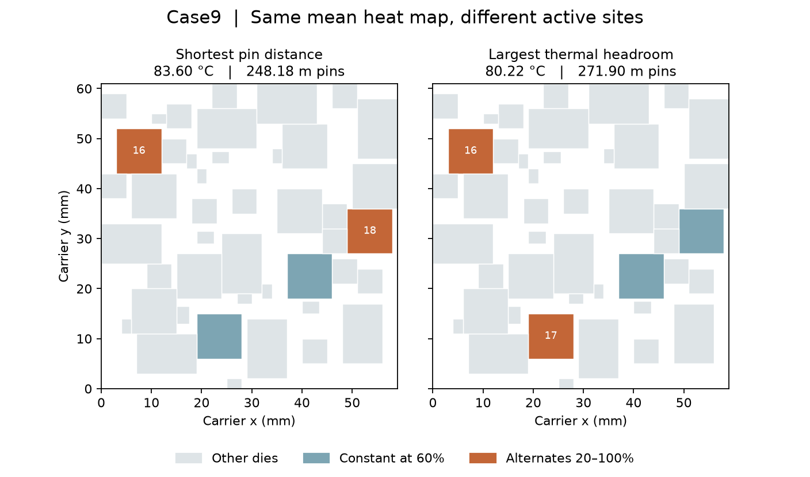

# 任务可以重排时，应该改调度还是换布局？

[实验结论与失败案例](#实验给出的选择规律) · [相同平均温度下的芯粒角色置换](#平均温度相同波动任务该放在哪里) · [无需瞬态仿真的布局判据](#哪些选择可以由能量守恒保证)

时间线可由 Git 核查：`b044bb6` 固定发现与确认分组，`4522a1b` 记录五例发现后的确认预测，`9832240` 固定任务占比检验，`a6dcb80` 固定静态热界，`5f45f5b` 定义同平均热图干预，`e9ebc6c` 记录对其余六例的预测。结果与参数见 `c3d9133`。提交链提供公开记录的先后顺序，本地执行依照各阶段约定进行。

## 看结果前的约定

本机 fetch 成功，远端 `1ba95b74c8697c60dff1d2f058b98996171660fc`。以前的工作分别处理了任意切换的单布局上界和连续稳态混合的布局选择。本轮把**固定任务量、可选运行顺序、物理布局**放入同一次决策。

每周期八个等长任务，A 和 B 各运行四次，重复至周期稳态。假设均可重排、无切换开销；相同任务量在此指两种功率模式各自的执行时间相同。沿用上轮单种子、原坐标、两个非负功率图和每例的引脚曼哈顿长度上限。比较同节拍内相同工作量和耗能的方案。跨节拍比较考察时间尺度，一周期的秒数和焦耳数也随节拍改变。

- 发现组 Case1–5，确认组 Case6–10。在看确认组之前，将从前五例得到的一条简单预测写下。每例原预算池五套布局；不加布局或种子。每套穷举相位旋转合并后的全部顺序，考察 5、50、500 ms 三种任务时长。考察成块 AAAABBBB 是否总是最热、交替 ABABABAB 是否总是最冷，以及切换时长是否改变最优布局。以模型内 0.1 K 为效果量级，另留原始温差。
- 主要决策比较为平均功率下最冷布局、顺序未知时最小化最坏峰温的布局、可同时选择布局与顺序的最冷方案。固定引脚总长上限，给出入选布局身份、长度和对应的周期峰温。此外比较在平均功率入选布局上**只重排**与在未知顺序时**只换布局**各自降低的最坏情形峰温。分母为同一起点。记录同一顺序下发生的两布局排序反转，和哪种顺序导致反转。
- 初筛采用 32 档几何贴合网格、每任务 2 个后向欧拉子步，记录所有子步末所有功率层位置的最大值。用同一布局的周期冲激响应在每个位置独立选贡献最大的四个时隙，与穷举解交叉核对。另用可解析的小型被动热网络，通过矩阵指数作连续方程时间推进对照。若基准中未推翻直觉，仍主动在 256 个固定种子生成的异质被动网络中寻找反例。
- 两组都结束后，挑选“平均功率选点相对最优抗顺序选点损失最大”的案例与节拍，以原五个候选重选，分别用 32 档/8 子步、64 档/8 子步比较时间与空间离散影响。Case3 另在已验收的 31.696922 m、单线 25 mm、0.20 TB/s 下，对两个合规布局使用旧存档的 IS、WH 路由端口功率，用 64 档/4 子步检验三个节拍。这两个通信图来自同一归一化吞吐；芯粒基础功率固定。

所有运行在本机。几何源为 ATPlace，散热与热容沿用已有热模型；原始功率和负载顺序没有对应封装的实测时序记录。

## 发现组后、打开确认组前的预测

Case1–5 的 15 个案例/节拍组合中，按平均发热选出的布局，恰好也分别是顺序未知和可控时的最优布局；75 个布局/节拍上，交替达到最低、成块达到最高。由此提出可以实际否证的简化决策：**先按平均功率选布局，再交替运行两种等量任务。** 在 Case6–10 的原始预算池上，逐项报告与完整联合最优的差值。严格预测为 15 项都选中联合最优布局；工程预测为至少 12/15 项峰温落差不超过 0.1 K。另预测至多看交替和成块两个顺序，即可在这 75 个布局/节拍上把真实最好和最坏峰温都包到 0.1 K 以内。固定上述标准后才运行确认组，不重调阈值。

解析/随机网络对照已出现反例：对 256 个网络和三个节拍，交替或成块偶尔会错。确认组检验的是上述芯粒工作负载中简化规则的适用率。最坏顺序的贡献排序则由线性叠加导出，另外与所有顺序逐一核对。

## 改变任务比例的迁移检验

以上预测针对各占一半。追加固定 50 ms 节拍，将第二类任务的占比从 1/8 变到 7/8，沿用十例原预算池和 32 档/2 子步。每个比例重新计算对应的平均功率并穷举全部合法顺序。简单策略选平均功率的最冷布局，将第二类任务尽量等距排布（累加任务份额，每跨过整数安排一次）。1/8 和 7/8 的顺序只有一种，单列为控制。在其余 50 个案例/比例上，预测至少 40 项简单策略落后联合最优不超过 0.1 K。此项在生成任何非对半的瞬态结果之前登记。

同时检验一个可以用来削减布局搜索成本的推论：周期稳态下，任何时序的峰温均不小于该布局在平均功率下的峰温。按此下界从小到大评估布局，一旦余下布局的下界均已超过当前可达峰温，就结束搜索。在全部 70 项上与完整联合穷举核对，报告实际需要做几个布局的瞬态分析；若少省或未省也记录。

最后直接问“某个布局能否靠调度救回来”。对合规的两个 Case3 端口设计和四种 NAS 模式，分别计算逐空间位置最高功率产生的稳态峰温上界、以及在所有平均模式份额中最凉的平均功率稳态峰温下界。若一个设计上界仍低于另一个设计下界，它即使遇到不利的顺序也优于另一个设计最有利的顺序。查 64 和 96 两档网格，报告界的距离及预先保留的成本差。对十个合成活动案例也在对半任务上统计这个无需瞬态计算的充分条件能淘汰多少布局。检验晚于两模式 NAS 的周期计算，早于上述四模界的数值计算。

## 故意使平均温度无法区分候选

均匀放置器的五个候选可能本来就容易排序。追加一个配对干预。Case3、4、8 分别有至少四颗同类型、同尺寸、同额定功率的 CPU 或 GPU。取原池最短线布局，选额定功率最高的合格类型中的前四颗，将四颗有身份的芯粒及方向在原四个足印上做全部 24 种置换，其他芯粒原位，逐根重验原引脚距离预算。四颗平均均为 60% 名义功率，其他芯粒为 25%。前两颗任务间在 20% 与 100% 间反向切换，后两颗恒定 60%。八任务各四次、节拍 50 ms。整个平均热源图与几何材料完全相同，但瞬时热源和逻辑连线可以不同。互换两种任务或两个恒定热源的候选，比较全体顺序时等价；每个波动足印对保留最短线代表。

对比三种选择：平均温度并列时选最短线再交替；从同一平均温度场选**两波动位置中较热者温度最低**的足印对再交替（同分取短线）；全可行足印对与顺序联合穷举。预测至少一例中最短线决策可损失 0.1 K，尝试用上述“给波动任务留热余量”规则挽回。即使规则失效也报告。初筛 32 档/2 子步；对第一种策略损失最大的整例，用 64 档/8 子步重算。三例在干预前指定。

上述三例中热余量策略均命中。Case3 细网格更改了入选位置，仍命中该网格的穷举解。现在将规则、并列口径和 50 ms 节拍固定，迁移至其余所有具有四颗同类芯粒的网表（Case2、5、6、7、9、10；Case1 缺少合格类型）。预测至少五个案例与联合最优相差不超过 0.1 K，报告全部失败。将热余量策略损失最大的整例提高到 64 档/8 子步，若都相同则取列表中的第一例。以上预测先于这六例的角色置换实验。

## 实验给出的选择规律

**先按平均热源选布局，将能重排的等量、等长任务均匀穿插。若多个位置具有相同的平均发热，再比较哪些位置能容纳更大的功率波动。** 第一部分在预留案例上与联合穷举对比；第二部分有意制造了平均温度场完全相同的不同候选。两条都是需要检验适用范围的经验规则。下文另给出何时仅凭热平衡就足以证明两个布局优劣的条件。

### 平均功率选布局，然后排任务

| 条件 | 简化选择与联合最优相差 ≤0.1 K | 观测 |
|---|---:|---|
| Case1–5 发现组，5/50/500 ms，对半 | 15/15 | 15 项选中同一布局；从最坏顺序换为交替，在原布局上降低 0.083–4.169 K |
| Case6–10 事前留出，同三档节拍，对半 | 15/15 | 15 项严格命中；在原布局上重排降低 0.186–2.559 K，中位 1.874 K |
| 十例，50 ms，第二类任务占 2/8 至 6/8 | 50/50 | 全部选中同一个布局及相同最低峰温；含 10 个前面已查的对半条件 |
| 十例，50 ms，占 1/8 或 7/8 | 20/20 | 粗网格中 Case1 的 7/8 选错布局，落后 0.040 K；全候选细网格复算后落差消失 |

均匀与成块顺序在预留的 75 个布局/节拍条件下给出了穷举最冷与最热的峰温（数值误差内）。每次比较都维持同一工作份额、时长和总能量。确认组有 13 个布局对/节拍在**相同顺序**下发生过排序反转，即使五选一的最终决定没有改变。对半条件的最大“平均布局换为抗最坏顺序布局”收益均为零；按预先次序重检 Case1、5 ms，获选布局在 32 档/8 子步与 64 档/8 子步均相同，调度收益分别为 1.330 与 1.353 K。

不能把“均匀最好、成块最坏”写成热力学定律。256 个异质无源 RC 网络 × 3 种节拍的矩阵指数实验中，交替有 3 项、成块有 7 项分别错过极值（门槛 0.000001 K）。最明显的是同一个网络。用每槽 64 点重新检查，50 ms 时 `00110011` 峰温升 2.17839 K，比交替的 2.18556 K 更低；`00010111` 峰温升 2.18988 K，比成块的 2.18422 K 更高。只有正热容、对环境散热和互易导热。不同位置的热扩散时滞使最近的四个时隙未必贡献最大。[发现组](evidence/periodic-order/discovery.json) · [确认组](evidence/periodic-order/confirmation.json) · [细网格](evidence/periodic-order/fine.json) · [被动网络及功率图](evidence/periodic-order/controls.json)

### 平均温度相同，波动任务该放在哪里

九个具有四颗同类芯粒的网表，各穷举 24 种角色置换。216 种中有 205 种满足原线长预算；按热对称性合并后，每例有六个不同的波动足印对。导热矩阵、热容和逐位置平均功率与原始足印逐项核对。下表报告各选法的周期峰温比同预算联合最优高多少；全部用 50 ms 节拍。净距、载板与逐引脚几何沿用原网表实验。

| 实验 | 案例 | 按最短线选择的损失 (K) | 把波动任务放在热余量较大处的损失 (K) |
|---|---|---:|---:|
| 首组三例，32 档 | Case3 / 4 / 8 | 1.511 / 0 / 0.150 | 0 / 0 / 0 |
| 预留六例，32 档 | Case2 / 5 / 6 | <0.001 / 0 / 0 | <0.001 / 0 / 0 |
| 预留六例，32 档 | Case7 / 9 / 10 | 0.639 / 3.154 / 0.510 | 0 / 0 / 0 |

**六个预留案例都在 0.1 K 内，五例严格命中。** Case2 的六个位置对几乎同温，连最坏与最好的差也不到 0.001 K。Case3 细化后，最短线选择落后从 1.511 K 缩为 0.140 K，热余量法选择的位置对也随网格改变，在两档均命中各自的最优。Case2 的 64 档重算仍无有意义的角色差异。这里的热余量法仅从一张平均稳态温度图读取四个足印的局部峰温，选择两位置中较热者温度最低的合规组合。它利用了同类芯粒相近的局部自热响应。不同工艺、面积、局部散热或任务切换开销均可能改变这个排序。九例共享同一模型和候选构造，不能据此推断任意系统有同样的命中率。[首组三例与细化](evidence/periodic-order/roles.json) · [独立六例与细化](evidence/periodic-order/roles-transfer.json)

**Case9 的物理代价。** 在预留组中看到最大收益后，加做该整例的 64 档/8 子步复算。四个 GPU 足印的平均功率、整个平均温度场和交替节拍均保持一致。全图平均功率稳态峰温为 79.626 °C。在最短引脚方案中，承担波动的 16、18 两处较热者为 78.532 °C，实际周期峰温 83.598 °C。换到 16、17 两处，较热者为 75.186 °C，实际周期峰温 80.215 °C。两套的周期峰温分别高出所选较热位置的平均温度 5.066 和 5.029 K；在这一对候选中，局部平均温度差解释了大部分排名差异。两者均满足 337.642 m 的总引脚距离上限，最短线方案用 248.179 m，热余量方案用 271.901 m。降温 **3.383 K** 的几何代价为 **23.722 m**。在粗网格上降温为 3.154 K。这是已有四个位置之间的逻辑芯粒置换，尚未布出对应的详细导线。[细网格六对完整结果](evidence/periodic-order/case9-fine.json)



### 哪些选择可以由能量守恒保证

对每个布局分别写出 `C dθ/dt + Gθ = P(t)`。在重复周期内积分，净储热为零，逐个位置的平均温升就是平均功率的稳态解。于是周期内的峰温至少等于所有位置中最高的平均温度。另一端，取每个位置上允许的最大热源组成包络功率图。被动导热的响应保持非负，其稳态解从上面包住周期稳态轨迹。设这两个峰温界为 L 和 U。若 **A 的 U 低于 B 的 L**，即使给 A 最不利的顺序、给 B 最有利的顺序，A 的周期峰温仍较低。若允许任意平均份额，可用一个线性规划把 B 的 L 再对所有份额取最小值。比较的是整周期峰温；域内固定线性材料、散热边界及各模式热源。有限冷启动、具有热反馈的功率及散热系统需要另外分析。

在 Case3 的 0.20 TB/s、四种 NAS 路由端口功率上，31.697 m 共同线长预算、25 mm CPU 单线距离与同一 (4,3,2,1) 模块配置下，两套设计的区间分离。下表给出长布局遇到任意顺序的上界、短布局选择任意顺序和份额的下界，单位均为 °C。

| 网格 | 28.374 m 布局上界 | 25.991 m 布局下界 | 长布局至少冷 (K) |
|---|---:|---:|---:|
| 64 | 107.479 | 108.405 | 0.926 |
| 96 | 107.706 | 108.432 | 0.727 |

为这份余量多用 2.383 m 引脚距离。两者在 109 °C 温限下都达标；短布局在这两个选择中用线最少。在 64 档显式重放 IS、WH 的各半周期时，较冷布局的最佳与最差顺序只差 0.0006–0.0026 K。十例合成活动中，芯粒核心功率本身大幅转移，静态区间在 50 个候选上**没有排除任何一对**。预算池内再用平均功率下界按序评估，70 项不同任务份额中，用 297 次候选评估即可得到穷举 350 次的相同结果，44/70 项仍需评估全部五套。这里计候选次数，不作为运行时间加速比。[静态上下界](evidence/periodic-order/bounds.json) · [NAS 周期重放](evidence/periodic-order/nas.json) · [七档任务份额](evidence/periodic-order/quota.json) · [份额复核](evidence/periodic-order/quota-fine.json)

### 数值计算与物理范围

容量由材料体积与体积热容相乘。每一功率模式下保持几何、材料与网格一致。用每个离散频率上的线性方程求后向欧拉的周期解，绕开未知初温和预热周期数。在位置与相位给定时，以全为模式 0 的状态为基准，每个改为模式 1 的时隙有一个可正可负的温度贡献。恰好要选 k 个时隙时，取贡献最大的 k 项即可得到该位置和相位的最坏顺序，再遍历位置和相位。该排序对离散周期与固定配额是精确的。小型 RC 网络用独立矩阵指数和顺序推进校验；封装模型直接按时间推进混合顺序，检查闭环初温和逐步能量收支。数值峰温取所有计算子步末的空间峰值，细化用于考察遗漏槽内极值和网格敏感性。

早期工作已研究在时限约束下为周期异质任务排序以抑制温度，并比较最优与最坏顺序。本实验进一步把任务具体落在哪个芯粒足印和共同引脚预算列为决策变量。两种负载的持续时间代表固定服务时间，未建模不同顺序下的缓存失效、性能及切换能耗。自定义热边界与真实引脚网表提供模型内对照，测得的 NAS 通信形状用于分配建模的端口功耗。[Jayaseelan 与 Mitra，ICCAD 2008](https://www.cecs.uci.edu/~papers/iccad08/PDFs/Papers/08B.3.pdf)

利用空间热余量做任务映射也已有文献。Kanduri 等通过在活动核之间分布空闲核来获得提升频率所需的热余量。本实验控制平均功率图、导热材料和任务总时长，直接测算**只交换功率波动的空间归属**仍然要付多少峰温和线长代价。其研究价值取决于这种对照能否迁移到新的封装与负载，尚没有建立学术首创性。[Kanduri 等，adBoost](https://users.utu.fi/spakan/wp-content/uploads/sites/57/2018/02/patTCCR.pdf)

## 本地复现

安装项目及其 NumPy、SciPy 依赖，`CASES` 是用仓库工具从固定版本导入的十份 ATPlace JSON 的目录。图需要 Matplotlib。本轮使用已有单种子布局档案，不重新采样。旧有 196 项测试及本次新增 2 项专项测试通过，双芯粒示例为 3 W、34.1886 °C。仅做了模型和数值验证。

```text
python tools/periodic_order_controls.py --output results/controls.json
python tools/periodic_layout_choice.py --cases CASES --phase discovery --output results/discovery.json
python tools/periodic_layout_choice.py --cases CASES --phase confirmation --output results/confirmation.json
python tools/periodic_layout_choice.py --cases CASES --phase fine --screen results/discovery.json results/confirmation.json --output results/fine.json
python tools/periodic_layout_choice.py --cases CASES --phase nas --output results/nas.json
python tools/periodic_quota_transfer.py --cases CASES --output results/quota.json
python tools/periodic_quota_transfer.py --cases CASES --refine results/quota.json --output results/quota-fine.json
python tools/periodic_design_bounds.py --cases CASES --output results/bounds.json
python tools/periodic_role_swap.py --cases CASES --output results/roles.json
python tools/periodic_role_swap.py --cases CASES --transfer --output results/roles-transfer.json
python tools/periodic_role_swap.py --cases CASES --recheck Case9 --output results/case9-fine.json --figure results/case9-roles.png
```

## 独立 Chat 审核

Chat 从已连接的 GitHub 打开六个协议及结果提交 `c3d9133`，检查核心实验代码、角色与配额记录，按上下界重新计算 Case3 的 0.726824 K。它接受相同平均热图下改变角色位置的模型内证据。六例迁移中，Case7、9、10 明显优于最短线选法；Case2 近乎同温，Case5、6 的最短线本来已最优。审阅认为局部稳态温度能提供一个经验排序，多种任务都适用的最优算法及跨封装精度仍缺证据。Git 可验证预测先于结果的公开归档，Chat 没有直接观察本地计算的执行时刻。该次审阅仅核查远端代码与记录。[完整独立审核](https://chatgpt.com/c/6afef04a-901c-83e8-b13a-f36b74f04223)
