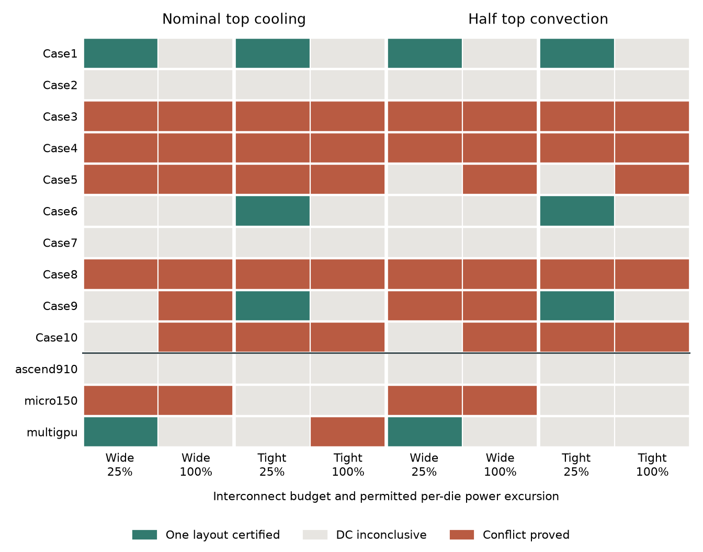

# 确定一种布局可以承受多大负载不确定性

## 实验前约定

本机成功 fetch，远端与本地均为 `92179c17367984ca7c256f20e99ce490556b879c`。上一轮 Case4/5 的短、长时长相互给出了反例。这次在看新结果之前固定一个可直接用于未知周期波形的判定。设定同一网表、散热边界、物理距离上限、候选池及逐芯粒平均功率。额定功率最大的四个位置可以在平均值上下改变至多每颗 A W，任意时刻总功率守恒，每颗经过一个周期回到相同的平均功率。允许任意周期、相位与波形，在周期稳态比较硅层空间和时间的最高温。热参数使用常值，功率由外部指定。目标容限为 0.1 K。

只用稳态物理量形成两边的判断。以所有变化源同时取上限建立逐位置温升包络，以每个竞争布局的平均功率稳态峰温作下界。如果存在一个共同布局的最坏损失上界在容限内，事先锁定它，并报告可证明覆盖的最大功率幅度。反向使用恒定均值以及逐对和两正两负的缓慢正弦转移极限作为冲突见证。若每个布局都至少被一个见证排除，则无法覆盖整个负载族。其余情况记为未决。独立检验使用周期 17 ms、137 ms 的六种逐对正弦以及一条两对相差四分之一周期的同时转移，各方向的波形保持相同净瓦数和平均功率。用复频域解求一整周期的精确峰温。盲测评价会检查全部预算合规候选，保留事前选定的布局。

本机计算 ATPlace Case1–10 中原距离预算以内、经前轮方法修复到 100 µm 并仍符合原上限的几何。Case1、6–10 都未用于前轮 Case2–5 的信息分组开发。另用 TAP-2.5D 系列三个配置预生成清单各自的前六种几何，按扩大了 bump 环的轮廓验间距，按芯粒核心轮廓施加额定功率与材料；采用原实验记录的需求加权平均中心距离并从坐标复算。TAP 的宽预算是这六种几何中最大的距离。每例另设修复后第二短布局的距离为紧预算，保留并列。预算重合及只有零或一个可行布局的情况单列。两组指标的单位和端点定义各自保持。

跨例统一比较标称顶冷和顶面对流减半两种边界，以及额定允许波动的 25% 和 100%。四个变化源取 60% 额定平均功率，其他芯粒取 25%；波动上限 A 的参考值为四源最低额定功率的 40%。每例沿用固定坐标和原有采样种子，此轮不再随机搜索。网格沿用几何贴合的 32 档。报告三种判断的分母、确证共用的实际最差盲测损失、冲突和未决组的盲测可区分程度、在容限内的最短互连距离。两套数据源共用同一类封装假设，数值分组并非独立样本。倘若静态条件过宽，应报告其欠缺的分辨力。

## 如何在还不知道负载时选择布局

设 $J_g(s)$ 是同一预算下用布局 $g$ 交付工况 $s$ 所需付出的物理代价，越小越好。允许出现的工况为 $S$。丢弃工况信息的代价是 $\rho=\min_g \sup_{s\in S}[J_g(s)-\min_h J_h(s)]$。有两条不同的取证途径。

* **证明能够共用。** 根据物理模型，求出布局 $g$ 在整个工况族内都成立的上界 $U_g$ 和各竞争者的下界 $L_h$。只要有一个布局满足 $U_g\le\min_{h\ne g}L_h+\epsilon$，就可以锁定它。先指定绝对产品温限时还要再比较 $U_g$ 和该温限。
* **证明必须区分。** 选一组物理上允许的见证工况 $W$。若每种布局都至少在其中一个工况落后某个竞争者超过 $\epsilon$，就无法用这个池中的某个固定设计覆盖 $S$。不同布局可以有不同的反例。见证可以采用落差严格超过容限且可由可行工况逼近的极限。

处在两者之间时，现有信息允许多种结论。优先用能区分剩余设计的动态工况做挑战。哪一个搜索器生成了这些布局不影响这项检验；更换候选集合后需要重新比较。这个做法也适用于有物理代价界和可行反例的其他决策；以下导热推导限定了它在芯粒热问题中具体能覆盖的工况。

### 为什么几次稳态求解能涵盖连续波形

实现中对完整的功率层取空间峰值，包含硅芯粒和芯粒间填充区域。环境温度为 45 °C，顶面标称对流系数约 2777.78 W/(m²·K)，减半边界约 1388.89 W/(m²·K)，底面和侧面绝热。

对每个布局，固定几何、导热矩阵 $G$、正对角热容 $C$ 和环境温度。温升满足 $C\dot\theta+G\theta=\bar p+Bq(t)$。$B$ 的第 $i$ 列是第 $i$ 颗变化芯粒放入一瓦的非负空间分布。每颗 $q_i$ 周期平均为零、瞬时绝对值不超过 $A$，且 $\sum_i q_i(t)=0$。每个导热连接的热流正比于两端温差，所有连通块均能向环境散热。因此 $-C^{-1}G$ 的非对角元素非负，稳定热响应保序。以平均功率和所有源同时增加 $A$ W 分别做稳态求解。前者给出周期平均温度场 $m_g=T_a+G^{-1}\bar p$，后者给出逐点上界。记 $b_g=G^{-1}B\mathbf 1$，单位 K/W。硅层观察位置记为 $x$，则整个负载族都满足

$$L_g=\max_x m_g(x)\ \le\ J_g(s)\ \le\ \max_x[m_g(x)+A b_g(x)]=U_g(A).$$

下界来自全周期峰值至少达到平均场最高点。上界来自将逐时功率输入替换为逐点更大的常值后，系统温度只能上升。这个虚构的同时加热向量只用于上界，构造的反例和盲测全部保持瞬时总功率。上界适用于稳定周期响应；任意初温或温度反馈漏电需要另外处理。[正系统的比较原理与静态增益](https://arxiv.org/abs/1203.0047)

逐位置用竞争布局留给自己的温度余量除以 $b_g(x)$，取最小，就得到该布局能用此上界保证的波动幅度，单位 W。若给定幅度低于它，波形细节可以省略。对每个布局求解，取最宽的已证范围；这里把数值截在额定允许幅度处。这样能对新网表给出以物理单位表示的适用范围，无须把前一网表的开关频率或最优坐标搬过去。

反方向取 $q(t)=a v\cos(\omega t)$，$v$ 为一增一减或两增两减的平衡转移。复振幅为 $(G+j\omega C)^{-1}Bv$。在 $\omega\to0$ 时单个位置的温度峰值趋向 $m_g(x)+a|(G^{-1}Bv)_x|$；有限候选池允许同时取这个极限。我们使用均值、各对转移、三种两正两负方向，在 100% 波动时也沿用 25% 的见证。若下界仍超出 0.1 K，就存在足够慢、周期有限的真实正弦输入能排除相应布局。准静态极限本身没有固定周期编号。

盲测选定两个有限频率及一个复数权重向量 $(1,-1,j,-j)$，在每个单元取复振幅的模，得到全周期的峰值，再按空间取最大。相位可以随单元不同。所有测试的最优基准均对应相同预算、边界和同一个输入波形。

## 两套来源的 13 个网表

59 个不同引脚布局或核心摆放通过同一网表各自的几何、间距与互连预算检查。ATPlace 每例宽预算含 4–5 个布局，TAP 每例含 6 个，两套的紧预算均含 2 个。芯粒数在 6–61 之间。把两个顶冷条件、两个距离上限、两档允许功率幅度交叉后有 104 组。九个迁移网表为 ATPlace 的 Case1、6–10 及三个 TAP 系统。Case2–5 单独列为曾参与方法开发的网表。TAP 用原配置的功率、芯粒、需求及仓库原有摆放清单，距离度量为需求加权平均中心距离；ATPlace 用原引脚 Manhattan 总距离。两种数值各自在本族内比较。TAP 的同一族封装模型与本实验施加的功率波形属于研究假设。[TAP-2.5D 原论文](https://www.date-conference.com/proceedings-archive/2021/pdf/1516.pdf) · [TAP 布局来源](evidence/tap-sensitivity-plan.json)

| 事先判定的对象 | 组数 | 可证明共用 | 可证明冲突 | 稳态未决 |
| --- | ---: | ---: | ---: | ---: |
| ATPlace，先前用于开发的 4 个网表 | 32 | 0 | 22 | 10 |
| ATPlace，另取的 6 个网表 | 48 | 8 | 17 | 23 |
| TAP，3 个网表 | 24 | 2 | 5 | 17 |
| 合计 | **104** | **10** | **44** | **50** |

未查看盲测前已将全部选择和温差界锁定于 `7dbb27f7a3b5c8889a1f97659df3ca3fb0e5dcc2`。59 个几何 × 2 个边界 × 2 档幅度 × 2 个频率 × 7 种空间与相位组合，共核对 3,304 个几何–工况峰温。因同一个复矩阵可服务多个热源、幅度和预算，完整盲测需要 236 次复矩阵分解。10 组事前确证的布局在全部盲测中均达到所在池的逐工况最低峰温。44 组已证冲突中有 30 组在盲测中也无法共同达标，另外 14 组则能找到满足全部盲测的布局。50 组稳态未决，锁定布局在 14 个盲测波形上的最大损失仅 0.034511 K。这些有限波形未排除剩余共用解，整族结论仍为未决。分母中的预算和幅度会共享布局与热解，不应将 104 组当作 104 个独立网表。[事前预测](evidence/power-uncertainty/predictions.json) · [逐布局盲测](evidence/power-uncertainty/challenge.json)



* **可直接锁定的例子。** 标称顶冷、宽预算下，Case1 的布局 5 可证明覆盖每颗变化源 ±4.209 W 以内的所有允许周期波形。在 ±2.5 W 盲测中，峰温最高为 81.989 °C，满足全部连续负载要求的最短池内引脚距离为 88.983 m。TAP MultiGPU 的布局 1 可证明覆盖 ±4.759 W，在 ±2 W 盲测中峰温最高为 77.451 °C，对应最短需求加权平均中心距离 33.407 mm。全部 10 个已证组中，未被反例淘汰的最短距离与保证达标的最短距离相等，故能同时给出池内最短代价。此处的温限随工况定义为同一预算内该工况的最低峰温加 0.1 K。
* **需要区分的例子。** TAP Micro150 在标称宽预算、每颗 ±15 W 时，准静态反例给出至少 1.168 K 的最坏损失。冻结的布局 4 在全部预留频率与相位组合中反而都最凉。完整功率族包含更慢的再分配，仅测固定频率会漏掉这种冲突。ATPlace Case8 在标称宽预算、每颗 ±1.2 W 时的准静态冲突下界为 0.704 K，有限频率盲测本身也已经给出 0.711 K 的冲突。
* **幅度和预算改变结论。** 在 25% 幅度处共有 10 组可证共用、19 组可证冲突；升到 100% 后分别为 0 与 25。同一预算下扩大允许功率集合会保留已经找到的冲突见证。若改变距离预算，候选池和工况最优基准会一起改变。例如 Micro150 宽预算下的冲突在紧预算下变为未决。报告保留每个预算的实际布局和距离上下界。[全部组别与双向指标](evidence/power-uncertainty/decisions.json)

### 14 组短周期没有暴露的冲突

针对全部 14 组锁定追加实验，重复短周期对照时补齐九种完全相同的空间转移方向和幅度。14 组在 17/137 ms 下依然都有共同近优布局。保持布局、散热、距离预算和功率转移方向不变，逐个加入更慢的周期后，八组在累计到 1.37 s 时给出冲突见证，两组需要累计至 13.7 s，四组需要至 137 s。由此，原先证明有冲突的 44 组全都有有限周期的实验反例。这里列出的是首次被所测周期集合排除的位置，不能由这些点推断精确临界频率或真实应用的持续时间。

例如 Micro150 标称宽预算、每颗 ±15 W 的布局 4 在原盲测全部波形上达到最低峰温。在 1.37 s 使用同样的单对转移方向 pair-12 时，布局 4 达 87.119 °C，布局 5 只达 86.095 °C；若改为布局 5，pair-03 又让它比布局 2 高 2.961 K。这组的最佳固定布局至少损失 1.024 K。另有一组 MultiGPU 的累计损失为 0.103 K，仅略过 0.1 K 门槛，其裁决对模型和容限敏感。每个被淘汰布局的几何编号、竞争者、方向、周期与实际峰温均有记录。[追加实验协议](power-uncertainty-witness.md) · [逐布局有限周期见证](evidence/power-uncertainty/finite-witnesses.json)

### 稳态测量为什么有时必然缺少信息

再构造两个设计问题，四个热节点分别以 1、1、10、10 W/K 向环境散热，平均功率为 5、5、2、2 W，四处允许 ±1 W 的零均值转移。设计 A 的热容是 0.005、0.05、1、1 J/K。第一组的另一设计仅把第三节点的热容从 1 增到 2 J/K。两个热节点的动态完全相同，两个低温节点在所有允许波形下温升最多 0.3 K，主节点的周期峰温至少为 5 K。因此这两个设计对整个负载族给出相同峰温。

第二组的另一设计交换两个主节点的热容。任何稳态输入在所有这些设计上都给出相同温度。分别在第一或第二主节点加正弦、由不同低温节点反向补偿，周期均为 0.1 s。设计 A 的两种峰值温升为 5.9540 和 5.3033 K，交换热容后两值对调。无论固定哪种设计，都至少在一种工况损失 0.6507 K。由平均态起步积分至最后一周期，同解析峰值相差小于 0.000001 K。两个问题具有完全相同的稳态输入输出，却分别允许和排除共同的 0.1 K 近优布局。**即使稳态数据任意精确，任何只看稳态的算法也无法正确判定每一个这类设计问题。** 热容或频率响应是在这类未决问题里有信息价值的额外观测。这个控制是构造的被动热网络；证据保存完整参数与逐工况温升。[解析与独立时间积分](evidence/power-uncertainty/challenge.json)

## 计算代价和复现

冻结判定后，另在本机仅对 50 个稳态未决组重跑盲测。按布局和边界复用工况，实际需要 160 次频域矩阵分解，全面检查为 236 次，减少 76 次（32.2%）。逐组输出和所有复用的布局峰温都与完整计算逐项相同。这个计数限于动态挑战步骤，未计入前置稳态求解，也未推算总运行时间。盲测每瓦输入的全局能量平衡最大差为 7.1×10⁻¹⁵，节点复方程残差最大 3.2×10⁻¹⁵。数值一致性只针对指定网格。两类案例的物理保证都以固定参数线性模型、给定平均功率、功率变化范围、周期稳态和候选池为条件；封装实物的材料、负载测量、详细布线与接口时序需要另行验证。

使用已导入的 [ATPlace 案例](https://github.com/PKU-IDEA/ATPlace_pub/tree/fe3dbfdaf78dc0ddeac3a2cfc3a85ff0971f88df/cases) 目录作为 `CASES`。TAP 几何和需求直接来自仓库内的预生成输入。设置 `PYTHONPATH=src`、`OPENBLAS_NUM_THREADS=1`、`OMP_NUM_THREADS=1`。本轮没有新增随机采样或服务器计算。

```sh
python tools/power_uncertainty.py --cases "$CASES" --output results/power/predictions.json
python tools/power_uncertainty.py --cases "$CASES" --challenge results/power/predictions.json --output results/power/challenge.json
python tools/power_uncertainty.py --cases "$CASES" --challenge results/power/predictions.json --unresolved-only --output results/power/selective.json
python tools/plot_power_uncertainty.py --predictions results/power/predictions.json --challenge results/power/challenge.json --selective results/power/selective.json --summary results/power/decisions.json --figure results/power/coverage.png
python tools/finite_power_witness.py --cases "$CASES" --predictions results/power/predictions.json --challenge results/power/challenge.json --output results/power/finite-witnesses.json
```

全部 204 项本地测试通过。双芯粒 CLI 校验及评估通过，参考功率 3 W，峰温 34.1886 °C。

### 独立 Chat 复核

远端确认 `9c387c8c1b4fb95c30ca01680a2606c8eafe6382` 后，新 Chat 会话通过已连接的 GitHub 静态核验，给出通过裁决。它核对了周期均值、保序上界、严格准静态反例与有限周期的关系，以及同稳态网络的热容反例。它从证据核验了两套来源的 13 个网表、59 个几何、104 组的 10/44/50 划分、14 组追加实验的 8/2/4 分布和 Micro150 的两组实际温差。审阅指出 MultiGPU 的 0.103 K 接近容限，候选池外布局、非周期初温、温度相关材料和漏电反馈仍需新的证明。热与频域求解由本机完成，Chat 未重跑实验。[独立审稿原文](https://chatgpt.com/c/6aff05b1-5c2c-83e8-948e-30287d2bb647)
