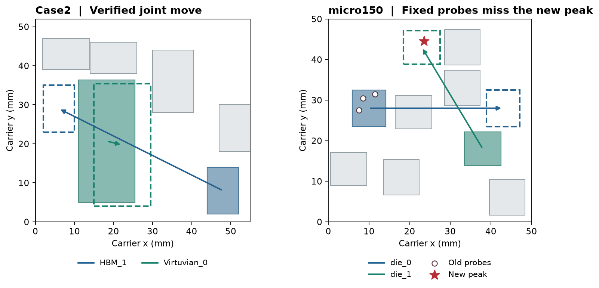

# 少数测点能否决定两颗芯粒的共同落点？

**13 个单起点、295 个合法双移动中，只对 28 个候选核验整板，就选出了与逐个整板求解完全相同的芯粒和坐标。** 做法是在每种冷板条件下用一个起点热点筛选，核验最有希望的联合移动，并把它暴露的新热点反馈给其余候选。一共只增加 16 个“冷板、测点”响应。直接按两个落点和一个旧热点选址则有 3/13 例漏掉更冷的可执行布局。下述最优性限于固定薄板模型、冻结候选池和四个声明的边界。

## 最大升温在哪里，峰温由谁决定？

**移动功率后，最大的正温差可在净增加功率的区域取得。最终峰温还取决于各处在移动前有多热。** 固定散热边界和导热路径，取两次稳态温度之差 $u=T_{新}-T_{旧}$，节点的功率变化为 $q=P_{新}-P_{旧}$。设相邻节点热导为 $g_{ij}\ge0$，对环境的热导为 $g_{i0}\ge0$，每个连通分量有散热通路。在常参数线性热路中，两次能量守恒相减得到

$$q_i=\sum_j g_{ij}(u_i-u_j)+g_{i0}u_i.$$

在正最大值位置，右边各项均非负。若该处没有增加功率，只能与所有相连节点并列，并且没有直接对环境的热导；沿并列区域必能遇到净增功率节点，否则与散热通路矛盾。因此整板最大升温的一个上界为 $M=\max(0,\max_{q_i>0}u_i)$，有正升温时取等号。减少功率处相应可取得最大的降温。有限面积芯粒要看净功率增加的整个脚印，重叠部分按实际功率差计。薄板模型的局部垂直热阻也可表示为热源与铜面之间的被动热导。这个结论只用热守恒与最大值原理，与芯粒数量及网表无关。[Doyle 与 Snell，《Random Walks and Electric Networks》第 1.2.2 节](https://arxiv.org/pdf/math/0001057)

给定互连预算内的一组联合移动和目标峰温 $T_*$，若某格原温度满足 $T_{旧,i}+M\le T_*$，它一定不会超过目标。相反，只要有一处 $T_{旧,i}+u_i>T_*$，该布局就不能达标。因而可先在新增发热区求升温上界，再只核查起点温度余量不够的格点。各散热条件要用自己的 $M$ 和温度余量。计算 $M$ 也有成本。移动改变材料、接触热阻或散热边界时，两次守恒式的导热项不再直接相消，此时须重新计算相应热路。

三节点反例可以手算。在 A–B–C 链上，相邻热导和每个节点对同一环境的热导均为 1 W/K。把 3 W 从 A 搬到 B，C 固定发热 2.5 W。A、B、C 的温升由 (2.1875, 1.3750, 1.9375) K 变为 (1.0625, 2.1250, 2.3125) K。B 升得最多（0.750 K），其终温低于旧峰温。C 只升 0.375 K 却成为新热点，使峰温升高 0.125 K。只盯旧热点 A 和落点 B 会把此次移动误判为降温。

本次补充分析开始前 fetch 成功，远端为 `9693d41`。用原有薄板求解器在本地重放已冻结的 13 例、295 个双移动、四种冷板位置。逐个布局复现该档案的最差降幅。在 1,180 个热场中，上述温差上界全部满足；其中 1,080 个热场的终态峰温严格高于净增功率区域的最高终温（数值判别余量 $10^{-8}$ K）。以低于各自旧峰温 0.1 K 为目标，利用从完整温差场回算的 $M$，可排除的终态发热格点比例中位数为 90.8%，范围为 0–100%。这衡量物理上能排除哪些位置，尚未测量只从增功率区求 $M$ 的求解成本。该回放沿用同一批已筛选布局，计数不能当作新网表的发生概率。[冻结的功率转移与对照值](evidence/observer-placement/selection.json)

回放时对每个候选及每个冷板位置使用下列统计，`p0, p1` 为起终点功率格图（W），`t0, t1` 为对应的同一薄板温升场（K）。

~~~python
added = p1 > p0
delta = t1 - t0
maximum_rise = max(0., delta[added].max())
assert delta.max() <= maximum_rise + 1e-8
peak_outside_added = t1.max() > t1[added].max() + 1e-8
below_target = t0 + maximum_rise < t0.max() - 0.1 - 1e-8
excluded_source_fraction = below_target[p1 > 0].mean()
~~~

Chat 复核了远端 `c54028f` 的最大值与并列情形，独立解出了三节点温度。审稿确认上述排除比例由完整温差场回算，实际节省的求解工作取决于如何便宜且保守地得到 $M$。[补充审稿意见](https://chatgpt.com/c/6aff994d-9910-83e8-bac5-9a5fa9426241)

## 比较约定

启动前 fetch 成功，远端与本机均为 `abaf82150b77722655ed2d5f38e92c127de10792`。沿用 10 个 ATPlace、3 个 TAP 案例，每例取原来单种子的同一个合法起点。各方法使用同一批合法双芯粒平移及原地选项，互连上限取起点实际成本，ATPlace 用源引脚总曼哈顿距离，TAP 用需求加权平均中心距离。功率为原额定的 10%，姿态与 100 µm 净间隙固定。判断在东、西、南、北四个冷板位置中的最小峰温降幅，指标为 K。选中移动须严格超过 0.1 K，选取按降幅、成本、候选顺序决定；浮点近并列记明。对同一候选集也从整板参考提取过门槛布局的最短互连成本。

按既有 1 mm 终点格点，使用四个起点热点的单位功率热响应，每颗芯粒保留对各方向最有利的单次平移。将不同芯粒的终点合成双移动，重新检查整体几何与成本。至多取 24 个合法双移动，前 16 个按旧热点估计，另外最多 8 个优先补入成本低的不同候选；可行数不足时照实记录。各选择器共享这一阶段，排序和补入均不得访问终点整板温度。与全板的最优差只针对这个有限候选集。

对照包括每个终点都计算整板、每种冷板只看原热点、每种冷板看起点最热的三个间隔至少 3 mm 的测点，以及从原热点开始自适应补点。补点法用少数测点给所有终点算降温上界，只对仍可能胜出的布局做整板核验，将该布局最不利冷板的真实热点用于筛下一批。另与只用初始热点上界、逐候选核验的版本比较，用于识别补点本身的增益。稀疏直接排名与补点均先单独运行，再由独立整板穷举揭晓最优值。记录错误选址、与可执行整板参考决策的峰温差、门槛误判、原始最佳收益损失、核验次数、每类线性求解数和单线程墙钟时间。明确区分前处理、目标评分和独立评测的成本。

主动构造正热导、守恒的固定网络，让一个移动后的新热点落在三个原测点之外。对所有不同的最终决策，另用既有三维封装模型在四个选择边界和留出中心比较起点与终点，均在本地执行。以此检验少测点漏判与薄板模型偏差，保留原地和升温结果。

## 看到首轮结果后追加的落点测点对照

首轮 13 例候选及结果的 LF 文本 SHA-256 为 `58f9b360da82534ddc8a8ad8d763df214cb4ef3bd59743b562f69ce9c8ae354a`。固定三个旧测点在 micro150 的动作升温 12.379 K。追加方法在每种边界保留一个旧热点，另外在每个移动终点的发热脚印里，只选一个最可能成为新热点的格点。选点依据为起点温度加上该格精确的局部垂直热阻温差变化，所需数据均来自已知功率和终点几何。三处温度用同一薄板的单位功率响应精确计算。跨候选重复的空间位置复用同一个响应。对照直接取这三个测点的首选，以及以该上界启动有核验的补点搜索，计入额外伴随求解。继续使用同一批候选、阈值及四个边界，增加所选布局的三维五边界审计。此追加比较用于解释已见案例，另筛选候选的泛化仍待检验。

## 检查 24 个候选之外是否确有更冷的布局

两个有核验的版本在原来的有限池内都与穷举吻合。为检验候选生成本身，在同一 13 个起点的合法组合里排除全部原候选，按原定旧热点上界顺序另取最多 8 个，其余条件和互连成本不变。先冻结新增坐标，再用四向薄板全面验温。报告所有超过原池最佳值的案例、增量及 0.1 K 门槛变化。若存在超过原来可执行决策 0.1 K 的新赢家，取其中额外降幅最大者，在四个选择边界和留出中心与原决策直接比较三维峰温。此挑战用于寻找预算外反例，不计入首轮三种稀疏法的成绩。

## 为什么少数测点可以用来淘汰布局

设起点在散热条件 $b$ 下的峰温为 $H_b$。对于候选布局 $m$，它的稳健降温是 $g(m)=\min_{b,x}[H_b-T_b(m,x)]$。只取少数测点求同样的最小值，一定得到 $g(m)$ 的上界。固定线性热路中，对测点做一次单位热响应计算，即可对每个移动芯粒的旧、新矩形功率脚印积分，计算该测点的温变。多颗的温变先在同一点相加，并保留该点距离原峰温的余量。积分含薄板的局部垂直热阻与部分覆盖单元的面积。

算法让上界最高的候选先核验整板。在最差冷板的真实峰值位置加一个测点，给余下所有候选收紧上界。已核验最好降幅超过全部剩余上界时即可停止。实现为数值误差留出 $10^{-8}$ K 的剪枝余量，并比较同温候选的互连成本与序号。有限集合中不漏更优布局来自这个不等式。每轮改的是观测位置，输出是一组芯粒一次直达的终点。若不同候选各自在不同位置产生热点，最坏情况仍可能要检查全部候选。[搜索实现](../src/chiplet_floorplanning/placement/observer_search.py)

## 同池对照和计算量

各方法共享起点、格点、边界和互连上限，初始筛选的合法组合共 22,961 个，按上述规则保留 295 个。穷举对这 295 个候选各做四次全板正向热求解。表中“错过更冷布局”以应用 0.1 K 执行门槛后，真实薄板峰温比同池参考高 $10^{-8}$ K 以上计数。“误接受”指所选动作在该模型中没有超过 0.1 K。额外测点列统计完整的单位响应求解数。

| 选择方式 | 与参考同一终点 /13 | 错过更冷布局 /13 | 最大峰温损失 | 误接受 /13 | 候选整板热场 | 额外测点响应 | 评分用时 |
|---|---:|---:|---:|---:|---:|---:|---:|
| 一个旧热点直接选 | 6 | 7 | 8.067 K | 5 | 0 | 0 | <0.001 s |
| 三个间隔开的旧测点直接选 | 7 | 5 | 12.379 K | 4 | 0 | 104 | 0.098 s |
| 旧热点和两个落点直接选 | 10 | 3 | 1.439 K | 1 | 0 | 700 | 0.706 s |
| 旧热点上界，逐候选核验 | 13 | 0 | 0 | 0 | 268 | 0 | 0.274 s |
| **核验后加入真实新热点** | **13** | **0** | **0** | **0** | **112** | **16** | **0.126 s** |
| 落点测点筛选后再核验补点 | 13 | 0 | 0 | 0 | 84 | 709 | 0.800 s |
| 穷举整板 | 13 | 0 | 0 | 0 | 1180 | 0 | 1.129 s |

固定三个旧测点在 Case10 选了峰温完全相同、互连较长的布局，因此“终点不同”和“峰温更高”相差一例。忽略执行门槛，按所有候选含原地的纯热最优值比较，单旧点、三旧点、落点三点的损失分别出现在 7、6、5 例。补点和穷举连原始最优序号也在 13 例中逐一一致。[所有终点、互连和整板参考](evidence/observer-placement/selection.json) · [落点探针的成本与候选上界](evidence/observer-placement/landings.json)

候选正向热场少了 90.5%。把 52 个起点场、52 个所有方法共用的起点测点响应以及补点开销都算上，线性求解总数从 1,284 次降至 232 次。共同前处理含四种冷板的矩阵分解、原始场和候选生成，合计 4.432 s。加上评分，穷举约 5.56 s，反馈补点约 4.56 s，本次实际节约约 18%。相同起点只跑一次，单线程计时仅作量级参考。最少整板次数的落点加核验法，反而需要 709 个不同的额外响应。每个布局只读三个点，与遍历所有布局总共要计算多少个不同的点，是两个量。[逐方法计数、三维达标数与计时](evidence/observer-placement/summary.json)

## 具体移动、物理复核及反例

| 案例 | 检查候选 / 原池 | 同池所选薄板降温 | 三维四向最差降温 | 三维留出中心降温 |
|---|---:|---:|---:|---:|
| Case1 | 0 / 13 | 0 | 0 | 0 |
| Case2 | 3 / 24 | 0.439 K | 0.174 K | 0.307 K |
| Case3 | 2 / 24 | 0 | 0 | 0 |
| Case4 | 1 / 24 | 0.491 K | 0.354 K | 1.359 K |
| Case5 | 1 / 18 | 0.10029 K | 0.183 K | 0.021 K |
| Case6 | 4 / 24 | 0.176 K | 0.349 K | 1.720 K |
| Case7 | 2 / 24 | 0.284 K | 0.272 K | 0.043 K |
| Case8 | 5 / 24 | 0 | 0 | 0 |
| Case9 | 1 / 24 | 1.697 K | 1.489 K | 1.289 K |
| Case10 | 4 / 24 | 1.795 K | 1.802 K | 2.422 K |
| ascend910 | 1 / 24 | 0.149 K | 0.186 K | 0.574 K |
| micro150 | 3 / 24 | 0 | 0 | 0 |
| multigpu | 1 / 24 | 0.254 K | 0.148 K | 0.050 K |

Case2 把 HBM_1 从 (48, 8) 直接移到 (6, 29) mm，同时把 Virtuvian_0 从 (18.25, 20.7) 移到 (22.25, 19.7) mm。西侧、北侧各补一个点就能选中这个布局。源引脚总曼哈顿距离从 130.052 m 降至 106.686 m。在四种冷板条件中，薄板的最小降幅为 0.439 K，三维的最小降幅为 0.174 K。比较反向指标时，Case10 原池内薄板达到 0.1 K 的最短布局为 122.531 m，对应降温 1.659 K；峰温最优点的互连为 143.330 m。

micro150 的固定三个旧测点全在原 die_0 上。它们预测候选降温 3.234 K；南侧冷板下，真实薄板峰温却升高 12.379 K，新热点出现在移动后的 die_1。三维封装复算也升温 12.404 K。落点三测点在此例会保留原地，但 Case10 的落点三测点漏掉了 1.439 K 的降温。Case2 的落点法在薄板上预测降温 0.709 K、整板实际升温 0.284 K，同一动作的三维四向最差却降温 0.153 K，说明测点误差与薄板到封装的模型误差都能影响判断。[三维同点复算](evidence/observer-placement/package.json) · [新增落点的三维复算](evidence/observer-placement/landing-package.json)

另构造 29 个节点的导热链，三个起点热源分别为 5、4.95、4 W。两个候选均将总连线从 21 mm 缩至 14 mm。三个旧测点判断把两颗芯粒移到弱散热区可获 0.672 K，略好于强散热区的 0.664 K。实际弱散热方案**升温 6.380 K**，强散热方案**降温 0.664 K**。这个反例只有正热导，所有输入功率都由对环境的散热带走。密集监测原热点，不能代替监测落点附近可能出现的新热点。

当找到的布局用同一三维封装重新组装求解，9/13 在四个已知冷板位置都超过 0.1 K。加上留出的中心位置，仍有 6/13 超过门槛。这组 13 例统计对各臂选出的不同终点做三维求解，后文另对三例的整个候选池穷举。首轮终点审计的最大能量余额小于 $1.8\times10^{-11}$ W。实验采用有限网格、固定源功率及给定冷板，没有详细绕线、接口时序和实测封装温度。ATPlace 原论文同时关注合法布局的互连和热表现，本轮仅借用其网表，与原论文的完整布局流程和冷却设定各异。[Wang 等，ICCAD 2024](https://yibolin.com/publications/papers/PLACE_ICCAD2024_Wang.pdf)

## 预算外挑战

另冻结 88 个不同的双移动。11 例各有 8 个，Case1 与 Case5 的原池已经覆盖了其短名单的全部合法组合。Case10 找到了原池外更冷的方案，CPU2_3 和 CPU2_8 分别前往 (37.5, 22.4)、(25.5, 32.5) mm，互连 133.577 m。薄板最差降温从 1.794779 K 增至 1.806555 K，多 0.011776 K。其余案例均未超过原池最优，没有案例因这 88 个布局改变 0.1 K 的达标状态。额外收益没有达到预先规定的 0.1 K 三维复核门槛。筛选器的同池零损失，与候选生成器覆盖到的空间应分别评价。[挑战坐标](evidence/observer-placement/challenge-moves.json) · [候选外整板结果](evidence/observer-placement/challenge.json)

## 三个案例的三维同池穷举

仅验证各方法最后挑出的布局，无法发现薄板模型把某个更好的三维布局提前淘汰。已知首轮结果后指定 Case2（落点法在薄板和三维的温变异号）、Case9（明显降温）和 micro150（补点法留在起点）作进一步检查。三个案例各沿用原池的 24 个双移动，不增加搜索候选；对起点和全部终点在东、西、南、北逐一求解 64 档三维封装，比较同池整板最优、薄板反馈补点决策和实际峰温损失。三维结果只用于事后对照，不计入布局搜索成本。此处选择的是诊断案例。

| 案例 | 薄板方案在三维的最差降温 | 三维穷举决策的最差降温 | 错过的三维降温 |
|---|---:|---:|---:|
| Case2 | 0.1741 K | 0.2138 K | 0.0397 K |
| Case9 | 1.4889 K | 1.4889 K | 0 |
| micro150 | 原地 | 原地 | 0 |

三例合计 300 次三维整板求解，最大能量余额小于 $3.0\times10^{-11}$ W。Case2 的三维最优动 HBM_1 与 HBM_3，互连为 117.725 m。薄板选择另一组芯粒，互连 106.686 m，二者都在同一 130.052 m 上限内。Case9 两种模型选出同一动作，micro150 的三维原始最优仅降 0.0109 K，应用同一个门槛后均原地。这个对照把三维选择损失与测点剪枝损失分开，前者在 Case2 可以实际观测到。[全部三维候选温度与最优序号](evidence/observer-placement/package-oracle.json)

## 本地复现

独立 Chat 会话从 GitHub 核对了由 `abaf821` 至 `21ac4cbfe185add5424ef3f8be0792c51929bc2b` 的四个提交、观测点筛选程序、实验驱动与四份主要证据。审稿确认少点上界方向、最差冷板的补点、浮点剪枝、同分选择和同池对照的范围；核实 112/1,180 个候选场、16 个响应、约 18% 总用时节约、Case2 三维损失与 Case10 池外增益。审稿建议下一阶段给尚未展开的“芯粒组合、落点区域”计算保守上界，优先展开可能打败当前布局的区域。此次为静态复核，所有仿真与计时均由本地运行。[Chat 审稿原文](https://chatgpt.com/c/6aff994d-9910-83e8-bac5-9a5fa9426241)

本地全量回归 209 项通过。双芯粒命令行校验与评估通过，输入总功率 3 W，参考峰温 34.1886 °C。

沿用已冻结的 ATPlace 输入和仓库附带的 TAP 起点。设置 `PYTHONPATH=src`、`OPENBLAS_NUM_THREADS=1`、`OMP_NUM_THREADS=1`，设置 `CASES` 为导入目录，`D` 为本地结果目录。各 JSON 使用 LF 归一化摘要核对前一步。计时字段随机器而变。[输入版本和导入说明](direct-relocation.md#本地复现)

~~~sh
python tools/observer_placement.py --cases "$CASES" --output "$D/selection.json"
python tools/observer_placement.py --cases "$CASES" --audit "$D/selection.json" --output "$D/package.json"
python tools/observer_placement.py --cases "$CASES" --audit "$D/selection.json" --package-oracle --output "$D/package-oracle.json"
python tools/landing_observers.py --cases "$CASES" --bank "$D/selection.json" --output "$D/landings.json"
python tools/landing_observers.py --cases "$CASES" --bank "$D/selection.json" --audit "$D/landings.json" --output "$D/landing-package.json"
python tools/observer_challenge.py --cases "$CASES" --bank "$D/selection.json" --output "$D/challenge-moves.json"
python tools/observer_challenge.py --cases "$CASES" --bank "$D/selection.json" --audit "$D/challenge-moves.json" --output "$D/challenge.json"
python tools/report_observer_placement.py --cases "$CASES" --evidence "$D"
~~~
