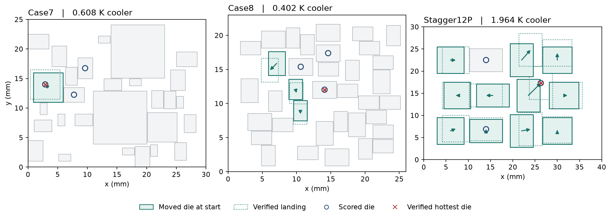

# 以互连余量选联动芯粒，以少数潜在热点选落点

## 等预算布局结果

表中每格为已核验最佳峰温（°C）及从输入到结果的单次墙钟时间（s）。三点法为允许总长补偿的版本，全芯粒列只改变同池评分位置。两列及两条基线在三个主例都用了两次新整板，各自保留起点。ATPlace2.5D 每例另用五个降阶训练标签，时间含冷启动训练、优化与坐标修复。外部 CPU 在原单线程环境执行。部分时段同机还在跑回归测试。

| 网表（颗数） | 共同总长上限 m | 起点 °C | 三点法 °C / s | 全芯粒 °C / s | relation_space °C / s | ATPlace2.5D + 可行化 °C / s |
|---|---:|---:|---:|---:|---:|---:|
| Case7（28） | 40.447734 | 80.68942 | 80.08170 / 1.232 | 80.08170 / 1.257 | 80.68942 / 5.364 | **79.43675** / 558.555 |
| Case8（36） | 43.357548 | 80.47560 | **80.07350** / 3.620 | **80.07350** / 3.902 | 80.47560 / 6.910 | 80.46035 / 742.579 |
| Stagger12P（12） | 1.491328 | 113.99209 | 112.02820 / 0.353 | 112.02820 / 0.352 | 113.99209 / 2.743 | **111.77057** / 123.581 |

三点法最冷解的引脚总长依次为 40.365414、43.357504、1.491316 m。反向指标取峰温不超过各自起点的已见最短合法布局。三点法在三例依次为 40.365414、43.357504、1.491316 m；全芯粒相同。relation_space 为 40.447734、43.357548、1.491328 m；ATPlace 为 40.107576、43.357092、1.489652 m，其中留出例的最短解与最冷解不同。新法获准的坐标满足冻结的间距、逐信号距离、总长、截面与逃逸容量检查。记录了热收支的核验中最大不平衡低于 3.3×10⁻¹⁰ W。材料、边界与合成功率的绝对温度未经实物标定。

| 网表 | 仅放开必动者时的合法候选 / 最佳降温 | 允许补偿后的合法候选 / 最佳降温 | 三点 / 全芯粒的候选–观测点评分次数 |
|---|---:|---:|---:|
| Case7 | 3 / 0.608 K | 9 / 0.608 K | 51 / 476 |
| Case8 | 16 / 0.402 K | 21 / 0.402 K | 123 / 1476 |
| Stagger12P | 6 / 0.000 K | 19 / 1.964 K | 111 / 444 |

Case7 最冷新法解只动 CPU2_0，向左、向上各 0.5 mm。Case8 最冷新法解由 CPU1_7 向左下各走 1 mm，Analog_8 和 Analog_16 都是给定动作下有正位移下界的跟随者。Stagger12P 中 Tile06 向右上各走 2.8 mm，三颗有几何跟随下界，含主动者共 11 颗移动。严格分组的两次核验均比留出例起点更热。加入总长补偿后得到新落点，两次核验又从 112.13831 降到 112.02820 °C。[主组原始布局与计时](evidence/successor-placement.json) · [主组补偿结果](evidence/successor-compensated.json) · [独立引脚对照](evidence/successor-distinct-placement.json) · [独立引脚补偿结果](evidence/successor-distinct-compensated.json)



同池三点与全芯粒在三个主例均选中同样的两个终点，观察到的峰温漏失为 0 K。候选–观测点评分从 2396 次降到 285 次，少 88.1%。三个独立计时相加，从 5.511 s 降到 5.206 s，实测少 5.5%。留出例三点法反而多用约 1 ms。起点全芯粒风险排序、几何规划、整板核验仍然要付费。每例只有一次运行，尚无稳定加速比。

外部对照在 Case7、8、Stagger12P 相对起点分别降 1.253、0.015、2.222 K。Case7 原始导出超距 339 条，投影后达到报告温度。Case8 作者末端合法化失败，保留其优化后的连续坐标，采用起点朝向投影。在 Stagger12P，原生导出逐链均过关，总长超限约 0.0098 µm，按同一硬门槛投影。Case7、8 的作者训练采样超时后使用既定合法采样回退，Stagger12P 使用作者采样器。这是特定小预算下的作者程序适配。它在两个主例找到更冷点，显示三点法在已见合法解中分别至少还漏掉 0.645 和 0.258 K。

同一组三维起点、互连上限和两次核验的既有五热点连续位移法曾达 Case7 79.05408、Case8 78.97830 °C，比当前生成器低 1.028、1.095 K。老法的坐标网格化曾带来最大轴位移超名义半径 1 µm；本轮严格执行该半径。两张已见布局给出仍有更冷几何的参照，不能从两次核验估出整片连续可行域的剩余空间。[较早的连续位移实验](continuous-interconnect.md)

对三个主例所有方法的已核验结果去除重复坐标，共得到 8、8、9 张不同布局（含各自起点）。Case7 的三点在两张布局漏掉新热点，最大的低估为 0.06494 K；其中本方法自己的第二张核验漏 0.05168 K。以这三颗的真实温度排序，本样本未发现名次反转；用点源模型预测排序，三例分别发现 1、0、3 对反转。Stagger12P 严格分组的首选被预测比起点冷 0.02414 K，整板却高 0.29510 K，此时实际热点仍被三点覆盖。把更多芯粒加入观测，无法单独解决温差模型误差。几何复查则分别找回 6、5、13 个只放开有正下界的跟随者时做不到的指定落点。所有这些事后检查都复用原始温度场。[主组漏判审计](evidence/successor-audit.json) · [修订引脚漏判审计](evidence/successor-distinct-audit.json)

原 Stagger12 的补偿法降 1.957 K，原始分组零降温，外部实现训练前即退出。该失败组没有与一个已完成的外部布局作比较。独立引脚修订保留了这一降温现象，也让外部方法完成了两次核验。两份输入共用功率与拓扑。

### 留出例为何必须有其他芯粒参与

固定获胜动作 Tile06 向右、向上各移 2.8 mm。沿起点几何的边距约束可推出 Tile07、Tile10、Tile11 各至少移动 0.8、2.3、1.6 mm（按最大轴位移计）。仅允许这四颗移动，保持逐链上限、朝向、分离关系和半径，解除总长限制后改为最小化总长。连续线性规划的最短值为 1.739266 m，比原上限多 0.247938 m。网格化只会进一步限制可行坐标。由此可知在这一指定落点及几何单元内，至少还需要一颗未被边距下界点名的芯粒参与。完整解有 11 颗移动，哪些额外成员是唯一必需的尚未确定。这项事后计算只用引脚和矩形，不增加热核验。[几何下界与获胜动作](evidence/successor-distinct-audit.json)

## 已知的漏判

原 Stagger12 有 672 个信号端点，只有 544 个不同的芯粒内引脚位置。ATPlace 在将共址端点归并为一引脚后，无法把一引脚的多个网号读为规则整数数组，训练开始前退出。其科学比较保留为失败。现冻结物理引脚修订例 Stagger12P，网表连接、功率、芯粒与起点均沿用原文件。有重合引脚的边保留端点沿边的质心，依原沿边次序、网序展开，间距取相应边长的 1%。672 个端点各占一个位置，最小中心距 52 µm。重新按起点引脚计算共同总长 1.491328 m，逐网仍限 10/25 mm。只依输入几何修订，无热结果参与引脚分配。两种生成规则与全部外部对照参数沿用冻结值。先公布修订例，随后各臂最多 2 次新整板，用同一流程独立重跑。该例与原合成例同源，统计时只按一张网表计。[修订输入](../examples/Stagger12P) · [几何冻结](evidence/successor-distinct-pins.json)

Case7 的 ATPlace 合规布局让 CPU2_1 接替 CPU2_0 成为最热点。起点规则选出的三颗是 CPU2_0、CPU1_1 和 CPU1_3，把这三颗的**真实**温度取最大值，仍比整板峰温低 0.06494 K。这次漏判只需读取 ATPlace 已核验的同一温度场即可确认。它能反驳“三颗足以覆盖所有合法落点”，不能单凭这一例推断漏判率。该布局是外部方法提出并经可行化后得到，超出本轮两主动芯粒生成器的候选池。

## 什么能由物理约束推出

令芯粒位移为 $u_i$，原引脚坐标为 $p_i,p_j$，单信号曼哈顿上限为 $L$。取任一对角方向 $s=(\pm1,\pm1)$，该面的剩余距离为 $h=L-s\cdot(p_i-p_j)$。移动后仍要满足同一上限，因此 $s\cdot u_j\ge s\cdot u_i-h$。沿多个相同方向的互连可以累加余量。芯粒固定分离次序时，沿水平或竖直轴，同样的不等式适用于相邻边距。当右侧为正，对端沿该方向必须跟随，最大轴位移至少为右侧除以 $\lVert s\rVert_1$。逐链余量都是正值时，总长上限仍可能要求别处缩短连线。程序按每条信号的实际引脚复查长度，并检查芯粒外框、间距、截面与局部逃逸容量。完整布线与时序仍待求解。

选落点时，半空间解给出相邻热源间的带符号温差贡献 $P_j(1/r'_{ij}-1/r_{ij})/(2\pi k)$，距离以 m 计，铜的导热率取 400 W/(m·K)。代理只更新芯粒之间的热作用。全板核验重新组装每张布局的材料与功率分布，并包含有限封装边界、自热和扩散。起点峰温用芯粒内部最热网格单元，三个观测位置随芯粒一起移动。代理升温界的适用范围是铜半空间点源模型，整板实际峰温的上界仍未知。

另以两种不使用新整板温度场的方式找反例。将起点选出的三个位置用于基线已核验的全部合法出口，统计漏掉真实热点的幅度，并检查两张已核验布局是否被误排序。对未产生候选的指定方向，保留主动芯粒的原定向量，仅把其他芯粒全部放开，重解同一个最小位移线性规划。找到合法终点即可反驳“没有正跟随下界的芯粒都可以锁死”。这些事后检查各自单独计时，不参与选解。

## 由 Case7 几何反例触发的第二阶段

第一阶段固定的生成器会遗漏有用的几何自由度。Case7 中 CPU1_1 走 (+1,−1) mm 时没有正跟随下界，单动总长达 40.535734 m，超过 40.447734 m 上限。允许 CPU2_0 同动后，同一主动落点可以做到 40.447558 m。这个反例来自几何计算。补充规则在读取 Case8 和 Stagger12 的新热结果前冻结。对同样的两个主动芯粒、同样的 32 个指定动作、同样的半径，先用原证书分组。若分组未产生几何合规点，再把其余位移放开，保留逐链、间距和总长硬约束，求最小总位移。额外移动的芯粒只称为该解的协助者。仍用三个潜在热点选解，同时保留同池全芯粒消融。每个独立方法至多两次整板，禁止合并两版预算选赢家。这个分阶段修正仅依据开发例 Case7，三个案例均按同一修正规则评测。

## 看新结果前冻结的规则

已 fetch 到 `58b6f36`，本机与远端一致。沿用 Case7、Case8 既有起点、各自的总长与逐网距离上限。新网表 Stagger12 为单独构造的三排错列芯粒，12 颗、21 条 16 信号总线，包括横向、纵向与跨排斜连。每个信号有固定边缘引脚。普通链限 10 mm，四条斜总线限 25 mm。固定输入功率、位置和尺寸，总线长上限等于共同起点 1.491200 m。该网表从未用于调参，属于合成留出例。其作者格式输入、逐链上限与起点在本次提交冻结。[新网表](../examples/Stagger12) · [冻结信息](evidence/successor-freeze.json)

所有方法单种子 20261119，同一布局起点、100 µm 芯粒间距、全截面和局部引脚布线容量必要条件。以同一个 64 目标分辨率的八层稳态导热模型评价绝对峰温。使用一份共同的起点整板温度，每臂至多两次新的整板核验，可另用至多五份降阶训练标签。每臂从冻结输入到最佳合法布局计时，包含起点读取与热场、几何搜索、优化、核验，以及 ATPlace 从零开始的采样和训练。固定输入文件的准备、测试及事后审计不计入方法用时。也报告起点温度上限下的最短合法互连。线长为各信号固定引脚曼哈顿距离之和。

新法固定起点朝向和矩形分离关系。选起点最热芯粒及对其有最大功率除以距离平方的邻居为两个主动移动者。各尝试八个方位，单轴最大移动半个芯粒短边中位数，再试半程。对每个指定动作先沿有向逐链余量与矩形间隙传播必须跟随的位移下界，仅释放该组，按精确逐链与总长约束求其余成员的最小总位移。做不到的动作保留为排除记录。正下界只是必要条件，锁住其他芯粒可能漏解。

从起点实测各颗峰温出发，固定铜半空间点源公式估计其他功率源相对距离改变造成的带符号温变。观测起点最热芯粒，另以移动半径内可接近距离给出的代理温升上限挑两颗潜在新热点。每个候选只算这三个位置。第二次可用首查的实际热点替换一个观测点。两次核验始终保留起点与已见最佳解。等预算消融使用相同生成器，在所有芯粒上算相同代理。验收时逐张查是否遗漏真实最热点，计算遗漏引起的实际温差和相对另一臂已核验解的可观察漏失。两次核验无法确定整个连续域或整个候选池的真最优。

主基线使用仓库 relation_space 的短线种子、退火和拓扑 LP（2 s MILP、8 步、2 链、小预算先投在线长阶段）。保留 ATPlace2.5D 固定提交 `fe3dbfd` 的训练器与热感知优化器，共同起点初始化，5 张降阶标签、100 轮短训、10 步连续优化、30 s 终端合法化，使用本地串行 CBC。两条基线均可在共同起点的可行几何单元内修复不合格输出。ATPlace 可用第二次核验评估起点到原生或修复目标的中点。记录原生合法性、失败与修复。新网表的 ATPlace 模型沿用 Case7 的训练和优化配置，替换网表、功率、几何与引脚。同一求解预算下，根据获准出口比较可取得的峰温，另报实际开销。[ATPlace 作者实现](https://github.com/PKU-IDEA/ATPlace_pub/tree/fe3dbfdaf78dc0ddeac3a2cfc3a85ff0971f88df)

## 本地复现

本轮完整本地回归通过 235 项。双芯粒命令行示例通过，热源合计 3 W，参考峰温 34.1886 °C。实验未运行电气时序签核。

三个观测点只减少候选排序的源–观测距离计算。每张布局由全芯粒的约 $n(n-1)$ 对缩至约 $3(n-1)$ 对。每个方法仍须读取整个起点热场，求起点风险次序、做几何规划、整板核验。计时纳入这些共同开销。ATPlace 的逐链可行化在本项目外接，原生权重训练的五个标签是同一层叠的 4 mm 分块降阶解。本机 CPU 负载与 MILP 时间上限都可能影响单次墙钟时间。

使用仓库的 Python 环境，在仓库根目录运行。另备作者提交 `fe3dbfd` 的本地检出和能运行该实现的 Python 环境（本实验用 CPU）。下列 PowerShell 命令中，`$author`、`$authorPy` 指向这两处。运行目录应为新目录，以确保外部模型从头训练。各方法读同一份历史总长与逐网合同，Case7 有 352 条 10 mm、2464 条 25 mm 信号，Case8 的 2948 条均限 25 mm；Stagger12 有 272 条 10 mm、64 条 25 mm 信号。

```powershell
$env:PYTHONPATH = 'src;tools'
$env:OMP_NUM_THREADS = '1'
$env:MKL_NUM_THREADS = '1'
$env:OPENBLAS_NUM_THREADS = '1'
$runDir = 'results/successor-reproduction'
$sourceCases = "$runDir/source"
python tools/import_atplace_cases.py --source $author --output $sourceCases
$common = @('--source',$sourceCases,'--upstream',$author,'--atpython',$authorPy,'--work',"$runDir/cold")
python tools/compare_successors.py @common --output "$runDir/strict.json"
python tools/compare_successors.py @common --compensate-from "$runDir/strict.json" --output "$runDir/compensated.json"
python tools/audit_successors.py --source $sourceCases --results "$runDir/strict.json" --compensated "$runDir/compensated.json" --output "$runDir/audit.json"
```

以相同参数复现修订引脚组时，在两条比较命令中分别加入 `--cases Stagger12P`，使用独立结果文件名，用这两份文件做同样的事后审计。原网表保留用于重现输入失败。
