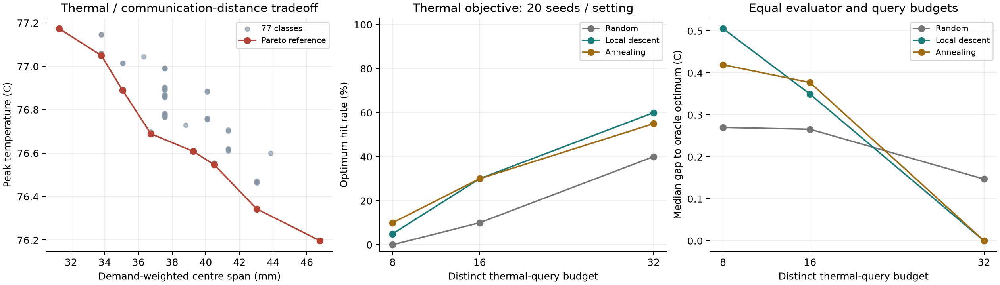

# First HiTS layout-search comparison

The research emphasis is now algorithms. Following the user's clarification,
the thermal model is required to express the relevant physical effects with
consistent units, conservation and boundaries; measured calibration or complete
manufacturing signoff is not a prerequisite for search experiments. Refine
accuracy only when it could change layout ordering or an algorithm conclusion.
The separately running local-access checks do not gate this experiment.

## Exact finite reference and tradeoff

The predeclared [experiment](tap-algorithm-reference-plan.md) evaluated all 77
thermal classes of the frozen six-chip domain with local HiTS. All passed the
existing numerical checks. Total reference construction took **70.42 seconds**;
the largest direct-solver temperature difference was 2.02e-8 K. HiTS was clean
at `be59924de3f0c1a3d6d134aea411d1264cfa64c6`. The source inputs and complete
compact oracle are [published](evidence/tap-algorithm-oracle.json).

Peak temperatures span 76.19670–77.17357 C. The minimum-centre-span reference
has peak 77.17357 C and span 31.29412 mm. The coolest layout has peak 76.19670 C
and span 46.78431 mm: **0.97688 C cooler, with 49.50% larger centre span**.
Eight numerically distinct Pareto tradeoff points occur in the fixed model.
Centre span is a communication-distance proxy, not routed wirelength or timing.
This establishes a model-level tradeoff without tightening a clock or reducing
resources; it is not evidence of a routed thermal penalty.

## Equal-budget baselines

The single-chip-move graph is connected (one component of 77 classes).
Twenty seeds for each of three methods, three budgets and two objectives give
360 completed query-counted replays. All use the same class set, cache and
objective values. Full per-seed traces and summaries are
[published](evidence/tap-search-comparison.json). Oracle construction cost is
separate; table-lookup runtime is not reported as an algorithm speedup.

| Thermal-query budget | Random optimum hits | Local descent | Simulated annealing |
| --- | ---: | ---: | ---: |
| 8 | 0 / 20 | 1 / 20 | 2 / 20 |
| 16 | 2 / 20 | 6 / 20 | 6 / 20 |
| 32 | 8 / 20 | 12 / 20 | 11 / 20 |

At budgets 8 and 16, random search has a smaller median temperature gap than
either local method. At budget 32 both local methods have zero median gap, but
their worst gaps remain larger than random search's. Local descent also uses
more proposals: means 181.4 versus annealing's 63.3 and random's 31 at budget 32.
There is no demonstrated consistent winner or new-method improvement yet.
The 20-seed rates are descriptive, not a statistical significance claim.

The normalized equal-weight thermal/span objective is already optimal at the
common starting layout within numerical tolerance. All methods therefore hit
it from their first query. This objective provides no discrimination on this
domain and should not be presented as an algorithm success. The Pareto search
problem is more informative than tuning a scalar weight to create a challenge.

## Next algorithm work

Move to online search in larger independent domains and all three source
workloads. Preserve these baselines and common evaluator/budget accounting.
Use Pareto coverage and best-known objective gaps; keep exact optimum claims
restricted to enumerated domains. Investigate compound moves and thermal-state
reuse with ablations, rather than asserting that another optimizer is needed.
The existing half-turn equivalence reduces 4,928 representations to 77 thermal
states; all baselines received that same reuse in this comparison.

These numerical temperatures use the already-frozen FV research model. The
new IHP attachment family is a separate branch of the research data, not an
unannounced change of evaluator. This increment is not yet Chat-reviewed.
All 280 current local tests and the documented two-chiplet CLI passed (3 W,
34.1886 C reference peak). Some tests cover the still-running access-check work;
the two algorithm-specific tests separately verified budget isolation and
disconnected-domain restarts. No remote experiments ran.
