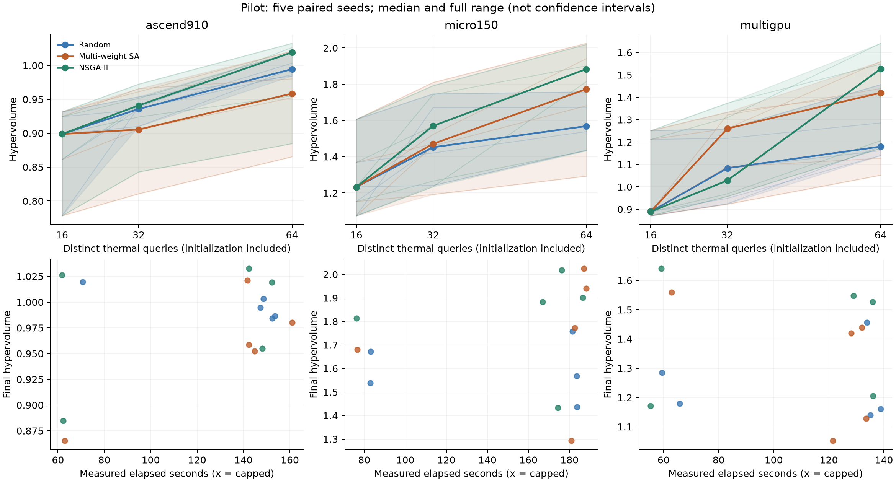
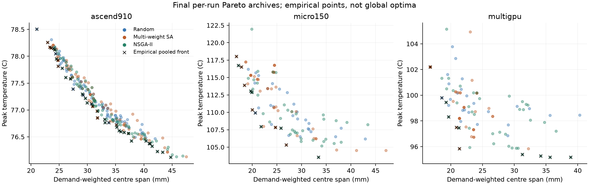

# Complete local online pilot

All 45 predeclared trials completed 64 distinct thermal queries, including
16 shared initial states per workload/seed. No proposal cap or solver failure
occurred. All 2,880 query receipts and policy traces passed the complete verifier
and deterministic replay. The frozen evaluator commit was `0959620`; the plan
SHA-256 is `bf9583b7d06fcb9601bdf692c925b3d81d9c73e71a96108e828cb2350ce76874`.

## Paired results

Higher hypervolume is better. Differences below compare the same workload and
seed against Random, under the predeclared scales/reference point.

| Workload | Method | Wins / losses vs Random | Median paired HV difference |
| --- | --- | --- | ---: |
| Ascend910 | SA | 1 / 4 | -0.027941 |
| Ascend910 | NSGA-II | 3 / 2 | +0.015974 |
| Micro150 | SA | 4 / 1 | +0.234755 |
| Micro150 | NSGA-II | 4 / 1 | +0.261255 |
| MultiGPU | SA | 2 / 3 | -0.033506 |
| MultiGPU | NSGA-II | 4 / 1 | +0.091388 |

There were no paired ties. NSGA-II is the most promising of these mechanism
baselines, particularly on the two more thermally sensitive workloads. SA is
not consistently better than Random. In MultiGPU, subtracting the two methods'
separate median HV values would misleadingly suggest a typical SA improvement;
the median of the actual paired differences is negative. Retain pairing in
subsequent decisions. These five seeds are descriptive evidence, not a broad
superiority claim. Future experiments follow the reduced-seed AGENTS policy.

All methods have the same charged query count; proposal effort differs.
NSGA-II's median proposal counts are 1,124 / 565 / 1,887 across the three cases,
versus Random's 76 / 64 / 110. This supports examining geometry-aware variation
and legality handling. Measured elapsed times vary substantially across seeds;
this shared workstation was not an isolated timing environment. Do not attribute
wall-time differences solely to optimizer or cache speedup.

The absolute-objective plot retains peak temperature and demand-weighted centre
span. Centre span is a communication proxy, not detailed routed wirelength or
delay. The pooled front contains evaluated layouts, not a global optimum.
The common physical assumptions and scope are in the frozen protocol.

## Next algorithm decision

Proceed to the published-method comparison and legality-aware search work,
using the separate TAP proposal adapter and the public ATPlace interface audit
as concrete starting points. The imported 6–61-chiplet, pin-level cases provide
the scale extension. Keep model/representation changes explicit and account for
initialization, training and legalization. Do not add more seeds to this pilot
or tune methods retrospectively. R2 Chat review should inspect these results,
the full pushed history, and recommend the next bounded algorithm experiment.

Reproduce verification/reporting using `tap-online-evidence-checks.md` and
`tap-online-reporting.md`. Complete [verified evidence](evidence/tap-online-pilot-v4.json)
and [paired analysis](evidence/tap-online-pilot-analysis.json) preserve all trial
values and source hashes; raw receipts remain local under
`results/physical-calibration/tap-online-pilot-v4`.
