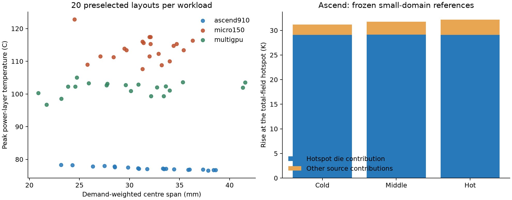

# Thermal layout sensitivity: three-workload diagnostic

The user's observation was correct for the original Ascend small domain, but
does not generalize to all workloads. With unchanged source power and cooling,
20 preselected larger-domain layouts per workload produced:

| Workload | Power (W) | Sample minimum (C) | Sample maximum (C) | Sample span (K) |
| --- | ---: | ---: | ---: | ---: |
| Ascend910 | 350 | 76.5932 | 78.3338 | 1.7407 |
| Micro150 | 680 | 107.6751 | 122.8380 | 15.1629 |
| MultiGPU | 755 | 96.7019 | 105.0274 | 8.3255 |

The [protocol](tap-sensitivity-plan.md) and complete
[placement manifest](evidence/tap-sensitivity-plan.json) were written before
temperature evaluation. They were committed as `1eb3284`. The sequential
construction sample is biased, not a uniform legal-layout sample. These are
observed ranges, not global extrema, optimizer gains or statistical estimates.
Ascend's larger-domain sample did not beat its known small-domain minimum;
the wider observed range alone does not demonstrate better optimization.

## Why Ascend changes little

For cold, median-rank and hot layouts in the original oracle, all six individual
source fields were solved with the same geometry, materials and thermal matrix.
Contributions are measured at each layout's total-field hotspot, owned by chip0
in all three layouts. No maxima from different spatial locations are added.

| Reference class | Hotspot die contribution (K) | Other source contributions (K) |
| --- | ---: | ---: |
| 75, cold | 29.09851 | 2.09819 |
| 39, middle | 29.11496 | 2.66327 |
| 0, hot | 29.10946 | 3.06411 |

Between the hot and cold references, the total difference is 0.97688 K:
0.01095 K from the hotspot die contribution and 0.96592 K from other sources
(about 98.9% of the difference). Thus the peak rise is dominated by self-source
heating, while almost all of this particular layout difference comes from
mutual heating. Self-source heating includes that source's complete path through
the package; it is NOT an isolated-die thermal resistance or a decomposition
into local versus common package resistance. The approximately 32 K full rise
must not be labeled a common package rise.

The maximum whole-field superposition discrepancy was 1.16e-8 K. All 81 solves
passed the existing residual, energy, direct-reference and boundary checks;
the largest direct-reference difference among the 60 samples was 6.02e-8 K.
The local run took 167.51 seconds, including 63 full-power and 18 single-source
solves and the existing reference checks. HiTS was clean at
`be59924de3f0c1a3d6d134aea411d1264cfa64c6`. No remote compute ran.

All sample placements, temperature summaries and source contributions are in
[compact evidence](evidence/tap-sensitivity.json), including plan/raw-result and
implementation hashes. Raw thermal receipts remain local in
`results/physical-calibration/tap-sensitivity-v1`. Reproduce with
`tools/diagnose_tap_sensitivity.py` and render with
`tools/report_tap_sensitivity.py`.

## Algorithm decision

Proceed with the three-workload online algorithm pilot under the same model.
Keep Ascend as a weak-sensitivity case; retain Micro150 and MultiGPU as cases
where placement has substantially greater observed thermal effect. Do not alter
power, cooling, objective weights or routing capacity to manufacture a conflict.
Freeze Pareto metrics and objective-scale conventions before comparisons;
report absolute temperature and centre-span tradeoffs alongside them. A sampled
temperature range proves sensitivity in this model, not that competing goals
necessarily conflict or that a new optimizer will outperform strong baselines.

The next protocol must still address Chat's atomic/joint move distinction,
floating-point ties, and complete online cost accounting. That is the next
review point; this diagnostic follows Chat guidance but its new numerical
results have not yet received a separate Chat review. All 282 current-workspace
tests and the documented two-chiplet CLI passed before publication (the count
includes three pending local-access tests outside this milestone).
