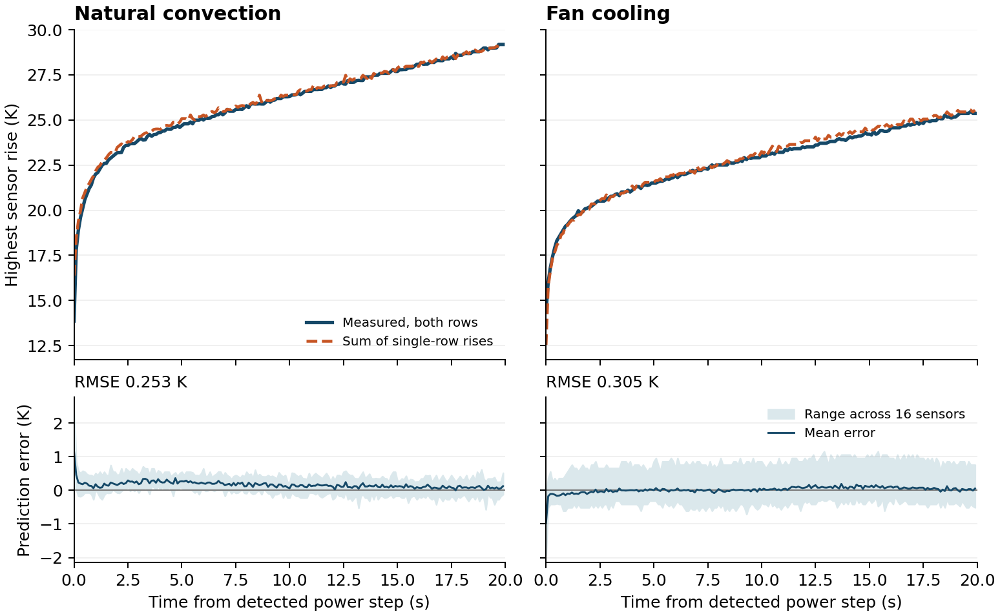

# 切换负载时，热怎样相加

同一位置在某一时刻的温升，等于初始热量的剩余影响，加上各处先前发热传到这里的贡献。固定线性导热、热容和冷却条件时，每项贡献都可以单独算。对于每段可以独立选负载的系统，设计时只需逐段判断，哪一种负载在该段发出的热，对指定时刻的同一热点贡献最大。

## 从能量守恒到最热历史

每个控制体存储的热量变化，等于输入功率减去传走的热流。以恒定环境温度为参考，记温升为 `θ`（K），节点功率为 `P`（W），热容对角阵为 `C`（J/K），导热和对流构成的矩阵为 `G`（W/K）。内部两端的热流相消，所以

```text
C dθ/dt + Gθ = P(t)
Σ P = d(Σ Cᵢθᵢ)/dt + Σ gᵢ,ambient θᵢ .
```

热容为正，导热边互易且非负，每个连通分量均能向环境散热。令 `A=C⁻¹G`，从单位脉冲热量到温升的响应为 `H(s)=exp(−As)C⁻¹`（K/J，滞后 s ≥ 0）。由于 `−A` 的非对角元非负，传播矩阵逐元素非负，附加热量在任一位置的温度贡献也非负。

给定同一初态和观察时刻 t，第 j 个单元在任意允许切换下的最高温升为

```text
θⱼ,max(t) = [exp(−At)θ(0)]ⱼ + ∫₀ᵗ maxₘ [H(s)Pₘ]ⱼ ds .
```

这是线性热方程的杜哈梅尔叠加原理。由此可以构造达到最高温度的历史。任一历史在每个滞后 s 的贡献都小于等于该处的最大值。反过来，逐个滞后选择一个达到最大值的负载，就是一条达到该温升的历史。有限模式取固定次序打破平局即可。允许模式的凸混合也给出同一最大值。先为每个观察单元计算，再取空间最大值。只要系统的热方程和容许负载满足这些条件，推导就适用于不同的布局、材料参数、芯粒数量和互连拓扑。

**什么时候只看恒定负载就够了？** 固定一个观察位置，允许有限个模式任意切换，并把历史延伸至充分久远。最热恒定负载的温升是 `maxₘ ∫₀∞ [H(s)Pₘ]ⱼ ds`，最热切换历史的温升是 `∫₀∞ maxₘ [H(s)Pₘ]ⱼ ds`。两者相等，当且仅当存在同一个模式，在几乎所有滞后时间都对这个位置贡献最大。因为积分中的差逐点非负，积分为零意味着差几乎处处为零。这个判据针对一个测点，可以直接判断热记忆是否会抬高其峰温。

若系统规定每个时段内模式固定，就先把响应在该段内积分，再对模式取最大。若切换次数、能量配额或必须完成的任务量把多个时段联系起来，逐段选出的历史可能不可执行，此式仍给出上界。Case3 的十段实验允许在任一模式稳态开始，因此还要比较各稳态作为初值留下的贡献。实验报告的是时段边界的终点温度。

**一遍稳态求解即可做保守验收。** 取每个位置允许的最大功率组成 `P*ᵢ=maxₘ Pₘ,ᵢ`，求 `Gθ*=P*`。只要初始温度场逐点低于或等于该稳态场，任意时刻都有 `θ(t)≤θ*`。理由是差值场受非负功率 `P*−P(t)` 驱动，初值也非负。环境温度起步、或先前在任一允许模式达到稳态，都满足初值条件。这个上界对任意快的切换和任意正的常值节点热容成立，最坏负载历史通常只用到其中部分功率。这样可以先用一次稳态求解判断是否有足够散热裕量，仅在需要收紧上界时求瞬态。

## 物理对照和数值检验

**两节点解析解。** 两个热容各 1 J/K，节点间和两节点各自到环境的热导均为 1 W/K。背景功率为 (2, 0) W，可选附加功率为 (1, 0) 或 (0, 2) W。两种完整功率图各自的全局最高稳态温升均为 2 K。在节点 1（第一个节点），近源和远源的单位热量响应分别为 `(exp(−s)+exp(−3s))/2` 和 `(exp(−s)−exp(−3s))/2`，式中时间以秒计。乘上各自功率后，两条曲线在 `ln(3)/2` 秒交叉。因此先把远源保持至稳态，再在观察前 0.549306 s 切到近源，即达到全局最高温升 `2+1/(3√3)=2.192450 K`。另一个节点的最大贡献始终来自远源。直接矩阵指数回放复现到浮点精度。

**不同热网络。** 对链、环、星和二维网格，采用不相等的节点热容、非均匀热导和三种空间热源。从任一稳态起步后，各取六个可独立切换的时段。每个网络直接积分全部 2,187 条历史，对每个节点比对逐段求最大的方法。8,748 条历史的最大温升差为 2.23×10⁻¹⁶ K 以内。[求解程序](../tools/thermal_history.py)

**公开芯片测量。** Terraneo、Leva 与 Fornaciari 的 SAMOS 2019 数据记录了 TTV-1202 上 4×4 个加热器和温度传感器。两个相邻的单行加热与同时开启两行是三次分别测量的阶跃。在每种冷却条件下，用两个单行实验温升之和预测双行试验。全程用实测电压乘电流核对输入。每条记录扣除本次阶跃前 1 s 的各传感器均值，从电功率跨过固定门限起连续评价 20 s，共 16×200 个读数。预测使用原始数据且无需拟合。[作者数据及许可](https://zenodo.org/records/3345878) · [测量处理代码](../tools/measured_row_heating.py)

| 冷却 | 双行实测最高温升 | 预测最高温升 | 全部读数 RMSE | 最大单点绝对误差 | 平均增量功率图相对差异 |
|---|---:|---:|---:|---:|---:|
| 自然对流 | 29.19 K | 29.10 K | 0.253 K | 2.55 K | 0.48% |
| 风扇 | 25.47 K | 25.55 K | 0.305 K | 1.92 K | 1.62% |

两个最大误差都在首个加热采样，保留在表内。一组记录每 0.1 s 采一次，各次试验的起始温场、实际电功率及采样对齐均可能贡献误差。这检验了实物上的热响应叠加。该试验的热源同步开启，任意切换历史的结论来自上面的推导。[实测结果与六份输入摘要](evidence/measured-row-heating-v1.json)



## Case3 的设计判断

沿用首套 56.74 mm 中心跨度布局、0.20 TB/s 需求、原有路由、固定接口端点热功率图和 109 °C 限制。每个芯粒功率按原位置存放，PHY 功率沉积在实际布局的端口矩形。45 °C 环境、八层材料、固定顶部对流、绝热底面和侧面继承此前模型。热容取有效材料体积乘体积热容。硅、铜、TIM 分别取 1.75、3.55、4.00 MJ/(m³ K)，另取填充与基板 2.65、1.60 MJ/(m³ K)。复合层按原导热模型的名义面积占比混合。参数为名义材料假设，Case3 尚缺实测材料、动态热图和温度轨迹。[HotSpot 模型参数来源](https://github.com/uvahotspot/HotSpot/blob/master/temperature.h) · [原布局与吞吐证据](evidence/any-traffic-v1.json)

| 固定安装对应的负载集合 | 每边模块数 | 既有金属线长指标 | 最热常值模式 | 任意切换保守上界 | 距 109 °C |
|---|---|---:|---:|---:|---:|
| 四种 NAS 通信模式与其混合 | 4、3、2、1 | 25.991 m | 108.500 °C | 108.509 °C | 0.491 K |
| 任意有向端点分配，固定逐对路由 | 3、4、4、4 | 30.652 m | 108.592 °C | 108.608 °C | 0.392 K |

上下界均取原 64、96、128、160、192 五种空间分辨率中的最高值。本次两个专用安装分别复现了原来的每个稳态端点和网格，再计算了各自逐位置最大功率图。这里的线长为源引脚与接口信号的 Manhattan 总长模型。上界覆盖空间离散物理模型的所有时间，数值裕量没有包含连续空间离散误差、材料误差、环境漂移或温度依赖漏电。

64 和 96 网格还独立计算了每段 50 ms、共十段的最热终点。每段均用 1、2、4 个后向欧拉步，保持物理切换时钟不变。从任一模式稳态开始，四模式有 4¹¹ 条历史，六模式有 6¹¹ 条。响应逐段组合只耗去与模式和段数成正比的传播次数。在 96 网格与最细时间步，六模式最热终点为 108.574938 °C，先在 0–1 端点模式达到稳态，最后 50 ms 切为 0–2。同一网格最热常值模式为 108.573972 °C。四种 NAS 模式在此网格的最热终点由保持 WH 达到。两个网格、两个安装中，从每段两个步长细化为四个步长，温度变化最大 0.000131 K。直接按找到的顺序正向回放，12 次计算中最大终点差 2.49×10⁻¹² K，逐步储热加散热与输入功率的最大差为 7.02×10⁻¹¹ W。时间离散内的数值精度和实物预测误差应分别解读。[逐网格温度、模式顺序与热账本](evidence/thermal-history-v1.json)

在这个硬件菜单中，分别承诺任意端点与指定四种模式，已有线长指标相差 4.661 m。两种设计各自已有的热裕量足以覆盖其承诺集合内的切换，因此本轮沿用原模块数和原布局。实际 PHY 时序、冷却系统及热安全认证仍需要目标硬件数据。

## 复现

Case3 和穷举对照在 moe-server 的 `results/thermal-history-8c81a56` 执行。公开实测归档在本机及 moe-server 分别下载并校验，两处各自重算六条记录，两组 RMSE 和最大误差均一致。已发布数值取自 moe-server。公开测试芯片原始归档的 SHA-256 为 `3fc86c8d59a3b1cff1f45d1caa7eb21e56be39e22d75f24fb6ba2557b92111b0`。两组输出包含驱动和输入摘要。以下命令以 DATA 指向含源 Case3 的 results 根目录，以 OUT 指向现有空输出目录。

```bash
export PYTHONPATH=src OPENBLAS_NUM_THREADS=1 OMP_NUM_THREADS=1 MKL_NUM_THREADS=1
python tools/thermal_history.py --data "$DATA" --output "$OUT/history.json"
python tools/measured_row_heating.py --archive "$ARCHIVE" --output "$OUT/measured.json" --figure "$OUT/rows.png"
```
