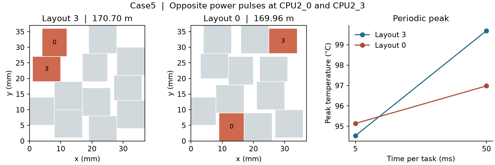
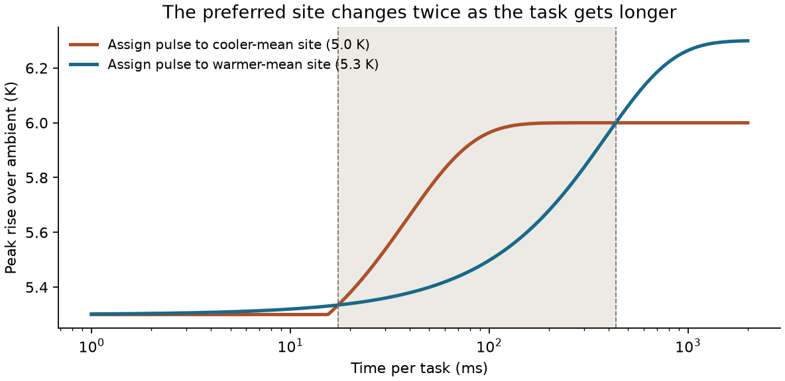

# 同样的平均功率，什么时候应选不同的芯粒布局？

**同一张逐芯粒平均功率表可以对应两种不同的最优几何。** Case5 的同两颗 CPU 交替加载，5 ms 时布局 3 较凉 0.602 K，50 ms 时布局 0 较凉 2.709 K。两套实体布局都满足同一引脚距离预算。这一翻转在细化网格与时间步、逐个重放五个候选后仍然存在。Case2 则在 18 个情景下始终选同一套布局。要判断能否只选一次，需要同时知道候选间的稳态峰温差，以及工作节拍能让各候选的峰温分别高出稳态多少。



独立 Chat 复核后，额外用 100 µm 净间距及三种顶底散热条件检查了同一对 CPU 的几何选择。三种边界下均保留翻转；5 ms 时布局 3 的优势为 0.353–0.990 K，50 ms 时布局 0 的优势为 2.579–2.869 K。[审核意见、正间距修复与边界复算](thermal-rule-transfer-review.md)

图中两端是细网格求解点，连线供辨认排序。两布局的引脚总距离分别为 170.701 与 169.960 m，共同上限 179.89 m。固定的 CPU2_0、CPU2_3 在平均功率上下反向波动 60 W，平均图按芯粒固定，同一几何内不随节拍改变。几何 3 的稳态峰温比几何 0 低 3.231 K；5 ms 时两者高出各自稳态的温差之差只有 2.628 K，尚未耗尽这一优势。50 ms 时温差之差达到 5.940 K，足以翻转。多个芯粒的坐标与朝向一起改变，图中的空间邻近本身不足以单独解释收益。[五个布局的细网格峰温、上下界与独立时域重放](evidence/thermal-rule-transfer/geometry-fine.json)

### 最简单的反例

单个热阻 $R$、热容 $C$ 的节点在两段各持续 $d$ 的 $\pm a$ W 方波下，周期稳态温度的半摆幅为 $aR\tanh[d/(2RC)]$。从 $C\dot\theta+\theta/R=P$ 对每一半周期积分，要求周期首尾温度相同就能得到这个式子。短时摆幅约为 $ad/(2C)$，长时趋近 $aR$。因此平均温度较高的节点如果热容较大，在某些节拍上反而更适合脉冲负载。下图两个位置的热阻相同。5、50、500 ms 对应的较优选择依次为较凉、较暖、较凉；解析交点为 17.41 和 433.65 ms。第三个冷参考节点补偿功率，使两种方案每一时刻的总瓦数相等。加入微弱互导后，这三点的排序仍成立。[控制数据与导热矩阵](evidence/thermal-rule-transfer/controls.json)



### 哪个结论可以迁移

固定一个布局、材料和冷却边界，在线性热方程 $C\dot\theta+G\theta=P(t)$ 的周期稳态下，平均温图由 $G\bar\theta=\bar P$ 给出，$\theta$ 是相对环境的温升。每个源偏离自身平均功率引起的**有符号**温度响应记为 $v_s(x,t)$。峰温是 $\max_{x,t}[\bar T(x)+\sum_s v_s(x,t)]$。这里的 $x$ 取可观测硅层单元，$t$ 取同一周期的采样相位。功率下降可产生负的温度偏差，且热量传到邻居会有延迟。要判断热源是否相互抵消，须在同一位置、同一时刻相加。已有瞬态 power blurring 工作也使用热响应叠加。本轮检验它作为布局选择条件的价值与失效范围。[Kemper 等，利用热响应叠加计算芯片温度](https://arxiv.org/abs/0709.1850)

仅知道每个源在每个位置的有符号最小、最大响应 $l_s(x),u_s(x)$ 时，仍可比较同一预算内的不同几何或任务映射。每个候选各求两个数：

$$L=\max_x\left[\bar T+\max\left(0,\sum_s l_s+\max_s(u_s-l_s)\right)\right],\qquad U=\max_x\left[\bar T+\sum_s u_s\right].$$

每个源达到其最大值时，其余源至少达到各自的下限。另一个下限是该点平均温度，因为零均值响应之和的周期最大值至少为零。两者给出 $L$；逐源相加所有上限给出 $U$。两源半波对称时，令 $b_s$ 为含激励瓦数的该点摆幅，温升界化为 $|b_1-b_2|$ 与 $b_1+b_2$。源数与占空比改变时，使用上面的有符号形式。

**布局决策。** 给任意便宜规则选出的候选 $A$，若 $U_A\le\min_{B\ne A}L_B+\varepsilon$，便可保证它在已比较的可行池中最多高出最优峰温 $\varepsilon$。若区间重叠过多，保留有竞争力的布局、按相位叠加求峰温。不同几何各自重建热响应，允许使用不同网格。这个保证需要从每个热源到所有观测位置的响应范围，仅有本芯粒的平均温度或本地热阻无法计算。本轮在同一离散模型中检验覆盖，没有用同一批系数证明实际硬件误差或节省的运行时间。

### 仿真验收

主指标为同一预算、同一功率轨迹条件下，所选候选的真实模型峰温减去有限候选池最优模型峰温。以下 0.1 K 是预定的选择损失容限。每个条件使用同一候选池进行配对。

| 决策 | 条件和候选数 | 结果 |
| --- | --- | --- |
| 固定几何，选两个交替活动的位置 | 8 网表 × 3 边界 × 3 节拍，405 个位置对评价 | 平均温度规则在异型网表 29/54 组超过 0.1 K，同型对照 0/18。按 5、50、500 ms 分别为 0/24、14/24、15/24。各组可选峰温跨度至少 0.183 K。 |
| 同一批位置对，加入自身动态响应 | 同上 | 72/72 组的损失上界 ≤0.1 K，最宽 0.0239 K，57 组的界已证可并列最优。直接比较最大损失为 0.00000359 K，12 组的选点编号与枚举最优编号不同。 |
| 三个角色，工作量份额不同 | 3 网表 × 2 边界 × 2 顺序，288 个有序映射 | 所有候选的全场峰温均落入有符号上下界。12/12 组的选点损失上界 ≤0.1 K，最大 0.00165 K，实际最大 0.000149 K。 |
| 强互导的被动四节点网络 | 六个位置对，500 ms | 只计自身选出 (2,3)，峰温升 5.6944 K；(0,1) 的反相热响应部分抵消，峰温升 5.1171 K。损失 0.5773 K，区间给出 0.5787 K 的上界，正确地拒绝 0.1 K 保证。 |

Case4 顶面换热减半、500 ms 时，在同一套引脚总距离 245.295 m 的坐标上，CPU1_0 的局部平均峰温 93.748 °C，略低于 GPU_0 的 93.917 °C。给两者各自施加同一幅值的波动，其自身峰温却为 99.228 与 96.488 °C。保留 CPU1_1，把另一份波动从 CPU1_0 分给 GPU_0，双源全场峰温由 99.230 降到 96.492 °C，64 档/8 子步复算相差 **2.738 K**。在同边界 5 ms 的第二个细化条件，两个选择的损失均低于 0.000001 K。这里比较预先存在的局部活动，不推定 CPU 与 GPU 执行同一程序可以等瓦、等时。[405 个两源评价](evidence/thermal-rule-transfer/screen.json) · [细网格复算](evidence/thermal-rule-transfer/fine.json) · [288 个三源评价](evidence/thermal-rule-transfer/multisource.json)

### 真正移动实体时

每例保留同一引脚距离预算内的五种坐标与朝向，工作量与芯粒的对应关系固定，逐几何重建材料、热源与热路径。表内温差为**选最短距离**相对最低周期峰温的损失，各栏在各自预算内比较。距离预算使用所有源网表引脚 Manhattan 距离之和；几何按原候选池的零额外间隙、不重叠、载板内放置检查。本轮相应工况的详细布线、真实封装间距与温度相关接口时序尚待验证。

| 网表 | 距离上限 (m) | 5 ms 损失 (K) | 500 ms 损失 (K) | 全场最优几何编号（两种节拍） |
| --- | ---: | ---: | ---: | ---: |
| Case2（本轮选点筛查外） | 145.50 | 0.004 | 0.004 | 3 |
| Case3 | 249.57 | 4.486 | 3.873 | 1 |
| Case4 | 319.43 | 0 | 0 | 0 |
| Case5（本轮选点筛查外） | 179.89 | 3.971 | 3.879 | 3 |

这 8 组中，最低稳态峰温与加入自身动态响应的规则均选中同一最优几何。逐条件区间全部能给出 0.1 K 保证，最宽 0.00042 K。Case5 在 500 ms 下用 170.701 m 的几何取代 169.960 m，峰温从 101.619 降至 97.740 °C。Case4 的最短几何已经最凉。对选布局这一目标，本批数据支持在可区分的候选间优先用稳态筛选；这批数据没有显示升级到瞬态评分的额外降温收益。布局池来自单种子，四组网表共用一套封装层叠，选中几何离连续设计空间的全局最优还有多远未知。[全部 40 个几何评价、距离和时域复算](evidence/thermal-rule-transfer/geometry.json)

### 设计时还不知道活跃位置与节拍

仍然使用上述四个网表与 20 套坐标。对每例额定功率最高的四颗实体冻结各自的平均功率，完整覆盖六个脉冲位置对 × 三种驻留时间。十八个情景的总瓦数在每个瞬间相同，四者每颗的时间平均瓦数也相同。四源均处于 60% 额定平均功率，因此这里与上一组固定两源的平均热源不同。情景 $s$ 已知时算出池内最优峰温。若在工作负载明确前就要固定几何，指标是**最坏选择损失**，即所选布局在所有情景中落后各自最优布局的最大温差。比较五个几何的该指标，得到池内最佳固定布局。没有给情景指定出现概率。

| 网表 | 各情景最优几何（胜出次数） | 任何固定几何的最坏损失至少为 (K)，由区间证明 | 最佳固定几何的实际最坏损失 (K) | 稳态几何损失超过 0.1 K 的情景 |
| --- | --- | ---: | ---: | ---: |
| Case2 | 0（18） | 0 | 0 | 0/18 |
| Case3 | 2（12），1（6） | 1.631 | 1.673 | 6/18 |
| Case4 | 0（10），1（8） | 2.667 | 2.675 | 8/18 |
| Case5 | 3（15），0（3） | 3.764 | 3.764 | 3/18 |

对任一几何 $g$ 和情景 $s$，其损失至少是 $\max(0,L_{g,s}-\min_{h\ne g}U_{h,s})$。先对情景取最大，再对可行几何取最小，即表中不依赖相位求和的下界。若下界超过容限，任何单一几何都无法在给定候选、情景集合内保证那个容限。反过来，若某一几何对每个情景的损失上界都低于容限，就可以直接固定它。中间区域需要保留相位计算。四个案例最低稳态几何均恰好也是最小化最坏损失的固定几何，但在其中三例，面对不同情景时必须实际承受温差。这里的“逐情景选择”用于衡量在设计时得知工作负载的价值。

还可以完全按区间给固定设计排序，选择“跨情景的最大损失上界”最小的几何。依次选出的几何为 0、2、0、3，与全相位的最小最坏损失解一致；它们的损失上界依次为 0、1.974、2.743、5.772 K。Case5 的上界比实际损失大约 2 K。若设计容限落在上下界之间，需要进一步计算。

360 个几何—情景组合均逐时域复算。情景已知时，自身动态响应在全部 72 组均选中了池内最优几何；强耦合控制说明这不能作为无条件捷径。完成粗网格筛查后，取最佳固定几何损失最大的 Case5，对见证处的 CPU 对在 50 ms 与另一个最短 5 ms 做 64 档/8 子步复算。50 ms 的损失由粗网格 3.764 K 收窄至 2.709 K，排序保留。上表最坏损失仍为 32 档/4 子步全筛结果，两个点的细化不能给出完整细网格极小极大值。[全部情景、布局、见证和界限](evidence/thermal-rule-transfer/uncertain.json)

### 独立硅片的实测约束

Terraneo、Leva、Fornaciari 在 SAMOS 2019 发布的 TTV-1202 数据中，四次单点阶跃各提供一列 16 个温度传感器的响应，用实测瓦数归一化，直接预测另一条四加热器同步开启记录。自然/风扇散热下，全传感器、前 20 s 的 RMSE 从只取本位置的 **5.398/4.888 K** 降至保留跨位置响应的 **0.567/0.529 K**。实测 20 s 峰温升为 24.580/21.740 K；只取本位置分别低估 9.863/9.025 K，叠加全场后低估 1.040/1.502 K。归一化后平均增量功率图的相对二范数差约 0.125%。全场预测最大的单点残差仍有 10.769/7.602 K，均出现在 10 Hz 记录的首个阶跃样本。[作者的原始数据与平台说明](https://zenodo.org/records/3345878) · [10 条原始记录的哈希、功率和温升误差](evidence/thermal-rule-transfer/measured.json)

用自然冷却 20 s 选出的单点位置，在其余七个冷却/时间组合中六次仍然最低。唯一的风扇 0.5 s 差值为 0.114 K（按 6.8 W 归一），未归一原始差 0.55 K。将滑窗前移或后移一个样本，归一损失分别变为 0.731 和 0 K。这次测量能支撑空间热耦合会影响多源峰温；短时位置反转、反相抵消和 ATPlace 的绝对结温仍缺相应实测。

### 本地复现

以 [ATPlace 原案例版本](https://github.com/PKU-IDEA/ATPlace_pub/tree/fe3dbfdaf78dc0ddeac3a2cfc3a85ff0971f88df/cases) 经本仓库 `tools/import_atplace_cases.py` 得到的目录替换 `CASES`，Zenodo v2 解压后的 `release` 替换 `RELEASE`。使用已安装本仓库的 Python、NumPy、SciPy，绘图另用 Matplotlib。坐标与预算从 [冻结的几何候选](evidence/layout-dominance-v1.json) 读取。

```text
python tools/thermal_role_transfer.py --cases CASES --output results/transfer/screen.json
python tools/thermal_role_transfer.py --cases CASES --refine results/transfer/screen.json --output results/transfer/fine.json
python tools/multisource_role_transfer.py --cases CASES --output results/transfer/multisource.json
python tools/thermal_geometry_transfer.py --cases CASES --output results/transfer/geometry.json
python tools/thermal_geometry_transfer.py --cases CASES --uncertain-sources --output results/transfer/uncertain.json
python tools/thermal_geometry_transfer.py --cases CASES --refine results/transfer/uncertain.json --output results/transfer/geometry-fine.json --figure results/transfer/geometry-witness.png
python tools/thermal_transfer_controls.py --output results/transfer/controls.json --figure results/transfer/storage-reversal.png
python tools/measured_hotspot_transfer.py --release RELEASE --output results/transfer/measured.json
```

本机全套 199 项测试通过。双芯粒 CLI 校验与评估通过，3 W、34.1886 °C。上述八份数值结果与两张图在干净的结果目录中复算一致。360 个不确定负载几何评价的两种离散求解路径，峰温最大相差 1.1×10⁻¹² K；这个数检验数值实现的一致性。全部实验在本机完成。

## 实验前约定

本机 fetch 成功，起点为 `05be233c3b6646123a953217dbd3fba6e7dc0bfb`。上轮是同类型芯粒、同一封装模型的角色置换。本轮询问局部平均温度能否预测异型位置在不同节拍及散热边界下的周期峰温。

1. 用两个互不耦合、均向环境导热的 RC 节点，构造可手算的反例。两个位置平均温升为 5 与 5.3 K，热阻均为 1 K/W，热容分别为 0.025 和 0.25 J/K。选择一个位置承担 ±1 W 的等时方波，另一个维持平均功率；每种分配每周期做功相同。与矩阵指数的独立时间推进核对。考察较凉位置是否在所有节拍占优。
2. 取原单种子预算池中最短线的固定布局。测试所有有两种以上 CPU/GPU 类型的 Case1、4、6、7、9、10；Case3、8 为单类型对照。异型案例取额定功率最高和最低计算类型各自的前两颗（若不足则全取），对照取前四颗。保持全部实体和原网表引脚不动。比较两处承担反向波动的合成局部计算活动，各处平均均为额定的 60%，无关芯粒 25%，波动幅值固定为入选位置最小额定功率的 40%。枚举每个合规位置对，所有方案逐点平均热源、总功率、八任务交替顺序和引脚距离一致。这里检验已驻留活动的热映射，两种硬件真实执行同一程序的性能另需测量。
3. 在 32 档几何贴合网格上，比较原顶面散热、顶面对流系数减半、顶面维持原值且底面增加同系数散热三组。任务持续 5、50、500 ms，每任务四个后向欧拉子步。按每个条件分别重算平均温图。对照两条冻结的规则：选两个局部平均温度中较热者最低的位置对；再给每个候选位置计入该节拍自身等幅波动的温升，保留芯粒内位置分辨率、忽略跨芯粒动态耦合，按全片最高预测值选点。平手取位置编号。主指标为同条件中入选峰温减去全部位置对最凉峰温，温差以 0.1 K 为实质门槛。无有效选择空间（最差、最好之差 ≤0.1 K）的条件单列，网格/节拍数不作独立样本数。频率响应叠加给出全部配对解，用独立时域算法核对。按旧规则损失最大的条件选一次 64 档/8 子步复算，再核对自身响应近似最大的失败（若同条件只算一次）。
4. TTV-1202 已公开的自然散热器和风扇散热器各有四次同名义 7 W 单点热点测试。先只读作者功率图与协议，再在两组中按相同方法提取各热点的读数：用实测总功率阶跃定位，扣每个传感器阶跃前一秒的均值；对 0.5、2、10、20 秒之前最后最多五个样本取均值，然后取 16 个传感器的最大温升，同时保留同期实测增量功率。在自然散热器 20 s 选择每瓦温升最低的位置，原样转到另外的时间与风扇工况；按响应率差乘参考增量功率 6.8 W 报等功率估算损失，并列出未归一化的原始温升及排名。探头位置、时间分辨率和实测电功率限制解释范围。这些是单点阶跃，不能作为芯粒周期任务的实测复现。

不据本轮数据调参。仿真变化属于同一层叠的大模型族；公开测量来自另一块器件。两类结果分别验收，所有计算在本机运行。

## 对跨位置传热的追加实测

四个单点源的筛查已完成。针对“只保留本位置的温升是否充分”，在使用 `four.csv` 的温度作本轮预测检验前，冻结如下对照。该记录同时加热上述四个位置（各约 3 W），而用于预测的四次独立阶跃各在一个位置加热到约 7 W。先用实测电压、电流提取各次试验前 20 s 的平均增量功率，以目标中该加热器的增量除以对应独立试验的增量，得到四个标量权重。扣除各次阶跃前 1 s 的逐传感器均值。预测 20 s 内全部 16 个传感器、200 个样本：方法一在每个加热器仅保留同位置传感器的响应，方法二保留全部跨位置响应。两种冷却分开、无温度拟合。同时报告叠加电功率图误差、全部传感器 RMSE、20 s 最后五点的峰温升误差。两个源功率水平不同，实测只检验同步阶跃叠加。对上一项风扇 0.5 s 的排序另检查窗平移一个采样间隔的敏感性，标记为事后分析。

## 从反例得到的附加判据

首次筛查发现平均温度规则失效，自身响应规则在八个网表上表现好，却在两个紧耦合、反向工作的节点上失效。为让新的经验规则有可检验的边界，追加以下不调参的证书。已知单位幅值单点激励在每个空间位置 x 产生的最大摆幅 b_i(x)、b_j(x)，则两个等幅反相角色产生的摆幅在 a|b_i−b_j| 与 a(b_i+b_j) 之间。在同一位置加平均温度，最后分别取全片最大，得到该布置的峰温下界 L 和上界 U。对同一条件的全部竞争方案，若经验选择的 U 不超过其余各方案最小 L 加 0.1 K，即可证明损失最多 0.1 K。记录全部候选的覆盖、能证实的例数和强耦合反例中是否拒绝给出错误保证。该检验是首次筛查后的推论。

为检查半周期反对称这个限制，追加三个角色、七个任务的非对称实验。Case3、4、9 在原顶冷与双面冷却下各重放两种顺序 `0000112` 和 `0120010`，每任务 50 ms、32 档/4 子步，三个角色各占 4/7、2/7、1/7。所有有序角色映射参与比较。每个源的扰动为 a 乘以“该角色正在运行”减其份额；各源时间平均为零、同一时刻扰动之和也为零。使用每个位置的有符号响应最小/最大值，检验全体候选的区间覆盖、能否给出 0.1 K 的选点保证，并对入选映射做逐步重放。不将两个顺序推广为最优调度。

## 移动芯粒的预留对照

在提取以下布局的本轮瞬态结果前，冻结 Case2、5（未进入上述位置筛查）以及 Case3、4。逐例重用原单种子生成、满足原引脚 Manhattan 总距离上限的全部几何候选。固定额定功率最高的两颗实体（平手按输入编号），对其各给 60% 额定平均功率，在二者间交替转移较小额定值的 40%，其余实体恒定为额定的 25%。不换任务映射。比较原顶冷下 5 与 500 ms 的驻留时间，32 档、每任务四子步。用同一组逐芯粒功率、固定网表和同一距离上限，比较最短距离、最低全片稳态峰温、仅自身动态响应三种选择与候选池的全场瞬态最优值。每组重新建立各个几何的热网络。检验上下界是否给出 0.1 K 的几何选择保证；同时报告各组实际可选温差和入选几何的时间域复算。该项检验候选池内排序，不新增搜索预算。

上述固定两源的八组全部选出稳态最凉的几何。为检验是否仅因挑了这一对负载，在查看新增温度前，再冻结同四网表、各五个原几何、同一距离上限。取前四个额定功率最高的实体（平手按输入编号），四者的平均功率均设为额定的 60%，其余 25%。完整枚举四者六个可能的反向活动对和 5、50、500 ms 三种节拍，所有活动对使用同一幅值（四者最小额定功率的 40%），实体的平均热源与瞬时总功率在十八种情景间相同。逐例比较固定稳态最凉几何、逐情景重选几何和事前选择的单一鲁棒几何。后者的目标为最小化十八个情景中相对于该情景最优几何的最大温差。记录全部候选与不同优胜几何，峰温界能否保证固定解在全部情景内损失 ≤0.1 K，以及逐时域回放。该项是固定功率不确定性集合，尚未测试的轨迹另论。
