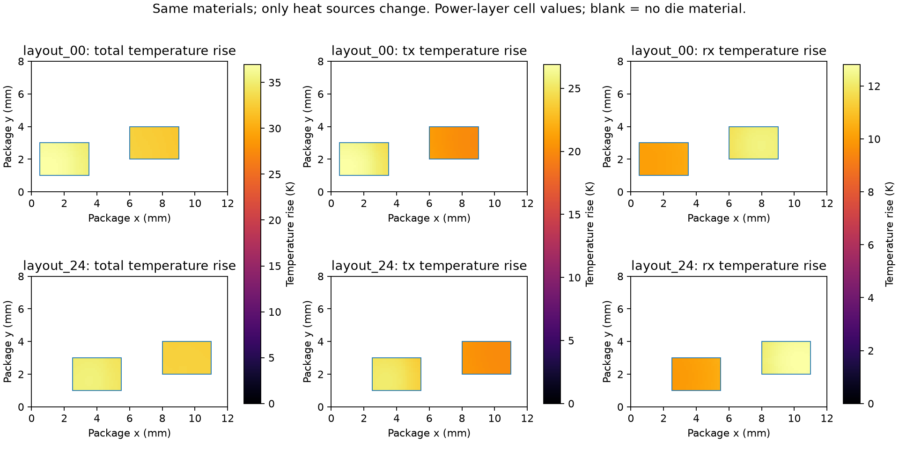

# v0.8：E1 独立热源贡献与边界敏感性

**E1 在声明的线性热模型内完成。E2 真实路由资源与 E3 时序约束必要性尚未完成。**
保留 v0.7 的负例：其 50 MHz 常温 GPIO 模型中，合法匹配路由没有迫使我们放弃
最低温布局。本轮不改变时钟周期、不添加优化器、不开放 hot-pad timing。

[运行计划与加密修订](validation-plan-v08.md) ·
[机器可读证据](evidence/v08-e1-validation.json) ·
[温升场图](evidence/v08-source-contributions.svg)

## 1. 实验与核验方法

沿用 v0.5 的全部 27 个布局、12×8 mm 封装、2 W TX 与 1 W RX 分块功耗。
每个固定布局分别求解总功率、仅 TX、仅 RX。关闭热源时保留两颗 die、全部材料、
接触规则和散热边界；没有删除未加热的 die。三次独立组装/求解逐项核对矩阵哈希、
节点编号和散热系数。叠加的是温升：

\[
G\theta=P_{TX}+P_{RX},\qquad
G\theta_{TX}=P_{TX},\qquad G\theta_{RX}=P_{RX},\qquad
\theta=\theta_{TX}+\theta_{RX}.
\]

总温度为环境 25°C 加总温升。分别取各个源的最大值再相加通常不等于总峰值。
本轮在**总温升场的同一个热点单元**读取 TX/RX 贡献，同时记录每颗 die 的总场热点。
不同布局的热点位置可以改变，以下跨布局贡献差包含这种采样位置变化。
贡献除以源功率得到的是该功率分布下的 K/W 响应系数，不是通用的单一 die 热阻。

27 个布局 × 6 个预先声明的边界/TIM 假设，使用 48×32、96×64 请求网格；
贴合几何会增加实际网格线。底部散热组全部再求解 192×128。加上名义 layout 00
整体旋转 180° 的三次源求解，共 **1,056 次独立线性求解**。
这些是确定性数值计算，不是 1,056 次独立物理实验。

## 2. 整体平移主要改变 TX 自身贡献，但 RX 热耦合并不小

| Layout | 峰温 °C | 热点 TX 贡献 K | 热点 RX 贡献 K |
| --- | ---: | ---: | ---: |
| 00 | 61.950845 | 26.884846 | 10.065999 |
| 12 | 60.924541 | 25.934708 | 9.989832 |
| 24 | 60.386184 | 25.364062 | 10.022122 |
| 26 | 59.749036 | 24.780808 | 9.968228 |

00→12→24 保持相对位置和方向，整体向右平移。00→24：

- 总峰温变化 **−1.564661 K**。
- 同一总场热点处的 TX 贡献变化 **−1.520784 K**。
- RX 贡献变化 **−0.043877 K**。

因此，这组平移的温度变化主要来自 TX 自身热源对应的响应变化，支持绝对位置
相对有限封装/散热结构的重要性。**RX 对热点的绝对贡献仍约 10 K**；小的变化量
不能解释成小的耦合量。这个分解也没有单独隔离侧边镜像、其他材料路径与热点移动，
不能把全部 TX 变化直接命名为某一项“侧边界因果效应”。



图显示功率层单元温升；空白为该层无 die 材料，不是整个封装绝热。
各列使用各自的固定色标，上下两行可直接比较；下面的 interposer 和上面的共享层
仍参与导热。

## 3. 只移动 RX：耦合变化与 TX 自身响应可方向相反

保持 TX 在 (1.5, 2) mm，RX 从 x=6→7→8 mm，对应 layout 10→13→16。

| Layout | 峰温 °C | 热点 TX 贡献 K | 热点 RX 贡献 K |
| --- | ---: | ---: | ---: |
| 10 | 60.578942 | 25.418669 | 10.160272 |
| 13 | 60.392175 | 25.425052 | 9.967123 |
| 16 | 60.270435 | 25.440903 | 9.829532 |

10→16 总峰温降低 **0.308507 K**，RX 贡献降低 **0.330741 K**，TX 贡献反而增加
**0.022234 K**。未加热 RX 的材料仍然存在，移动它也会改变热网络 G；因此不能假定
移动 RX 只会改变互热项。这是本模型内的分解，不是实测热阻辨识。

## 4. 边界/TIM 假设确实能改变排序

| Profile | top/bottom h W/(m²K) | TIM k W/(mK) | 原始最低温候选 | 最低峰温 °C | 最大末级 XY 网格变化 K |
| --- | --- | ---: | --- | ---: | ---: |
| nominal | 1000 / 0 | 10 | 26 | 59.749036 | 0.012533 |
| weaker_top | 500 / 0 | 10 | 26 | 91.006615 | 0.012683 |
| stronger_top | 2000 / 0 | 10 | 26 | 44.109649 | 0.012249 |
| bottom_only | 0 / 1000 | 10 | 26 | 63.089924 | 0.026127 |
| lower_tim_k | 1000 / 0 | 1 | 20；20/23 未区分 | 73.213904 | 0.021360 |
| higher_tim_k | 1000 / 0 | 20 | 26 | 58.943340 | 0.012012 |

这些材料/散热数值是敏感性假设，**没有测量或校准依据**。所有组固定厚度、其余
材料和功耗，没有根据结果调参。低 TIM 导热率时：

- 20 比 26 低 **0.083562 K**；二者末级峰温网格变化之和为 **0.031740 K**。
- 名义 TIM 时 20 比 26 高 **0.315428 K**；对应网格变化之和 **0.017664 K**。
- 20 比 23 仅低 **0.014633 K**，小于对应网格变化之和 **0.033290 K**。

因此，20/26 的排序反转通过了本轮网格变化筛选；20/23 未被该筛选区分，不能断言
20 是唯一可信最优。网格变化只是**数值分辨能力的筛选代理**，不是严格离散误差上界，
更不是物理模型误差、参数不确定度或置信区间。没有进行 z 方向加密：仍为每物理层
一个厚度方向节点。即使超过 XY 筛选代理，也不能将小温差当成封装实物预测。

底部散热初始 48×32→96×64 最大变化 **0.101544 K**，未通过预定 0.1 K 门槛。
保留该失败，并对该组所有 27 个布局加密到 192×128，末级最大变化降到 **0.026127 K**；
门槛没有放宽。初次执行另发现报告脚本的旋转属性拼写错误；修正后完整重跑，
没有以初次不完整结果代替成功记录。

## 5. 因素分解与数值检查

完整 3³ 平衡因素分解在名义条件得到下列平方和占比：

| 项 | 总样本平方和占比 |
| --- | ---: |
| TX x 主效应 | 64.2402% |
| TX y 主效应 | 30.4059% |
| RX x 主效应 | 4.7708% |
| 所有交互项合计 | 0.5832% |

主效应合计 **99.4168%**。这只是固定样本的描述性正交分解，不是物理因果贡献率；
没有 p 值、独立重复或推广到其他封装的统计论证。实现用已知解析主效应/交互项
检验平方和与闭合，报告也分别分解两个热源在总热点处的贡献。

| 本地检查 | 结果 |
| --- | --- |
| 27 个名义峰温复现 v0.5 | 全部通过，门槛 1e−6 K |
| 关闭功率后矩阵/节点/sink 完全一致 | 全部通过 |
| 全材料节点温升叠加最大误差 | 1.85e−13 K |
| 总源线性残差最大值 | 7.82e−14 W |
| 总源热平衡最大误差 | 1.47e−11 W 以下 |
| 封装中心 180° 旋转，全场最大误差 | 2.28e−13 K 以下 |
| 六组末级 XY 峰温网格变化 ≤0.1 K | 全部通过，含保留的加密修订 |
| 单元测试 | 72 项通过 |
| 原始 two_chiplets CLI | 通过；峰温 34.1886°C；时序 not_run |

新测试还使用独立推导的两节点解析热网络，覆盖被动 die 保留、零功率、环境温度
只计一次以及“各源峰值相加”错误。软件通过不改变 v0.6 pad SPICE–Liberty
资格验证失败，也不新增物理校准或外部热求解器认证。

## 6. 复现与下一步

```bash
python -m pip install -e '.[validation]'
python -m unittest discover -s tests -p '*_unittest.py' -v
chiplet-floorplanning evaluate examples/two_chiplets.json --output results/v08-cli
OPENBLAS_NUM_THREADS=1 python tools/validate_thermal_decomposition.py \
  --output results/v08-e1
```

每次使用新的目录。`report.json` 保留每档网格、逐源热平衡与矩阵哈希；NPZ 保留
独立温升场。`summary.json` 是可提交的紧凑证据，保留全部 162 个候选、因素分解、
排序筛选、输入/代码哈希和原始报告哈希。公开证据记录本地运行时的基线 commit 与
dirty 状态；代码哈希标识实际执行源码，不能把基线 commit 单独当作执行版本。
CI 独立运行 E1 并上传完整输出，不需要 PDK 下载。

E1 支持“热偏好依赖位置、被动材料与散热假设”，尚不证明 timing 会改变最佳布局。
E2 下一步需要有来源的 pin/bump 排列、共享时钟组、可用层/track/keepout 和资源容量，
并区分必要 cut-capacity 条件、实际合法路由和搜索失败。E3 仍需同一接口/PDK 下有
来源的时钟边沿与约束；不能用当前演示周期制造 timing-critical 结论。
未将未完成的多 lane 映射探索接入正式评估器，也没有将它标为获准 benchmark。
E2 已补充 [IHP ADK 资源来源准入审查](routing-resource-admission.md)，锁定六份
参考文件；其中装配间距与 bump pitch 不能代替金属线宽/间距或真实端口排列。
