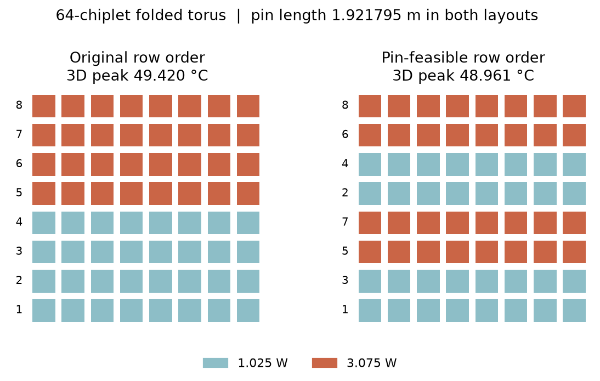

# 用真实引脚连接选择冷热槽位

## 64 颗的可行降温

在原来的 1.921795192846 m 引脚总长上限内，把 64 颗 folded torus 的四行高功率芯粒分为两组，中间插入两行低功率芯粒。峰温从 **49.419553 降至 48.960936 °C，降温 0.458617 K**。同一可行上限下，上轮可实现的最好成绩为原地。本轮使用两次新布局核验，第一次便找到所选方案。全排列域中仍可能再降 **0–0.822555 K**，比原差距缩小 35.8%。收紧来自找到了可实现的冷布局，沿用了上轮 48.138381 °C 的全域峰温下界。



图中从下往上按原始编号排列为 **1、3、5、7、2、4、6、8**。列保持原状，48 颗芯粒换位，全部 128 条网的端点身份和芯粒朝向保持其输入定义。与起点相比，16 条连接合计增加 0.566291 m，48 条合计缩短 0.566291 m，另 64 条等长。颜色表示 1.025/3.075 W 功率，图示方案和数值选中的最低线长代表具有相同的槽位功率图及亚纳米精度内相同的引脚总长。最低线长代表实际移动 52 颗，图示的纯行重排移动 48 颗；两者的最长单链均为 47.191 mm。[布局映射及逐步核验](evidence/wire-slot-selection.json)

| 案例 | 方法 | 同上限最佳峰温 °C | 该点线长 m | 新布局整板核验 | 伴随行 | 总用时 s |
|---|---|---:|---:|---:|---:|---:|
| 64 颗 folded torus | 旧法，先选热图再配身份 | 49.419553 | 1.921795 | 2 | 65 | 2.54 |
| 64 颗 folded torus | 行列身份与热图联合选 | **48.960936** | 1.921795 | 2 | 66 | **1.07** |
| 24 颗 mesh | 旧法，先选热图再配身份 | 47.750947 | 0.162959 | 2 | 25 | 0.52 |
| 24 颗 mesh | 行列身份与热图联合选 | 47.750947 | 0.162959 | 0 | 24 | 0.13 |

同一台本地 i7-12700 的顺序运行，每臂计入共用输入准备时间、起点求解、矩阵分解和伴随、筛选及独立重建的三维复算。时间从进程内读案例起算，Python 启动和导入在外。反向指标取不超过各自起点峰温的已见布局，两法在两个案例的最短线长均分别为 1.921795 和 0.162959 m。旧法的两次提议在 64 颗上均为 3.326885 m，24 颗上均为 0.774343 m，超过相应上限。新法的第二个 64 颗候选虽然满足上限，峰温 48.982641 °C，较第一次高 0.021705 K。24 颗 mesh 的 38 条边各自都必须取唯一相对位移，并连通全部芯粒，故包括行列重排以外的任意槽位排列，剩余降温也严格为零。

## 怎样把连接放进选择

曼哈顿引脚总长等于两轴投影之和。重排行时，可以一次算出**所有实际引脚在纵向增加和节省的距离**；重排列时同理。横轴只依赖列顺序，纵轴只依赖行顺序，二者之和就是这整个布局的实际引脚曼哈顿总长。任一轴的开销加上另一轴最小可能开销已超上限时，可直接排除这一顺序。对产生相同槽位功率的轴重排，只保留该轴线长最低的身份实现。两轴置换可交换，之后无论怎样重排另一轴，都保留了这个功率图在线长上的最好机会。[实现](../src/chiplet_floorplanning/placement/wire_slots.py)

具体地，对端点为 $i,j$ 的网络 $e$，设 $b^x_e$ 为两端真实引脚在固定朝向下的横向偏移之差。给定列重排 $c$，它贡献的横向距离为 $|x_{c(i)}-x_{c(j)}+b^x_e|$，纵向同理。将各网求和得 $L_x(c)+L_y(r)$。在这个和不超过线长上限时，才比较联合功率图在各观察位置的剩余温度余量。总长与峰温始终对应同一份身份映射。

64 颗案例每轴有 40,320 种次序。按真实连接筛过后，每轴各剩 70 种，共有 **4,900 个**合规身份映射，对应 **6 种**不同的功率图。固定材料和占用使三维热响应满足叠加。用每个槽位原热点对各处功率的响应用来预估峰温，先验算最冷者；把整板实际出现的新热点加入观察行，再选下一个候选。所有可行功率图的已观察峰温之最小值，给出行列族最优峰温的下界。终点在这个域的数值差约 10⁻⁷ K。在全部 64! 个身份排列中，整行整列以外的移动仍可能改善 0.822555 K。旧法与新法的全域下界、受限域下界及热核验成本分别保存在证据中。[比较与独立整板复算](../tools/compare_wire_slots.py)

该方法不需要写入 mesh、torus 或奇偶行规则。它利用的是规则槽阵、固定朝向的可互换芯粒和可按轴分解的引脚总长。相同热图的合并要求身份交换不改变材料、散热边界或其他热源。两个功率档和冷热成行为本次数据的结构，有利于压缩。候选生成按行数和列数分别做阶乘枚举；小矩形阵列可穷尽，并不意味着任意尺寸封装都只需六张功率图。带三档交错功率、非均匀槽距、不同朝向、重复热图与实际引脚的六槽单测与完整身份穷举对照。[穷举测试](../tests/wire_slots_unittest.py)

为了区分复用历史下界和从零认证的成本，另固定一次补充计算。在选址结束后，只用本臂已经取得的观察行，调用原先的全排列热松弛，整数求解仍限 2 s。单列新下界与额外墙钟。24 颗的刚性证明已足够，此项不需要热整数求解。补充计算不增加候选或三维核验次数。

**从零认证结果。** 64 颗的本臂 66 行给出的全域峰温下界为 48.083156 °C，剩余至多 **0.877779 K**，已小于原来的 1.281173 K。额外耗时 1.20 s，含整个选址、独立重建与这次求界共 **2.27 s**，可与旧法独立运行的 2.54 s 对照。旧法从另一组热点获得了更强的全域下界 48.138381 °C；沿用它才得到 0.822555 K。证据保留六张图的见证峰温、三张已知真值（含起点）、观察节点和两个不同的全域下界。独立整板复算的能量误差在两例均小于 1.1×10⁻¹² W。

### 哪一项额外的互连条件会消去这次收益

看到主实验后，另用起点已有的最长一条引脚曼哈顿距离作诊断。在 64 颗起点为 **16.086 mm**，选中热图在行列族内所有合规身份映射中，最短可实现的“最长一条”为 **47.191 mm**。逐网核算全部 4,900 个合规映射，同时保住起点总长和起点最长单链的只有 **4 个**，均为起点功率图。因此行列族在双上限下的降温为零。这个附加条件没有进入主排名，也没有额外热核验。单链实际时延、布线绕行与带宽仍需相应的电气模型。[全部功率图的逐链上限](evidence/wire-slot-link-lengths.json) · [独立逐网核算](../tools/audit_slot_link_lengths.py)

## 早期好的效果，是否仍有依据

早到 11 月 12 日就有一组小预算同起点消融。Case1 共 6 颗、780 W、3,168 条双端网，两组同一种子、每组 48 次新热求解（含共同的 16 个初始布局），以 73.840209 m 为同一引脚总长上限。均匀合法变异的最冷点为 105.118177 °C，按实际引脚筛选候选为 103.712271 °C，低 **1.405907 K**，且后者引脚总长也较短。反过来统一温度上限，两组选出的最短布局相差 6.51%。[11 月 12 日的原始双指标、轨迹与预算](atplace-case1-search-results.md)

11 月 14 日的六法内部对照中，固定相对布局关系后直接解引脚线长的 `topology_lp`，在 29 个温度上限中拿到 28 个线长最优。11 月 16–17 日的 `relation_space` 进一步搜索芯粒相对位置关系；Case1–8 的完整 ATPlace 对照在 FV 与 ATSim 两种模型上均为 **7 胜、1 平、0 负**。Case9/10 缺完整 ATPlace 热感知结果，十例总判定为 incomplete。每例约 1,000 次 FV、种子 2、允许变化的位置与姿态，服务器历史实验只读引用。[六方法比较](method-comparison-v2-results.md) · [固定版本与原始协议](atplace-comparison-v2-plan.md) · [八例完整结果](atplace-comparison-v3-plan.md)

为区分“超过某个外部点”和“超过这个线长上限内最好的外部点”，本机从归档 JSON 重算两种数字。下表每例均在原外部点给出的线长阈值中取最大差，为真实布局的 FV 峰温差。后两列给出在该阈值下双方各自达到的最低峰温。

| 历史案例 | 上限 m | 相对单个外部点的最大优势 K | 对双方预算内最佳点的优势 K | 最佳 ATPlace °C | 最佳 relation_space °C |
|---|---:|---:|---:|---:|---:|
| Case4 | 48.520145 | 9.158 | 8.959 | 138.222 | 129.263 |
| Case5 | 120.402231 | 9.668 | 9.668 | 136.700 | 127.032 |
| Case6 | 32.121022 | 13.765 | 10.776 | 118.541 | 107.764 |

为免逐例挑上限，又按同一条事后统计规则读取 v3 快照：每例取 ATPlace 的默认热权重点 `thermal_x1` 的实际总长作上限，双方都可从各自所有已保存点中选预算内最低峰温。正数表示 relation_space 较冷；统计范围为六个外部标签齐全的八例。它是归档布局的补充分析，原实验判定仍按预先冻结的双目标裕量规则。[v3 布局逐点原始数据](evidence/atplace-compare-rsg4-v3.json)

| 案例 | 共同上限 m | FV 峰温差 K | ATSim 峰温差 K |
|---|---:|---:|---:|
| Case1 | 51.297 | 4.839 | 4.685 |
| Case2 | 157.054 | −0.179 | −0.151 |
| Case3 | 214.717 | 3.159 | 2.921 |
| Case4 | 48.520 | 8.959 | 9.005 |
| Case5 | 120.402 | 9.668 | 8.373 |
| Case6 | 32.121 | 10.776 | 10.391 |
| Case7 | 37.863 | 0.705 | 0.887 |
| Case8 | 9.669 | 5.399 | 4.610 |
| 中位数 | | **5.119** | **4.648** |

这些历史结果支持把真实互连直接放进搜索。上述数值衡量相对外部方法的差；本次 0.458617 K 衡量的是相对已满足紧上限的规则起点的降温。这 64 颗的总功率为 131.2 W，环境 45 °C，起点温升仅 4.420 K。按上轮全排列热下界，即使找到同一模型内全局最好的合法布局，从这个起点最多也只能降 1.281173 K。因此用历史 Case6 的十余 K 作为这个例子的降温目标，在物理和数学上都不可达。[原始双方布局数据](evidence/atplace-compare-rsg4-v2.json)

## 独立 Chat 审稿

Chat 通过已连接的 GitHub 只读核对了起点 `7aeb685`、冻结协议 `bf68559` 和实验提交 `bda847e`，读取代码、测试、两份新证据和历史 ATPlace 比较。审稿侧没有运行仿真。原始峰温、两次候选核验、4,900 个合规映射、6 张功率图、24 颗刚性及历史 Case4–6 的两种温差口径均获复核。上文默认权重的八例历史中位数由本机另从 v3 归档计算。[完整独立审稿](https://chatgpt.com/c/6affd32b-c9ac-83e8-92c1-d6a88ddd9472)

按完整 ICCAD 论文标准，审稿给出 **Weak Reject**。两个规则槽阵上的结果成立，算法仅覆盖整行整列重排，且两档功率的这个正例依靠一些连接变长才保持总长不增。24 颗的唯一性限定在固定朝向、固定网表与占满的离散槽位。64 颗的族内峰温下界显式扣除了 10⁻⁷ K 数值容差；它解释了可行峰温与该下界的末位差。

2.27 s 的独立求界沿用冻结实例和起点，本臂重新求初始温场、观察响应和全域热下界。1.07 s 仅涵盖选址、复建和选址流程内的计算，报告 0.822555 K 时另用了旧法的全域下界。各时间是本机单次顺序实测，两法内部优化和认证工作量不同。审稿建议的下一个区分实验，是保持总长、最长单链和核验次数，在整行整列以外联合选择若干芯粒的落点。

## 本地复算

从 `local/rapidchiplet-holdout` 读取固定提交 `17176f92c91eda629a25bc11bf7959d6b963a23b`。沿用种子记录 20261119。两个规则起点和行列枚举本身均为确定性。项目 Python 环境设置 `PYTHONPATH` 包括 `src` 与 `tools`，数值库线程数设为 1。

本地全套 218 项回归通过。双芯粒 CLI 验证与评估通过，3 W、34.1886 °C。六槽身份穷举测试另核对了功率图集合、同图最短线长和身份映射的准确个数。

```sh
python tools/compare_wire_slots.py --upstream local/rapidchiplet-holdout --output results/wire-slots.json
python tools/audit_slot_link_lengths.py --upstream local/rapidchiplet-holdout --evidence results/wire-slots.json --output results/wire-lengths.json
python tools/plot_wire_slots.py results/wire-slots.json results/wire-slots.png
```

## 实验前冻结

已 fetch，起始版本为 `7aeb685796537d5af61f39dbb6e66edcfc537c8c`，远端没有新提交。只在本机使用上轮的 RapidChiplet 固定版本、几何、朝向、功率、规则网格起点、三维封装、环境和同一种子 20261119。64 颗 folded torus 的精确互连上限为 1.921795192845845 m，24 颗 mesh 为 0.16295909689024515 m。沿用原准入容差 10⁻⁹ m。历史上另外一个 64 颗乱序起点的降温 0.767265 K 对应 7.606313 m 上限，单列为背景。

- 旧法本地原样复算。新法只允许与旧法实际开销相同的至多两次新布局整板核验，另有共同的起点求解和最终独立重建三维复算。热点响应行取自本臂自己的起点及核验反馈。记录尝试、超限、未改善与提前停止。
- 对全占用矩形槽阵，一次为所有行和所有列共同选择新顺序。曼哈顿引脚线长可精确分为两个轴的和，各自计算实际网络、芯粒身份和引脚偏移。可实现的行列组合先满足同一上限，再比较热点余量。两个布置若每槽功率相同且材料未变，热方程相同，只需保留其中线长最短的身份映射。这是对任意网表和槽位功率图都可用的受限布局族。此次最多八行八列，可枚举轴顺序。
- 主要指标为同互连上限下的最佳三维峰温，同时报告原温限下已见可行点的最短线长、总墙钟、伴随行与核验数。分别计算行列搜索域内剩余差与全排列域剩余差。全域使用此前已验证的热松弛下界，比较新可行点能把全域区间缩小多少；不把受限域下界用于全域。沿用 0.1 K 的判清门槛。
- 以 24 颗 mesh 的 38 条锁定边和零降温作阴性对照。保留 64 颗上轮超限布局及本轮任何无法封闭的差距。若热模式在共同线长下不能复现，记录实际结果。[既有证据](atplace-margin-scale.md)
